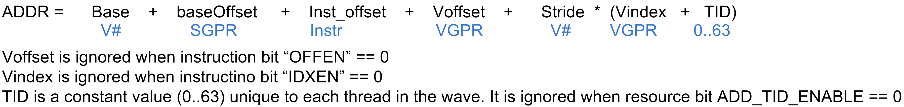
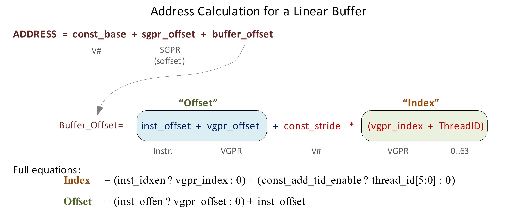
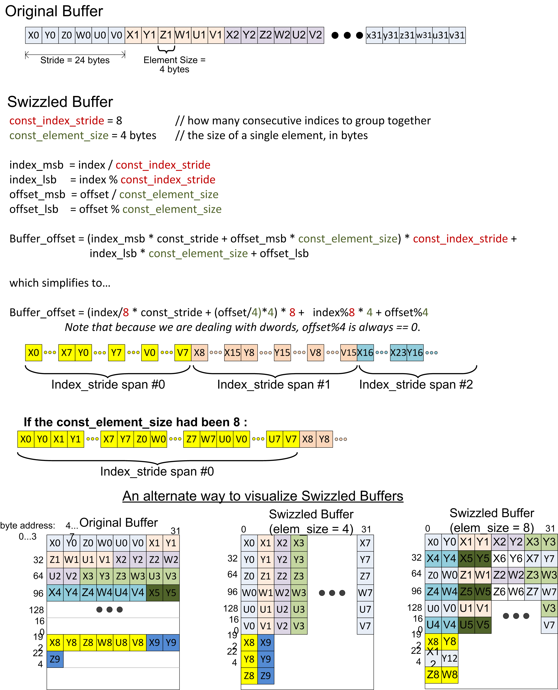
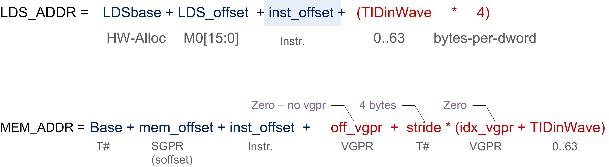
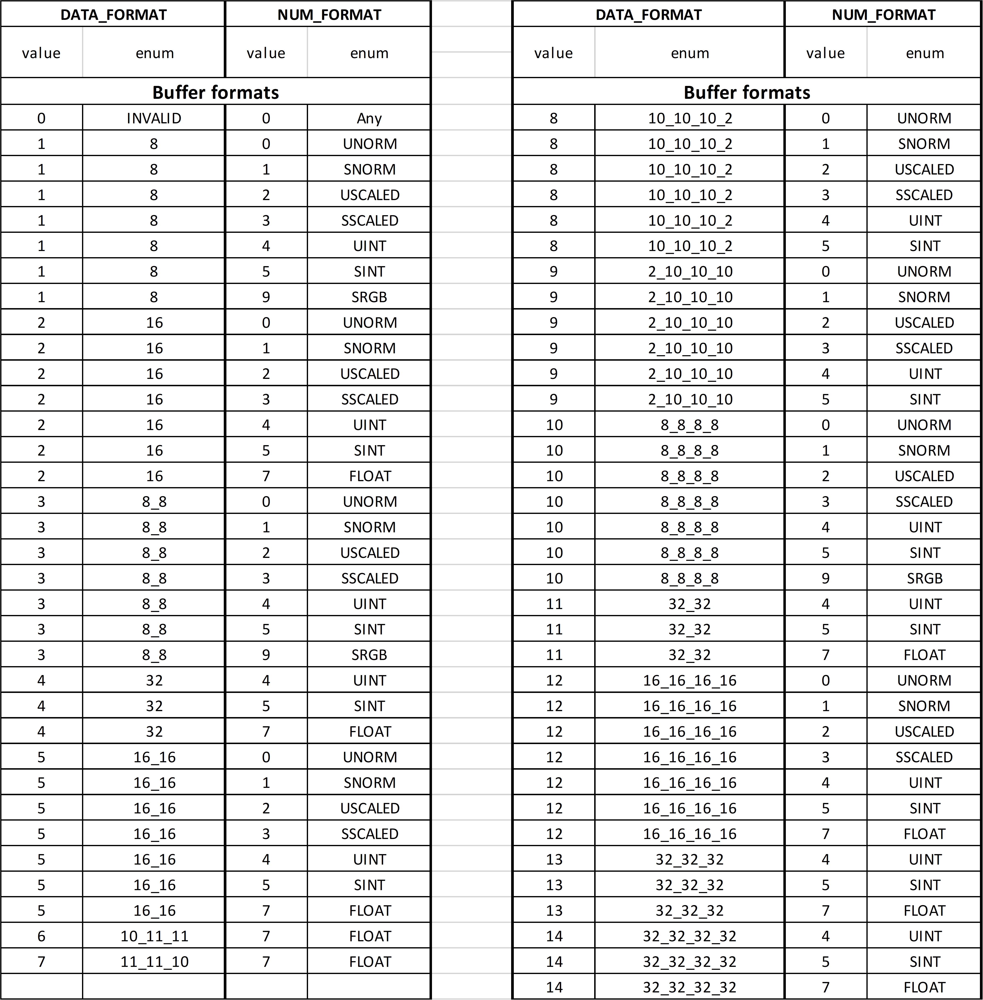

<!-- page 82 -->

# Chapter 9. Vector Memory Operations

Vector Memory (VMEM) instructions read or write one piece of data separately for each work-item in a wavefront into, or out of, VGPRs. This is in contrast to Scalar Memory instructions, which move a single piece of data that is shared by all threads in the wavefront. All Vector Memory (VM) operations are processed by the texture cache system (level 1 and level 2 caches).

Software initiates a load, store or atomic operation through the texture cache through one of these types of VMEM instructions:

- MTBUF: Memory typed-buffer operations.

- MUBUF: Memory untyped-buffer operations.

The instruction defines which VGPR(s) supply the addresses for the operation, which VGPRs supply or receive data from the operation, and a series of SGPRs that contain the memory buffer descriptor (V#).

## 9.1. Vector Memory Buffer Instructions

Vector-memory (VM) operations transfer data between the VGPRs and buffer objects in memory through the texture cache (TC). **Vector** means that one or more piece of data is transferred uniquely for every thread in the wavefront, in contrast to scalar memory reads, which transfer only one value that is shared by all threads in the wavefront.

Buffer reads have the option of returning data to VGPRs or directly into LDS.

Examples of buffer objects are vertex buffers, raw buffers, stream-out buffers, and structured buffers.

Buffer objects support both homogeneous and heterogeneous data, but no filtering of read-data. Buffer instructions are divided into two groups:

- MUBUF: Untyped buffer objects.

   - Data format is specified in the resource constant.

   - Load, store, atomic operations, with or without data format conversion.

- MTBUF: Typed buffer objects.

   - Data format is specified in the instruction.

   - The only operations are Load and Store, both with data format conversion.

Atomic operations take data from VGPRs and combine them arithmetically with data already in memory. Optionally, the value that was in memory before the operation took place can be returned to the shader.

All VM operations use a buffer resource constant (V#) which is a 128-bit value in SGPRs. This constant is sent to the texture cache when the instruction is executed. This constant defines the address and characteristics of the buffer in memory. Typically, these constants are fetched from memory using scalar memory reads prior to executing VM instructions, but these constants also can be generated within the shader.

<!-- page 83 -->

### 9.1.1. Simplified Buffer Addressing

The equation below shows how the hardware calculates the memory address for a buffer access.



### 9.1.2. Buffer Instructions

Buffer instructions (MTBUF and MUBUF) allow the shader program to read from, and write to, linear buffers in memory. These operations can operate on data as small as one byte, and up to four Dwords per work-item. Atomic arithmetic operations are provided that can operate on the data values in memory and, optionally, return the value that was in memory before the arithmetic operation was performed.

The D16 instruction variants convert the results to packed 16-bit values. For example, BUFFER_LOAD_FORMAT_D16_XYZW writes two VGPRs.

_Table 40. Buffer Instructions_

|**Instruction**|**Description**|
|---|---|
|MTBUF Instructions||
|TBUFFER_LOAD_FORMAT_{x,xy,xyz,xyzw}<br>TBUFFER_STORE_FORMAT_{x,xy,xyz,xyzw}|Read from, or write to, a typed buffer object. Also used for a vertex fetch.|
|MUBUF Instructions||
|BUFFER_LOAD_FORMAT_{x,xy,xyz,xyzw}<br>BUFFER_STORE_FORMAT_{x,xy,xyz,xyzw}<br>BUFFER_LOAD_&lt;size><br>BUFFER_STORE_&lt;size>|Read to, or write from, an untyped buffer object.<br>&lt;size> = byte, ubyte, short, ushort, Dword, Dwordx2, Dwordx3, Dwordx4|
|BUFFER_ATOMIC_&lt;op><br>BUFFER_ATOMIC_&lt;op>_ x2|Buffer object atomic operation. Globally coherent. Operates on 32-bit or 64-bit values (x2 = 64 bits).|

_Table 41. Microcode Formats_

|**Field**|**Bit Size**|**Description**|
|---|---|---|
|OP|4<br>7|MTBUF: Opcode for Typed buffer instructions.<br>MUBUF: Opcode for Untyped buffer instructions.|
|VADDR|8|Address of VGPR to supply first component of address (offset or index). When both index and offset are used, index is in the first VGPR, offset in the second.|
|VDATA|8|Address of VGPR to supply first component of write data or receive first component of read-data.|
|SOFFSET|8|SGPR to supply unsigned byte offset. Must be an SGPR, M0, or inline constant.|
|SRSRC|5|Specifies which SGPR supplies T# (resource constant) in four or eight consecutive SGPRs. This field is missing the two LSBs of the SGPR address, since this address must be aligned to a multiple of four SGPRs.|
|DFMT|4|Data Format of data in memory buffer:<br>0 invalid<br>1 8<br>2 16<br>3 8_8<br>4 32<br>5 16_16<br>6 10_11_11<br>7 11_11_10<br>8 10_10_10_2<br>9 2_10_10_10<br>10 8_8_8_8<br>11 32_32<br>12 16_16_16_16<br>13 32_32_32<br>14 32_32_32_32<br>15 reserved|
|NFMT|3|Numeric format of data in memory:<br>0 unorm<br>1 snorm<br>2 uscaled<br>3 sscaled<br>4 uint<br>5 sint<br>6 reserved<br>7 float|
|OFFSET|12|Unsigned byte offset.|
|OFFEN|1|1 = Supply an offset from VGPR (VADDR). 0 = Do not (offset = 0).|
|IDXEN|1|1 = Supply an index from VGPR (VADDR). 0 = Do not (index = 0).|
|SC0|1|Scope bit 0|
|NT|1|Non-Temporal|
|ACC|1|VDATA is Accumulation VGPR|
|SC1|1|Scope bit 1|
|LDS|1|MUBUF-ONLY: 0 = Return read-data to VGPRs. 1 = Return read-data to LDS instead of VGPRs.|

<!-- page 84 -->

### 9.1.3. VGPR Usage

VGPRs supply address and write-data; also, they can be the destination for return data (the other option is LDS).

**Address**

Zero, one or two VGPRs are used, depending of the offset-enable (OFFEN) and index-enable (IDXEN) in the instruction word, as shown in the table below:

_Table 42. Address VGPRs_

|**IDXEN**|**OFFEN**|**VGPRn**|**VGPRn+1**|
|---|---|---|---|
|0|0|nothing||
|0|1|uint offset||
|1|0|uint index||
|1|1|uint index|uint offset|

<!-- page 85 -->

**Write Data** : N consecutive VGPRs, starting at VDATA. The data format specified in the instruction word (NFMT, DFMT for MTBUF, or encoded in the opcode field for MUBUF) determines how many Dwords to write.

**Read Data** : Same as writes. Data is returned to consecutive GPRs.

**Read Data Format** : Read data is 32 bits, based on the data format in the instruction or resource. Float or normalized data is returned as floats; integer formats are returned as integers (signed or unsigned, same type as the memory storage format). Memory reads of data in memory that is 32 or 64 bits do not undergo any format conversion.

**Atomics with Return** : Data is read out of the VGPR(s) starting at VDATA to supply to the atomic operation. If the atomic returns a value to VGPRs, that data is returned to those same VGPRs starting at VDATA.

### 9.1.4. Buffer Data

The amount and type of data that is read or written is controlled by the following: data-format (dfmt), numeric-format (nfmt), destination-component-selects (dst_sel), and the opcode. Dfmt and nfmt can come from the resource, instruction fields, or the opcode itself. Dst_sel comes from the resource, but is ignored for many operations.

_Table 43. Buffer Instructions_

|**Instruction**|**Data Format**|**Num Format**|**DST SEL**|
|---|---|---|---|
|TBUFFER_LOAD_FORMAT_*|instruction|instruction|identity|
|TBUFFER_STORE_FORMAT_*|instruction|instruction|identity|
|BUFFER_LOAD_&lt;type>|derived|derived|identity|
|BUFFER_STORE_&lt;type>|derived|derived|identity|
|BUFFER_LOAD_FORMAT_*|resource|resource|resource|
|BUFFER_STORE_FORMAT_*|resource|resource|resource|
|BUFFER_ATOMIC_*|derived|derived|identity|

**Instruction** : The instruction’s dfmt and nfmt fields are used instead of the resource’s fields.

**Data format derived** : The data format is derived from the opcode and ignores the resource definition. For example, buffer_load_ubyte sets the data-format to 8 and number-format to uint.

The resource’s data format must not be INVALID; that format has specific meaning (unbound resource), and for that case the data format is not replaced by the instruction’s  implied data format.

**DST_SEL identity** : Depending on the number of components in the data-format, this is: X000, XY00, XYZ0, or XYZW.

The MTBUF derives the data format from the instruction. The MUBUF BUFFER_LOAD_FORMAT and BUFFER_STORE_FORMAT instructions use dst_sel from the resource; other MUBUF instructions derive data-format from the instruction itself.

**D16 Instructions** : Load-format and store-format instructions also come in a "d16" variant. For stores, each 32-bit VGPR holds two 16-bit data elements that are passed to the texture unit. This texture unit converts them to the texture format before writing to memory. For loads, data returned from the texture unit is converted to 16 bits, and a pair of data are stored in each 32-bit VGPR (LSBs first, then MSBs). Control over int vs. float is controlled by NFMT.

<!-- page 86 -->

### 9.1.5. Buffer Addressing

A **buffer** is a data structure in memory that is addressed with an **index** and an **offset** . The index points to a particular record of size **stride** bytes, and the offset is the byte-offset within the record. The **stride** comes from the resource, the index from a VGPR (or zero), and the offset from an SGPR or VGPR and also from the instruction itself.

_Table 44. BUFFER Instruction Fields for Addressing_

|**Field**|**Size**|**Description**|
|---|---|---|
|inst_offset|12|Literal byte offset from the instruction.|
|inst_idxen|1|Boolean: get index from VGPR when true, or no index when false.|
|inst_offen|1|Boolean: get offset from VGPR when true, or no offset when false. Note that inst_offset is present, regardless of this bit.|

The "element size" for a buffer instruction is the amount of data the instruction transfers. It is determined by the DFMT field for MTBUF instructions, or from the opcode for MUBUF instructions. It can be 1, 2, 4, 8, or 16 bytes.

_Table 45. V# Buffer Resource Constant Fields for Addressing_

<table>
<thead>
<tr><th>Field</th><th>Size</th><th>Description</th></tr>
</thead>
<tbody>
<tr><td>const_base</td><td>48</td><td>Base address, in bytes, of the buffer resource.</td></tr>
<tr><td>const_stride</td><td>14 or 18</td><td>Stride of the record in bytes (0 to 16,383 bytes, or 0 to 262,143 bytes). Normally 14 bits, but is extended to 18-bits when:<br>const_add_tid_enable = true used with MUBUF instructions which are not <b>format</b> types (or cache invalidate/WB).<br>This is extension intended for use with scratch (private) buffers.
<pre><code>If (const_add_tid_enable &amp;&amp; MUBUF-non-format instr.)
  const_stride [17:0] = { V#.DFMT[3:0],
                          V#.const_stride[13:0] }
else
  const_stride is 14 bits: {4'b0, V#.const_stride[13:0]}</code></pre></td></tr>
<tr><td>const_num_records</td><td>32</td><td>Number of records in the buffer.<br>In units of Bytes for raw buffers, units of Stride for structured buffers, and ignored for private (scratch) buffers.<br>In units of: (inst_idxen == 1) ? Bytes : Stride</td></tr>
<tr><td>const_add_tid_enable</td><td>1</td><td>Boolean. Add thread_ID within the wavefront to the index when true.</td></tr>
<tr><td>const_swizzle_enable</td><td>1</td><td>Boolean. Indicates that the surface is swizzled when true.</td></tr>
<tr><td>const_element_size</td><td>2</td><td>Used only when const_swizzle_en = true. Number of contiguous bytes of a record for a given index (2, 4, 8, or 16 bytes).<br>Must be &gt;= the maximum element size in the structure. const_stride must be an integer multiple of const_element_size.</td></tr>
<tr><td>const_index_stride</td><td>2</td><td>Used only when const_swizzle_en = true. Number of contiguous indices for a single element (of const_element_size) before switching to the next element. There are 8, 16, 32, or 64 indices.</td></tr>
</tbody>
</table>

<!-- page 87 -->

_Table 46. Address Components from GPRs_

|**Field**|**Size**|**Description**|
|---|---|---|
|SGPR_offset|32|An unsigned byte-offset to the address. Comes from an SGPR or M0.|
|VGPR_offset|32|An optional unsigned byte-offset. It is per-thread, and comes from a VGPR.|
|VGPR_index|32|An optional index value. It is per-thread and comes from a VGPR.|

The final buffer memory address is composed of three parts:

- the base address from the buffer resource (V#),

- the offset from the SGPR, and

- a buffer-offset that is calculated differently, depending on whether the buffer is linearly addressed (a simple Array-of-Structures calculation) or is swizzled.



_Figure 4. Address Calculation for a Linear Buffer_

#### 9.1.5.1. Range Checking

Addresses can be checked to see if they are in or out of range. When an address is out of range, reads return zero, and writes and atomics are dropped. The address range check method depends on the buffer type.

**Private (Scratch) Buffer**

Used when: AddTID==1 && IdxEn==0

For this buffer, there is no range checking.

**Raw Buffer**

Used when: AddTID==0 && SWizzleEn==0 && IdxEn==0

Out of Range if: (InstOffset + (OffEN ? vgpr_offset : 0)) >= NumRecords

**Structured Buffer**

Used when: AddTID==0 && Stride!=0 && IdxEn==1

Out of Range if: Index(vgpr) >= NumRecords

**Notes:**

1. Reads that go out-of-range return zero (except for components with V#.dst_sel = SEL_1 that return 1).

<!-- page 88 -->

2. Writes that are out-of-range do not write anything.

3. Load/store-format-* instruction and atomics are range-checked "all or nothing" - either entirely in or out.

4. Load/store-Dword-x{2,3,4} and range-check per component.

#### 9.1.5.2. Swizzled Buffer Addressing

Swizzled addressing rearranges the data in the buffer to help provide improved cache locality for arrays of structures. Swizzled addressing also requires Dword-aligned accesses. A single fetch instruction cannot attempt to fetch a unit larger than const-element-size. The buffer’s STRIDE must be a multiple of element_size.

```
Index = (inst_idxen ? vgpr_index : 0) +
        (const_add_tid_enable ? thread_id[5:0] : 0)

Offset = (inst_offen ? vgpr_offset : 0) + inst_offset

index_msb = index / const_index_stride
index_lsb = index % const_index_stride
offset_msb = offset / const_element_size
offset_lsb = offset % const_element_size

buffer_offset = (index_msb * const_stride + offset_msb *
                  const_element_size) * const_index_stride + index_lsb *
                  const_element_size + offset_lsb

Final Address = const_base + sgpr_offset + buffer_offset
```

Remember that the "sgpr_offset" is not a part of the "offset" term in the above equations.

<!-- page 89 -->



_Figure 5. Example of Buffer Swizzling_

<!-- page 90 -->

#### 9.1.5.3. Proposed Use Cases for Swizzled Addressing

Here are few proposed uses of swizzled addressing in common graphics buffers.

_Table 47. Swizzled Buffer Use Cases_

||**DX11 Raw**<br>**Uav OpenCL**<br>**Buffer Object**|**Dx11 Structured (literal offset)**|**Dx11 Structured (gpr offset)**|**Scratch**|**Ring / stream-out**|**Const Buffer**|
|---|---|---|---|---|---|---|
|inst_vgpr_offset_en|T|F|T|T|T|T|
|inst_vgpr_index_en|F|T|T|F|F|F|
|const_stride|na|&lt;api>|&lt;api>|scratchSize|na|na|
|const_add_tid_enable|F|F|F|T|T|F|
|const_buffer_swizzle|F|T|T|T|F|F|
|const_elem_size|na|4|4|4 or 16|na|4|
|const_index_stride|na|16|16|64|||

### 9.1.6. 16-bit Memory Operations

The D16 buffer instructions allow a kernel to load or store just 16 bits per work item between VGPRs and memory. There are two variants of these instructions:

- D16 loads data into or stores data from the lower 16 bits of a VGPR.

- D16_HI loads data into or stores data from the upper 16 bits of a VGPR.

For example, BUFFER_LOAD_UBYTE_D16 reads a byte per work-item from memory, converts it to a 16-bit integer, then loads it into the lower 16 bits of the data VGPR.

When ECC is enabled 16-bit memory loads write the full 32-bit VGPR. Unused bits are set to zero.

### 9.1.7. Alignment

For Dword or larger reads or writes, the two LSBs of the byte-address are ignored, thus forcing Dword alignment.

### 9.1.8. Buffer Resource

The buffer resource describes the location of a buffer in memory and the format of the data in the buffer. It is specified in four consecutive SGPRs (four aligned SGPRs) and sent to the texture cache with each buffer instruction.

The table below details the fields that make up the buffer resource descriptor.

_Table 48. Buffer Resource Descriptor_

<!-- page 91 -->

|**Bits**|**Size**|**Name**|**Description**|
|---|---|---|---|
|47:0|48|Base address|Byte address.|
|61:48|14|Stride|Bytes 0 to 16383|
|62|1|Cache swizzle|Buffer access. Optionally, swizzle texture cache TC L1 cache banks.|
|63|1|Swizzle enable|Swizzle AOS according to stride, index_stride, and element_size, else linear (stride * index + offset).|
|95:64|32|Num_records|In units of stride or bytes.|
|98:96|3|Dst_sel_x|Destination channel select:<br>0=0, 1=1, 4=R, 5=G, 6=B, 7=A|
|101:99|3|Dst_sel_y||
|104:102|3|Dst_sel_z||
|107:105|3|Dst_sel_w||
|110:108|3|Num format|Numeric data type (float, int, …). See instruction encoding for values.|
|114:111|4|Data format|Number of fields and size of each field. See instruction encoding for values. For MUBUF instructions with ADD_TID_EN = 1. This field holds Stride [17:14].|
|115|1|User VM Enable|Resource is mapped via tiled pool / heap.|
|116|1|User VM mode|Unmapped behavior: 0: null (return 0 / drop write); 1:invalid (results in error)|
|118:117|2|Index stride|8, 16, 32, or 64. Used for swizzled buffer addressing.|
|119|1|Add tid enable|Add thread ID to the index for to calculate the address.|
|122:120|3|RSVD|Reserved. Must be set to zero.|
|123|1|NV|Non-volatile (0=volatile)|
|125:124|2|RSVD|Reserved. Must be set to zero.|
|127:126|2|Type|Value == 0 for buffer. Overlaps upper two bits of four-bit TYPE field in 128-bit T# resource.|

A resource set to all zeros acts as an unbound texture or buffer (return 0,0,0,0).

### 9.1.9. Memory Buffer Load to LDS

The MUBUF instruction format allows reading data from a memory buffer directly into LDS without passing through VGPRs. This is supported for the following subset of MUBUF instructions.

- BUFFER_LOAD_{ubyte, sbyte, ushort, sshort, dword, dwordX3, dwordX4, format_x}.

LDS_offset = 18-bit unsigned byte offset from M0[17:0].<br>
Mem_offset = 32-bit unsigned byte offset from an SGPR (the SOFFSET SGPR).<br>
idx_vgpr = index value from a VGPR (located at VADDR). (Zero if idxen=0.)<br>
off_vgpr = offset value from a VGPR (located at VADDR or VADDR+1). (Zero if offen=0.)

The figure below shows the components of the LDS and memory address calculation:

<!-- page 92 -->



TIDinWave is only added if the resource (T#) has the ADD_TID_ENABLE field set to 1, whereas LDS adds it. The MEM_ADDR M0 is in the VDATA field; it specifies M0.

For loads to LDS with data-size of 3 or 4 dwords, the equation is modified to be: (TIDinWAve * 16). _Note that LOAD_DWORDX3 writes 3 dwords and skips the 4th._

#### 9.1.9.1. Clamping Rules

Memory address clamping follows the same rules as any other buffer fetch. LDS address clamping: the return data must not be written outside the LDS space allocated to this wave.

- Set the active-mask to limit buffer reads to those threads that return data to a legal LDS location.

- The LDSbase (alloc) is in units of 32 Dwords, as is LDSsize.

### 9.1.10. Memory Scope and Temporal Control

#### 9.1.10.1. Scalar Memory

Scalar Memory instructions have a single memory control bit: GLC (Globally Coherent). The GLC bit means different things for loads, stores, and atomic ops.

**READ**

GLC = 0 Reads can hit on the L1 and persist across wavefronts

GLC = 1 Reads miss the L1 and L2 and force fetch to the data fabric. No L1 persistence across waves.

**WRITE**

GLC = 0 Writes miss the L1, write through to L2, and persist in L1 across wavefronts.

GLC = 1 Writes miss the L1, write through to L2. No persistence across wavefronts.

**ATOMIC**

GLC = 0 Previous data value is not returned. No L1 persistence across wavefronts.

GLC = 1 Previous data value is returned. No L1 persistence across wavefronts.

Note: GLC means "return pre-op value" for atomics.

#### 9.1.10.2. Vector Memory

Vector Memory instructions (Flat, Global, Scratch, and Buffer) have 3 bits to control scope and cacheability:

- SC[1:0] System Cache level: 0=wave, 1=group, 2=device, 3=system

<!-- page 93 -->

- NT Non-Temporal: 0=expect temporal reuse; 1=do not expect temporal reuse

**Loads**

_Table 49. Load Controls_

|**Scope**|**SC1**|**SC0**|**NT**|**CU Cache Behavior**|**L2 Cache Behavior**|**Last-level Cache Behavior**|
|---|---|---|---|---|---|---|
|Wave|0|0|0|Hit LRU|Hit LRU|Hit LRU|
||||1|Miss Evict|Hit Stream|Hit Evict|
|Group|0|1|0|Hit LRU|Hit LRU|Hit Evict|
||||1|Miss Evict|Hit Stream|Hit Evict|
|Device|1|0|0|Miss Evict|(1 L2 cache): Hit LRU; (>1 L2 cache): Coherent Cache Bypass|Hit LRU|
||||1|Miss Evict|(1 L2 cache): Hit Stream; (>1 L2 cache): Coherent Cache Bypass|Hit Evict|
|System|1|1|0|Miss Evict|Coherent Cache Bypass|Hit LRU|
||||1|Miss Evict|Coherent Cache Bypass|Hit Evict|

Note that if TG_SPLIT mode is active, SC1==0, SC0==1, NT==0 case becomes: Miss LRU, Hit LRU, Hit LRU.

**Stores**

_Table 50. Store Controls_

|**Scope**|**SC1**|**SC0**|**NT**|**CU Cache Behavior**|**L2 Cache Behavior**|**Last-level Cache Behavior**|
|---|---|---|---|---|---|---|
|Wave|0|0|0|Miss LRU|Hit LRU|Hit LRU|
||||1|Miss Evict|Hit Stream|Hit Evict|
|Group|0|1|0|Miss LRU|Hit LRU|Hit LRU|
||||1|Miss Evict|Hit Stream|Hit Evict|
|Device|1|0|0|Miss Evict|(1 L2 cache): Hit LRU; (>1 L2 cache): Coherent Cache Bypass|Hit LRU|
||||1|Miss Evict|(1 L2 cache): Hit Stream; (>1 L2 cache): Coherent Cache Bypass|Hit Evict|
|System|1|1|0|Miss Evict|Coherent Cache Bypass|Hit LRU|
||||1|Miss Evict|Coherent Cache Bypass|Hit Evict|

**Atomics**

For atomics, SC0 indicates whether or not to return the "pre-op" memory value (the value in memory before the atomic operation was performed). 0 = no return, 1 = return pre-op value.

SC1 : 0 = device scope atomic, 1 = system scope atomic

NT : 0 = last level cache "allocate" policy; 1 = "no Allocate" policy

<!-- page 94 -->

**Invalidate and Writeback**

_Table 51. BUFFER_WBL2_

|**SC1**|**SC0**|**L2 Cache Behavior**|
|---|---|---|
|0|any|NOP|
|1|0|(1 L2 cache): NOP,<br>(>1 L2 cache) Write-back dirty data|
|1|1|Write back dirty data|

_Table 52. BUFFER_INV_

|**SC1**|**SC0**|**CU Cache Behavior**|**L2 Cache Behavior**|
|---|---|---|---|
|0|0|NOP|NOP|
|0|1|(if TG Split): Invalidate cache,<br>(If not TG Split): NOP|NOP|
|1|0|Invalidate cache|(1 L2 cache): NOP,<br>(>1 L2 cache) Invalidate non-coherently cached lines|
|1|1|Invalidate cache|Invalidate non-coherently cached lines|

### 9.1.11. Data Formats

The table below shows the buffer data formats:

<!-- page 95 -->



## 9.2. Float Memory Atomics

Floating point memory atomics are executed in LDS and in the L2 cache. They can be issued as LDS, Buffer, Flat, Global, and Scratch instructions.

This chapter explains the rules for rounding, denormals and NaN for floating point atomics.

<!-- page 96 -->

### 9.2.1. Rounding of Float Atomics

All float atomic ADD opcodes use "Round to Nearest-Even" rounding.

### 9.2.2. Denormal (Subnormal) Handling

When atomics operate on floating point data, there is the possibility of the data containing denormal numbers, or the operation producing a denormal.

Denormals: The floating point atomic instructions have the option of passing denormal values through, or flushing them to zero. This is controlled with the MODE.denorm bits which also control VALU denormal behavior. As with VALU ops, “denorm_single” affects F32 ops and “denorm_double” affects F64 and F16. Some atomics have fixed denormal handling behavior.

LDS instructions allows denormals to be passed through or flushed to zero based on the MODE.denormal wave-state register.

- Float 16 and 32 bit Adder uses both input and output denorm flush controls from MODE

- Float 64 bit adder does not flush denorms

- Float CMP, MIN and MAX use only the “input denormal” flushing control

   - Each input to the comparisons flushes the mantissa of both operands to zero before the compare if the exponent is zero and the flush denorm control is active. For Min and Max the actual result returned is the selected non-flushed input.

   - CompareStore (“compare swap”) flushes the result when input denormal flushing occurs.

_Table 53. Denorm Handling Rules for Memory Ops_

|**Atomic type**|**LDS Handling**|**L2 Cache Handling**|
|---|---|---|
|PK_ADD_F16 / BF16|Mode|Do not Flush Denorms|
|ADD_F32|Mode|Flush Denorms|
|Min/MAX_F32|Mode|N/A|
|CMPST_F32|Mode|N/A|
|MIN/MAX_F64|Mode|Do not Flush Denorms|
|CMPST_F64|Mode|N/A|
|ADD_F64|Do not Flush Denorms|Do not Flush Denorms|

- “Flush Denorms” = flush all input denorm

- “Do not Flush” = don’t flush input denorm

- “Mode” = denormal flush controlled by bit from shader’s “MODE . fp_denorm” register

- “Mode + reg” = “Mode” from above, but there exists an override register to flush output or not.

Note that MIN and MAX when flushing denormals only do it for the comparison, but the result is an unmodified copy of one of the sources. CompareStore (“compare swap”) flushes the result when input denormal flushing occurs.

### 9.2.3. NaN Handling

Not A Number (“NaN”) is a IEEE-754 value representing a result which cannot be computed.

<!-- page 97 -->

There two types of NaN: quiet and signaling

- Quiet NaN Exponent=0xFF, Mantissa MSB=1

- Signaling NaN Exponent=0xFF, Mantissa MSB=0 and at least one other mantissa bit ==1

The LDS does not produce any exception or “signal” due to a signaling NaN.

DS_ADD_F32 can create a quiet NaN, or propagate NaN from its inputs: if either input is a NaN, the output is that same NaN, and if both inputs are NaN, the NaN from the first input is selected as the output. Signaling NaN is converted to Quiet NaN.

Floating point atomics (CMPSWAP, MIN, MAX) flush input denormals only when MODE (allow_input_denorm)=0, otherwise values are passed through without modification. When flushing, denorms are flushed before the operation (i.e. before the comparison).

FP Max Selection Rules:

> if (src0 == SNaN) result = QNaN (src0)<br>
> else if (src1 == SNaN) result = QNaN (src1)<br>
> else result = larger of (src0, src1)<br>
> “Larger” order from smallest to largest: QNaN, -inf, -float, -denorm, -0, +0, +denorm, +float, +inf

FP Min Selection Rules:

> if (src0 == SNaN) result = QNaN (src0)<br>
> else if (src1 == SNaN) result = QNaN (src1)<br>
> else result = smaller of (src0, src1)<br>
> “Smaller” order from smallest to largest: -inf, -float, -denorm, -0, +0, +denorm, +float, +inf, QNaN

FP Compare Swap: only swap if the compare condition (==) is true, treating +0 and -0 as equal

> doSwap = (src0 != NaN) && (src1 != NaN) && (src0 == src1) // allow +0 == -0

Float Add rules:

1. -INF + INF = QNAN (mantissa is all zeros except MSB)

2. +/-INF + NAN = QNAN (NAN input is copied to output but made quiet NAN)

3. -0 + 0 = +0

4. INF + (float, +0, -0) = INF, with infinity sign preserved

5. NaN + NaN = SRC0’s NaN, converted to QNaN
