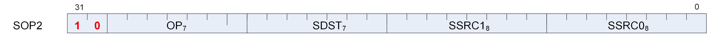

## 12.1. SOP2 Instructions



Instructions in this format may use a 32-bit literal constant which occurs immediately after the instruction.

#### S_ADD_U32

Opcode: 0

Add two unsigned 32-bit integer inputs, store the result into a scalar register and store the carry-out bit into SCC.

<!-- page 109 -->

```
tmp = 64'U(S0.u32) + 64'U(S1.u32);
SCC = tmp >= 0x100000000ULL ? 1'1U : 1'0U;
// unsigned overflow or carry-out for S_ADDC_U32.
D0.u32 = tmp.u32
```

#### S_SUB_U32

Opcode: 1

Subtract the second unsigned 32-bit integer input from the first input, store the result into a scalar register and store the carry-out bit into SCC.

```
tmp = S0.u32 - S1.u32;
SCC = S1.u32 > S0.u32 ? 1'1U : 1'0U;
// unsigned overflow or carry-out for S_SUBB_U32.
D0.u32 = tmp.u32
```

#### S_ADD_I32

Opcode: 2

Add two signed 32-bit integer inputs, store the result into a scalar register and store the carry-out bit into SCC.

```
tmp = S0.i32 + S1.i32;
SCC = ((S0.u32[31] == S1.u32[31]) && (S0.u32[31] != tmp.u32[31]));
// signed overflow.
D0.i32 = tmp.i32
```

**Notes**

This opcode is not suitable for use with S_ADDC_U32 for implementing 64-bit operations.

#### S_SUB_I32

Opcode: 3

Subtract the second signed 32-bit integer input from the first input, store the result into a scalar register and store the carry-out bit into SCC.

```
tmp = S0.i32 - S1.i32;
SCC = ((S0.u32[31] != S1.u32[31]) && (S0.u32[31] != tmp.u32[31]));
// signed overflow.
D0.i32 = tmp.i32
```

**Notes**

This opcode is not suitable for use with S_SUBB_U32 for implementing 64-bit operations.

<!-- page 110 -->

#### S_ADDC_U32

Opcode: 4

Add two unsigned 32-bit integer inputs and a carry-in bit from SCC, store the result into a scalar register and store the carry-out bit into SCC.

```
tmp = 64'U(S0.u32) + 64'U(S1.u32) + SCC.u64;
SCC = tmp >= 0x100000000ULL ? 1'1U : 1'0U;
// unsigned overflow or carry-out for S_ADDC_U32.
D0.u32 = tmp.u32
```

#### S_SUBB_U32

Opcode: 5

Subtract the second unsigned 32-bit integer input from the first input, subtract the carry-in bit, store the result into a scalar register and store the carry-out bit into SCC.

```
tmp = S0.u32 - S1.u32 - SCC.u32;
SCC = 64'U(S1.u32) + SCC.u64 > 64'U(S0.u32) ? 1'1U : 1'0U;
// unsigned overflow or carry-out for S_SUBB_U32.
D0.u32 = tmp.u32
```

#### S_MIN_I32

Opcode: 6

Select the minimum of two signed 32-bit integer inputs, store the selected value into a scalar register and set SCC iff the first value is selected.

```
SCC = S0.i32 < S1.i32;
D0.i32 = SCC ? S0.i32 : S1.i32
```

#### S_MIN_U32

Opcode: 7

Select the minimum of two unsigned 32-bit integer inputs, store the selected value into a scalar register and set SCC iff the first value is selected.

```
SCC = S0.u32 < S1.u32;
D0.u32 = SCC ? S0.u32 : S1.u32
```

#### S_MAX_I32

Opcode: 8

<!-- page 111 -->

Select the maximum of two signed 32-bit integer inputs, store the selected value into a scalar register and set SCC iff the first value is selected.

```
SCC = S0.i32 >= S1.i32;
D0.i32 = SCC ? S0.i32 : S1.i32
```

#### S_MAX_U32

Opcode: 9

Select the maximum of two unsigned 32-bit integer inputs, store the selected value into a scalar register and set SCC iff the first value is selected.

```
SCC = S0.u32 >= S1.u32;
D0.u32 = SCC ? S0.u32 : S1.u32
```

#### S_CSELECT_B32

Opcode: 10

Select the first input if SCC is true otherwise select the second input, then store the selected input into a scalar register.

```
D0.u32 = SCC ? S0.u32 : S1.u32
```

#### S_CSELECT_B64

Opcode: 11

Select the first input if SCC is true otherwise select the second input, then store the selected input into a scalar register.

```
D0.u64 = SCC ? S0.u64 : S1.u64
```

#### S_AND_B32

Opcode: 12

Calculate bitwise AND on two scalar inputs, store the result into a scalar register and set SCC iff the result is nonzero.

```
D0.u32 = (S0.u32 & S1.u32);
SCC = D0.u32 != 0U
```

<!-- page 112 -->

#### S_AND_B64

Opcode: 13

Calculate bitwise AND on two scalar inputs, store the result into a scalar register and set SCC iff the result is nonzero.

```
D0.u64 = (S0.u64 & S1.u64);
SCC = D0.u64 != 0ULL
```

#### S_OR_B32

Opcode: 14

Calculate bitwise OR on two scalar inputs, store the result into a scalar register and set SCC iff the result is nonzero.

```
D0.u32 = (S0.u32 | S1.u32);
SCC = D0.u32 != 0U
```

#### S_OR_B64

Opcode: 15

Calculate bitwise OR on two scalar inputs, store the result into a scalar register and set SCC iff the result is nonzero.

```
D0.u64 = (S0.u64 | S1.u64);
SCC = D0.u64 != 0ULL
```

#### S_XOR_B32

Opcode: 16

Calculate bitwise XOR on two scalar inputs, store the result into a scalar register and set SCC iff the result is nonzero.

```
D0.u32 = (S0.u32 ^ S1.u32);
SCC = D0.u32 != 0U
```

#### S_XOR_B64

Opcode: 17

Calculate bitwise XOR on two scalar inputs, store the result into a scalar register and set SCC iff the result is nonzero.

```
D0.u64 = (S0.u64 ^ S1.u64);
SCC = D0.u64 != 0ULL
```

<!-- page 113 -->

#### S_ANDN2_B32

Opcode: 18

Calculate bitwise AND with the first input and the negation of the second input, store the result into a scalar register and set SCC if the result is nonzero.

```
D0.u32 = (S0.u32 & ~S1.u32);
SCC = D0.u32 != 0U
```

#### S_ANDN2_B64

Opcode: 19

Calculate bitwise AND with the first input and the negation of the second input, store the result into a scalar register and set SCC if the result is nonzero.

```
D0.u64 = (S0.u64 & ~S1.u64);
SCC = D0.u64 != 0ULL
```

#### S_ORN2_B32

Opcode: 20

Calculate bitwise OR with the first input and the negation of the second input, store the result into a scalar register and set SCC if the result is nonzero.

```
D0.u32 = (S0.u32 | ~S1.u32);
SCC = D0.u32 != 0U
```

#### S_ORN2_B64

Opcode: 21

Calculate bitwise OR with the first input and the negation of the second input, store the result into a scalar register and set SCC if the result is nonzero.

```
D0.u64 = (S0.u64 | ~S1.u64);
SCC = D0.u64 != 0ULL
```

#### S_NAND_B32

Opcode: 22

Calculate bitwise NAND on two scalar inputs, store the result into a scalar register and set SCC if the result is nonzero.

<!-- page 114 -->

```
D0.u32 = ~(S0.u32 & S1.u32);
SCC = D0.u32 != 0U
```

#### S_NAND_B64

Opcode: 23

Calculate bitwise NAND on two scalar inputs, store the result into a scalar register and set SCC if the result is nonzero.

```
D0.u64 = ~(S0.u64 & S1.u64);
SCC = D0.u64 != 0ULL
```

#### S_NOR_B32

Opcode: 24

Calculate bitwise NOR on two scalar inputs, store the result into a scalar register and set SCC if the result is nonzero.

```
D0.u32 = ~(S0.u32 | S1.u32);
SCC = D0.u32 != 0U
```

#### S_NOR_B64

Opcode: 25

Calculate bitwise NOR on two scalar inputs, store the result into a scalar register and set SCC if the result is nonzero.

```
D0.u64 = ~(S0.u64 | S1.u64);
SCC = D0.u64 != 0ULL
```

#### S_XNOR_B32

Opcode: 26

Calculate bitwise XNOR on two scalar inputs, store the result into a scalar register and set SCC if the result is nonzero.

```
D0.u32 = ~(S0.u32 ^ S1.u32);
SCC = D0.u32 != 0U
```

<!-- page 115 -->

#### S_XNOR_B64

Opcode: 27

Calculate bitwise XNOR on two scalar inputs, store the result into a scalar register and set SCC if the result is nonzero.

```
D0.u64 = ~(S0.u64 ^ S1.u64);
SCC = D0.u64 != 0ULL
```

#### S_LSHL_B32

Opcode: 28

Given a shift count in the second scalar input, calculate the logical shift left of the first scalar input, store the result into a scalar register and set SCC iff the result is nonzero.

```
D0.u32 = (S0.u32 << S1[4 : 0].u32);
SCC = D0.u32 != 0U
```

#### S_LSHL_B64

Opcode: 29

Given a shift count in the second scalar input, calculate the logical shift left of the first scalar input, store the result into a scalar register and set SCC iff the result is nonzero.

```
D0.u64 = (S0.u64 << S1[5 : 0].u32);
SCC = D0.u64 != 0ULL
```

#### S_LSHR_B32

Opcode: 30

Given a shift count in the second scalar input, calculate the logical shift right of the first scalar input, store the result into a scalar register and set SCC iff the result is nonzero.

```
D0.u32 = (S0.u32 >> S1[4 : 0].u32);
SCC = D0.u32 != 0U
```

#### S_LSHR_B64

Opcode: 31

Given a shift count in the second scalar input, calculate the logical shift right of the first scalar input, store the result into a scalar register and set SCC iff the result is nonzero.

```
D0.u64 = (S0.u64 >> S1[5 : 0].u32);
SCC = D0.u64 != 0ULL
```

<!-- page 116 -->

#### S_ASHR_I32

Opcode: 32

Given a shift count in the second scalar input, calculate the arithmetic shift right (preserving sign bit) of the first scalar input, store the result into a scalar register and set SCC iff the result is nonzero.

```
D0.i32 = 32'I(signext(S0.i32) >> S1[4 : 0].u32);
SCC = D0.i32 != 0
```

#### S_ASHR_I64

Opcode: 33

Given a shift count in the second scalar input, calculate the arithmetic shift right (preserving sign bit) of the first scalar input, store the result into a scalar register and set SCC iff the result is nonzero.

```
D0.i64 = (signext(S0.i64) >> S1[5 : 0].u32);
SCC = D0.i64 != 0LL
```

#### S_BFM_B32

Opcode: 34

Calculate a bitfield mask given a field offset and size and store the result in a scalar register.

```
D0.u32 = (((1U << S0[4 : 0].u32) - 1U) << S1[4 : 0].u32)
```

#### S_BFM_B64

Opcode: 35

Calculate a bitfield mask given a field offset and size and store the result in a scalar register.

```
D0.u64 = (((1ULL << S0[5 : 0].u32) - 1ULL) << S1[5 : 0].u32)
```

#### S_MUL_I32

Opcode: 36

Multiply two signed 32-bit integer inputs and store the result into a scalar register.

```
D0.i32 = S0.i32 * S1.i32
```

<!-- page 117 -->

#### S_BFE_U32

Opcode: 37

Extract an unsigned bitfield from the first input using field offset and size encoded in the second input, store the result into a scalar register and set SCC iff the result is nonzero.

```
D0.u32 = ((S0.u32 >> S1[4 : 0].u32) & ((1U << S1[22 : 16].u32) - 1U));
SCC = D0.u32 != 0U
```

#### S_BFE_I32

Opcode: 38

Extract a signed bitfield from the first input using field offset and size encoded in the second input, store the result into a scalar register and set SCC iff the result is nonzero.

```
tmp.i32 = ((S0.i32 >> S1[4 : 0].u32) & ((1 << S1[22 : 16].u32) - 1));
D0.i32 = signext_from_bit(tmp.i32, S1[22 : 16].u32);
SCC = D0.i32 != 0
```

#### S_BFE_U64

Opcode: 39

Extract an unsigned bitfield from the first input using field offset and size encoded in the second input, store the result into a scalar register and set SCC iff the result is nonzero.

```
D0.u64 = ((S0.u64 >> S1[5 : 0].u32) & ((1ULL << S1[22 : 16].u32) - 1ULL));
SCC = D0.u64 != 0ULL
```

#### S_BFE_I64

Opcode: 40

Extract a signed bitfield from the first input using field offset and size encoded in the second input, store the result into a scalar register and set SCC iff the result is nonzero.

```
tmp.i64 = ((S0.i64 >> S1[5 : 0].u32) & ((1LL << S1[22 : 16].u32) - 1LL));
D0.i64 = signext_from_bit(tmp.i64, S1[22 : 16].u32);
SCC = D0.i64 != 0LL
```

#### S_CBRANCH_G_FORK

Opcode: 41

Conditional branch using branch-stack.

<!-- page 118 -->

S0 = compare mask (VCC or any SGPR) and S1 = 64-bit byte address of target instruction. See also S_CBRANCH_JOIN.

```
mask_pass = (S0.u64 & EXEC.u64);
mask_fail = (~S0.u64 & EXEC.u64);
if mask_pass == EXEC.u64 then
    PC = 64'I(S1.u64)
elsif mask_fail == EXEC.u64 then
    PC += 4LL
elsif bitCount(mask_fail.b64) < bitCount(mask_pass.b64) then
    EXEC = mask_fail.b64;
    SGPR[WAVE_MODE.CSP.u32 * 4U].b128 = { S1.u64, mask_pass };
    WAVE_MODE.CSP += 3'1U;
    PC += 4LL
else
    EXEC = mask_pass.b64;
    SGPR[WAVE_MODE.CSP.u32 * 4U].b128 = { (PC + 4LL), mask_fail };
    WAVE_MODE.CSP += 3'1U;
    PC = 64'I(S1.u64)
endif
```

#### S_ABSDIFF_I32

Opcode: 42

Calculate the absolute value of difference between two scalar inputs, store the result into a scalar register and set SCC iff the result is nonzero.

```
D0.i32 = S0.i32 - S1.i32;
if D0.i32 < 0 then
    D0.i32 = -D0.i32
endif;
SCC = D0.i32 != 0
```

**Notes**

Functional examples:

```
S_ABSDIFF_I32(0x00000002, 0x00000005) => 0x00000003
S_ABSDIFF_I32(0xffffffff, 0x00000000) => 0x00000001
S_ABSDIFF_I32(0x80000000, 0x00000000) => 0x80000000     // Note: result is negative!
S_ABSDIFF_I32(0x80000000, 0x00000001) => 0x7fffffff
S_ABSDIFF_I32(0x80000000, 0xffffffff) => 0x7fffffff
S_ABSDIFF_I32(0x80000000, 0xfffffffe) => 0x7ffffffe
```

#### S_MUL_HI_U32

Opcode: 44

Multiply two unsigned integers and store the high 32 bits of the result into a scalar register.

<!-- page 119 -->

```
D0.u32 = 32'U((64'U(S0.u32) * 64'U(S1.u32)) >> 32U)
```

#### S_MUL_HI_I32

Opcode: 45

Multiply two signed integers and store the high 32 bits of the result into a scalar register.

```
D0.i32 = 32'I((64'I(S0.i32) * 64'I(S1.i32)) >> 32U)
```

#### S_LSHL1_ADD_U32

Opcode: 46

Calculate the logical shift left of the first input by 1, then add the second input, store the result into a scalar register and set SCC iff the summation results in an unsigned overflow.

```
tmp = (64'U(S0.u32) << 1U) + 64'U(S1.u32);
SCC = tmp >= 0x100000000ULL ? 1'1U : 1'0U;
// unsigned overflow.
D0.u32 = tmp.u32
```

#### S_LSHL2_ADD_U32

Opcode: 47

Calculate the logical shift left of the first input by 2, then add the second input, store the result into a scalar register and set SCC iff the summation results in an unsigned overflow.

```
tmp = (64'U(S0.u32) << 2U) + 64'U(S1.u32);
SCC = tmp >= 0x100000000ULL ? 1'1U : 1'0U;
// unsigned overflow.
D0.u32 = tmp.u32
```

#### S_LSHL3_ADD_U32

Opcode: 48

Calculate the logical shift left of the first input by 3, then add the second input, store the result into a scalar register and set SCC iff the summation results in an unsigned overflow.

```
tmp = (64'U(S0.u32) << 3U) + 64'U(S1.u32);
SCC = tmp >= 0x100000000ULL ? 1'1U : 1'0U;
// unsigned overflow.
D0.u32 = tmp.u32
```

<!-- page 120 -->

#### S_LSHL4_ADD_U32

Opcode: 49

Calculate the logical shift left of the first input by 4, then add the second input, store the result into a scalar register and set SCC iff the summation results in an unsigned overflow.

```
tmp = (64'U(S0.u32) << 4U) + 64'U(S1.u32);
SCC = tmp >= 0x100000000ULL ? 1'1U : 1'0U;
// unsigned overflow.
D0.u32 = tmp.u32
```

#### S_PACK_LL_B32_B16

Opcode: 50

Pack two 16-bit scalar values into a scalar register.

```
D0 = { S1[15 : 0].u16, S0[15 : 0].u16 }
```

#### S_PACK_LH_B32_B16

Opcode: 51

Pack two 16-bit scalar values into a scalar register.

```
D0 = { S1[31 : 16].u16, S0[15 : 0].u16 }
```

#### S_PACK_HH_B32_B16

Opcode: 52

Pack two 16-bit scalar values into a scalar register.

```
D0 = { S1[31 : 16].u16, S0[31 : 16].u16 }
```
