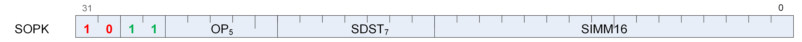

<!-- page 121 -->

## 12.2. SOPK Instructions



Instructions in this format may use a 32-bit literal constant which occurs immediately after the instruction.

#### S_MOVK_I32

Opcode: 0

Sign extend a literal 16-bit constant and store the result into a scalar register.

```
D0.i32 = 32'I(signext(S0.i16))
```

#### S_CMOVK_I32

Opcode: 1

Move the sign extension of a literal 16-bit constant into a scalar register iff SCC is nonzero.

```
if SCC then
    D0.i32 = 32'I(signext(S0.i16))
endif
```

#### S_CMPK_EQ_I32

Opcode: 2

Set SCC to 1 iff scalar input is equal to the sign extension of a literal 16-bit constant.

```
SCC = S0.i32 == 32'I(signext(S1.i16))
```

#### S_CMPK_LG_I32

Opcode: 3

Set SCC to 1 iff scalar input is less than or greater than the sign extension of a literal 16-bit constant.

```
SCC = S0.i32 != 32'I(signext(S1.i16))
```

#### S_CMPK_GT_I32

Opcode: 4

Set SCC to 1 iff scalar input is greater than the sign extension of a literal 16-bit constant.

<!-- page 122 -->

```
SCC = S0.i32 > 32'I(signext(S1.i16))
```

#### S_CMPK_GE_I32

Opcode: 5

Set SCC to 1 iff scalar input is greater than or equal to the sign extension of a literal 16-bit constant.

```
SCC = S0.i32 >= 32'I(signext(S1.i16))
```

#### S_CMPK_LT_I32

Opcode: 6

Set SCC to 1 iff scalar input is less than the sign extension of a literal 16-bit constant.

```
SCC = S0.i32 < 32'I(signext(S1.i16))
```

#### S_CMPK_LE_I32

Opcode: 7

Set SCC to 1 iff scalar input is less than or equal to the sign extension of a literal 16-bit constant.

```
SCC = S0.i32 <= 32'I(signext(S1.i16))
```

#### S_CMPK_EQ_U32

Opcode: 8

Set SCC to 1 iff scalar input is equal to the zero extension of a literal 16-bit constant.

```
SCC = S0.u32 == 32'U(S1.u16)
```

#### S_CMPK_LG_U32

Opcode: 9

Set SCC to 1 iff scalar input is less than or greater than the zero extension of a literal 16-bit constant.

```
SCC = S0.u32 != 32'U(S1.u16)
```

<!-- page 123 -->

#### S_CMPK_GT_U32

Opcode: 10

Set SCC to 1 iff scalar input is greater than the zero extension of a literal 16-bit constant.

```
SCC = S0.u32 > 32'U(S1.u16)
```

#### S_CMPK_GE_U32

Opcode: 11

Set SCC to 1 iff scalar input is greater than or equal to the zero extension of a literal 16-bit constant.

```
SCC = S0.u32 >= 32'U(S1.u16)
```

#### S_CMPK_LT_U32

Opcode: 12

Set SCC to 1 iff scalar input is less than the zero extension of a literal 16-bit constant.

```
SCC = S0.u32 < 32'U(S1.u16)
```

#### S_CMPK_LE_U32

Opcode: 13

Set SCC to 1 iff scalar input is less than or equal to the zero extension of a literal 16-bit constant.

```
SCC = S0.u32 <= 32'U(S1.u16)
```

#### S_ADDK_I32

Opcode: 14

Add a scalar input and the sign extension of a literal 16-bit constant, store the result into a scalar register and store the carry-out bit into SCC.

```
tmp = D0.i32;
// Save value to check sign bits for overflow later.
D0.i32 = D0.i32 + 32'I(signext(S0.i16));
SCC = ((tmp[31] == S0.i16[15]) && (tmp[31] != D0.i32[31]));
// signed overflow.
```

#### S_MULK_I32

Opcode: 15

<!-- page 124 -->

Multiply a scalar input with the sign extension of a literal 16-bit constant and store the result into a scalar register.

```
D0.i32 = D0.i32 * 32'I(signext(S0.i16))
```

#### S_CBRANCH_I_FORK

Opcode: 16

Conditional branch using branch-stack.

S0 = compare mask (VCC or any SGPR), and SIMM16 = signed DWORD branch offset relative to next instruction. See also S_CBRANCH_JOIN.

```
// Initial setup.
mask_pass = (S0.u64 & EXEC.u64);
mask_fail = (~S0.u64 & EXEC.u64);
target_addr = PC + signext(SIMM16.i32 * 4) + 4LL;
// Decide where to jump to.
if mask_pass == EXEC.u64 then
    PC = target_addr
elsif mask_fail == EXEC.u64 then
    PC += 4LL
elsif bitCount(mask_fail.b64) < bitCount(mask_pass.b64) then
    EXEC = mask_fail.b64;
    SGPR[WAVE_MODE.CSP.u32 * 4U].b128 = { target_addr, mask_pass };
    WAVE_MODE.CSP += 3'1U;
    PC += 4LL
else
    EXEC = mask_pass.b64;
    SGPR[WAVE_MODE.CSP.u32 * 4U].b128 = { (PC + 4LL), mask_fail };
    WAVE_MODE.CSP += 3'1U;
    PC = target_addr
endif
```

#### S_GETREG_B32

Opcode: 17

Read some or all of a hardware register into the LSBs of destination.

```
hwRegId = SIMM16.u16[5 : 0];
offset = SIMM16.u16[10 : 6];
size = SIMM16.u16[15 : 11].u32 + 1U;
// logical size is in range 1:32
value = HW_REGISTERS[hwRegId];
D0.u32 = 32'U(32'I(value >> offset.u32) & ((1 << size) - 1))
```

#### S_SETREG_B32

Opcode: 18

<!-- page 125 -->

Write some or all of the LSBs of source argument into a hardware register.

```
hwRegId = SIMM16.u16[5 : 0];
offset = SIMM16.u16[10 : 6];
size = SIMM16.u16[15 : 11].u32 + 1U;
// logical size is in range 1:32
mask = (1 << size) - 1;
mask = (mask << offset.u32);
mask = (mask & HwRegWriteMask(hwRegId, WAVE_STATUS.PRIV));
// Mask of bits that can be modified
value = ((S0.u32 << offset.u32) & mask.u32);
value = (value | 32'U(HW_REGISTERS[hwRegId].i32 & ~mask));
HW_REGISTERS[hwRegId] = value.b32;
// Side-effects may trigger here if certain bits are modified
```

#### S_SETREG_IMM32_B32

Opcode: 20

Write some or all of the LSBs of a 32-bit literal constant into a hardware register; this instruction requires a 32-bit literal constant.

```
hwRegId = SIMM16.u16[5 : 0];
offset = SIMM16.u16[10 : 6];
size = SIMM16.u16[15 : 11].u32 + 1U;
// logical size is in range 1:32
mask = (1 << size) - 1;
mask = (mask << offset.u32);
mask = (mask & HwRegWriteMask(hwRegId, WAVE_STATUS.PRIV));
// Mask of bits that can be modified
value = ((SIMM32.u32 << offset.u32) & mask.u32);
value = (value | 32'U(HW_REGISTERS[hwRegId].i32 & ~mask));
HW_REGISTERS[hwRegId] = value.b32;
// Side-effects may trigger here if certain bits are modified
```

#### S_CALL_B64

Opcode: 21

Store the address of the next instruction to a scalar register and then jump to a constant offset relative to the current PC.

The literal argument is a signed DWORD offset relative to the PC of the next instruction. The byte address of the instruction immediately _following_ this instruction is saved to the destination.

```
D0.i64 = PC + 4LL;
PC = PC + signext(SIMM16.i16 * 16'4) + 4LL
```

**Notes**

<!-- page 126 -->

This implements a short subroutine call where the return address (the next instruction after the S_CALL_B64) is saved to D. Long calls should consider S_SWAPPC_B64 instead.

This instruction must be 4 bytes.
