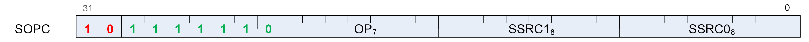

<!-- page 145 -->

## 12.4. SOPC Instructions



Instructions in this format may use a 32-bit literal constant which occurs immediately after the instruction.

#### S_CMP_EQ_I32

Opcode: 0

Set SCC to 1 iff the first scalar input is equal to the second scalar input.

```
SCC = S0.i32 == S1.i32
```

**Notes**

Note that S_CMP_EQ_I32 and S_CMP_EQ_U32 are identical opcodes, but both are provided for symmetry.

#### S_CMP_LG_I32

Opcode: 1

Set SCC to 1 iff the first scalar input is less than or greater than the second scalar input.

```
SCC = S0.i32 <> S1.i32
```

**Notes**

Note that S_CMP_LG_I32 and S_CMP_LG_U32 are identical opcodes, but both are provided for symmetry.

#### S_CMP_GT_I32

Opcode: 2

Set SCC to 1 iff the first scalar input is greater than the second scalar input.

```
SCC = S0.i32 > S1.i32
```

#### S_CMP_GE_I32

Opcode: 3

Set SCC to 1 iff the first scalar input is greater than or equal to the second scalar input.

```
SCC = S0.i32 >= S1.i32
```

<!-- page 146 -->

#### S_CMP_LT_I32

Opcode: 4

Set SCC to 1 iff the first scalar input is less than the second scalar input.

```
SCC = S0.i32 < S1.i32
```

#### S_CMP_LE_I32

Opcode: 5

Set SCC to 1 iff the first scalar input is less than or equal to the second scalar input.

```
SCC = S0.i32 <= S1.i32
```

#### S_CMP_EQ_U32

Opcode: 6

Set SCC to 1 iff the first scalar input is equal to the second scalar input.

```
SCC = S0.u32 == S1.u32
```

**Notes**

Note that S_CMP_EQ_I32 and S_CMP_EQ_U32 are identical opcodes, but both are provided for symmetry.

#### S_CMP_LG_U32

Opcode: 7

Set SCC to 1 iff the first scalar input is less than or greater than the second scalar input.

```
SCC = S0.u32 <> S1.u32
```

**Notes**

Note that S_CMP_LG_I32 and S_CMP_LG_U32 are identical opcodes, but both are provided for symmetry.

#### S_CMP_GT_U32

Opcode: 8

Set SCC to 1 iff the first scalar input is greater than the second scalar input.

```
SCC = S0.u32 > S1.u32
```

<!-- page 147 -->

#### S_CMP_GE_U32

Opcode: 9

Set SCC to 1 iff the first scalar input is greater than or equal to the second scalar input.

```
SCC = S0.u32 >= S1.u32
```

#### S_CMP_LT_U32

Opcode: 10

Set SCC to 1 iff the first scalar input is less than the second scalar input.

```
SCC = S0.u32 < S1.u32
```

#### S_CMP_LE_U32

Opcode: 11

Set SCC to 1 iff the first scalar input is less than or equal to the second scalar input.

```
SCC = S0.u32 <= S1.u32
```

#### S_BITCMP0_B32

Opcode: 12

Extract a bit from the first scalar input based on an index in the second scalar input, and set SCC to 1 iff the extracted bit is equal to 0.

```
SCC = S0.u32[S1.u32[4 : 0]] == 1'0U
```

#### S_BITCMP1_B32

Opcode: 13

Extract a bit from the first scalar input based on an index in the second scalar input, and set SCC to 1 iff the extracted bit is equal to 1.

```
SCC = S0.u32[S1.u32[4 : 0]] == 1'1U
```

#### S_BITCMP0_B64

Opcode: 14

<!-- page 148 -->

Extract a bit from the first scalar input based on an index in the second scalar input, and set SCC to 1 iff the extracted bit is equal to 0.

```
SCC = S0.u64[S1.u32[5 : 0]] == 1'0U
```

#### S_BITCMP1_B64

Opcode: 15

Extract a bit from the first scalar input based on an index in the second scalar input, and set SCC to 1 iff the extracted bit is equal to 1.

```
SCC = S0.u64[S1.u32[5 : 0]] == 1'1U
```

#### S_SETVSKIP

Opcode: 16

Enables or disables VSKIP mode.

When VSKIP is enabled, no VOP*/M*BUF/MIMG/DS/FLAT instructions are issued. Note that VSKIPped memory instructions do not manipulate the waitcnt counters; as a result, if there are outstanding memory requests the shader may want to issue S_WAITCNT 0 prior to enabling VSKIP, otherwise the shader must be careful not to count VSKIPped instructions in waitcnt calculations.

```
VSKIP = S0.u32[S1.u32[4 : 0]]
```

**Notes**

Functional examples:

```
    s_setvskip 1, 0     // Enable vskip mode.
    s_setvskip 0, 0     // Disable vskip mode.
```

#### S_SET_GPR_IDX_ON

Opcode: 17

Enable GPR indexing mode.

Vector operations after this perform relative GPR addressing based on the contents of M0. The index is specified in the SRC0 operand. The raw bits of the SRC1 field are read and used to set the enable bits. S1[0] = VSRC0_REL, S1[1] = VSRC1_REL, S1[2] = VSRC2_REL and S1[3] = VDST_REL.

S_SET_GPR_IDX_ON, S_SET_GPR_IDX_OFF, S_SET_GPR_IDX_MODE and S_SET_GPR_IDX_IDX are related instructions.

<!-- page 149 -->

```
WAVE_MODE.GPR_IDX_EN = 1'1U;
M0[7 : 0] = S0.u32[7 : 0].b8;
M0[15 : 12] = SRC1.u32[3 : 0].b4;
// this is the direct content of raw S1 field
// Remaining bits of M0 are unmodified.
```

#### S_CMP_EQ_U64

Opcode: 18

Set SCC to 1 iff the first scalar input is equal to the second scalar input.

```
SCC = S0.u64 == S1.u64
```

#### S_CMP_LG_U64

Opcode: 19

Set SCC to 1 iff the first scalar input is less than or greater than the second scalar input.

```
SCC = S0.u64 <> S1.u64
```
