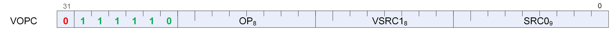
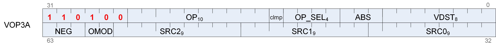

## 12.9. VOPC Instructions

The bitfield map for VOPC is:



```
    where:

    SRC0  = First operand for instruction.
    VSRC1 = Second operand for instruction.
    OP    = Instructions.
    All VOPC instructions can alternatively be encoded in the VOP3A format.
```

Compare instructions perform the same compare operation on each lane (workItem or thread) using that lane’s private data, and producing a 1 bit result per lane into VCC or EXEC.

Instructions in this format may use a 32-bit literal constant which occurs immediately after the instruction.

Most compare instructions fall into one of two categories:

- Those which can use one of 16 compare operations (floating point types). "{COMPF}"

- Those which can use one of 8 compare operations (integer types). "{COMPI}"

The opcode number is such that for these the opcode number can be calculated from a base opcode number for the data type, plus an offset for the specific compare operation.

_Table 59. Float Compare Operations_

|**Compare Operation**|**Opcode Offset**|**Description**|
|---|---|---|
|F|0|D.u = 0|
|LT|1|D.u = (S0 < S1)|
|EQ|2|D.u = (S0 == S1)|
|LE|3|D.u = (S0 <= S1)|
|GT|4|D.u = (S0 > S1)|
|LG|5|D.u = (S0 <> S1)|
|GE|6|D.u = (S0 >= S1)|
|O|7|D.u = (!isNaN(S0) && !isNaN(S1))|
|U|8|D.u = (!isNaN(S0) \|\| !isNaN(S1))|
|NGE|9|D.u = !(S0 >= S1)|
|NLG|10|D.u = !(S0 <> S1)|
|NGT|11|D.u = !(S0 > S1)|
|NLE|12|D.u = !(S0 <= S1)|
|NEQ|13|D.u = !(S0 == S1)|
|NLT|14|D.u = !(S0 < S1)|
|TRU|15|D.u = 1|

<!-- page 229 -->

_Table 60. Instructions with Sixteen Compare Operations_

|**Instruction**|**Description**|**Hex Range**|
|---|---|---|
|V_CMP_{COMPF}_F16|16-bit float compare.|0x20 to 0x2F|
|V_CMPX_{COMPF}_F16|16-bit float compare. Also writes EXEC.|0x30 to 0x3F|
|V_CMP_{COMPF}_F32|32-bit float compare.|0x40 to 0x4F|
|V_CMPX_{COMPF}_F32|32-bit float compare. Also writes EXEC.|0x50 to 0x5F|
|V_CMPS_{COMPF}_F64|64-bit float compare.|0x60 to 0x6F|
|V_CMPSX_{COMPF}_F64|64-bit float compare. Also writes EXEC.|0x70 to 0x7F|

_Table 61. Integer Compare Operations_

|**Compare Operation**|**Opcode Offset**|**Description**|
|---|---|---|
|F|0|D.u = 0|
|LT|1|D.u = (S0 < S1)|
|EQ|2|D.u = (S0 == S1)|
|LE|3|D.u = (S0 <= S1)|
|GT|4|D.u = (S0 > S1)|
|LG|5|D.u = (S0 <> S1)|
|GE|6|D.u = (S0 >= S1)|
|TRU|7|D.u = 1|

_Table 62. Instructions with Eight Compare Operations_

|**Instruction**|**Description**|**Hex Range**|
|---|---|---|
|V_CMP_{COMPI}_I16|16-bit signed integer compare.|0xA0 - 0xA7|
|V_CMP_{COMPI}_U16|16-bit signed integer compare.|0xA8 - 0xAF|
|V_CMPX_{COMPI}_I16|16-bit unsigned integer compare. Also writes EXEC.|0xB0 - 0xB7|
|V_CMPX_{COMPI}_U16|16-bit unsigned integer compare. Also writes EXEC.|0xB8 - 0xBF|
|V_CMP_{COMPI}_I32|32-bit signed integer compare.|0xC0 - 0xC7|
|V_CMP_{COMPI}_U32|32-bit signed integer compare.|0xC8 - 0xCF|
|V_CMPX_{COMPI}_I32|32-bit unsigned integer compare. Also writes EXEC.|0xD0 - 0xD7|
|V_CMPX_{COMPI}_U32|32-bit unsigned integer compare. Also writes EXEC.|0xD8 - 0xDF|
|V_CMP_{COMPI}_I64|64-bit signed integer compare.|0xE0 - 0xE7|
|V_CMP_{COMPI}_U64|64-bit signed integer compare.|0xE8 - 0xEF|
|V_CMPX_{COMPI}_I64|64-bit unsigned integer compare. Also writes EXEC.|0xF0 - 0xF7|
|V_CMPX_{COMPI}_U64|64-bit unsigned integer compare. Also writes EXEC.|0xF8 - 0xFF|

_Table 63. VOPC Compare Opcodes_

<!-- page 230 -->

#### V_CMP_CLASS_F32

Opcode: 16

Evaluate the IEEE numeric class function specified as a 10 bit mask in the second input on the first input, a single-precision float, and set the per-lane condition code to the result. Store the result into VCC or a scalar register.

The function reports true if the floating point value is _any_ of the numeric types selected in the 10 bit mask according to the following list:

S1.u[0] value is a signaling NAN.<br>
S1.u[1] value is a quiet NAN.<br>
S1.u[2] value is negative infinity.<br>
S1.u[3] value is a negative normal value.<br>
S1.u[4] value is a negative denormal value.<br>
S1.u[5] value is negative zero.<br>
S1.u[6] value is positive zero.<br>
S1.u[7] value is a positive denormal value.<br>
S1.u[8] value is a positive normal value.<br>
S1.u[9] value is positive infinity.

```
declare result : 1'U;
if isSignalNAN(64'F(S0.f32)) then
    result = S1.u32[0]
elsif isQuietNAN(64'F(S0.f32)) then
    result = S1.u32[1]
elsif exponent(S0.f32) == 255 then
    // +-INF
    result = S1.u32[sign(S0.f32) ? 2 : 9]
elsif exponent(S0.f32) > 0 then
    // +-normal value
    result = S1.u32[sign(S0.f32) ? 3 : 8]
elsif 64'F(abs(S0.f32)) > 0.0 then
    // +-denormal value
    result = S1.u32[sign(S0.f32) ? 4 : 7]
else
    // +-0.0
    result = S1.u32[sign(S0.f32) ? 5 : 6]
endif;
D0.u64[laneId] = result;
// D0 = VCC in VOPC encoding.
```

#### V_CMPX_CLASS_F32

Opcode: 17

Evaluate the IEEE numeric class function specified as a 10 bit mask in the second input on the first input, a single-precision float, and set the per-lane condition code to the result. Store the result into the EXEC mask and to VCC or a scalar register.

The function reports true if the floating point value is _any_ of the numeric types selected in the 10 bit mask according to the following list:

<!-- page 231 -->

S1.u[0] value is a signaling NAN.<br>
S1.u[1] value is a quiet NAN.<br>
S1.u[2] value is negative infinity.<br>
S1.u[3] value is a negative normal value.<br>
S1.u[4] value is a negative denormal value.<br>
S1.u[5] value is negative zero.<br>
S1.u[6] value is positive zero.<br>
S1.u[7] value is a positive denormal value.<br>
S1.u[8] value is a positive normal value.<br>
S1.u[9] value is positive infinity.

```
declare result : 1'U;
if isSignalNAN(64'F(S0.f32)) then
    result = S1.u32[0]
elsif isQuietNAN(64'F(S0.f32)) then
    result = S1.u32[1]
elsif exponent(S0.f32) == 255 then
    // +-INF
    result = S1.u32[sign(S0.f32) ? 2 : 9]
elsif exponent(S0.f32) > 0 then
    // +-normal value
    result = S1.u32[sign(S0.f32) ? 3 : 8]
elsif 64'F(abs(S0.f32)) > 0.0 then
    // +-denormal value
    result = S1.u32[sign(S0.f32) ? 4 : 7]
else
    // +-0.0
    result = S1.u32[sign(S0.f32) ? 5 : 6]
endif;
EXEC.u64[laneId] = D0.u64[laneId] = result
```

#### V_CMP_CLASS_F64

Opcode: 18

Evaluate the IEEE numeric class function specified as a 10 bit mask in the second input on the first input, a double-precision float, and set the per-lane condition code to the result. Store the result into VCC or a scalar register.

The function reports true if the floating point value is _any_ of the numeric types selected in the 10 bit mask according to the following list:

S1.u[0] value is a signaling NAN.<br>
S1.u[1] value is a quiet NAN.<br>
S1.u[2] value is negative infinity.<br>
S1.u[3] value is a negative normal value.<br>
S1.u[4] value is a negative denormal value.<br>
S1.u[5] value is negative zero.<br>
S1.u[6] value is positive zero.<br>
S1.u[7] value is a positive denormal value.<br>
S1.u[8] value is a positive normal value.<br>
S1.u[9] value is positive infinity.

<!-- page 232 -->

```
declare result : 1'U;
if isSignalNAN(S0.f64) then
    result = S1.u32[0]
elsif isQuietNAN(S0.f64) then
    result = S1.u32[1]
elsif exponent(S0.f64) == 2047 then
    // +-INF
    result = S1.u32[sign(S0.f64) ? 2 : 9]
elsif exponent(S0.f64) > 0 then
    // +-normal value
    result = S1.u32[sign(S0.f64) ? 3 : 8]
elsif abs(S0.f64) > 0.0 then
    // +-denormal value
    result = S1.u32[sign(S0.f64) ? 4 : 7]
else
    // +-0.0
    result = S1.u32[sign(S0.f64) ? 5 : 6]
endif;
D0.u64[laneId] = result;
// D0 = VCC in VOPC encoding.
```

#### V_CMPX_CLASS_F64

Opcode: 19

Evaluate the IEEE numeric class function specified as a 10 bit mask in the second input on the first input, a double-precision float, and set the per-lane condition code to the result. Store the result into the EXEC mask and to VCC or a scalar register.

The function reports true if the floating point value is _any_ of the numeric types selected in the 10 bit mask according to the following list:

S1.u[0] value is a signaling NAN.<br>
S1.u[1] value is a quiet NAN.<br>
S1.u[2] value is negative infinity.<br>
S1.u[3] value is a negative normal value.<br>
S1.u[4] value is a negative denormal value.<br>
S1.u[5] value is negative zero.<br>
S1.u[6] value is positive zero.<br>
S1.u[7] value is a positive denormal value.<br>
S1.u[8] value is a positive normal value.<br>
S1.u[9] value is positive infinity.

```
declare result : 1'U;
if isSignalNAN(S0.f64) then
    result = S1.u32[0]
elsif isQuietNAN(S0.f64) then
    result = S1.u32[1]
elsif exponent(S0.f64) == 2047 then
    // +-INF
    result = S1.u32[sign(S0.f64) ? 2 : 9]
elsif exponent(S0.f64) > 0 then
    // +-normal value
    result = S1.u32[sign(S0.f64) ? 3 : 8]
elsif abs(S0.f64) > 0.0 then
    // +-denormal value
    result = S1.u32[sign(S0.f64) ? 4 : 7]
else
    // +-0.0
    result = S1.u32[sign(S0.f64) ? 5 : 6]
endif;
EXEC.u64[laneId] = D0.u64[laneId] = result
```

<!-- page 233 -->

#### V_CMP_CLASS_F16

Opcode: 20

Evaluate the IEEE numeric class function specified as a 10 bit mask in the second input on the first input, a half-precision float, and set the per-lane condition code to the result. Store the result into VCC or a scalar register.

The function reports true if the floating point value is _any_ of the numeric types selected in the 10 bit mask according to the following list:

S1.u[0] value is a signaling NAN.<br>
S1.u[1] value is a quiet NAN.<br>
S1.u[2] value is negative infinity.<br>
S1.u[3] value is a negative normal value.<br>
S1.u[4] value is a negative denormal value.<br>
S1.u[5] value is negative zero.<br>
S1.u[6] value is positive zero.<br>
S1.u[7] value is a positive denormal value.<br>
S1.u[8] value is a positive normal value.<br>
S1.u[9] value is positive infinity.

```
declare result : 1'U;
if isSignalNAN(64'F(S0.f16)) then
    result = S1.u32[0]
elsif isQuietNAN(64'F(S0.f16)) then
    result = S1.u32[1]
elsif exponent(S0.f16) == 31 then
    // +-INF
    result = S1.u32[sign(S0.f16) ? 2 : 9]
elsif exponent(S0.f16) > 0 then
    // +-normal value
    result = S1.u32[sign(S0.f16) ? 3 : 8]
elsif 64'F(abs(S0.f16)) > 0.0 then
    // +-denormal value
    result = S1.u32[sign(S0.f16) ? 4 : 7]
else
    // +-0.0
    result = S1.u32[sign(S0.f16) ? 5 : 6]
endif;
D0.u64[laneId] = result;
// D0 = VCC in VOPC encoding.
```

<!-- page 234 -->

**Notes**

Note that the S1 has a format of f16 since floating point literal constants are interpreted as 16 bit value for this opcode.

#### V_CMPX_CLASS_F16

Opcode: 21

Evaluate the IEEE numeric class function specified as a 10 bit mask in the second input on the first input, a half-precision float, and set the per-lane condition code to the result. Store the result into the EXEC mask and to VCC or a scalar register.

The function reports true if the floating point value is _any_ of the numeric types selected in the 10 bit mask according to the following list:

S1.u[0] value is a signaling NAN.<br>
S1.u[1] value is a quiet NAN.<br>
S1.u[2] value is negative infinity.<br>
S1.u[3] value is a negative normal value.<br>
S1.u[4] value is a negative denormal value.<br>
S1.u[5] value is negative zero.<br>
S1.u[6] value is positive zero.<br>
S1.u[7] value is a positive denormal value.<br>
S1.u[8] value is a positive normal value.<br>
S1.u[9] value is positive infinity.

```
declare result : 1'U;
if isSignalNAN(64'F(S0.f16)) then
    result = S1.u32[0]
elsif isQuietNAN(64'F(S0.f16)) then
    result = S1.u32[1]
elsif exponent(S0.f16) == 31 then
    // +-INF
    result = S1.u32[sign(S0.f16) ? 2 : 9]
elsif exponent(S0.f16) > 0 then
    // +-normal value
    result = S1.u32[sign(S0.f16) ? 3 : 8]
elsif 64'F(abs(S0.f16)) > 0.0 then
    // +-denormal value
    result = S1.u32[sign(S0.f16) ? 4 : 7]
else
    // +-0.0
    result = S1.u32[sign(S0.f16) ? 5 : 6]
endif;
EXEC.u64[laneId] = D0.u64[laneId] = result
```

**Notes**

Note that the S1 has a format of f16 since floating point literal constants are interpreted as 16 bit value for this opcode.

<!-- page 235 -->

#### V_CMP_F_F16

Opcode: 32

Set the per-lane condition code to 0. Store the result into VCC or a scalar register.

```
D0.u64[laneId] = 1'0U;
// D0 = VCC in VOPC encoding.
```

#### V_CMP_LT_F16

Opcode: 33

Set the per-lane condition code to 1 iff the first input is less than the second input. Store the result into VCC or a scalar register.

```
D0.u64[laneId] = S0.f16 < S1.f16;
// D0 = VCC in VOPC encoding.
```

#### V_CMP_EQ_F16

Opcode: 34

Set the per-lane condition code to 1 iff the first input is equal to the second input. Store the result into VCC or a scalar register.

```
D0.u64[laneId] = S0.f16 == S1.f16;
// D0 = VCC in VOPC encoding.
```

#### V_CMP_LE_F16

Opcode: 35

Set the per-lane condition code to 1 iff the first input is less than or equal to the second input. Store the result into VCC or a scalar register.

```
D0.u64[laneId] = S0.f16 <= S1.f16;
// D0 = VCC in VOPC encoding.
```

#### V_CMP_GT_F16

Opcode: 36

Set the per-lane condition code to 1 iff the first input is greater than the second input. Store the result into VCC or a scalar register.

```
D0.u64[laneId] = S0.f16 > S1.f16;
// D0 = VCC in VOPC encoding.
```

<!-- page 236 -->

#### V_CMP_LG_F16

Opcode: 37

Set the per-lane condition code to 1 iff the first input is less than or greater than the second input. Store the result into VCC or a scalar register.

```
D0.u64[laneId] = S0.f16 <> S1.f16;
// D0 = VCC in VOPC encoding.
```

#### V_CMP_GE_F16

Opcode: 38

Set the per-lane condition code to 1 iff the first input is greater than or equal to the second input. Store the result into VCC or a scalar register.

```
D0.u64[laneId] = S0.f16 >= S1.f16;
// D0 = VCC in VOPC encoding.
```

#### V_CMP_O_F16

Opcode: 39

Set the per-lane condition code to 1 iff the first input is orderable to the second input. Store the result into VCC or a scalar register.

```
D0.u64[laneId] = (!isNAN(64'F(S0.f16)) && !isNAN(64'F(S1.f16)));
// D0 = VCC in VOPC encoding.
```

#### V_CMP_U_F16

Opcode: 40

Set the per-lane condition code to 1 iff the first input is not orderable to the second input. Store the result into VCC or a scalar register.

```
D0.u64[laneId] = (isNAN(64'F(S0.f16)) || isNAN(64'F(S1.f16)));
// D0 = VCC in VOPC encoding.
```

#### V_CMP_NGE_F16

Opcode: 41

Set the per-lane condition code to 1 iff the first input is not greater than or equal to the second input. Store the result into VCC or a scalar register.

<!-- page 237 -->

```
D0.u64[laneId] = !(S0.f16 >= S1.f16);
// With NAN inputs this is not the same operation as <
// D0 = VCC in VOPC encoding.
```

#### V_CMP_NLG_F16

Opcode: 42

Set the per-lane condition code to 1 iff the first input is not less than or greater than the second input. Store the result into VCC or a scalar register.

```
D0.u64[laneId] = !(S0.f16 <> S1.f16);
// With NAN inputs this is not the same operation as ==
// D0 = VCC in VOPC encoding.
```

#### V_CMP_NGT_F16

Opcode: 43

Set the per-lane condition code to 1 iff the first input is not greater than the second input. Store the result into VCC or a scalar register.

```
D0.u64[laneId] = !(S0.f16 > S1.f16);
// With NAN inputs this is not the same operation as <=
// D0 = VCC in VOPC encoding.
```

#### V_CMP_NLE_F16

Opcode: 44

Set the per-lane condition code to 1 iff the first input is not less than or equal to the second input. Store the result into VCC or a scalar register.

```
D0.u64[laneId] = !(S0.f16 <= S1.f16);
// With NAN inputs this is not the same operation as >
// D0 = VCC in VOPC encoding.
```

#### V_CMP_NEQ_F16

Opcode: 45

Set the per-lane condition code to 1 iff the first input is not equal to the second input. Store the result into VCC or a scalar register.

```
D0.u64[laneId] = !(S0.f16 == S1.f16);
// With NAN inputs this is not the same operation as !=
// D0 = VCC in VOPC encoding.
```

<!-- page 238 -->

#### V_CMP_NLT_F16

Opcode: 46

Set the per-lane condition code to 1 iff the first input is not less than the second input. Store the result into VCC or a scalar register.

```
D0.u64[laneId] = !(S0.f16 < S1.f16);
// With NAN inputs this is not the same operation as >=
// D0 = VCC in VOPC encoding.
```

#### V_CMP_TRU_F16

Opcode: 47

Set the per-lane condition code to 1. Store the result into VCC or a scalar register.

```
D0.u64[laneId] = 1'1U;
// D0 = VCC in VOPC encoding.
```

#### V_CMPX_F_F16

Opcode: 48

Set the per-lane condition code to 0. Store the result into the EXEC mask and to VCC or a scalar register.

```
EXEC.u64[laneId] = D0.u64[laneId] = 1'0U;
// D0 = VCC in VOPC encoding.
```

#### V_CMPX_LT_F16

Opcode: 49

Set the per-lane condition code to 1 iff the first input is less than the second input. Store the result into the EXEC mask and to VCC or a scalar register.

```
EXEC.u64[laneId] = D0.u64[laneId] = S0.f16 < S1.f16;
// D0 = VCC in VOPC encoding.
```

#### V_CMPX_EQ_F16

Opcode: 50

Set the per-lane condition code to 1 iff the first input is equal to the second input. Store the result into the EXEC mask and to VCC or a scalar register.

<!-- page 239 -->

```
EXEC.u64[laneId] = D0.u64[laneId] = S0.f16 == S1.f16;
// D0 = VCC in VOPC encoding.
```

#### V_CMPX_LE_F16

Opcode: 51

Set the per-lane condition code to 1 iff the first input is less than or equal to the second input. Store the result into the EXEC mask and to VCC or a scalar register.

```
EXEC.u64[laneId] = D0.u64[laneId] = S0.f16 <= S1.f16;
// D0 = VCC in VOPC encoding.
```

#### V_CMPX_GT_F16

Opcode: 52

Set the per-lane condition code to 1 iff the first input is greater than the second input. Store the result into the EXEC mask and to VCC or a scalar register.

```
EXEC.u64[laneId] = D0.u64[laneId] = S0.f16 > S1.f16;
// D0 = VCC in VOPC encoding.
```

#### V_CMPX_LG_F16

Opcode: 53

Set the per-lane condition code to 1 iff the first input is less than or greater than the second input. Store the result into the EXEC mask and to VCC or a scalar register.

```
EXEC.u64[laneId] = D0.u64[laneId] = S0.f16 <> S1.f16;
// D0 = VCC in VOPC encoding.
```

#### V_CMPX_GE_F16

Opcode: 54

Set the per-lane condition code to 1 iff the first input is greater than or equal to the second input. Store the result into the EXEC mask and to VCC or a scalar register.

```
EXEC.u64[laneId] = D0.u64[laneId] = S0.f16 >= S1.f16;
// D0 = VCC in VOPC encoding.
```

#### V_CMPX_O_F16

Opcode: 55

<!-- page 240 -->

Set the per-lane condition code to 1 iff the first input is orderable to the second input. Store the result into the EXEC mask and to VCC or a scalar register.

```
EXEC.u64[laneId] = D0.u64[laneId] = (!isNAN(64'F(S0.f16)) && !isNAN(64'F(S1.f16)));
// D0 = VCC in VOPC encoding.
```

#### V_CMPX_U_F16

Opcode: 56

Set the per-lane condition code to 1 iff the first input is not orderable to the second input. Store the result into the EXEC mask and to VCC or a scalar register.

```
EXEC.u64[laneId] = D0.u64[laneId] = (isNAN(64'F(S0.f16)) || isNAN(64'F(S1.f16)));
// D0 = VCC in VOPC encoding.
```

#### V_CMPX_NGE_F16

Opcode: 57

Set the per-lane condition code to 1 iff the first input is not greater than or equal to the second input. Store the result into the EXEC mask and to VCC or a scalar register.

```
EXEC.u64[laneId] = D0.u64[laneId] = !(S0.f16 >= S1.f16);
// With NAN inputs this is not the same operation as <
// D0 = VCC in VOPC encoding.
```

#### V_CMPX_NLG_F16

Opcode: 58

Set the per-lane condition code to 1 iff the first input is not less than or greater than the second input. Store the result into the EXEC mask and to VCC or a scalar register.

```
EXEC.u64[laneId] = D0.u64[laneId] = !(S0.f16 <> S1.f16);
// With NAN inputs this is not the same operation as ==
// D0 = VCC in VOPC encoding.
```

#### V_CMPX_NGT_F16

Opcode: 59

Set the per-lane condition code to 1 iff the first input is not greater than the second input. Store the result into the EXEC mask and to VCC or a scalar register.

```
EXEC.u64[laneId] = D0.u64[laneId] = !(S0.f16 > S1.f16);
// With NAN inputs this is not the same operation as <=
// D0 = VCC in VOPC encoding.
```

<!-- page 241 -->

#### V_CMPX_NLE_F16

Opcode: 60

Set the per-lane condition code to 1 iff the first input is not less than or equal to the second input. Store the result into the EXEC mask and to VCC or a scalar register.

```
EXEC.u64[laneId] = D0.u64[laneId] = !(S0.f16 <= S1.f16);
// With NAN inputs this is not the same operation as >
// D0 = VCC in VOPC encoding.
```

#### V_CMPX_NEQ_F16

Opcode: 61

Set the per-lane condition code to 1 iff the first input is not equal to the second input. Store the result into the EXEC mask and to VCC or a scalar register.

```
EXEC.u64[laneId] = D0.u64[laneId] = !(S0.f16 == S1.f16);
// With NAN inputs this is not the same operation as !=
// D0 = VCC in VOPC encoding.
```

#### V_CMPX_NLT_F16

Opcode: 62

Set the per-lane condition code to 1 iff the first input is not less than the second input. Store the result into the EXEC mask and to VCC or a scalar register.

```
EXEC.u64[laneId] = D0.u64[laneId] = !(S0.f16 < S1.f16);
// With NAN inputs this is not the same operation as >=
// D0 = VCC in VOPC encoding.
```

#### V_CMPX_TRU_F16

Opcode: 63

Set the per-lane condition code to 1. Store the result into the EXEC mask and to VCC or a scalar register.

```
EXEC.u64[laneId] = D0.u64[laneId] = 1'1U;
// D0 = VCC in VOPC encoding.
```

#### V_CMP_F_F32

Opcode: 64

<!-- page 242 -->

Set the per-lane condition code to 0. Store the result into VCC or a scalar register.

```
D0.u64[laneId] = 1'0U;
// D0 = VCC in VOPC encoding.
```

#### V_CMP_LT_F32

Opcode: 65

Set the per-lane condition code to 1 iff the first input is less than the second input. Store the result into VCC or a scalar register.

```
D0.u64[laneId] = S0.f32 < S1.f32;
// D0 = VCC in VOPC encoding.
```

#### V_CMP_EQ_F32

Opcode: 66

Set the per-lane condition code to 1 iff the first input is equal to the second input. Store the result into VCC or a scalar register.

```
D0.u64[laneId] = S0.f32 == S1.f32;
// D0 = VCC in VOPC encoding.
```

#### V_CMP_LE_F32

Opcode: 67

Set the per-lane condition code to 1 iff the first input is less than or equal to the second input. Store the result into VCC or a scalar register.

```
D0.u64[laneId] = S0.f32 <= S1.f32;
// D0 = VCC in VOPC encoding.
```

#### V_CMP_GT_F32

Opcode: 68

Set the per-lane condition code to 1 iff the first input is greater than the second input. Store the result into VCC or a scalar register.

```
D0.u64[laneId] = S0.f32 > S1.f32;
// D0 = VCC in VOPC encoding.
```

<!-- page 243 -->

#### V_CMP_LG_F32

Opcode: 69

Set the per-lane condition code to 1 iff the first input is less than or greater than the second input. Store the result into VCC or a scalar register.

```
D0.u64[laneId] = S0.f32 <> S1.f32;
// D0 = VCC in VOPC encoding.
```

#### V_CMP_GE_F32

Opcode: 70

Set the per-lane condition code to 1 iff the first input is greater than or equal to the second input. Store the result into VCC or a scalar register.

```
D0.u64[laneId] = S0.f32 >= S1.f32;
// D0 = VCC in VOPC encoding.
```

#### V_CMP_O_F32

Opcode: 71

Set the per-lane condition code to 1 iff the first input is orderable to the second input. Store the result into VCC or a scalar register.

```
D0.u64[laneId] = (!isNAN(64'F(S0.f32)) && !isNAN(64'F(S1.f32)));
// D0 = VCC in VOPC encoding.
```

#### V_CMP_U_F32

Opcode: 72

Set the per-lane condition code to 1 iff the first input is not orderable to the second input. Store the result into VCC or a scalar register.

```
D0.u64[laneId] = (isNAN(64'F(S0.f32)) || isNAN(64'F(S1.f32)));
// D0 = VCC in VOPC encoding.
```

#### V_CMP_NGE_F32

Opcode: 73

Set the per-lane condition code to 1 iff the first input is not greater than or equal to the second input. Store the result into VCC or a scalar register.

```
D0.u64[laneId] = !(S0.f32 >= S1.f32);
// With NAN inputs this is not the same operation as <
// D0 = VCC in VOPC encoding.
```

<!-- page 244 -->

#### V_CMP_NLG_F32

Opcode: 74

Set the per-lane condition code to 1 iff the first input is not less than or greater than the second input. Store the result into VCC or a scalar register.

```
D0.u64[laneId] = !(S0.f32 <> S1.f32);
// With NAN inputs this is not the same operation as ==
// D0 = VCC in VOPC encoding.
```

#### V_CMP_NGT_F32

Opcode: 75

Set the per-lane condition code to 1 iff the first input is not greater than the second input. Store the result into VCC or a scalar register.

```
D0.u64[laneId] = !(S0.f32 > S1.f32);
// With NAN inputs this is not the same operation as <=
// D0 = VCC in VOPC encoding.
```

#### V_CMP_NLE_F32

Opcode: 76

Set the per-lane condition code to 1 iff the first input is not less than or equal to the second input. Store the result into VCC or a scalar register.

```
D0.u64[laneId] = !(S0.f32 <= S1.f32);
// With NAN inputs this is not the same operation as >
// D0 = VCC in VOPC encoding.
```

#### V_CMP_NEQ_F32

Opcode: 77

Set the per-lane condition code to 1 iff the first input is not equal to the second input. Store the result into VCC or a scalar register.

```
D0.u64[laneId] = !(S0.f32 == S1.f32);
// With NAN inputs this is not the same operation as !=
// D0 = VCC in VOPC encoding.
```

<!-- page 245 -->

#### V_CMP_NLT_F32

Opcode: 78

Set the per-lane condition code to 1 iff the first input is not less than the second input. Store the result into VCC or a scalar register.

```
D0.u64[laneId] = !(S0.f32 < S1.f32);
// With NAN inputs this is not the same operation as >=
// D0 = VCC in VOPC encoding.
```

#### V_CMP_TRU_F32

Opcode: 79

Set the per-lane condition code to 1. Store the result into VCC or a scalar register.

```
D0.u64[laneId] = 1'1U;
// D0 = VCC in VOPC encoding.
```

#### V_CMPX_F_F32

Opcode: 80

Set the per-lane condition code to 0. Store the result into the EXEC mask and to VCC or a scalar register.

```
EXEC.u64[laneId] = D0.u64[laneId] = 1'0U;
// D0 = VCC in VOPC encoding.
```

#### V_CMPX_LT_F32

Opcode: 81

Set the per-lane condition code to 1 iff the first input is less than the second input. Store the result into the EXEC mask and to VCC or a scalar register.

```
EXEC.u64[laneId] = D0.u64[laneId] = S0.f32 < S1.f32;
// D0 = VCC in VOPC encoding.
```

#### V_CMPX_EQ_F32

Opcode: 82

Set the per-lane condition code to 1 iff the first input is equal to the second input. Store the result into the EXEC mask and to VCC or a scalar register.

```
EXEC.u64[laneId] = D0.u64[laneId] = S0.f32 == S1.f32;
// D0 = VCC in VOPC encoding.
```

<!-- page 246 -->

#### V_CMPX_LE_F32

Opcode: 83

Set the per-lane condition code to 1 iff the first input is less than or equal to the second input. Store the result into the EXEC mask and to VCC or a scalar register.

```
EXEC.u64[laneId] = D0.u64[laneId] = S0.f32 <= S1.f32;
// D0 = VCC in VOPC encoding.
```

#### V_CMPX_GT_F32

Opcode: 84

Set the per-lane condition code to 1 iff the first input is greater than the second input. Store the result into the EXEC mask and to VCC or a scalar register.

```
EXEC.u64[laneId] = D0.u64[laneId] = S0.f32 > S1.f32;
// D0 = VCC in VOPC encoding.
```

#### V_CMPX_LG_F32

Opcode: 85

Set the per-lane condition code to 1 iff the first input is less than or greater than the second input. Store the result into the EXEC mask and to VCC or a scalar register.

```
EXEC.u64[laneId] = D0.u64[laneId] = S0.f32 <> S1.f32;
// D0 = VCC in VOPC encoding.
```

#### V_CMPX_GE_F32

Opcode: 86

Set the per-lane condition code to 1 iff the first input is greater than or equal to the second input. Store the result into the EXEC mask and to VCC or a scalar register.

```
EXEC.u64[laneId] = D0.u64[laneId] = S0.f32 >= S1.f32;
// D0 = VCC in VOPC encoding.
```

#### V_CMPX_O_F32

Opcode: 87

Set the per-lane condition code to 1 iff the first input is orderable to the second input. Store the result into the EXEC mask and to VCC or a scalar register.

<!-- page 247 -->

```
EXEC.u64[laneId] = D0.u64[laneId] = (!isNAN(64'F(S0.f32)) && !isNAN(64'F(S1.f32)));
// D0 = VCC in VOPC encoding.
```

#### V_CMPX_U_F32

Opcode: 88

Set the per-lane condition code to 1 iff the first input is not orderable to the second input. Store the result into the EXEC mask and to VCC or a scalar register.

```
EXEC.u64[laneId] = D0.u64[laneId] = (isNAN(64'F(S0.f32)) || isNAN(64'F(S1.f32)));
// D0 = VCC in VOPC encoding.
```

#### V_CMPX_NGE_F32

Opcode: 89

Set the per-lane condition code to 1 iff the first input is not greater than or equal to the second input. Store the result into the EXEC mask and to VCC or a scalar register.

```
EXEC.u64[laneId] = D0.u64[laneId] = !(S0.f32 >= S1.f32);
// With NAN inputs this is not the same operation as <
// D0 = VCC in VOPC encoding.
```

#### V_CMPX_NLG_F32

Opcode: 90

Set the per-lane condition code to 1 iff the first input is not less than or greater than the second input. Store the result into the EXEC mask and to VCC or a scalar register.

```
EXEC.u64[laneId] = D0.u64[laneId] = !(S0.f32 <> S1.f32);
// With NAN inputs this is not the same operation as ==
// D0 = VCC in VOPC encoding.
```

#### V_CMPX_NGT_F32

Opcode: 91

Set the per-lane condition code to 1 iff the first input is not greater than the second input. Store the result into the EXEC mask and to VCC or a scalar register.

```
EXEC.u64[laneId] = D0.u64[laneId] = !(S0.f32 > S1.f32);
// With NAN inputs this is not the same operation as <=
// D0 = VCC in VOPC encoding.
```

<!-- page 248 -->

#### V_CMPX_NLE_F32

Opcode: 92

Set the per-lane condition code to 1 iff the first input is not less than or equal to the second input. Store the result into the EXEC mask and to VCC or a scalar register.

```
EXEC.u64[laneId] = D0.u64[laneId] = !(S0.f32 <= S1.f32);
// With NAN inputs this is not the same operation as >
// D0 = VCC in VOPC encoding.
```

#### V_CMPX_NEQ_F32

Opcode: 93

Set the per-lane condition code to 1 iff the first input is not equal to the second input. Store the result into the EXEC mask and to VCC or a scalar register.

```
EXEC.u64[laneId] = D0.u64[laneId] = !(S0.f32 == S1.f32);
// With NAN inputs this is not the same operation as !=
// D0 = VCC in VOPC encoding.
```

#### V_CMPX_NLT_F32

Opcode: 94

Set the per-lane condition code to 1 iff the first input is not less than the second input. Store the result into the EXEC mask and to VCC or a scalar register.

```
EXEC.u64[laneId] = D0.u64[laneId] = !(S0.f32 < S1.f32);
// With NAN inputs this is not the same operation as >=
// D0 = VCC in VOPC encoding.
```

#### V_CMPX_TRU_F32

Opcode: 95

Set the per-lane condition code to 1. Store the result into the EXEC mask and to VCC or a scalar register.

```
EXEC.u64[laneId] = D0.u64[laneId] = 1'1U;
// D0 = VCC in VOPC encoding.
```

#### V_CMP_F_F64

Opcode: 96

<!-- page 249 -->

Set the per-lane condition code to 0. Store the result into VCC or a scalar register.

```
D0.u64[laneId] = 1'0U;
// D0 = VCC in VOPC encoding.
```

#### V_CMP_LT_F64

Opcode: 97

Set the per-lane condition code to 1 iff the first input is less than the second input. Store the result into VCC or a scalar register.

```
D0.u64[laneId] = S0.f64 < S1.f64;
// D0 = VCC in VOPC encoding.
```

#### V_CMP_EQ_F64

Opcode: 98

Set the per-lane condition code to 1 iff the first input is equal to the second input. Store the result into VCC or a scalar register.

```
D0.u64[laneId] = S0.f64 == S1.f64;
// D0 = VCC in VOPC encoding.
```

#### V_CMP_LE_F64

Opcode: 99

Set the per-lane condition code to 1 iff the first input is less than or equal to the second input. Store the result into VCC or a scalar register.

```
D0.u64[laneId] = S0.f64 <= S1.f64;
// D0 = VCC in VOPC encoding.
```

#### V_CMP_GT_F64

Opcode: 100

Set the per-lane condition code to 1 iff the first input is greater than the second input. Store the result into VCC or a scalar register.

```
D0.u64[laneId] = S0.f64 > S1.f64;
// D0 = VCC in VOPC encoding.
```

<!-- page 250 -->

#### V_CMP_LG_F64

Opcode: 101

Set the per-lane condition code to 1 iff the first input is less than or greater than the second input. Store the result into VCC or a scalar register.

```
D0.u64[laneId] = S0.f64 <> S1.f64;
// D0 = VCC in VOPC encoding.
```

#### V_CMP_GE_F64

Opcode: 102

Set the per-lane condition code to 1 iff the first input is greater than or equal to the second input. Store the result into VCC or a scalar register.

```
D0.u64[laneId] = S0.f64 >= S1.f64;
// D0 = VCC in VOPC encoding.
```

#### V_CMP_O_F64

Opcode: 103

Set the per-lane condition code to 1 iff the first input is orderable to the second input. Store the result into VCC or a scalar register.

```
D0.u64[laneId] = (!isNAN(S0.f64) && !isNAN(S1.f64));
// D0 = VCC in VOPC encoding.
```

#### V_CMP_U_F64

Opcode: 104

Set the per-lane condition code to 1 iff the first input is not orderable to the second input. Store the result into VCC or a scalar register.

```
D0.u64[laneId] = (isNAN(S0.f64) || isNAN(S1.f64));
// D0 = VCC in VOPC encoding.
```

#### V_CMP_NGE_F64

Opcode: 105

Set the per-lane condition code to 1 iff the first input is not greater than or equal to the second input. Store the result into VCC or a scalar register.

```
D0.u64[laneId] = !(S0.f64 >= S1.f64);
// With NAN inputs this is not the same operation as <
// D0 = VCC in VOPC encoding.
```

<!-- page 251 -->

#### V_CMP_NLG_F64

Opcode: 106

Set the per-lane condition code to 1 iff the first input is not less than or greater than the second input. Store the result into VCC or a scalar register.

```
D0.u64[laneId] = !(S0.f64 <> S1.f64);
// With NAN inputs this is not the same operation as ==
// D0 = VCC in VOPC encoding.
```

#### V_CMP_NGT_F64

Opcode: 107

Set the per-lane condition code to 1 iff the first input is not greater than the second input. Store the result into VCC or a scalar register.

```
D0.u64[laneId] = !(S0.f64 > S1.f64);
// With NAN inputs this is not the same operation as <=
// D0 = VCC in VOPC encoding.
```

#### V_CMP_NLE_F64

Opcode: 108

Set the per-lane condition code to 1 iff the first input is not less than or equal to the second input. Store the result into VCC or a scalar register.

```
D0.u64[laneId] = !(S0.f64 <= S1.f64);
// With NAN inputs this is not the same operation as >
// D0 = VCC in VOPC encoding.
```

#### V_CMP_NEQ_F64

Opcode: 109

Set the per-lane condition code to 1 iff the first input is not equal to the second input. Store the result into VCC or a scalar register.

```
D0.u64[laneId] = !(S0.f64 == S1.f64);
// With NAN inputs this is not the same operation as !=
// D0 = VCC in VOPC encoding.
```

<!-- page 252 -->

#### V_CMP_NLT_F64

Opcode: 110

Set the per-lane condition code to 1 iff the first input is not less than the second input. Store the result into VCC or a scalar register.

```
D0.u64[laneId] = !(S0.f64 < S1.f64);
// With NAN inputs this is not the same operation as >=
// D0 = VCC in VOPC encoding.
```

#### V_CMP_TRU_F64

Opcode: 111

Set the per-lane condition code to 1. Store the result into VCC or a scalar register.

```
D0.u64[laneId] = 1'1U;
// D0 = VCC in VOPC encoding.
```

#### V_CMPX_F_F64

Opcode: 112

Set the per-lane condition code to 0. Store the result into the EXEC mask and to VCC or a scalar register.

```
EXEC.u64[laneId] = D0.u64[laneId] = 1'0U;
// D0 = VCC in VOPC encoding.
```

#### V_CMPX_LT_F64

Opcode: 113

Set the per-lane condition code to 1 iff the first input is less than the second input. Store the result into the EXEC mask and to VCC or a scalar register.

```
EXEC.u64[laneId] = D0.u64[laneId] = S0.f64 < S1.f64;
// D0 = VCC in VOPC encoding.
```

#### V_CMPX_EQ_F64

Opcode: 114

Set the per-lane condition code to 1 iff the first input is equal to the second input. Store the result into the EXEC mask and to VCC or a scalar register.

```
EXEC.u64[laneId] = D0.u64[laneId] = S0.f64 == S1.f64;
// D0 = VCC in VOPC encoding.
```

<!-- page 253 -->

#### V_CMPX_LE_F64

Opcode: 115

Set the per-lane condition code to 1 iff the first input is less than or equal to the second input. Store the result into the EXEC mask and to VCC or a scalar register.

```
EXEC.u64[laneId] = D0.u64[laneId] = S0.f64 <= S1.f64;
// D0 = VCC in VOPC encoding.
```

#### V_CMPX_GT_F64

Opcode: 116

Set the per-lane condition code to 1 iff the first input is greater than the second input. Store the result into the EXEC mask and to VCC or a scalar register.

```
EXEC.u64[laneId] = D0.u64[laneId] = S0.f64 > S1.f64;
// D0 = VCC in VOPC encoding.
```

#### V_CMPX_LG_F64

Opcode: 117

Set the per-lane condition code to 1 iff the first input is less than or greater than the second input. Store the result into the EXEC mask and to VCC or a scalar register.

```
EXEC.u64[laneId] = D0.u64[laneId] = S0.f64 <> S1.f64;
// D0 = VCC in VOPC encoding.
```

#### V_CMPX_GE_F64

Opcode: 118

Set the per-lane condition code to 1 iff the first input is greater than or equal to the second input. Store the result into the EXEC mask and to VCC or a scalar register.

```
EXEC.u64[laneId] = D0.u64[laneId] = S0.f64 >= S1.f64;
// D0 = VCC in VOPC encoding.
```

#### V_CMPX_O_F64

Opcode: 119

Set the per-lane condition code to 1 iff the first input is orderable to the second input. Store the result into the EXEC mask and to VCC or a scalar register.

<!-- page 254 -->

```
EXEC.u64[laneId] = D0.u64[laneId] = (!isNAN(S0.f64) && !isNAN(S1.f64));
// D0 = VCC in VOPC encoding.
```

#### V_CMPX_U_F64

Opcode: 120

Set the per-lane condition code to 1 iff the first input is not orderable to the second input. Store the result into the EXEC mask and to VCC or a scalar register.

```
EXEC.u64[laneId] = D0.u64[laneId] = (isNAN(S0.f64) || isNAN(S1.f64));
// D0 = VCC in VOPC encoding.
```

#### V_CMPX_NGE_F64

Opcode: 121

Set the per-lane condition code to 1 iff the first input is not greater than or equal to the second input. Store the result into the EXEC mask and to VCC or a scalar register.

```
EXEC.u64[laneId] = D0.u64[laneId] = !(S0.f64 >= S1.f64);
// With NAN inputs this is not the same operation as <
// D0 = VCC in VOPC encoding.
```

#### V_CMPX_NLG_F64

Opcode: 122

Set the per-lane condition code to 1 iff the first input is not less than or greater than the second input. Store the result into the EXEC mask and to VCC or a scalar register.

```
EXEC.u64[laneId] = D0.u64[laneId] = !(S0.f64 <> S1.f64);
// With NAN inputs this is not the same operation as ==
// D0 = VCC in VOPC encoding.
```

#### V_CMPX_NGT_F64

Opcode: 123

Set the per-lane condition code to 1 iff the first input is not greater than the second input. Store the result into the EXEC mask and to VCC or a scalar register.

```
EXEC.u64[laneId] = D0.u64[laneId] = !(S0.f64 > S1.f64);
// With NAN inputs this is not the same operation as <=
// D0 = VCC in VOPC encoding.
```

<!-- page 255 -->

#### V_CMPX_NLE_F64

Opcode: 124

Set the per-lane condition code to 1 iff the first input is not less than or equal to the second input. Store the result into the EXEC mask and to VCC or a scalar register.

```
EXEC.u64[laneId] = D0.u64[laneId] = !(S0.f64 <= S1.f64);
// With NAN inputs this is not the same operation as >
// D0 = VCC in VOPC encoding.
```

#### V_CMPX_NEQ_F64

Opcode: 125

Set the per-lane condition code to 1 iff the first input is not equal to the second input. Store the result into the EXEC mask and to VCC or a scalar register.

```
EXEC.u64[laneId] = D0.u64[laneId] = !(S0.f64 == S1.f64);
// With NAN inputs this is not the same operation as !=
// D0 = VCC in VOPC encoding.
```

#### V_CMPX_NLT_F64

Opcode: 126

Set the per-lane condition code to 1 iff the first input is not less than the second input. Store the result into the EXEC mask and to VCC or a scalar register.

```
EXEC.u64[laneId] = D0.u64[laneId] = !(S0.f64 < S1.f64);
// With NAN inputs this is not the same operation as >=
// D0 = VCC in VOPC encoding.
```

#### V_CMPX_TRU_F64

Opcode: 127

Set the per-lane condition code to 1. Store the result into the EXEC mask and to VCC or a scalar register.

```
EXEC.u64[laneId] = D0.u64[laneId] = 1'1U;
// D0 = VCC in VOPC encoding.
```

#### V_CMP_F_I16

Opcode: 160

<!-- page 256 -->

Set the per-lane condition code to 0. Store the result into VCC or a scalar register.

```
D0.u64[laneId] = 1'0U;
// D0 = VCC in VOPC encoding.
```

#### V_CMP_LT_I16

Opcode: 161

Set the per-lane condition code to 1 iff the first input is less than the second input. Store the result into VCC or a scalar register.

```
D0.u64[laneId] = S0.i16 < S1.i16;
// D0 = VCC in VOPC encoding.
```

#### V_CMP_EQ_I16

Opcode: 162

Set the per-lane condition code to 1 iff the first input is equal to the second input. Store the result into VCC or a scalar register.

```
D0.u64[laneId] = S0.i16 == S1.i16;
// D0 = VCC in VOPC encoding.
```

#### V_CMP_LE_I16

Opcode: 163

Set the per-lane condition code to 1 iff the first input is less than or equal to the second input. Store the result into VCC or a scalar register.

```
D0.u64[laneId] = S0.i16 <= S1.i16;
// D0 = VCC in VOPC encoding.
```

#### V_CMP_GT_I16

Opcode: 164

Set the per-lane condition code to 1 iff the first input is greater than the second input. Store the result into VCC or a scalar register.

```
D0.u64[laneId] = S0.i16 > S1.i16;
// D0 = VCC in VOPC encoding.
```

<!-- page 257 -->

#### V_CMP_NE_I16

Opcode: 165

Set the per-lane condition code to 1 iff the first input is not equal to the second input. Store the result into VCC or a scalar register.

```
D0.u64[laneId] = S0.i16 <> S1.i16;
// D0 = VCC in VOPC encoding.
```

#### V_CMP_GE_I16

Opcode: 166

Set the per-lane condition code to 1 iff the first input is greater than or equal to the second input. Store the result into VCC or a scalar register.

```
D0.u64[laneId] = S0.i16 >= S1.i16;
// D0 = VCC in VOPC encoding.
```

#### V_CMP_T_I16

Opcode: 167

Set the per-lane condition code to 1. Store the result into VCC or a scalar register.

```
D0.u64[laneId] = 1'1U;
// D0 = VCC in VOPC encoding.
```

#### V_CMP_F_U16

Opcode: 168

Set the per-lane condition code to 0. Store the result into VCC or a scalar register.

```
D0.u64[laneId] = 1'0U;
// D0 = VCC in VOPC encoding.
```

#### V_CMP_LT_U16

Opcode: 169

Set the per-lane condition code to 1 iff the first input is less than the second input. Store the result into VCC or a scalar register.

```
D0.u64[laneId] = S0.u16 < S1.u16;
// D0 = VCC in VOPC encoding.
```

<!-- page 258 -->

#### V_CMP_EQ_U16

Opcode: 170

Set the per-lane condition code to 1 iff the first input is equal to the second input. Store the result into VCC or a scalar register.

```
D0.u64[laneId] = S0.u16 == S1.u16;
// D0 = VCC in VOPC encoding.
```

#### V_CMP_LE_U16

Opcode: 171

Set the per-lane condition code to 1 iff the first input is less than or equal to the second input. Store the result into VCC or a scalar register.

```
D0.u64[laneId] = S0.u16 <= S1.u16;
// D0 = VCC in VOPC encoding.
```

#### V_CMP_GT_U16

Opcode: 172

Set the per-lane condition code to 1 iff the first input is greater than the second input. Store the result into VCC or a scalar register.

```
D0.u64[laneId] = S0.u16 > S1.u16;
// D0 = VCC in VOPC encoding.
```

#### V_CMP_NE_U16

Opcode: 173

Set the per-lane condition code to 1 iff the first input is not equal to the second input. Store the result into VCC or a scalar register.

```
D0.u64[laneId] = S0.u16 <> S1.u16;
// D0 = VCC in VOPC encoding.
```

#### V_CMP_GE_U16

Opcode: 174

Set the per-lane condition code to 1 iff the first input is greater than or equal to the second input. Store the result into VCC or a scalar register.

<!-- page 259 -->

```
D0.u64[laneId] = S0.u16 >= S1.u16;
// D0 = VCC in VOPC encoding.
```

#### V_CMP_T_U16

Opcode: 175

Set the per-lane condition code to 1. Store the result into VCC or a scalar register.

```
D0.u64[laneId] = 1'1U;
// D0 = VCC in VOPC encoding.
```

#### V_CMPX_F_I16

Opcode: 176

Set the per-lane condition code to 0. Store the result into the EXEC mask and to VCC or a scalar register.

```
EXEC.u64[laneId] = D0.u64[laneId] = 1'0U;
// D0 = VCC in VOPC encoding.
```

#### V_CMPX_LT_I16

Opcode: 177

Set the per-lane condition code to 1 iff the first input is less than the second input. Store the result into the EXEC mask and to VCC or a scalar register.

```
EXEC.u64[laneId] = D0.u64[laneId] = S0.i16 < S1.i16;
// D0 = VCC in VOPC encoding.
```

#### V_CMPX_EQ_I16

Opcode: 178

Set the per-lane condition code to 1 iff the first input is equal to the second input. Store the result into the EXEC mask and to VCC or a scalar register.

```
EXEC.u64[laneId] = D0.u64[laneId] = S0.i16 == S1.i16;
// D0 = VCC in VOPC encoding.
```

#### V_CMPX_LE_I16

Opcode: 179

Set the per-lane condition code to 1 iff the first input is less than or equal to the second input. Store the result into the EXEC mask and to VCC or a scalar register.

<!-- page 260 -->

```
EXEC.u64[laneId] = D0.u64[laneId] = S0.i16 <= S1.i16;
// D0 = VCC in VOPC encoding.
```

#### V_CMPX_GT_I16

Opcode: 180

Set the per-lane condition code to 1 iff the first input is greater than the second input. Store the result into the EXEC mask and to VCC or a scalar register.

```
EXEC.u64[laneId] = D0.u64[laneId] = S0.i16 > S1.i16;
// D0 = VCC in VOPC encoding.
```

#### V_CMPX_NE_I16

Opcode: 181

Set the per-lane condition code to 1 iff the first input is not equal to the second input. Store the result into the EXEC mask and to VCC or a scalar register.

```
EXEC.u64[laneId] = D0.u64[laneId] = S0.i16 <> S1.i16;
// D0 = VCC in VOPC encoding.
```

#### V_CMPX_GE_I16

Opcode: 182

Set the per-lane condition code to 1 iff the first input is greater than or equal to the second input. Store the result into the EXEC mask and to VCC or a scalar register.

```
EXEC.u64[laneId] = D0.u64[laneId] = S0.i16 >= S1.i16;
// D0 = VCC in VOPC encoding.
```

#### V_CMPX_T_I16

Opcode: 183

Set the per-lane condition code to 1. Store the result into the EXEC mask and to VCC or a scalar register.

```
EXEC.u64[laneId] = D0.u64[laneId] = 1'1U;
// D0 = VCC in VOPC encoding.
```

<!-- page 261 -->

#### V_CMPX_F_U16

Opcode: 184

Set the per-lane condition code to 0. Store the result into the EXEC mask and to VCC or a scalar register.

```
EXEC.u64[laneId] = D0.u64[laneId] = 1'0U;
// D0 = VCC in VOPC encoding.
```

#### V_CMPX_LT_U16

Opcode: 185

Set the per-lane condition code to 1 iff the first input is less than the second input. Store the result into the EXEC mask and to VCC or a scalar register.

```
EXEC.u64[laneId] = D0.u64[laneId] = S0.u16 < S1.u16;
// D0 = VCC in VOPC encoding.
```

#### V_CMPX_EQ_U16

Opcode: 186

Set the per-lane condition code to 1 iff the first input is equal to the second input. Store the result into the EXEC mask and to VCC or a scalar register.

```
EXEC.u64[laneId] = D0.u64[laneId] = S0.u16 == S1.u16;
// D0 = VCC in VOPC encoding.
```

#### V_CMPX_LE_U16

Opcode: 187

Set the per-lane condition code to 1 iff the first input is less than or equal to the second input. Store the result into the EXEC mask and to VCC or a scalar register.

```
EXEC.u64[laneId] = D0.u64[laneId] = S0.u16 <= S1.u16;
// D0 = VCC in VOPC encoding.
```

#### V_CMPX_GT_U16

Opcode: 188

Set the per-lane condition code to 1 iff the first input is greater than the second input. Store the result into the EXEC mask and to VCC or a scalar register.

```
EXEC.u64[laneId] = D0.u64[laneId] = S0.u16 > S1.u16;
// D0 = VCC in VOPC encoding.
```

<!-- page 262 -->

#### V_CMPX_NE_U16

Opcode: 189

Set the per-lane condition code to 1 iff the first input is not equal to the second input. Store the result into the EXEC mask and to VCC or a scalar register.

```
EXEC.u64[laneId] = D0.u64[laneId] = S0.u16 <> S1.u16;
// D0 = VCC in VOPC encoding.
```

#### V_CMPX_GE_U16

Opcode: 190

Set the per-lane condition code to 1 iff the first input is greater than or equal to the second input. Store the result into the EXEC mask and to VCC or a scalar register.

```
EXEC.u64[laneId] = D0.u64[laneId] = S0.u16 >= S1.u16;
// D0 = VCC in VOPC encoding.
```

#### V_CMPX_T_U16

Opcode: 191

Set the per-lane condition code to 1. Store the result into the EXEC mask and to VCC or a scalar register.

```
EXEC.u64[laneId] = D0.u64[laneId] = 1'1U;
// D0 = VCC in VOPC encoding.
```

#### V_CMP_F_I32

Opcode: 192

Set the per-lane condition code to 0. Store the result into VCC or a scalar register.

```
D0.u64[laneId] = 1'0U;
// D0 = VCC in VOPC encoding.
```

#### V_CMP_LT_I32

Opcode: 193

Set the per-lane condition code to 1 iff the first input is less than the second input. Store the result into VCC or a scalar register.

```
D0.u64[laneId] = S0.i32 < S1.i32;
// D0 = VCC in VOPC encoding.
```

<!-- page 263 -->

#### V_CMP_EQ_I32

Opcode: 194

Set the per-lane condition code to 1 iff the first input is equal to the second input. Store the result into VCC or a scalar register.

```
D0.u64[laneId] = S0.i32 == S1.i32;
// D0 = VCC in VOPC encoding.
```

#### V_CMP_LE_I32

Opcode: 195

Set the per-lane condition code to 1 iff the first input is less than or equal to the second input. Store the result into VCC or a scalar register.

```
D0.u64[laneId] = S0.i32 <= S1.i32;
// D0 = VCC in VOPC encoding.
```

#### V_CMP_GT_I32

Opcode: 196

Set the per-lane condition code to 1 iff the first input is greater than the second input. Store the result into VCC or a scalar register.

```
D0.u64[laneId] = S0.i32 > S1.i32;
// D0 = VCC in VOPC encoding.
```

#### V_CMP_NE_I32

Opcode: 197

Set the per-lane condition code to 1 iff the first input is not equal to the second input. Store the result into VCC or a scalar register.

```
D0.u64[laneId] = S0.i32 <> S1.i32;
// D0 = VCC in VOPC encoding.
```

#### V_CMP_GE_I32

Opcode: 198

Set the per-lane condition code to 1 iff the first input is greater than or equal to the second input. Store the result into VCC or a scalar register.

<!-- page 264 -->

```
D0.u64[laneId] = S0.i32 >= S1.i32;
// D0 = VCC in VOPC encoding.
```

#### V_CMP_T_I32

Opcode: 199

Set the per-lane condition code to 1. Store the result into VCC or a scalar register.

```
D0.u64[laneId] = 1'1U;
// D0 = VCC in VOPC encoding.
```

#### V_CMP_F_U32

Opcode: 200

Set the per-lane condition code to 0. Store the result into VCC or a scalar register.

```
D0.u64[laneId] = 1'0U;
// D0 = VCC in VOPC encoding.
```

#### V_CMP_LT_U32

Opcode: 201

Set the per-lane condition code to 1 iff the first input is less than the second input. Store the result into VCC or a scalar register.

```
D0.u64[laneId] = S0.u32 < S1.u32;
// D0 = VCC in VOPC encoding.
```

#### V_CMP_EQ_U32

Opcode: 202

Set the per-lane condition code to 1 iff the first input is equal to the second input. Store the result into VCC or a scalar register.

```
D0.u64[laneId] = S0.u32 == S1.u32;
// D0 = VCC in VOPC encoding.
```

#### V_CMP_LE_U32

Opcode: 203

<!-- page 265 -->

Set the per-lane condition code to 1 iff the first input is less than or equal to the second input. Store the result into VCC or a scalar register.

```
D0.u64[laneId] = S0.u32 <= S1.u32;
// D0 = VCC in VOPC encoding.
```

#### V_CMP_GT_U32

Opcode: 204

Set the per-lane condition code to 1 iff the first input is greater than the second input. Store the result into VCC or a scalar register.

```
D0.u64[laneId] = S0.u32 > S1.u32;
// D0 = VCC in VOPC encoding.
```

#### V_CMP_NE_U32

Opcode: 205

Set the per-lane condition code to 1 iff the first input is not equal to the second input. Store the result into VCC or a scalar register.

```
D0.u64[laneId] = S0.u32 <> S1.u32;
// D0 = VCC in VOPC encoding.
```

#### V_CMP_GE_U32

Opcode: 206

Set the per-lane condition code to 1 iff the first input is greater than or equal to the second input. Store the result into VCC or a scalar register.

```
D0.u64[laneId] = S0.u32 >= S1.u32;
// D0 = VCC in VOPC encoding.
```

#### V_CMP_T_U32

Opcode: 207

Set the per-lane condition code to 1. Store the result into VCC or a scalar register.

```
D0.u64[laneId] = 1'1U;
// D0 = VCC in VOPC encoding.
```

<!-- page 266 -->

#### V_CMPX_F_I32

Opcode: 208

Set the per-lane condition code to 0. Store the result into the EXEC mask and to VCC or a scalar register.

```
EXEC.u64[laneId] = D0.u64[laneId] = 1'0U;
// D0 = VCC in VOPC encoding.
```

#### V_CMPX_LT_I32

Opcode: 209

Set the per-lane condition code to 1 iff the first input is less than the second input. Store the result into the EXEC mask and to VCC or a scalar register.

```
EXEC.u64[laneId] = D0.u64[laneId] = S0.i32 < S1.i32;
// D0 = VCC in VOPC encoding.
```

#### V_CMPX_EQ_I32

Opcode: 210

Set the per-lane condition code to 1 iff the first input is equal to the second input. Store the result into the EXEC mask and to VCC or a scalar register.

```
EXEC.u64[laneId] = D0.u64[laneId] = S0.i32 == S1.i32;
// D0 = VCC in VOPC encoding.
```

#### V_CMPX_LE_I32

Opcode: 211

Set the per-lane condition code to 1 iff the first input is less than or equal to the second input. Store the result into the EXEC mask and to VCC or a scalar register.

```
EXEC.u64[laneId] = D0.u64[laneId] = S0.i32 <= S1.i32;
// D0 = VCC in VOPC encoding.
```

#### V_CMPX_GT_I32

Opcode: 212

Set the per-lane condition code to 1 iff the first input is greater than the second input. Store the result into the EXEC mask and to VCC or a scalar register.

```
EXEC.u64[laneId] = D0.u64[laneId] = S0.i32 > S1.i32;
// D0 = VCC in VOPC encoding.
```

<!-- page 267 -->

#### V_CMPX_NE_I32

Opcode: 213

Set the per-lane condition code to 1 iff the first input is not equal to the second input. Store the result into the EXEC mask and to VCC or a scalar register.

```
EXEC.u64[laneId] = D0.u64[laneId] = S0.i32 <> S1.i32;
// D0 = VCC in VOPC encoding.
```

#### V_CMPX_GE_I32

Opcode: 214

Set the per-lane condition code to 1 iff the first input is greater than or equal to the second input. Store the result into the EXEC mask and to VCC or a scalar register.

```
EXEC.u64[laneId] = D0.u64[laneId] = S0.i32 >= S1.i32;
// D0 = VCC in VOPC encoding.
```

#### V_CMPX_T_I32

Opcode: 215

Set the per-lane condition code to 1. Store the result into the EXEC mask and to VCC or a scalar register.

```
EXEC.u64[laneId] = D0.u64[laneId] = 1'1U;
// D0 = VCC in VOPC encoding.
```

#### V_CMPX_F_U32

Opcode: 216

Set the per-lane condition code to 0. Store the result into the EXEC mask and to VCC or a scalar register.

```
EXEC.u64[laneId] = D0.u64[laneId] = 1'0U;
// D0 = VCC in VOPC encoding.
```

#### V_CMPX_LT_U32

Opcode: 217

Set the per-lane condition code to 1 iff the first input is less than the second input. Store the result into the EXEC mask and to VCC or a scalar register.

```
EXEC.u64[laneId] = D0.u64[laneId] = S0.u32 < S1.u32;
// D0 = VCC in VOPC encoding.
```

<!-- page 268 -->

#### V_CMPX_EQ_U32

Opcode: 218

Set the per-lane condition code to 1 iff the first input is equal to the second input. Store the result into the EXEC mask and to VCC or a scalar register.

```
EXEC.u64[laneId] = D0.u64[laneId] = S0.u32 == S1.u32;
// D0 = VCC in VOPC encoding.
```

#### V_CMPX_LE_U32

Opcode: 219

Set the per-lane condition code to 1 iff the first input is less than or equal to the second input. Store the result into the EXEC mask and to VCC or a scalar register.

```
EXEC.u64[laneId] = D0.u64[laneId] = S0.u32 <= S1.u32;
// D0 = VCC in VOPC encoding.
```

#### V_CMPX_GT_U32

Opcode: 220

Set the per-lane condition code to 1 iff the first input is greater than the second input. Store the result into the EXEC mask and to VCC or a scalar register.

```
EXEC.u64[laneId] = D0.u64[laneId] = S0.u32 > S1.u32;
// D0 = VCC in VOPC encoding.
```

#### V_CMPX_NE_U32

Opcode: 221

Set the per-lane condition code to 1 iff the first input is not equal to the second input. Store the result into the EXEC mask and to VCC or a scalar register.

```
EXEC.u64[laneId] = D0.u64[laneId] = S0.u32 <> S1.u32;
// D0 = VCC in VOPC encoding.
```

#### V_CMPX_GE_U32

Opcode: 222

Set the per-lane condition code to 1 iff the first input is greater than or equal to the second input. Store the result into the EXEC mask and to VCC or a scalar register.

<!-- page 269 -->

```
EXEC.u64[laneId] = D0.u64[laneId] = S0.u32 >= S1.u32;
// D0 = VCC in VOPC encoding.
```

#### V_CMPX_T_U32

Opcode: 223

Set the per-lane condition code to 1. Store the result into the EXEC mask and to VCC or a scalar register.

```
EXEC.u64[laneId] = D0.u64[laneId] = 1'1U;
// D0 = VCC in VOPC encoding.
```

#### V_CMP_F_I64

Opcode: 224

Set the per-lane condition code to 0. Store the result into VCC or a scalar register.

```
D0.u64[laneId] = 1'0U;
// D0 = VCC in VOPC encoding.
```

#### V_CMP_LT_I64

Opcode: 225

Set the per-lane condition code to 1 iff the first input is less than the second input. Store the result into VCC or a scalar register.

```
D0.u64[laneId] = S0.i64 < S1.i64;
// D0 = VCC in VOPC encoding.
```

#### V_CMP_EQ_I64

Opcode: 226

Set the per-lane condition code to 1 iff the first input is equal to the second input. Store the result into VCC or a scalar register.

```
D0.u64[laneId] = S0.i64 == S1.i64;
// D0 = VCC in VOPC encoding.
```

#### V_CMP_LE_I64

Opcode: 227

<!-- page 270 -->

Set the per-lane condition code to 1 iff the first input is less than or equal to the second input. Store the result into VCC or a scalar register.

```
D0.u64[laneId] = S0.i64 <= S1.i64;
// D0 = VCC in VOPC encoding.
```

#### V_CMP_GT_I64

Opcode: 228

Set the per-lane condition code to 1 iff the first input is greater than the second input. Store the result into VCC or a scalar register.

```
D0.u64[laneId] = S0.i64 > S1.i64;
// D0 = VCC in VOPC encoding.
```

#### V_CMP_NE_I64

Opcode: 229

Set the per-lane condition code to 1 iff the first input is not equal to the second input. Store the result into VCC or a scalar register.

```
D0.u64[laneId] = S0.i64 <> S1.i64;
// D0 = VCC in VOPC encoding.
```

#### V_CMP_GE_I64

Opcode: 230

Set the per-lane condition code to 1 iff the first input is greater than or equal to the second input. Store the result into VCC or a scalar register.

```
D0.u64[laneId] = S0.i64 >= S1.i64;
// D0 = VCC in VOPC encoding.
```

#### V_CMP_T_I64

Opcode: 231

Set the per-lane condition code to 1. Store the result into VCC or a scalar register.

```
D0.u64[laneId] = 1'1U;
// D0 = VCC in VOPC encoding.
```

<!-- page 271 -->

#### V_CMP_F_U64

Opcode: 232

Set the per-lane condition code to 0. Store the result into VCC or a scalar register.

```
D0.u64[laneId] = 1'0U;
// D0 = VCC in VOPC encoding.
```

#### V_CMP_LT_U64

Opcode: 233

Set the per-lane condition code to 1 iff the first input is less than the second input. Store the result into VCC or a scalar register.

```
D0.u64[laneId] = S0.u64 < S1.u64;
// D0 = VCC in VOPC encoding.
```

#### V_CMP_EQ_U64

Opcode: 234

Set the per-lane condition code to 1 iff the first input is equal to the second input. Store the result into VCC or a scalar register.

```
D0.u64[laneId] = S0.u64 == S1.u64;
// D0 = VCC in VOPC encoding.
```

#### V_CMP_LE_U64

Opcode: 235

Set the per-lane condition code to 1 iff the first input is less than or equal to the second input. Store the result into VCC or a scalar register.

```
D0.u64[laneId] = S0.u64 <= S1.u64;
// D0 = VCC in VOPC encoding.
```

#### V_CMP_GT_U64

Opcode: 236

Set the per-lane condition code to 1 iff the first input is greater than the second input. Store the result into VCC or a scalar register.

```
D0.u64[laneId] = S0.u64 > S1.u64;
// D0 = VCC in VOPC encoding.
```

<!-- page 272 -->

#### V_CMP_NE_U64

Opcode: 237

Set the per-lane condition code to 1 iff the first input is not equal to the second input. Store the result into VCC or a scalar register.

```
D0.u64[laneId] = S0.u64 <> S1.u64;
// D0 = VCC in VOPC encoding.
```

#### V_CMP_GE_U64

Opcode: 238

Set the per-lane condition code to 1 iff the first input is greater than or equal to the second input. Store the result into VCC or a scalar register.

```
D0.u64[laneId] = S0.u64 >= S1.u64;
// D0 = VCC in VOPC encoding.
```

#### V_CMP_T_U64

Opcode: 239

Set the per-lane condition code to 1. Store the result into VCC or a scalar register.

```
D0.u64[laneId] = 1'1U;
// D0 = VCC in VOPC encoding.
```

#### V_CMPX_F_I64

Opcode: 240

Set the per-lane condition code to 0. Store the result into the EXEC mask and to VCC or a scalar register.

```
EXEC.u64[laneId] = D0.u64[laneId] = 1'0U;
// D0 = VCC in VOPC encoding.
```

#### V_CMPX_LT_I64

Opcode: 241

Set the per-lane condition code to 1 iff the first input is less than the second input. Store the result into the EXEC mask and to VCC or a scalar register.

```
EXEC.u64[laneId] = D0.u64[laneId] = S0.i64 < S1.i64;
// D0 = VCC in VOPC encoding.
```

<!-- page 273 -->

#### V_CMPX_EQ_I64

Opcode: 242

Set the per-lane condition code to 1 iff the first input is equal to the second input. Store the result into the EXEC mask and to VCC or a scalar register.

```
EXEC.u64[laneId] = D0.u64[laneId] = S0.i64 == S1.i64;
// D0 = VCC in VOPC encoding.
```

#### V_CMPX_LE_I64

Opcode: 243

Set the per-lane condition code to 1 iff the first input is less than or equal to the second input. Store the result into the EXEC mask and to VCC or a scalar register.

```
EXEC.u64[laneId] = D0.u64[laneId] = S0.i64 <= S1.i64;
// D0 = VCC in VOPC encoding.
```

#### V_CMPX_GT_I64

Opcode: 244

Set the per-lane condition code to 1 iff the first input is greater than the second input. Store the result into the EXEC mask and to VCC or a scalar register.

```
EXEC.u64[laneId] = D0.u64[laneId] = S0.i64 > S1.i64;
// D0 = VCC in VOPC encoding.
```

#### V_CMPX_NE_I64

Opcode: 245

Set the per-lane condition code to 1 iff the first input is not equal to the second input. Store the result into the EXEC mask and to VCC or a scalar register.

```
EXEC.u64[laneId] = D0.u64[laneId] = S0.i64 <> S1.i64;
// D0 = VCC in VOPC encoding.
```

#### V_CMPX_GE_I64

Opcode: 246

Set the per-lane condition code to 1 iff the first input is greater than or equal to the second input. Store the result into the EXEC mask and to VCC or a scalar register.

<!-- page 274 -->

```
EXEC.u64[laneId] = D0.u64[laneId] = S0.i64 >= S1.i64;
// D0 = VCC in VOPC encoding.
```

#### V_CMPX_T_I64

Opcode: 247

Set the per-lane condition code to 1. Store the result into the EXEC mask and to VCC or a scalar register.

```
EXEC.u64[laneId] = D0.u64[laneId] = 1'1U;
// D0 = VCC in VOPC encoding.
```

#### V_CMPX_F_U64

Opcode: 248

Set the per-lane condition code to 0. Store the result into the EXEC mask and to VCC or a scalar register.

```
EXEC.u64[laneId] = D0.u64[laneId] = 1'0U;
// D0 = VCC in VOPC encoding.
```

#### V_CMPX_LT_U64

Opcode: 249

Set the per-lane condition code to 1 iff the first input is less than the second input. Store the result into the EXEC mask and to VCC or a scalar register.

```
EXEC.u64[laneId] = D0.u64[laneId] = S0.u64 < S1.u64;
// D0 = VCC in VOPC encoding.
```

#### V_CMPX_EQ_U64

Opcode: 250

Set the per-lane condition code to 1 iff the first input is equal to the second input. Store the result into the EXEC mask and to VCC or a scalar register.

```
EXEC.u64[laneId] = D0.u64[laneId] = S0.u64 == S1.u64;
// D0 = VCC in VOPC encoding.
```

#### V_CMPX_LE_U64

Opcode: 251

<!-- page 275 -->

Set the per-lane condition code to 1 iff the first input is less than or equal to the second input. Store the result into the EXEC mask and to VCC or a scalar register.

```
EXEC.u64[laneId] = D0.u64[laneId] = S0.u64 <= S1.u64;
// D0 = VCC in VOPC encoding.
```

#### V_CMPX_GT_U64

Opcode: 252

Set the per-lane condition code to 1 iff the first input is greater than the second input. Store the result into the EXEC mask and to VCC or a scalar register.

```
EXEC.u64[laneId] = D0.u64[laneId] = S0.u64 > S1.u64;
// D0 = VCC in VOPC encoding.
```

#### V_CMPX_NE_U64

Opcode: 253

Set the per-lane condition code to 1 iff the first input is not equal to the second input. Store the result into the EXEC mask and to VCC or a scalar register.

```
EXEC.u64[laneId] = D0.u64[laneId] = S0.u64 <> S1.u64;
// D0 = VCC in VOPC encoding.
```

#### V_CMPX_GE_U64

Opcode: 254

Set the per-lane condition code to 1 iff the first input is greater than or equal to the second input. Store the result into the EXEC mask and to VCC or a scalar register.

```
EXEC.u64[laneId] = D0.u64[laneId] = S0.u64 >= S1.u64;
// D0 = VCC in VOPC encoding.
```

#### V_CMPX_T_U64

Opcode: 255

Set the per-lane condition code to 1. Store the result into the EXEC mask and to VCC or a scalar register.

```
EXEC.u64[laneId] = D0.u64[laneId] = 1'1U;
// D0 = VCC in VOPC encoding.
```

<!-- page 276 -->

### 12.9.1. VOPC using VOP3A encoding

Instructions in this format may also be encoded as VOP3A. This allows access to the extra control bits (e.g. ABS, OMOD) in exchange for not being able to use a literal constant. The VOP3 opcode is: VOP2 opcode + 0x000.

When the CLAMP microcode bit is set to 1, these compare instructions signal an exception when either of the inputs is NaN. When CLAMP is set to zero, NaN does not signal an exception. The second eight VOPC instructions have {OP8} embedded in them. This refers to each of the compare operations listed below.



```
where:

  VDST = Destination for instruction in the VGPR.
  ABS = Floating-point absolute value.
  CLMP = Clamp output.
  OP = Instructions.
  SRC0 = First operand for instruction.
  SRC1 = Second operand for instruction.
  SRC2 = Third operand for instruction. Unused in VOPC instructions.
  OMOD = Output modifier for instruction. Unused in VOPC instructions.
  NEG = Floating-point negation.
```
