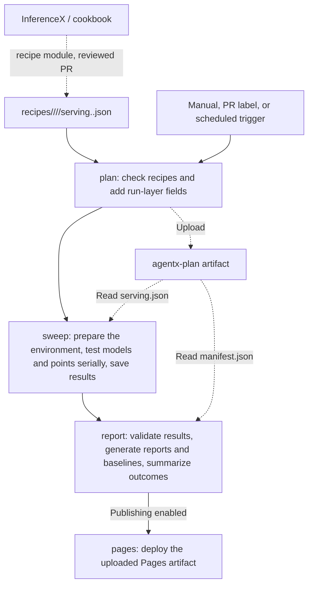

# AgentX CI Guide

[中文](README.zh.md)

This guide covers the AKLR AgentX performance pipeline, GitHub triggers, local CLI, model configuration, and GitHub runner registration.

## 1. GitHub Runner Pipeline

[agentx-ci.yaml](../../.github/workflows/agentx-ci.yaml) contains four jobs:



Solid arrows show job execution order; dashed arrows show artifact uploads and reads. `agentx-plan` is uploaded once and read by both sweep and report. The report job waits for plan and sweep to finish; it can use the plan to report failures even when sweep fails.

After sweep finishes the selected points, the job completes successfully as long as at least one measurement succeeded. When other points fail, its summary says **Partial success**; sweep fails on point results only when every measurement failed. A run's baseline (one model, target and serving framework) is updated only when every point of that run completes a formal measurement successfully and the source tree is clean. Failed, incomplete, dirty, or unknown-source runs do not update the baseline.

### 1.1 Trigger with a GitHub Runner

Open the [AKLR-agentx-ci workflow](https://github.com/AMD-AGI/AKLR/actions/workflows/agentx-ci.yaml), click **Run workflow**, select an AKLR branch, fill in the parameters below, and click **Run workflow** in the form. See section 4 for runner registration and setup.

The form has **6 workflow inputs**, plus GitHub's **Branch / Use workflow from** selector: 7 settings in total. All 6 inputs can be left at their defaults.

| Setting / input | Default | Meaning |
| --- | --- | --- |
| Branch / Use workflow from | Default branch, usually `main` | Select the **AKLR** workflow, source, configuration, and recipe revision |
| `models` | `all` | Enabled model IDs, separated by commas, such as `glm52-fp4`; `all` selects every enabled model |
| `targets` | `all` | Enabled target IDs within the selected models, such as `mi355x`, separated by commas; selected runs execute serially in plan order |
| `frameworks` | `all` | Enabled serving frameworks within the selected targets, `sglang` and/or `vllm`, comma-separated |
| `points` | Empty | Smoke run: recipe `ARM:CONC` points, such as `tp8-ep1-none-spec-mtp:1`, separated by commas; requires exactly one selected model/target/framework run; empty runs every Pareto point in the recipe |
| `duration_s` | Empty | Override each point's measurement duration in seconds; a positive integer such as `60`; empty inherits the recipe duration, currently `3600` seconds for AgentX |
| `publish` | `false`, unchecked | Deploy the report to GitHub Pages when checked; generated result and report artifacts are still uploaded when unchecked |

### 1.2 Trigger with a PR Label

For a PR from a branch in this repository targeting `main`, add **`ci:agentx-mi355x`** under **Labels** on the PR page to trigger AgentX CI.

| Trigger | Model / target scope | Points | Duration per AKLR off/on measurement | Publish Pages |
| --- | --- | --- | --- | --- |
| PR label `ci:agentx-mi355x` | Enabled frameworks of the targets assigned to `agentx-mi355x`, of the models on the PR description's `AgentX:` line | Recipe Pareto points | 600 seconds | No |

Notes:

- Opening a PR, pushing new commits to it, or reopening it triggers a run when it carries this label. A label event starts AgentX tests only when the newly added label is `ci:agentx-mi355x`.
- Pushing new commits while keeping the label triggers a new run and automatically cancels that PR's running or queued AgentX run.
- `ci:agentx-mi355x` is a **GitHub Actions runner label**. PR runs select only the enabled models, targets and frameworks whose target has `runner_label: agentx-mi355x`.
- The `AgentX:` line of the PR description (see the PR template) lists the models the change can affect by their ids in `agentx.yaml`, ignoring case (see `agentx.yaml` for the supported models), separated by commas or spaces, such as `AgentX: glm52-fp4, minimaxm31flash-fp4`; `AgentX: all`, with `all` as the only name, runs every enabled model.
- Unlisted models are skipped. Without the line, or with only the template comment, the run is skipped. Names that are not enabled model ids are skipped too; the plan job still succeeds but adds a warning annotation to the run.
- The plan job reads the PR description when it runs. After editing the `AgentX:` line, re-run the workflow or push a new commit to apply it; editing the description alone does not start a run.

### 1.3 Scheduled Runs

Set the repository variable `AGENTX_SCHEDULE_ENABLED` to `true` to enable the weekly schedule. Scheduled runs use the default branch and its recipe files.

| Trigger | Model / target scope | Points | Duration per AKLR off/on measurement | Publish Pages |
| --- | --- | --- | --- | --- |
| Schedule | All enabled frameworks of the targets assigned to `agentx-mi355x` | Recipe Pareto points | 3600 seconds | Yes |

Week-over-week comparison: each formal run is compared with the latest baseline of the same model, target and framework.

## 2. CLI Commands

### 2.1 Environment and Entry Point

Run the commands in this section from `benchmarks/agentx` in the repository.

```bash
# Start at the repository root
cd benchmarks/agentx
python3 -m pip install pyyaml==6.0.3
python3 -m agentx_bench pipeline --help
```

| Command | Purpose |
| --- | --- |
| `pipeline` | Run one model/target/framework through plan → sweep → report → cleanup |
| `plan` | Load recipe files for one or more model/target/framework runs and generate a manifest for report validation |
| `sweep` | Install the current checkout in Docker and execute a serving plan |
| `report` | Render a single result; with `--plan`, validate the plan, build a site, and manage baselines |

### 2.2 Run the Pipeline

`pipeline` tests one model/target/framework run at a time and requires `--model <id>`. You can omit `--target` when the model has exactly one enabled target, and `--framework` when the target has exactly one enabled framework. The example assumes that pinned model weights are already cached in `/data/hf/hub`; see section 4 for how to prepare them.

```bash
python3 -m agentx_bench pipeline \
  --model glm52-fp4 \
  --target mi355x \
  --framework sglang \
  --hub /data/hf/hub \
  --out /data/agentx/run-001
```

`--out` must be a new directory that does not exist yet. When the run finishes, open `/data/agentx/run-001/site/index.html`.

The pipeline produces this directory structure:

```text
<out>/
├── plan/
│   ├── manifest.json
│   └── models/<model-id>/targets/<target-id>/frameworks/<framework>/serving.json
├── results/models/<model-id>/targets/<target-id>/frameworks/<framework>/
│   ├── install.log
│   ├── prepare_traces.log
│   ├── results.json
│   └── attempts/<attempt-id>/<mode>/points/<exp-name>/
│       ├── server.log
│       ├── client.log
│       └── ...
├── site/
│   ├── index.html
│   ├── manifest.json
│   └── models/<model-id>/targets/<target-id>/frameworks/<framework>/
│       ├── index.html
│       ├── results.json
│       ├── report.json
│       └── baseline-pareto.json
├── work/                  # Temporary runtime and trace caches
└── cache/                 # Temporary build and other caches
```

`<mode>` is `disabled` (AKLR off) or `enabled` (AKLR on). Logs appear only after the corresponding stage has started. The default `work/` and `cache/` directories are removed when the local pipeline finishes. Directories supplied explicitly with `--work` and `--cache` are retained.

Common options:

| Option | Description |
| --- | --- |
| `--config` | Custom YAML path; defaults to `agentx.yaml` in this directory |
| `--model` | Required: exactly one enabled model ID; `all` and comma-separated lists are not accepted |
| `--target` | Exactly one enabled target ID; optional only when the model has one enabled target |
| `--framework` | `sglang` or `vllm`; optional only when the target has one enabled framework |
| `--points` | Smoke filter over the recipe points, as `ARM:CONC,ARM:CONC`; excludes the run from baseline promotion |
| `--duration` | Override DURATION per point in seconds; excludes the run from baseline promotion |
| `--model-path` | Use a model directory visible inside the container; does not add a mount and excludes the run from baseline promotion |
| `--git-dir` | Checkout used to generate AKLR commit history in the report; defaults to this repository |

### 2.3 Run Individual Stages

First, build the plan from the recipe file:

```bash
python3 -m agentx_bench plan \
  --models glm52-fp4 \
  --targets mi355x \
  --frameworks sglang \
  --run-id staged-001 \
  --out /data/agentx/staged-001/plan

python3 -m json.tool /data/agentx/staged-001/plan/manifest.json
```

Once the run's status in the manifest is `resolved`, run it in Docker:

```bash
python3 -m agentx_bench sweep \
  --serving /data/agentx/staged-001/plan/models/glm52-fp4/targets/mi355x/frameworks/sglang/serving.json \
  --hub /data/hf/hub \
  --run-id staged-001 \
  --work /data/agentx/staged-work/sweep-glm52 \
  --cache /data/agentx/staged-cache \
  --out /data/agentx/staged-001/results/models/glm52-fp4/targets/mi355x/frameworks/sglang
```

Finally, generate the index and model reports:

```bash
python3 -m agentx_bench report \
  --plan /data/agentx/staged-001/plan/manifest.json \
  --results /data/agentx/staged-001/results \
  --baseline-dir /data/agentx/run-001/site \
  --out /data/agentx/staged-001/site
```

Omit `--baseline-dir` when no baseline exists yet. `plan --models`, `--targets` and `--frameworks` support the multiple runs used by CI; this local example runs one. The report's `--results` points to the root containing `models/`, while sweep's `--out` points to the specific framework directory. Planning and execution must use the same `--run-id`.

## 3. Configuration

### 3.1 agentx.yaml Fields

The current configuration is:

```yaml
models:
  glm52-fp4:
    enabled: true
    display_name: GLM-5.2 MXFP4
    family: GLM
    precision: mxfp4
    weights:
      repo: amd/GLM-5.2-MXFP4
      revision: 386bd0e4ec821f7b07975701cec3c3b953a5576a
    targets:
      mi355x:
        hardware:
          gpu_name_pattern: '\bMI355X\b'
          gpu_arch: gfx950
          gpu_count: 8
        runner_label: agentx-mi355x
        frameworks:
          sglang:
            recipe_source:
              kind: inferencex
              repo: SemiAnalysisAI/InferenceX
              ref: main
              config_key: glm5.2-fp4-mi355x-sglang-agentic-mtp
              expect:
                config_file: inferencex-e2e/configs/amd-master.yaml
                recipe: inferencex-e2e/benchmarks/single_node/srt-slurm-recipes/glm5.2/sglang/mi355x-fp4-mtp/agentic.yaml
                model: amd/GLM-5.2-MXFP4
                model-prefix: glm5.2
                framework: sglang
                runner_pattern: mi355x
  # glm52-fp8 and minimaxm31flash-fp4 (frameworks.vllm) follow the same shape
report:
  repo_url: https://github.com/AMD-AGI/AKLR
```

| Field | Description |
| --- | --- |
| `models.<id>` | Model identity for CLI selection, directories, and separate baselines; 1–64 lowercase letters, digits, `_`, or `-`, starting with a letter or digit; `all` is reserved |
| `enabled` | Model, target or framework flag, default `true`; disabled entries cannot be selected even by explicit ID |
| `display_name` | Name shown in reports; defaults to the model ID |
| `family` | Required model series; its recipes live in `recipes/<family>/`, such as `GLM` or `MiniMax` |
| `precision` | Required weight precision of the model, such as `mxfp4` |
| `models.<id>.targets.<target-id>` | Hardware target within a model, with the same ID rules as models, for example `mi355x` |
| `models.<id>.targets.<target-id>.frameworks.<framework>` | Serving framework of a target: `sglang` or `vllm`. Each model/target/framework is one run with its own recipe file, directories and baselines |
| Target-level `hardware.gpu_name_pattern` | Regular expression matching GPU names, such as `\bMI355X\b` |
| Target-level `hardware.gpu_arch` | Required GPU architecture, such as `gfx950` |
| Target-level `hardware.gpu_count` | GPU count on the target host; currently configured as `8` |
| Target-level `runner_label` | GitHub runner label used to schedule the target; must match registration's `--label` |
| Framework-level `recipe_source.kind` | Where the recipe module takes this framework's recipe from: `inferencex` or `cookbook`. Set explicitly; switching sources is a reviewed change. `plan` requires the recipe's `source` to match it: the same `kind`; for `inferencex` the same `repo` and `config_key`, with `expect.config_file` and `expect.recipe` listed in `source.files`; for `cookbook` the same `url` |
| Framework-level `recipe_source.*` (other keys) | Source locator read by the recipe module. For `inferencex`: `repo`, `ref` (the resolved commit is recorded in `source.sha`), `config_key` (entry key in the upstream master configuration) and `expect` (`config_file`, `recipe`, `model`, `model-prefix`, `framework`, `runner_pattern`, which must match upstream). For `cookbook`: e.g. `framework` and `url` |
| `weights.repo` | Hugging Face model repository, configured separately for each model |
| `weights.revision` | Pinned weight commit SHA, used for the snapshot path that the server loads; like srtctl, the server gets no `--revision` |
| `advisory_env` | Optional global additional server environment; use string values |
| `models.<id>.advisory_env` | Model-level environment overriding global values. Conflicts with keys already set in the recipe's `launch.env` are rejected; `plan` sets device variables itself |
| `models.<id>.targets.<target-id>.advisory_env` | Target-level environment overriding model and global values; conflicts with the recipe's `launch.env` keys are also rejected |
| `...frameworks.<framework>.advisory_env` | Framework-level environment overriding the levels above. Do not set the AKLR plugin switch here; the executor sets it per mode. The same conflict rule applies |
| `report.repo_url` | Repository URL used for AKLR commit and history links; not the Pages site URL |

Targets and frameworks within a model share its `weights` and `precision`. The server image is defined only by the recipe's `image.run`.

The executor sets the framework's AKLR plugin switch for each mode: `AKLR_SGLANG_PLUGIN` for SGLang and `AKLR_VLLM_PLUGIN` for vLLM, together with `AKLR_DISABLE`.

### 3.2 Add a Model

A model is added in two steps: describe it in `agentx.yaml`, then generate its recipe file.

Add a separate entry under the existing `models:` mapping. Replace the angle-bracket placeholders below with real values before use:

```yaml
  new-model:
    enabled: true
    display_name: New Model
    family: NewFamily
    precision: <weight precision, such as bf16 or mxfp4>
    weights:
      repo: <Hugging Face owner/model>
      revision: <pinned 40-character weight commit SHA>
    targets:
      mi355x:
        hardware:
          gpu_name_pattern: '\bMI355X\b'
          gpu_arch: gfx950
          gpu_count: 8
        runner_label: agentx-mi355x
        frameworks:
          sglang:
            recipe_source:
              # InferenceX source
              kind: inferencex
              repo: SemiAnalysisAI/InferenceX
              ref: main
              config_key: <upstream configuration entry key>
              expect:
                config_file: inferencex-e2e/configs/amd-master.yaml
                recipe: <recipe path relative to the upstream repository root>
                model: <upstream model name>
                model-prefix: <upstream model prefix>
                framework: sglang
                runner_pattern: mi355x
          # Another framework of the same model and target goes beside it, e.g. from a cookbook:
          # vllm:
          #   recipe_source:
          #     kind: cookbook
          #     framework: vllm
          #     url: https://recipes.vllm.ai/<Hugging Face owner/model>.json
```

Then turn the InferenceX or SGLang/vLLM cookbook recipe into one file per enabled framework of the target, `recipes/<family>/<target-id>/<framework>/serving.<model-id>.json`, where `<family>` is the model's `family` in `agentx.yaml` (`GLM`, `MiniMax`, ...) and `<framework>` is `sglang` or `vllm`; every point's `client_env.FRAMEWORK` must equal that framework. The file is updated through a PR and merged after review. Its contract is [recipes/serving.schema.json](recipes/serving.schema.json) (schema 4):

| Field | Written by the recipe module |
| --- | --- |
| `image.run` / `image.recipe` | Execution image pinned by digest / image the recipe was measured with (reference only) |
| `source` | `kind` (`inferencex` or `cookbook`), `repo` or `url`, optional `ref`, `sha`, and any source details such as `config_key` or `files` |
| `client` | `repo` and `sha` of the InferenceX checkout whose AgentX client (load generator and trace loaders) runs every recipe, whatever its source |
| `trace` | Agent trace dataset replayed at every point: `loader`, `repo`, pinned `revision`; before downloading, sweep checks that the pinned client's `loader` resolves to `repo` |
| `points[]` | Only the points on the upstream measured Pareto frontier, all of which plan runs: `arm` (serving scheme name), `conc`, `exp_name`, `served_model_name`, `gpus` (at most `hardware.gpu_count`), `launch.command` / `launch.env`, `client_env` (must include `CONC` equal to `conc`, digit `TOTAL_CPU_DRAM_GB`, and `AIPERF_EXPERIMENTAL_FAST: "0"`), `runtime` (`port`, null for a free port, and positive `ready_timeout_s`, `point_timeout_s`, `poll_s`), optional `recipe_fingerprint` |

## 4. Register a Runner

### 4.1 Run the Registration Script

In the target GitHub repository, open **Settings → Actions → Runners → New self-hosted runner** to obtain a temporary registration token. Pass it through the `RUNNER_TOKEN` environment variable.

```bash
# Run from the repository root; token input is not echoed
read -r -s -p 'Runner registration token: ' RUNNER_TOKEN
echo
export RUNNER_TOKEN

bash scripts/agentx/register_runner.sh \
  --repo AMD-AGI/AKLR \
  --label agentx-mi355x \
  --dir /opt/agentx-runner \
  --name "$(hostname -s)-agentx" \
  --hf-hub-dir /data/hf/hub

unset RUNNER_TOKEN
```

| Option | Default | Purpose |
| --- | --- | --- |
| `--repo` | `AMD-AGI/AKLR` | Target repository; the token must come from this repository |
| `--label` | `agentx-mi355x` | Custom label used by the workflow to schedule jobs |
| `--version` | `2.338.2` | GitHub Actions runner version to download; can be overridden |
| `--dir` | `/opt/agentx-runner` | Runner installation directory |
| `--name` | `<hostname>-agentx` | Runner name displayed on GitHub |
| `--hf-hub-dir` | None | Optional: check that the directory exists and print the next configuration step |

The script downloads the Linux x64 runner, registers it with `config.sh --unattended --replace`, and installs and starts the service with `svc.sh install/start`. `--replace` replaces a runner registration with the same name in the target repository; choose a distinct name for a new host.

### 4.2 Configure Repository Variables and Verify

Set these variables under **Settings → Secrets and variables → Actions → Variables**:

| Repository variable | Required | Value and purpose |
| --- | --- | --- |
| `AGENTX_HF_HUB_DIR` | Yes | Absolute path to the weights hub on the runner, such as `/data/hf/hub` |
| `AGENTX_SCHEDULE_ENABLED` | To enable scheduled runs | Set to the string `true`; controls scheduled triggers only, independently of manual or PR label triggers |
| `AGENTX_PAGES_URL` | For a custom site URL | Root URL for reading the previous site and baselines; defaults to `https://<owner>.github.io/<repo>` |

The selected target's `runner_label` in `agentx.yaml` must match registration's `--label`; both are `agentx-mi355x` in this example.

To publish reports, set the build and deployment source to **GitHub Actions** under **Settings → Pages**. Ensure that the `github-pages` environment allows deployments from the target branch.

Confirm that the runner appears Online / Idle on GitHub, then check the service on the host:

```bash
cd /opt/agentx-runner
sudo ./svc.sh status
```
