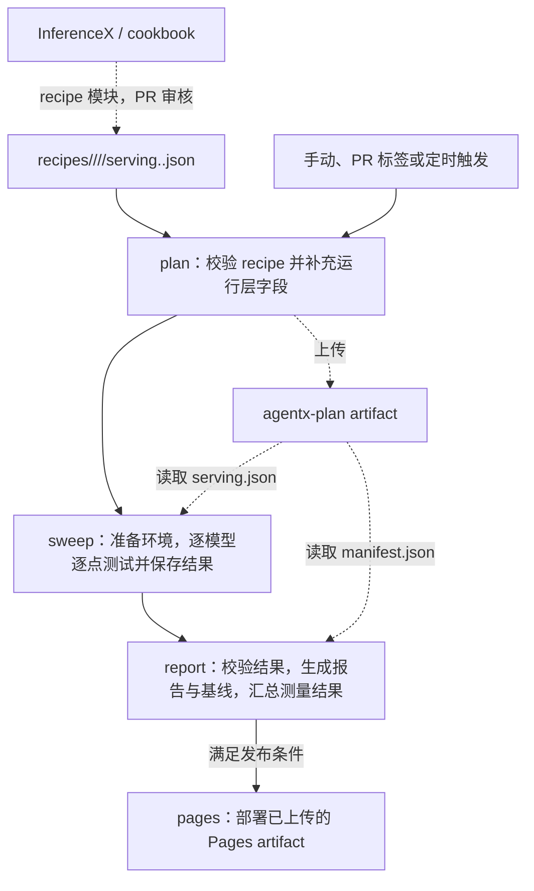

# AgentX CI 使用说明

本文介绍 AKLR 的 AgentX 性能测试流程、GitHub 触发方式、本地 CLI、模型配置和 GitHub runner 注册。

## 1. Github Runner Pipeline 介绍

[agentx-ci.yaml](../../.github/workflows/agentx-ci.yaml) 包含四个 job：



实线表示 job 的执行顺序；虚线表示 artifact 的上传或读取。`agentx-plan` 只上传一次，分别供 sweep 和 report 读取。report 等待 plan 和 sweep 结束后运行；sweep 失败时仍可依据计划生成失败报告。

sweep 遍历完所选数据点后，只要至少一次测量成功，job 就正常结束。有其他点失败时，摘要显示**部分成功**，全部测量失败时 sweep 才因测点结果报失败。一次运行（一个模型、target 与服务框架）的所有点成功完成正式测量且源码为干净状态，才会更新该运行的基线。失败、部分完成、dirty 或源码状态未知的运行不会更新基线。

### 1.1 使用 Github runner 触发

打开 [AKLR-agentx-ci workflow](https://github.com/AMD-AGI/AKLR/actions/workflows/agentx-ci.yaml)，点击 **Run workflow**，选择 AKLR 分支、填写下面的参数，再点击表单中的 **Run workflow**。runner 的注册与准备见第 4 节。

表单共有 **6 个 workflow 输入项**，另有 GitHub 提供的 **Branch / Use workflow from** 选择器，合计 7 项设置；6 个输入项均可保留默认值。

| 页面设置 / 输入名 | 默认值 | 含义 |
| --- | --- | --- |
| Branch / Use workflow from | 默认分支，通常为 `main` | 选择本次使用的 **AKLR** workflow、源码、配置和 recipe 版本 |
| `models` | `all` | 选择已启用的模型 ID；多个用英文逗号分隔，例如 `glm52-fp4`；`all` 选择全部已启用模型 |
| `targets` | `all` | 在所选模型中选择已启用的 target ID，例如 `mi355x`；多个用英文逗号分隔，所选运行按计划顺序串行执行 |
| `frameworks` | `all` | 在所选 target 中选择已启用的服务框架：`sglang`、`vllm`，多个用英文逗号分隔 |
| `points` | 留空 | 单点冒烟：从 recipe 的点中选择 `ARM:CONC`，例如 `tp8-ep1-none-spec-mtp:1`；多个用英文逗号分隔；要求只选中一个模型/target/框架运行；留空跑 recipe 中的全部 Pareto 点 |
| `duration_s` | 留空 | 覆盖每个点的测量时长，单位秒，必须为正整数，例如 `60`；留空继承 recipe 中的时长，当前 AgentX 默认 `3600` 秒 |
| `publish` | `false`，不勾选 | 勾选后将报告部署到 GitHub Pages；不勾选仍会上传已生成的结果与报告 artifacts |

### 1.2 通过 PR 标签触发

对于本仓库内分支发起、目标分支为 `main` 的 PR，在 PR 页面的 **Labels** 中添加 **`ci:agentx-mi355x`** 即可触发 AgentX CI。

| 触发方式 | 模型 / target 范围 | 测量点 | AKLR off/on 每次测量时长 | 发布 Pages |
| --- | --- | --- | --- | --- |
| PR 标签 `ci:agentx-mi355x` | PR 描述 `AgentX:` 行所列模型中，绑定 `agentx-mi355x` 的 target 下已启用的框架 | recipe 中的 Pareto 点 | 600 秒 | 否 |

注意：
- PR 创建、更新提交、重新打开时，如果保留该标签，就会触发运行。添加标签时，只有新增的标签正是 `ci:agentx-mi355x` 才会启动 AgentX 测试。
- 保留标签后推送新提交会触发新的 run，该 PR 正在运行或排队的 AgentX run 会被自动取消。
- `ci:agentx-mi355x` 是 **GitHub Actions runner 标签**。PR 运行只选择 target 配置为 `runner_label: agentx-mi355x` 的已启用模型、target 和框架。
- PR 描述中的 `AgentX:` 行（见 PR 模板）用 `agentx.yaml` 中的模型 id（不区分大小写，已经支持的模型见 agentx.yaml） 列出改动可能影响的模型，以逗号或空格分隔，例如 `AgentX: glm52-fp4, minimaxm31flash-fp4`，只写 `AgentX: all`（`all` 是唯一的名字）则运行全部已启用模型。
- 未列出的模型会被跳过。没有这一行，或只保留模板注释时，跳过本次运行。不是已启用模型 id 的名字也会被跳过；plan job 仍然成功，但会在运行页面上添加 warning 注释。
- plan job 在运行时读取 PR 描述。修改 `AgentX:` 行后，需要 re-run workflow 或推送新提交才会生效；仅编辑描述不会触发运行。

### 1.3 定时运行

将仓库变量 `AGENTX_SCHEDULE_ENABLED` 设为 `true`，即可启用每周定时运行。定时使用默认分支及其 recipe 文件。

| 触发方式 | 模型 / target 范围 | 测量点 | AKLR off/on 每次测量时长 | 发布 Pages |
| --- | --- | --- | --- | --- |
| 定时 | 全部绑定 `agentx-mi355x` 的 target 下已启用的框架 | recipe 中的 Pareto 点 | 3600 秒 | 是 |

周环比：每次正式运行都与同一模型、target、框架最近的基线比较。

## 2. CLI 命令介绍

### 2.1 准备环境与命令入口

本节命令在仓库的 `benchmarks/agentx` 执行。

```bash
# 从仓库根目录开始
cd benchmarks/agentx
python3 -m pip install pyyaml==6.0.3
python3 -m agentx_bench pipeline --help
```

| 子命令 | 用途 |
| --- | --- |
| `pipeline` | 单个模型/target/框架一键 plan → sweep → report → 清理 |
| `plan` | 读取一个或多个模型/target/框架运行的 recipe 文件，生成可供 report 校验的 manifest |
| `sweep` | 在 Docker 中安装当前 checkout 并执行 serving 计划 |
| `report` | 渲染单个结果；加 `--plan` 时校验计划、生成站点并管理基线 |

### 2.2 使用 pipeline 一键测试

`pipeline` 每次只测试一个模型/target/框架运行，必须使用 `--model <id>`；模型只有一个已启用 target 时可省略 `--target`，target 只有一个已启用框架时可省略 `--framework`。以下示例假定固定版本权重已经放在 `/data/hf/hub`；准备方式见第 4 节。

```bash
python3 -m agentx_bench pipeline \
  --model glm52-fp4 \
  --target mi355x \
  --framework sglang \
  --hub /data/hf/hub \
  --out /data/agentx/run-001
```

`--out` 必须是尚不存在的新目录。完成后打开 `/data/agentx/run-001/site/index.html`。

`pipeline` 输出目录结构如下。

```text
<out>/
├── plan/
│   ├── manifest.json
│   └── models/<model-id>/targets/<target-id>/frameworks/<framework>/serving.json
├── results/models/<model-id>/targets/<target-id>/frameworks/<framework>/
│   ├── install.log
│   ├── prepare_traces.log
│   ├── results.json
│   └── attempts/<attempt-id>/<mode>/points/<exp-name>/
│       ├── server.log
│       ├── client.log
│       └── ...
├── site/
│   ├── index.html
│   ├── manifest.json
│   └── models/<model-id>/targets/<target-id>/frameworks/<framework>/
│       ├── index.html
│       ├── results.json
│       ├── report.json
│       └── baseline-pareto.json
├── work/                  # 默认临时运行时与 trace 缓存
└── cache/                 # 默认临时编译等缓存
```

`<mode>` 为 `disabled`（AKLR off）或 `enabled`（AKLR on）。日志只在执行到相应阶段后出现。默认 `work/`、`cache/` 在本地 pipeline 结束后清理；显式传入 `--work`、`--cache` 的目录保留。

常用参数：

| 参数 | 说明 |
| --- | --- |
| `--config` | 自定义 YAML 路径；默认使用本目录的 `agentx.yaml` |
| `--model` | 必填，恰好一个已启用模型 ID；不接受 `all` 或逗号分隔列表 |
| `--target` | 恰好一个已启用 target ID；仅当模型只有一个已启用 target 时可省略 |
| `--framework` | `sglang` 或 `vllm`；仅当 target 只有一个已启用框架时可省略 |
| `--points` | 在 recipe 的点中做 smoke 过滤，格式为 `ARM:CONC,ARM:CONC`；设定后不晋升正式基线 |
| `--duration` | 每点 DURATION 覆盖，单位秒；设定后不晋升正式基线 |
| `--model-path` | 使用容器内可见的本地模型目录；不会自动新增挂载，且不晋升正式基线 |
| `--git-dir` | 生成报告中 AKLR 提交历史所用的 checkout；默认本仓库 |

### 2.3 分阶段测试

先根据 recipe 文件生成计划：

```bash
python3 -m agentx_bench plan \
  --models glm52-fp4 \
  --targets mi355x \
  --frameworks sglang \
  --run-id staged-001 \
  --out /data/agentx/staged-001/plan

python3 -m json.tool /data/agentx/staged-001/plan/manifest.json
```

确认 manifest 中该运行的状态为 `resolved` 后，在 Docker 中运行它：

```bash
python3 -m agentx_bench sweep \
  --serving /data/agentx/staged-001/plan/models/glm52-fp4/targets/mi355x/frameworks/sglang/serving.json \
  --hub /data/hf/hub \
  --run-id staged-001 \
  --work /data/agentx/staged-work/sweep-glm52 \
  --cache /data/agentx/staged-cache \
  --out /data/agentx/staged-001/results/models/glm52-fp4/targets/mi355x/frameworks/sglang
```

最后生成总览与模型报告：

```bash
python3 -m agentx_bench report \
  --plan /data/agentx/staged-001/plan/manifest.json \
  --results /data/agentx/staged-001/results \
  --baseline-dir /data/agentx/run-001/site \
  --out /data/agentx/staged-001/site
```

首次没有基线时省略 `--baseline-dir`。`plan` 可通过 `--models`、`--targets` 和 `--frameworks` 生成 CI 所需的多运行计划；本地分阶段示例只运行一个。`--results` 指向包含 `models/` 的根目录，sweep 的 `--out` 则指向具体框架目录。plan 与执行必须使用同一 `--run-id`。

## 3. 配置介绍

### 3.1 agentx.yaml 字段说明

当前配置如下：

```yaml
models:
  glm52-fp4:
    enabled: true
    display_name: GLM-5.2 MXFP4
    family: GLM
    precision: mxfp4
    weights:
      repo: amd/GLM-5.2-MXFP4
      revision: 386bd0e4ec821f7b07975701cec3c3b953a5576a
    targets:
      mi355x:
        hardware:
          gpu_name_pattern: '\bMI355X\b'
          gpu_arch: gfx950
          gpu_count: 8
        runner_label: agentx-mi355x
        frameworks:
          sglang:
            recipe_source:
              kind: inferencex
              repo: SemiAnalysisAI/InferenceX
              ref: main
              config_key: glm5.2-fp4-mi355x-sglang-agentic-mtp
              expect:
                config_file: inferencex-e2e/configs/amd-master.yaml
                recipe: inferencex-e2e/benchmarks/single_node/srt-slurm-recipes/glm5.2/sglang/mi355x-fp4-mtp/agentic.yaml
                model: amd/GLM-5.2-MXFP4
                model-prefix: glm5.2
                framework: sglang
                runner_pattern: mi355x
  # glm52-fp8 与 minimaxm31flash-fp4（frameworks.vllm）结构相同
report:
  repo_url: https://github.com/AMD-AGI/AKLR
```

| 字段 | 说明 |
| --- | --- |
| `models.<id>` | 模型独立标识，用于 CLI、目录与基线隔离；1–64 位小写字母、数字、`_`、`-`，首位须为字母或数字，`all` 保留 |
| `enabled` | 模型、target 或框架是否启用，布尔值，省略时为 `true`；禁用项不能通过显式 ID 选择 |
| `display_name` | 报告展示名，省略时使用模型 ID |
| `family` | 必填，模型系列，其 recipe 存放在 `recipes/<family>/` 下，例如 `GLM`、`MiniMax` |
| `precision` | 必填，模型权重精度，例如 `mxfp4` |
| `models.<id>.targets.<target-id>` | 模型下的硬件目标，ID 规则与模型相同，例如 `mi355x` |
| `models.<id>.targets.<target-id>.frameworks.<framework>` | target 下的服务框架：`sglang` 或 `vllm`。每个模型/target/框架是一次独立运行，使用独立的 recipe 文件、目录与基线 |
| `hardware.gpu_name_pattern`（target 内） | 匹配 GPU 名称的正则表达式，例如 `\bMI355X\b` |
| `hardware.gpu_arch`（target 内） | 要求的 GPU 架构，例如 `gfx950` |
| `hardware.gpu_count`（target 内） | 目标主机的 GPU 数量；当前配置为 `8` |
| `runner_label`（target 内） | GitHub 调度该 target 使用的 runner 标签，需与注册时的 `--label` 一致 |
| `recipe_source.kind`（框架内） | recipe 模块从哪里取该框架的 recipe：`inferencex` 或 `cookbook`。显式填写，切换来源需经审核。`plan` 要求 recipe 的 `source` 与之一致：`kind` 相同；`inferencex` 还要求 `repo`、`config_key` 相同，且 `source.files` 包含 `expect.config_file` 和 `expect.recipe`；`cookbook` 要求 `url` 相同 |
| `recipe_source.*`（框架内其余键） | 供 recipe 模块读取的来源定位信息。`inferencex`：`repo`、`ref`（解析出的 commit 记录在 `source.sha`）、`config_key`（上游 master 配置中的条目键）、`expect`（`config_file`、`recipe`、`model`、`model-prefix`、`framework`、`runner_pattern`，须与上游一致）；`cookbook`：例如 `framework`、`url` |
| `weights.repo` | Hugging Face 模型仓库，每个模型独立设置 |
| `weights.revision` | 固定的权重 commit SHA；服务从该 snapshot 路径加载；与 srtctl 一致，不传 `--revision` |
| `advisory_env` | 可选，全局服务器补充环境变量，值建议写成字符串 |
| `models.<id>.advisory_env` | 模型级补充环境，覆盖同名全局值。若与 recipe 文件 `launch.env` 中已设置的变量同名，会报冲突；设备变量由 `plan` 生成 |
| `models.<id>.targets.<target-id>.advisory_env` | target 级补充环境，覆盖同名模型级和全局值；同样不允许与 recipe 文件 `launch.env` 冲突 |
| `...frameworks.<framework>.advisory_env` | 框架级补充环境，覆盖以上各级同名值。不要在这里设置 AKLR plugin 开关，执行器会按模式设置。冲突规则相同 |
| `report.repo_url` | 报告中 AKLR commit 与历史链接的仓库 URL；不是 Pages 站点地址 |

`weights` 和 `precision` 由同一模型的各个 target 和框架共享。服务镜像只由 recipe 的 `image.run` 决定。

执行器在两种模式下设置对应框架的 AKLR plugin 开关：SGLang 为 `AKLR_SGLANG_PLUGIN`，vLLM 为 `AKLR_VLLM_PLUGIN`，同时设置 `AKLR_DISABLE`。

### 3.2 新增模型

新增模型分两步：先在 `agentx.yaml` 中描述模型，再生成 recipe 文件。

在已有 `models:` 下加入一个独立节点。下面是模板，尖括号内容必须替换为真实值，不能直接执行：

```yaml
  new-model:
    enabled: true
    display_name: New Model
    family: NewFamily
    precision: <权重精度，例如 bf16 或 mxfp4>
    weights:
      repo: <Hugging Face 模型仓库 owner/model>
      revision: <固定的 40 位权重 commit SHA>
    targets:
      mi355x:
        hardware:
          gpu_name_pattern: '\bMI355X\b'
          gpu_arch: gfx950
          gpu_count: 8
        runner_label: agentx-mi355x
        frameworks:
          sglang:
            recipe_source:
              # InferenceX 来源
              kind: inferencex
              repo: SemiAnalysisAI/InferenceX
              ref: main
              config_key: <上游配置条目键>
              expect:
                config_file: inferencex-e2e/configs/amd-master.yaml
                recipe: <相对上游仓库根目录的 recipe 路径>
                model: <上游模型名称>
                model-prefix: <上游模型前缀>
                framework: sglang
                runner_pattern: mi355x
          # 同一模型与 target 的其他框架并列添加，例如 cookbook 来源：
          # vllm:
          #   recipe_source:
          #     kind: cookbook
          #     framework: vllm
          #     url: https://recipes.vllm.ai/<Hugging Face owner/model>.json
```

然后将 InferenceX 或 SGLang/vLLM cookbook 的 recipe 转成 target 下每个已启用框架一份的 `recipes/<family>/<target-id>/<framework>/serving.<model-id>.json`，其中 `<family>` 是模型在 `agentx.yaml` 中的 `family`（`GLM`、`MiniMax` 等），`<framework>` 为 `sglang` 或 `vllm`，每个点的 `client_env.FRAMEWORK` 必须与之一致。文件通过 PR 更新，经审核后入库。约定见 [recipes/serving.schema.json](recipes/serving.schema.json)（schema 4）：

| 字段 | 由 recipe 填写 |
| --- | --- |
| `image.run` / `image.recipe` | 固定 digest 的执行镜像 / recipe 上游测量用的镜像（仅供参考） |
| `source` | `kind`（`inferencex` 或 `cookbook`）、`repo` 或 `url`，可选 `ref`、`sha`，以及 `config_key`、`files` 等来源细节 |
| `client` | InferenceX 仓库的 `repo` 与 `sha`；无论 recipe 来自哪里，都用其中的 AgentX 客户端（压测与 trace 加载）按 InferenceX 的方法压测 |
| `trace` | 每个点回放的 agent trace 数据集：`loader`、`repo`、固定的 `revision`；sweep 下载前会确认固定版本客户端中的 `loader` 解析到的正是 `repo` |
| `points[]` | 只包含上游实测 Pareto 前沿上的点，plan 会全部运行：`arm`、`conc`、`exp_name`、`served_model_name`、`gpus`（不超过 `hardware.gpu_count`）、`launch.command` / `launch.env`、`client_env`（必须包含与 `conc` 相同的 `CONC`、纯数字的 `TOTAL_CPU_DRAM_GB`，以及 `AIPERF_EXPERIMENTAL_FAST: "0"`）、`runtime`（`port`，填 null 表示自动选空闲端口；以及正数的 `ready_timeout_s`、`point_timeout_s`、`poll_s`），可选 `recipe_fingerprint` |

## 4. 注册 runner

### 4.1 执行注册脚本

在目标 GitHub 仓库进入 **Settings → Actions → Runners → New self-hosted runner**，获取临时 registration token。它通过 `RUNNER_TOKEN` 环境变量传入。

```bash
# 从仓库根目录执行；交互输入不会显示 token
read -r -s -p 'Runner registration token: ' RUNNER_TOKEN
echo
export RUNNER_TOKEN

bash scripts/agentx/register_runner.sh \
  --repo AMD-AGI/AKLR \
  --label agentx-mi355x \
  --dir /opt/agentx-runner \
  --name "$(hostname -s)-agentx" \
  --hf-hub-dir /data/hf/hub

unset RUNNER_TOKEN
```

| 参数 | 默认值 | 作用 |
| --- | --- | --- |
| `--repo` | `AMD-AGI/AKLR` | 注册到哪个仓库；token 必须来自该仓库 |
| `--label` | `agentx-mi355x` | workflow 用来调度的自定义标签 |
| `--version` | `2.338.2` | 下载的 GitHub Actions runner 版本，可显式覆盖 |
| `--dir` | `/opt/agentx-runner` | runner 安装目录 |
| `--name` | `<hostname>-agentx` | GitHub 上显示的 runner 名称 |
| `--hf-hub-dir` | 无 | 可选：检查目录存在并打印后续变量设置提示 |

脚本会下载 Linux x64 runner、调用 `config.sh --unattended --replace` 注册，然后使用 `svc.sh install/start` 安装并启动服务。`--replace` 会替换目标仓库中同名 runner 的注册，给新主机选择独立名称。

### 4.2 设置仓库变量并验证

在 **Settings → Secrets and variables → Actions → Variables** 设置：

| 仓库变量 | 是否需要 | 值与用途 |
| --- | --- | --- |
| `AGENTX_HF_HUB_DIR` | 必填 | runner 上权重 hub 的绝对路径，例如 `/data/hf/hub` |
| `AGENTX_SCHEDULE_ENABLED` | 启用定时时填写 | 字符串 `true`；只控制定时触发，不影响手动或 PR 标签触发 |
| `AGENTX_PAGES_URL` | 自定义站点地址时填写 | 读取历史站点和基线的根 URL；默认 `https://<owner>.github.io/<repo>` |

所选 target 在 `agentx.yaml` 中的 `runner_label` 必须与注册时的 `--label` 一致；本例均为 `agentx-mi355x`。

需要发布报告时，在 **Settings → Pages** 将构建与部署来源设为 **GitHub Actions**，并确认 `github-pages` environment 的部署规则允许目标分支。

确认 runner 在 GitHub 页面显示 Online / Idle，并在主机检查服务：

```bash
cd /opt/agentx-runner
sudo ./svc.sh status
```
