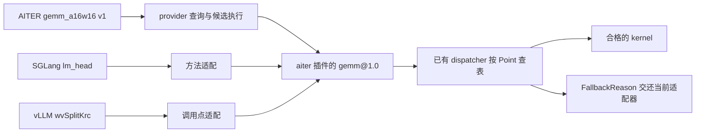

# AKLR 插件详细设计

第 3.1 节的 **`Plugin` 公共接口已定稿**。算子定义和三种宿主接入都在实例上登记，kernel 实现以族内 `impls/` JSON 发布。上游通过各自的 entry point 加载 provider 或安装 hook。本文覆盖 `aklr/plugins/{aiter,sglang,vllm}` 和整个 `aklr/ops/` 的迁移，实施与运行时验收列在第 6–7 节。资产清单固定在基线 `766a200e367f`。[需求与逐族清单](aiter_refactor_requirements.zh.md)

**当前实现以《AKLR Plugin 目录与 AITER 接口》为准。** 各族现已合并到 `plugin.py`。AITER 的公开调用使用上游函数，已接入 21 个 provider ABI。下文关于分文件声明、28 个直调函数和 20 条 ABI 的文字与第 8 节的 wheel、GPU 数据均记录第一轮设计及验证。最新目录、逐项 ABI 对照和暂缓处理的算子见[当前设计](plugin_layout.zh.md)。

## 1. origin/main 上的两条跨插件调用链

### 1.1 为什么 SGLang 要告诉 AITER 本次是 target verify

这条优化服务于 SGLang 的 DSA 索引器。开启 decode context parallelism（DCP）后，索引器把 verify 的查询展平成多行，每行携带该请求的 block table。假设有 6 行，它们既可能属于 6 个普通 decode 请求，也可能属于 2 个请求、每个请求验证 3 行。AITER 的 `fp8_paged_mqa_logits` 收到的张量形状可以相同，只有 SGLang 的 `forward_batch.forward_mode` 能说明行的归属。这个信息让 AKLR 有机会按请求合并打分。没有提示时仍可使用普通逐行路径。

| 环节 | 盘点基线上的行为 | 固定提交的源码 |
|---|---|---|
| 写入 | `Indexer._get_topk_paged` 的 hook 仅声明支持 `0.5.24.dev809`。当 `is_target_verify()`、`attn_dcp_size > 1` 且配置了 draft tokens 时，写入 `(rows, draft_tokens)`。其他批次用 0 清除。返回 `OUT_OF_CONTRACT` 让 SGLang 继续执行原 top-k | [SGLang 写入点](https://github.com/AMD-AGI/AKLR/blob/766a200e367fac608a91db74b22e67fbf140397e/aklr/plugins/sglang/layers/dsa_backend/api.py#L55-L75) |
| 读取 | `note_target_verify` 把提示存在进程级单元素列表中。provider 检查行数、可整除性和布局，尝试 `fp8_paged_mqa_logits_verify.serving(...)`，命中则按请求分组写回原 logits。否则继续询问逐行契约 | [提示与分组](https://github.com/AMD-AGI/AKLR/blob/766a200e367fac608a91db74b22e67fbf140397e/aklr/plugins/aiter/provider/mla.py#L349-L395) · [两个契约的选择顺序](https://github.com/AMD-AGI/AKLR/blob/766a200e367fac608a91db74b22e67fbf140397e/aklr/plugins/aiter/provider/mla.py#L454-L487) |
| 生命周期 | `select` 只读，AKLR 的 logits 执行函数会清除提示。测试覆盖 verify、普通 decode、无 DCP、仅询问和 verify 未命中后走逐行契约 | [SGLang 用例](https://github.com/AMD-AGI/AKLR/blob/766a200e367fac608a91db74b22e67fbf140397e/tests/plugins/sglang/test_dsa_verify_logits.py#L44-L57) · [provider 用例](https://github.com/AMD-AGI/AKLR/blob/766a200e367fac608a91db74b22e67fbf140397e/tests/plugins/aiter/test_provider_mla.py#L656-L710) |

上一版的 `with provider.target_verify(...)` 是设计提案。主线只有 `note_target_verify(rows, draft_tokens)`。本设计把这项协作放在 SGLang DSA 和 AITER MLA 的私有适配里。当前 `stack.json` 的 SGLang 镜像为 `0.5.23`，不会安装这个版本限定为 `0.5.24.dev809` 的 hook。发布验收分别覆盖这两个版本。[锁定栈](../stack.json)

### 1.2 declining() 到底抑制哪一次调用

SGLang 的 chunked-prefix MLA prefill 需要同时得到 attention 输出和 LSE。它优先尝试 AKLR 的 `mla_prefill_varlen_lse`。当这条路放弃，或处于此路径不支持的图捕获中，SGLang 调用 AITER 的 BF16 `flash_attn_varlen_func(..., return_lse=True)`。这个函数本身也受 AITER provider 路由。如果再让 AKLR 接管，它可能把这次 BF16 回退重新映射到 `qkv_fp8=True` 的契约。这里需要保住的是框架已经选好的精度和执行路径。[框架决策](https://github.com/AMD-AGI/AKLR/blob/766a200e367fac608a91db74b22e67fbf140397e/aklr/plugins/sglang/layers/aiter_backend_mla_prefill.py#L132-L155) · [AITER 到 FP8 的映射](https://github.com/AMD-AGI/AKLR/blob/766a200e367fac608a91db74b22e67fbf140397e/aklr/plugins/aiter/provider/mla_prefill.py#L151-L165)

当前 `with declining():` 只包住这次 BF16 调用。进入时保存并设置线程局部标志，这个线程上的 AKLR provider 在作用域内直接返回 `None`，退出时通过 `finally` 恢复原值，嵌套及异常均可恢复。其他线程和其他 provider 继续按各自配置运行。如果没有其他 provider 获选，AITER 执行原生实现。普通未命中直接返回 `None` 或 `FallbackReason` 就足够了。保留已有 `aklr.plugins.aiter.provider.declining()` 导入及语义，避免为每种插件增加一个抑制开关。[调用位置](https://github.com/AMD-AGI/AKLR/blob/766a200e367fac608a91db74b22e67fbf140397e/aklr/plugins/sglang/layers/aiter_backend_mla_prefill.py#L50-L71) · [线程局部实现](https://github.com/AMD-AGI/AKLR/blob/766a200e367fac608a91db74b22e67fbf140397e/aklr/plugins/aiter/provider/_base.py#L83-L97) · [provider 入口](https://github.com/AMD-AGI/AKLR/blob/766a200e367fac608a91db74b22e67fbf140397e/aklr/plugins/aiter/provider/__init__.py#L40-L46) · [BF16 回退用例](https://github.com/AMD-AGI/AKLR/blob/766a200e367fac608a91db74b22e67fbf140397e/tests/plugins/sglang/test_aiter_backend_mla_prefill.py#L120-L129)

## 2. Plugin 的职责和身份

插件的所有权边界是 `aklr/plugins/<name>/` 这个包。`Plugin(name)` 确定声明的命名空间，实例拥有声明、检查冲突并发布只读结果。宿主入口消费实例上的接入声明，契约发现按族读取实例上的 `contracts`。例如 `aiter` 是 AKLR 的命名空间，`aklr` 是 AITER 发现的 provider 名。这样算子发现与宿主启动能够独立进行。[宿主入口](../pyproject.toml) · [AKLR 契约发现](../aklr/core/contract/registry.py)

### 2.1 PyTorch 的 FRAGMENT 允许拆开声明同一命名空间

PyTorch 对同一命名空间只允许一个存活的 `DEF` 注册块。`FRAGMENT` 是可重复创建的注册块种类，对应 C++ 的 `TORCH_LIBRARY_FRAGMENT`。同一命名空间可以有一个 `DEF` 加多个 `FRAGMENT`，也可以直接由多个 `FRAGMENT` 贡献。不同文件能各自定义算子，名称仍然是 `namespace::op`。同一算子同一 overload 的 schema 只能定义一次。kernel 由 `impl` 关联到算子和 dispatch key，创建片段本身不会改变调用时选哪个 kernel。[PyTorch 的注册种类](https://github.com/pytorch/pytorch/blob/7269437d655783a26cba32aa88195b741ff496aa/torch/library.py#L67-L105) · [define](https://github.com/pytorch/pytorch/blob/7269437d655783a26cba32aa88195b741ff496aa/torch/library.py#L127-L173) · [impl 的重复检查](https://github.com/pytorch/pytorch/blob/7269437d655783a26cba32aa88195b741ff496aa/torch/library.py#L283-L340)

```python
import torch

# 两个模块可以分别持有这两个注册对象。
defs = torch.library.Library("aklr_docs_demo", "DEF")
defs.define("negate(Tensor x) -> Tensor")
fragment = torch.library.Library("aklr_docs_demo", "FRAGMENT")
fragment.define("square(Tensor x) -> Tensor")

cpu = torch.library.Library("aklr_docs_demo", "IMPL", "CPU")
cpu.impl("square", torch.square)
assert torch.ops.aklr_docs_demo.square(torch.tensor(3)).item() == 9
```

两次 `define` 都直接向同一个 PyTorch dispatcher 登记。示例保留 `defs`、`fragment`、`cpu` 的引用，每个注册对象的生命周期覆盖它贡献的注册项。[注册对象的生命周期](https://github.com/pytorch/pytorch/blob/7269437d655783a26cba32aa88195b741ff496aa/torch/library.py#L101-L122)

AKLR 借用按命名空间分文件贡献的能力。例如 RMSNorm 和 GEMM 各提供一个普通的 `declare(plugin)` 函数，调用传入实例的登记方法。`plugin.build(*declarations)` 组合本次需要的声明。一个族可以独立加载，跨族重复的契约 ID 仍由仓库的 `ContractRegistry` 拒绝。

| 结构 | AKLR 的对应物 | 身份与边界 |
|---|---|---|
| namespace | 插件包名 | 表示资产所有权。历史记录继续使用原有全局 `contract_id` |
| DEF / define | `plugin.define(contract)` | 定义一个 `OpContract`。参数、输出、可变性、布局和误差都在契约中声明。全仓每个契约 ID 只有一个定义 |
| IMPL / impl | 族内的 `impls/<language>/<scenario>/<uuid>.json` | JSON 的 `contract_id` 指向定义。加载器校验资产，dispatcher 对有源码的实现建立分派表。一个实现可覆盖多个 Point，同一 Point 可有多个实现 |
| FRAGMENT | 普通 Python 函数 `declare(plugin)` | 族和模型模块可以贡献契约或宿主接入。登记的所有者始终是传入的 `Plugin` 实例 |
| 按调用分派 | 既有 AKLR dispatcher | `@family.op` 将函数签名绑定到族内契约。设备目标和工具链决定可加载范围，Point、资格与实测结果决定运行哪个 kernel |

### 2.2 AKLR 的宿主接入以调用权为边界

| 谁持有调用 | 插件作者声明什么 | 谁决定下一步 |
|---|---|---|
| AITER 持有一个有版本的 op | `plugin.provide` 登记此 op/ABI 的候选查询函数 | AITER 可以只询问、选择其他 provider 或走原生路径。只有选中 AKLR 才调用候选的 `run` |
| SGLang 调用模型方法或模块函数 | `plugin.wrap` 登记目标、release 和处理整个原调用的方式 | 普通适配返回结果或 `FallbackReason`。安装的 AROUND 包装器在放弃时调用原函数一次。DSA 观察 hook 包住原调用的动态作用域 |
| vLLM 的 caller 在运行时查找 callee | `plugin.intercept` 登记 caller、显式 callee、release 和安装组 | worker 在设备就绪后安装。每个包装器决定返回结果或继续原调用，复合适配还可取得安装前保存的 callable |

SGLang 的 lm_head 与 vLLM 的 skinny GEMM 在主线上已经共用同一个 `gemm`。迁移时，两个适配函数只需切换导入路径，各自保留参数转换和回退。另一个方向也成立，AITER 的一个 `per_group_quant` 入口可以按 scale 布局选择两个不同的 AKLR 契约。路由因此关联到一个能处理宿主调用的函数，实际契约由函数按实参决定。[SGLang lm_head](../aklr/plugins/sglang/layers/logits_processor_torch_gemm.py) · [vLLM skinny GEMM](../aklr/plugins/vllm/layers/skinny_gemm.py) · [AITER 的两种量化布局](https://github.com/AMD-AGI/AKLR/blob/766a200e367fac608a91db74b22e67fbf140397e/aklr/plugins/aiter/provider/quant.py)



现有插件手册用 **Entry and hooking、Routes、Ops** 描述一次框架调用。三层沿用这个划分。`Plugin` 在加载时提供声明，热路径从相应 entry point 或具名算子进入。[主线插件架构与路由规则](../aklr/plugins/README.md)

| 执行层 | 输入 → 产出 | 事务 |
|---|---|---|
| 1. 宿主接入（Entry and hooking） | entry point、版本、worker 状态 → provider 或已安装的 hook | 启用、设备就绪、安装和宿主的继续执行协议 |
| 2. 调用适配（Routes） | 宿主实参 → 具名算子调用 → 宿主结果或放弃 | 判断框架语义、转换参数、还原返回值及 out/state。准备输入昂贵时先问算子的 `.fallback_reason(...)` 或 `.serving(...)`。AITER 在此区分查询与执行 |
| 3. 算子分派（Ops） | 契约、Point 和合格实现 → 输出或回退原因 | 复用现有契约、reference、baseline、builder 与 dispatcher，由算子判断形状、dtype、设备和 Point 资格。直接调用 AKLR 从此层进入 |

## 3. Plugin 作者接口、目录和加载

### 3.1 Plugin 实例的公共接口（定稿）

`aklr.core.plugin` 定义三个宿主共用的 `Plugin` 类，插件作者通过 `from aklr.plugins import Plugin` 导入同一个类。公共面包括构造函数、两个只读属性、组装方法 `build`、算子入口装饰器 `op` 和四个登记方法。下列签名采用 Python 3.11 的 `.pyi` 记法，两个 `wrap` 重载描述同一个实例方法。`KernelCandidate` 是上游类型，运行时导入 `Plugin` 只需要 AKLR 的基础依赖。

```python
from __future__ import annotations

from collections.abc import Callable, Mapping
from typing import TYPE_CHECKING, Concatenate, Self, overload

from aklr.core.contract.op import OpContract

if TYPE_CHECKING:
    from aiter.plugin import KernelCandidate

_Callback = Callable[..., object]

class Plugin:
    def __init__(self, name: str) -> None: ...

    @property
    def name(self) -> str: ...

    @property
    def contracts(self) -> tuple[OpContract, ...]: ...

    def build(self, *declarations: Callable[[Plugin], None]) -> Self: ...
    def define(self, contract: OpContract) -> None: ...
    def op(self, fn: _Callback) -> _Callback: ...
    def provide(
        self, op: str, *, version: int,
        select: Callable[[tuple[object, ...], Mapping[str, object]], KernelCandidate | None],
    ) -> None: ...

    @overload
    def wrap(
        self, target: str, *, versions: tuple[str, ...],
        replace: _Callback, eager: bool = False,
    ) -> None: ...
    @overload
    def wrap(
        self, target: str, *, versions: tuple[str, ...],
        around: Callable[Concatenate[_Callback, ...], object], eager: bool = False,
    ) -> None: ...

    def intercept(
        self, caller: str, callee: str, *other_callees: str,
        versions: tuple[str, ...], replace: _Callback, group: str | None = None,
    ) -> None: ...
```

| 登记方法 | 作者交付的内容 | 唯一性和生效点 |
|---|---|---|
| `define` | 本命名空间的 `OpContract` 原对象 | 实例内契约 ID 唯一。族将已构建的 `contracts` 导出为 `CONTRACTS` 后，现有 core 按 ID 和完整 API 名检查全局唯一性 |
| `provide` | AITER selector 接受规范化的 `(args, kwargs)`，命中时交还含 `run` 的候选，放弃时交还 `None` | 键为 `(op, ABI version)`。provider 从同一批声明派生选择索引和 `op_versions`，由 AITER 决定是否执行 |
| `wrap` | SGLang 的 `replace` 接收目标的原始实参并可返回 `FallbackReason`。`around(orig, *args, **kwargs)` 额外接收下一环 callable，负责向框架返回最终结果 | 两种写法共享 `(release, target)` 键。普通适配使用 `replace`，需要包住原调用的 DSA 观察 hook 使用 `around` |
| `intercept` | vLLM 的 caller、至少一个显式 callee、可选的安装组，以及接受 callee 原参数的替换函数 | 每个 `(release, callee)` 只能有一个处理者。设备就绪后由安装器检查实际 Python 绑定并应用 |

**实例与可见性。** `name` 自构造起只读。每次调用 `Plugin("sglang")` 都创建独立对象。外部扩展在本进程首次 SGLang 构建前，向 `aklr.plugins.sglang.plugin` 这个包级实例登记。AITER、vLLM 遵循同一约定。算子族可以用局部实例组装契约，通过模块常量 `CONTRACTS` 发布。`contracts` 在构建成功后返回按登记顺序排列的原对象元组，提前读取报 `RuntimeError`。`define` 按 `contract.op_package` 中 `aklr.plugins` 的下一级包名校验归属。全局唯一性留给随后读取各族 `CONTRACTS` 的 `ContractRegistry` 检查，避免族导入时递归发现。[现有契约发现](../aklr/core/contract/registry.py) · [族与命名空间的定位](../aklr/core/contract/locate.py)

**登记与冲突。** 四种登记方法只写入接收调用的实例。`define` 适用于三个命名空间，`provide`、`wrap`、`intercept` 分别用于 AITER、SGLang、vLLM。`version` 是正整数 ABI，`versions` 是非空的宿主 release 字符串元组。安装时按已安装版本的 `Version(...).public` 精确匹配，保留 dev 与 rc。`wrap` 的 `replace` 和 `around` 必须恰选一个。漏传、双传、回调不可调用和 `intercept` 缺第一个 callee 均报 `TypeError`。不适用于该宿主的方法、无效标识或版本、重复键报 `ValueError`，重复键的诊断指出两处声明。每次登记先校验整项，多 callee、多版本项要么整体加入，要么保持原状态。

**构建与重试。** `build` 依次执行同步片段 `declare(plugin)`，成功时冻结并返回同一实例。片段失败时传播异常，只撤销本轮对实例的登记，保留进入 `build` 前的贡献。首次构建和对同一实例的外部登记串行化，构建线程在片段中可以登记，递归 `build` 报 `RuntimeError`。冻结后 `build()` 或按原顺序再次传入逐项 `is` 相同的函数对象均返回自身，片段不会重跑。再登记、换序或换函数对象报 `RuntimeError`。宿主启动负责冻结自己的包级实例，安装器另行管理是否已应用、恢复及重装。

**实现资产的边界。** kernel 作者把带 `contract_id` 的 JSON 放入算子族的 `impls/`，这就是 AKLR 中与 PyTorch 的 IMPL 对应的声明。dispatcher 的输入来自 `ContractRegistry.read_schemas`。草案中的 Python `impl(schema, path=...)` 只会写入一个临时实例，无法使该 kernel 参与执行，因此从定稿中移除。宿主索引和测量覆盖路径同属内部数据，作者只需维护一份 kernel 资产。[schema 读取](../aklr/core/contract/registry.py) · [dispatcher 的实际输入](../aklr/core/runtime/dispatch/_registry.py)

### 3.2 以 RMSNorm 为例发布契约和实现

**算子作者定义契约。** 在目标 `aiter/rms_norm/contract.py` 中，两个现有常量保持原有含义和 ID。族导出的 `CONTRACTS` 仍是现有 core 读取的元组。

```python
from aklr.plugins import Plugin

def declare_contracts(plugin: Plugin) -> None:
    plugin.define(ADD_RMS_NORM)
    plugin.define(RMS_NORM)

family = Plugin("aiter").build(declare_contracts)
CONTRACTS = family.contracts
```

同族的 `api.py` 从 `contract.py` 导入已冻结的 `family`。它按函数的完整 Python 名称查找本族声明，只在导入时校验签名并生成调用入口。拼错函数名或从其他族导入同名函数会在绑定时失败。调用、`serving` 和 `fallback_reason` 直接使用同一个 dispatcher。包级插件启动时收集本命名空间各族发布的同一批契约对象，并和宿主路由一起冻结。

```python
from aklr.plugins.aiter.rms_norm.contract import family

@family.op
def rms_norm(x, weight, epsilon): ...
```

**kernel 作者提交实现资产。** 在 `rms_norm/impls/<language>/<scenario>/<uuid>.json` 中提交源码、目标、契约和 workloads。现有 HIP 与 Triton 两份 `add_rms_norm_hidden_size6144` 都声明了 `n_tokens=4`，它们通过同一 `contract_id` 关联到已发布契约，拥有各自的 UUID。以下示例使用迁移后的族路径，展示如何在 CPU 上确认新增资产已进入发现结果。[基线 HIP 资产](https://github.com/AMD-AGI/AKLR/blob/766a200e367fac608a91db74b22e67fbf140397e/aklr/ops/rms_norm/impls/hip/add_rms_norm_hidden_size6144/1f0b6c68db064ca4.json) · [基线 Triton 资产](https://github.com/AMD-AGI/AKLR/blob/766a200e367fac608a91db74b22e67fbf140397e/aklr/ops/rms_norm/impls/triton/add_rms_norm_hidden_size6144/20cb6b303f4acc8c.json)

```python
from aklr.core.contract.registry import ContractRegistry
from aklr.plugins.aiter.rms_norm.contract import CONTRACTS

registry = ContractRegistry(CONTRACTS)
passed, errors = registry.read_schemas("aklr.plugins.aiter.rms_norm")
assert not errors, errors
implementations = {
    path.stem for path, schema in passed
    if schema.contract_id == "add_rms_norm@1.0" and schema.kernel.sources
}
assert {"1f0b6c68db064ca4", "20cb6b303f4acc8c"} <= implementations
```

`read_schemas` 保持原有 `(passed, errors)` 约定，按实际读取路径和原枚举顺序交回有效 schema，保留禁用 ID、测量覆盖和逐文件错误。空源码场景也是有效 schema，供 export 与验证使用。现有 runtime 只从有效 schema 中取有源码者，按设备、资格和测量建立分派表。迁移需要补的是第 5.1 节的路径解析与历史测量回读。[契约读取](../aklr/core/contract/registry.py) · [runtime 构表](../aklr/core/runtime/dispatch/_registry.py)

### 3.3 在 Plugin 实例上声明宿主接入

#### AITER 提供可供仲裁的候选

RMSNorm 族在 `routes.py` 中定义 selector 和 `run`，对外提供一个声明片段。片段调用实例的 `provide`，写明上游 op、ABI 和查询函数。同族的 `rmsnorm` v2 和 `rmsnorm_with_add` v1 可以一起声明。[主线 RMSNorm selector 与 run](https://github.com/AMD-AGI/AKLR/blob/766a200e367fac608a91db74b22e67fbf140397e/aklr/plugins/aiter/provider/norm.py)

```python
from aklr.plugins import Plugin

def declare(plugin: Plugin) -> None:
    plugin.provide("rmsnorm", version=2, select=_select_rmsnorm)
    plugin.provide("rmsnorm_with_add", version=1, select=_select_rmsnorm_with_add)
```

provider 入口在 AITER 包的实例上组合各族片段，从冻结后的同一份声明派生 `op_versions` 和 `(op, version)` 查询索引。以 `rmsnorm` v2 为例，`use_model_sensitive_rmsnorm` 为真时 selector 交回 `None`，否则查询 `rms_norm.serving(x, weight, epsilon)`。命中才构造带 kernel 身份与 `run` 的上游 `KernelCandidate`。AITER 选择 AKLR 后才执行该候选，执行失败直接传播。应用直调则使用 `aklr.plugins.aiter.api.rms_norm`。[上游候选协议](https://github.com/ROCm/aiter/blob/a6c759b1fc700cbe856ebc57770c549ac010ea3b/aiter/plugin/__init__.py) · [AKLR 的候选构造与执行检查](https://github.com/AMD-AGI/AKLR/blob/766a200e367fac608a91db74b22e67fbf140397e/aklr/plugins/aiter/provider/_base.py)

#### SGLang 包装函数或方法

lm_head 模块的声明如下。`_compute_lm_head` 保留原签名和 LoRA、量化、精度守卫，适用时调用 `gemm(hidden_states, lm_head.weight)`。同一 `wrap` 方法也能表达 DSA 观察 hook，后者需要在原函数执行期间设置 verify 上下文。[lm_head 适配](../aklr/plugins/sglang/layers/logits_processor_torch_gemm.py) · [DSA 的目标与版本](../aklr/plugins/sglang/layers/dsa_backend/api.py)

```python
from aklr.plugins import Plugin

def declare_lm_head(plugin: Plugin) -> None:
    plugin.wrap(
        "sglang.srt.layers.logits_processor.LogitsProcessor._compute_lm_head",
        versions=("0.5.23",),
        replace=_compute_lm_head,
    )

def declare_dsa(plugin: Plugin) -> None:
    plugin.wrap(
        "sglang.srt.layers.attention.dsa.dsa_indexer.Indexer._get_topk_paged",
        versions=("0.5.24.dev809",),
        around=_with_target_verify,
    )
```

`replace` 只在返回 `FallbackReason` 时触发一次框架回退。DSA 的 `_forward_cuda_k_only(..., return_indices=False)` 更新状态后可合法返回 `None`。对 `around`，SGLang 将下一环 callable 作为首参 `orig`，其余实参和关键字原样传递。回调负责最终结果或异常，外层不会追加回退。例如 `_with_target_verify` 在作用域内调用一次 `orig`，退出时恢复上下文。校验 `around` 的签名时应扣除注入的首参，验证剩余参数可接受该版本的真实调用，包括可变尾参。29 条普通适配与这条观察 hook 共享冲突键，安装器保留可选依赖检查和 Dynamo 的 eager 门控。[合法的 None 返回](../aklr/plugins/sglang/layers/dsa_indexer/api.py) · [现有门控和回退](../aklr/plugins/sglang/hook.py)

#### vLLM 拦截 caller 实际查找的 callee

vLLM 的 skinny GEMM 适配继续调用 AITER 插件拥有的具名算子。其声明通过 vLLM 实例的 `intercept` 提供 caller 和被调路径。运行时替换的是 callee 的 Python 绑定，其他查找同一绑定的 caller 也会看到包装器。[主线 skinny GEMM](../aklr/plugins/vllm/layers/skinny_gemm.py)

```python
from aklr.plugins import Plugin
from aklr.plugins.aiter.api import gemm

def _wv_split_krc(a, b, cu_count, bias=None):
    return gemm(a, b, bias=bias)

def declare(plugin: Plugin) -> None:
    plugin.intercept(
        "vllm.model_executor.layers.utils.rocm_unquantized_gemm_impl",
        "vllm._custom_ops.wvSplitKrc",
        versions=("0.32.1rc1.dev276", "0.33.0rc1.dev910", "0.33.0", "0.34.0"),
        replace=_wv_split_krc,
    )
```

每个显式 callee 按 `(release, callee)` 独占。组内任一成员未声明支持当前版本时整组跳过。对选中的成员，安装器在设备就绪后检查 caller 的调用点，以及 callee 与回调的参数名和种类，包括 keyword-only 参数。默认值可能是框架枚举，比较时沿用原有规则。整个选中 phase 一次性安装。两个路径解析到同一 owner 的同一属性时可合并兼容的 hook 栈。两个属性即使原来引用同一函数，也分别安装和恢复。[vLLM 安装](../aklr/plugins/vllm/hook.py) · [别名与原子安装](../aklr/core/runtime/_vllm_hook_registry.py)

`FallbackReason` 使包装器继续原调用。`unified_attention` 写入 `out` 后返回 `None` 时已经处理完成。Muse Spark 的复合回退分别取安装前保存的 norm 和 experts callable，私有查询随 restore 失效，重装后重新解析。这些行为使用同一个 `intercept` 签名。[unified attention](../aklr/plugins/vllm/layers/attention.py) · [Muse Spark 的回退](../aklr/plugins/vllm/models/muse_spark/api.py)

#### 入口如何取得同一批声明

各包导出一个供本进程宿主使用的 `plugin` 实例。切换到新 API 的发行版本时，外部扩展移除原装饰器，保留原处理函数，在宿主首次 `build` 前执行对应的登记。`@sglang_route` 的 `eager` 随目标迁到 `wrap`，`@vllm_route` 的全部 callee 和 `group` 随 caller 迁到 `intercept`。

```python
from aklr.plugins.sglang import plugin as sglang
from aklr.plugins.vllm import plugin as vllm

sglang.wrap(target, versions=sglang_releases, replace=sglang_handler)
vllm.intercept(caller, callee, versions=vllm_releases, replace=vllm_handler)
```

SGLang 的 `register()` 在包级实例上组合内置片段与预先登记的外部声明，冻结成功后才安装。重复启动时，协调器分别检查 runtime bootstrap hook 和函数包装的安装状态，保证每个目标只装一次。AITER 在 provider 发现时组装自己的实例。vLLM 把实际应用状态交给现有 phase registry，设备就绪后安装，restore 后用同一冻结结果重装。[SGLang bootstrap](../aklr/core/runtime/dispatch/_sglang.py) · [vLLM worker 生命周期](../aklr/plugins/vllm/__init__.py)

### 3.4 第一轮实现的包布局

```text
aklr/core/plugin.py            Plugin 的声明、归属检查、组装与算子入口绑定
aklr/plugins/
  __init__.py                  对作者导出 Plugin
  aiter/
    __init__.py                包级 Plugin 实例和既有 fused_moe 调用入口
    _candidate.py              供 selector 与 run 使用的私有候选辅助函数
    api.py                     28 个算子的直接调用门面
    provider/                  消费 Plugin 声明、实现上游 provider、管理启用
    <family>/                  contract.py、api.py、reference.py、baseline.py、impls/
      routes.py                有 AITER 接入的族提供声明片段、selector 和 run
  sglang/
    __init__.py  hook.py       包级 Plugin 实例、原生 entry point、私有安装器
    layers/  models/           私有算子片段、方法适配和框架专有辅助逻辑
  vllm/
    __init__.py  hook.py       包级 Plugin 实例、原生 entry point、按 worker 安装
    layers/  models/           私有算子片段、调用点适配及专用实现
    warmup.py  stack.py        worker 预热与执行包装
```

11 个旧族进入 `aiter/<family>/`，已有 `situv2_a4w4_moe` 保留原位置。原 `ops/README.md` 迁为 `aiter/README.md`。专用文件如 `mega_moe/group.py`、`mla_prefill/ps_plan.py`、框架族自己的辅助 Python、HIP 或 Triton 文件随原所有者。SGLang/vLLM 的 `layers`、`models` 继续按上游代码组织。AITER 的直接调用门面覆盖迁移后的全部 28 个契约。框架调用共享 GEMM 等算子时导入该门面。

同名入口单独处理。`aklr.plugins.aiter.api.fused_moe` 接受 AKLR 契约参数，既有 `from aklr.plugins.aiter import fused_moe` 接受 AITER 参数。新族包重导出原兼容函数及 `op_kwargs`，插件根包在导入族后显式重导出该兼容函数。provider 与兼容函数共用 AITER 参数转换，直接调用门面导出族内由 `@family.op` 绑定的算子函数。不同导入顺序下都应取得对应签名。声明和读取 schema 只依赖 AKLR 自身及其基础依赖。使用 AITER、SGLang、vLLM 的导入安排在各自的安装或调用阶段。

## 4. 三个宿主如何运行

| 宿主 entry point | 启用和设备时机 | 路由执行和回退 |
|---|---|---|
| `aiter.plugins` → `aklr.plugins.aiter.provider:provider` | 实例保留 `name="aklr"`、`api_versions={1}`、`op_versions` 和 `select`。宿主可调用 `enable(source="AKLR") -> bool`。拟议实现去重置首、保留其他 provider 的相对顺序和既有逐 op exclude。无插件接口返回 False | 依上游 op/version 查适配，查询具名算子的 `.serving`，交还候选或 `None`。AITER 负责仲裁与原生路径 |
| `sglang.srt.plugins` → `aklr.plugins.sglang:register` | 独立处理 `AKLR_SGLANG_PLUGIN` 和 `AKLR_AITER_PLUGIN`。沿用 `ModelRunner.init_torch_distributed` 之后的 `init_once` | 版本匹配的函数和方法在 AROUND 中执行。普通算子适配放弃时调用原函数。框架专用的编译门控、MLA prefill 配对 hook 和 DSA 观察 hook 由 SGLang 安装 |
| `vllm.general_plugins` → `aklr.plugins.vllm:register` | 独立处理 `AKLR_VLLM_PLUGIN` 和 AITER 开关。在 bootstrap 登记 worker hooks，设备绑定后安装路由，模型预热后补充 warmup，`execute_model` 保留 `roomy` 包装 | 查 caller 实际使用的 callee。Muse Spark 的 deferred norm 和 experts 作为一组安装或跳过，失败路径能取正确的原函数。无上游 provider 路由的 Triton unified attention 暂留框架适配 |

在 SGLang 或 vLLM 中只打开 AITER 开关时，仍可启用 provider。框架私有路由由各自的开关控制。校验 baseline 的进程独立运行，保持 provider 未启用，避免计时又进入候选路径。[三个 entry point](../pyproject.toml) · [SGLang 启动](../aklr/plugins/sglang/__init__.py) · [vLLM 启动](../aklr/plugins/vllm/__init__.py) · [成组回退实例](../aklr/plugins/vllm/models/muse_spark/api.py)

### 4.1 AITER 的候选与执行

1. `select` 按上游提供的顺序接收已补默认值的位置参数和只读关键字参数。精确版本、框架提示和参数守卫决定要询问的契约。未知 ABI 返回 `None`。例如 `per_group_quant` 的 group 128 加转置 FP32 scales 和 group 32 加行主序 E8M0 scales 分别选择两个契约。
2. `.serving(...)` 复用 dispatcher 对设备、布局、Point、开关、测量和预热的判断。命中时用 `RunnableMetadata.kernel_ref`、`"aklr:" + content_hash`、现有 qualification 及匹配签名的 `run` 构造上游 `KernelCandidate`。未命中交回 `None`。新增合格耗时字段须有同条件实测数据。
3. 上游可能调用 `explain` 或选中其他 provider。查询阶段只查看查表所需元数据，不读取 GPU 张量值、不复制或修改调用方张量、不运行候选或消耗提示。需要等价占位时保持设备、dtype、shape、stride 和对齐与实际执行一致。裸宿主首次 eager 初始化可能 build，开启 export/trace 时某些查询 miss 会计数。冷启动与诊断计数单独验收。
4. 只有 AITER 选中候选才执行 `run`。固定所选契约分支并使用相同参数映射，在 worker 调用边界之外才重配表。复制、结果布局转换及 out/state 写入均在执行期。已接受却返回 `FallbackReason` 是接口不一致，抛错。kernel 异常传播，防止在部分写入后重跑原函数。可复用的执行函数不持有本次张量。
5. `AITER_PLUGINS=0`、按 contract 禁用、未测量或未达现行阈值按既有规则放弃。独立宿主首次 eager 请求沿用并发一次的初始化。若首次查询在图捕获中，待下一次 eager 才初始化。已初始化的表按 `NOT_WARMED` 判断。目标 GPU 上分别验证冷捕获和预热后捕获。[现有 dispatcher](../aklr/core/runtime/dispatch/_dispatcher.py) · [上游候选协议](https://github.com/ROCm/aiter/blob/a6c759b1fc700cbe856ebc57770c549ac010ea3b/aiter/plugin/__init__.py)

### 4.2 三类调用与两个局部例外

| 调用 | 分派边界与输出责任 |
|---|---|
| AITER `rmsnorm_with_add`、`topk_gating`、KDA conv | 映射调用方的 out/residual/state。前两类按上游约定返回 `None`，KDA 返回 q/k/v 并更新原卷积状态 |
| AITER MoE、GEMM、varlen attention | MoE 按激活 dtype 等条件选普通契约或 SiTUv2，保留确定性和舍入守卫。GEMM 各入口保留 shuffle 与 out 约束。varlen 的 LSE 按 AITER 的 `[heads, tokens]` 返回 |
| SGLang / vLLM 直调 | SGLang 的 lm_head 与 vLLM 的 skinny GEMM 都能调用 `aklr.plugins.aiter.api.gemm`。两端保留自己的资格守卫和原生回退。私有复合算子归各自的宿主插件，多 rank 的 `mega_moe` 在 AITER 插件中保有独立 reference 和验证 setup |

第 1.1 节的 verify 提示在迁移时收窄到一次同步索引器调用。SGLang 通过 `plugin.wrap(..., around=_with_target_verify)` 声明指定版本的 `_get_topk_paged` 观察 hook，在执行 `orig` 的整个作用域内设置并在 `finally` 恢复私有上下文。普通 decode 屏蔽外层提示。主线的普通适配先等 handler 返回再调 `orig`，因此观察回调需要持有原函数并包住这次调用。AITER MLA 只在行数、分组和布局匹配时使用提示。`select` 可反复询问，真正执行该 logits 调用后消费提示，原生执行、其他 provider 获选或异常退出时随作用域清理。实现时在适配版本验证真实 logits 位于该同步调用内，另测同形状交错请求。`provider.mla.note_target_verify` 继续以原导入路径提供兼容。旧调用方可在当前线程写入或清除一次性提示，下一次写入覆盖前值。受控的索引器作用域优先，仓内写方与读方一起切换。第 1.2 节已有的线程局部 `declining()` 继续围住 BF16 回退。两者均留在具体适配内。

## 5. 迁移资产、发现和历史数据

### 5.1 路径与身份

| 对象 | 旧位置 / 身份 | 迁移规则 |
|---|---|---|
| Python 族与作者规范 | `aklr/ops/F/`、`aklr/ops/README.md` | `aklr/plugins/aiter/F/`、`aklr/plugins/aiter/README.md`。同步修改包内相对/绝对导入、按字符串动态导入、测试夹具和用户示例 |
| 实现或定义文件 | `aklr/ops/F/impls/L/S/U.json` | 新前缀加相同 `F/impls/L/S/U.json`。纯移动要求 git blob 逐字节相等。`op_type=F`、contract_id、schema version、Point、UUID、测量字段和 kernel content hash 均保持 |
| 算子定位 | `OpContract.op_package` 和 `api_name` 随包路径派生 | `core/contract/locate.py` 只从 `aklr/plugins/**/contract.py` 发现活跃族，以叶目录名唯一映射 `op_type`。删除对 `aklr.ops` 的强制 import 和未知类型的旧包名兜底。重复族名报出冲突路径，未知族名明确报错 |
| 契约注册 / 执行 | `ContractRegistry` 按 ID 和完整 API 名建索引。runtime 用 `contract.op_package` 读 schema | 核对 `Plugin.define` 导出的对象、装饰器所在模块、`registry.get(...)` 和 `for_api(...)` 指向同一契约。只发现一份。导入兼容函数、公共 API 或框架注册不会增加第二个 dispatcher |
| 历史 call records、导出 | calls 使用 `contract_id` 和 Point。导出产物从 `<op_type>/impls/...` 开始 | 保留记录格式与导出相对路径。拿迁移前的 JSONL 在新版本执行 `export --from ... --to ...`，对比文件名、Point 和场景计数 |
| `AKLR_MEASURED_DIR` | 历史报告按仓库旧路径镜像 | 在 `ContractRegistry.read_schemas` 优先读新相对路径。对于纯移动的 11 族，按同一 `F/L/S/U` 允许读取旧镜像，校验 schema 和 authored 内容与当前文件一致。找不到才回到已提交文件。冲突的 authored 数据应报出路径。新报告只写新路径 |

区分**当前工作树**与**历史 Git 树**。全量验证枚举指定 root 下的插件族，避免用本机安装包扫描临时 checkout。历史比较通过旧到新的确定映射读取 base blob，保留旧路径在 base 侧的识别。`ValidationScope` 的 changed/bench 集合、first-release 判定、审计的 `PERF_EDITED`、`BenchStage._incumbents` 和 report/baseline 回读都要使用正确的树与路径。对纯搬运能找到同一 incumbent。新的实现继续按正常新增规则验证。修改 core 触发的既有全量验证照常执行。[现有验证范围](../aklr/core/validation/stages/validation_scope.py) · [CI 审计](../aklr/core/validation/stages/_audit/_stage.py) · [基线 kernel 查找](../aklr/core/validation/stages/_bench/_stage.py)

### 5.2 先处理不能原样移动的 kernel

`fused_moe` 的 `0b71c55c9efc3663.json` 在内嵌 `kernel.py` 顶层导入 `aklr.ops.fused_moe.baseline`。20 个 workload 中，9 个 `n_tokens <= 70` 走 FlyDSL，11 个 `n_tokens > 70` 走 `fused_moe_baseline`。该文件当前没有测量字段。同场景 `0dfa00476f455757.json` 是空源码定义，覆盖全部 20 个点以及其他点。它不能代替一个可执行 kernel。默认阈值和 `AKLR_MIN_SPEEDUP=0` 下的行为须分别核对。

1. **在旧包仍存在时单独提交修复**。首选保全全部 20 个已声明 workload，用可直接执行、不重新进入 AITER routed 公共函数的实现覆盖大于 70 的分支。逐 Point 验证输出、资格和实际执行身份。可先验证按 token 分段的做法。把 token 分段为至多 70 行，沿用现有 FlyDSL 两阶段实现、每个 token 的 top-k 归约顺序和对应的 out 视图。分段边界、写回和耗时在目标 GPU 上实测。小于等于 70 的分支也进入回归。基线函数仍独立供验证计时。把这项源码变更与目录搬运分开审查。
2. 源码或 workload 一旦变化，就按标准流程重新生成 UUID、清除原有测量字段并由 CI 写回。不能给新实现继承旧 blob 的测量和摘要。以此修复合并后的树作为纯搬运的比较基线。
3. 若大尺寸分支无法在此次实现中提供，可供评审的降级选择是只声明 9 个真实由 FlyDSL 执行的点，其他点保留定义并由宿主原生路径执行。这样会改变 `AKLR_MIN_SPEEDUP=0` 下直调方看到的结果（可能收到 `FallbackReason`），必须作为单独的兼容性决策。默认迁移计划以第 1 项通过为前提。

### 5.3 工具、wheel 与 CI

| 消费者 | 实施改动和验证 |
|---|---|
| setuptools / wheel | 打包时相对每个族收集 `impls/*/*/*.json`，覆盖 AITER 和任意业务目录深度的 SGLang/vLLM 族。更新 coverage omit。对 wheel 内每个期望 JSON 核验路径与摘要，在 checkout 外安装并加载 entry point 和 schema |
| Forge 和仓内工作流 | `harness/scripts/forge_task/schema.py` 的 find/load、模板 driver 的目标路径与 publish 使用同一位置规则。同步生成的任务提示、fixture、Shepherd 路径/新鲜度判定、作者手册、教程、benchmarks、CONTRIBUTING 和现役技能中的操作命令。读取旧 Git 历史和历史示例须标记其基线 |
| 测量防护 | `perf-guard.yaml` 使用 **base 分支**的可信工作流。先在独立 PR 给它加“等内容移动”识别并合并，再提交搬运。资格限定于固定族和同一 `F/L/S/U`、base 旧处为普通文件、head 旧处删除、base 新处不存在、head 新处为普通文件、blob OID 全等。沿用对符号链接、子模块的检查。复制、改测量、换 UUID、改源码、覆盖另一文件均不能走移动例外。对应 Python audit 做相同判断 |
| CI 的 scope 和报告 | `aiter-test` 用锁定 AITER 计时原 11 族，包括已在 main 恢复计时的 `mega_moe`。SGLang、vLLM 镜像只构建/校验这些共享族。`situv2_a4w4_moe` 目前随 SGLang job 计时，应保留该归属。SGLang/vLLM 私有族各由其原 job 计时。`reference_contracts.py` 的限定、pytest 路径、artifact 收集和 `publish_measurement.sh` 的报告来源都随之调整 |
| 路径过滤的具体落点 | 现有 validate 仅接受一个 `--under` 和一个 `--exclude`。两个参数支持重复传入后，先取多个 under 的**并集**，再减去多个 exclude 的并集，同样作用于 schema/bench 两集合。这样 aiter-test 的计时范围可表达为 `--under aklr/plugins/aiter --exclude aklr/plugins/aiter/situv2_a4w4_moe`。sglang-test 计时用 `--under aklr/plugins/sglang --under aklr/plugins/aiter/situv2_a4w4_moe`。CI 对各 job 的路径集合做交集和差集断言，防止重复发布或静默漏测 |
| 跨版本发布 | 新报告始终带产生它的 SHA 和当时的计时环境。跨越迁移的旧报告可以按 `AKLR_MEASURED_DIR` 规则离线复核。发布 bot 只写当前 main 上可验证的文件，过期 SHA、authored 差异或 core/stack 变更照原规则丢弃并重测 |

`mega_moe` 在 AITER 作业中计时，并在有 mori 的环境验证多 rank 正确性。不能把“任务跑绿但 scope 为空”计作覆盖。[CI 作业与镜像](../.github/workflows/ci.yaml) · [可信测量防护](../.github/workflows/perf-guard.yaml) · [wheel 配置](../pyproject.toml)

## 6. 实施、切换与回滚

| 次序 | 可独立评审的工作 | 进入下一步的条件 |
|---|---|---|
| A. 锁定基线 | 对两个 Git SHA 生成资产/ABI 对照，记录每个 JSON 的路径、blob、Point、测量，抽取全部 66 个契约签名、20 个 AITER 目标及两个框架按版本展开的调用点。用相同环境保存代表性命中、拒绝、trace 和导出样本 | 清单可在新旧工作树重跑，能区分“移动”“新增”“修改” |
| B. 准备基础设施 | 先合并可信 perf guard 的窄移动规则，再使发现/验证在旧、新布局间可切换。部署能处理历史 base 的 audit、incumbent 读取及报告消费。按 `5.2` 独立处理有旧 import 的 kernel，更新搬运基线 | base 分支已含防护。篡改值和保留旧副本的反例均被拒绝。异常 kernel 获得独立结论 |
| C. 切换目录 | 在同一可运行提交中移动各族、切换消费者/CI/wheel/测试目录并删除 `aklr/ops`。发现层禁止同名族双注册。旧 adapter 暂可调用新算子位置 | 全量发现、纯移动 OID、wheel、旧 call/测量读取全部通过。各 job 实际读取的契约/文件数相符 |
| D. 接入 Plugin 与 AITER provider | 三个命名空间的族用 `plugin.define` 组装并导出 `CONTRACTS`。现有 `ContractRegistry.read_schemas` 从新族路径读取 JSON，dispatcher 消费其中有源码的实现。先以 RMSNorm 验证 `plugin.provide` 的查询与执行，再逐族迁移 selector，最后移除隐式扫描和 `SELECTORS` 全局写入 | 单族发现与 AITER provider 可分别加载。新增一份有效实现文件即可被发现。原 entry point 可发现 20 条匹配 ABI。重复键在修改上游状态前报错，决策及返回与样本一致 |
| E. 接入 SGLang 与 vLLM | 内置作者分别改用 `plugin.wrap`、`plugin.intercept`。DSA 的 `around` 与 MLA 读方一起切换上下文。切换新 API 时移除 `sglang_route`、`vllm_route`，外部扩展按第 3.3 节在宿主首次构建前向包级实例登记。安装器读取冻结结果 | 外部与内置声明可共同生效，争用同一键时能定位双方。SGLang 的 29 条替换和 1 条观察 hook、vLLM 的 6 条声明和 7 个显式被调路径均可表达。验证重复启动、restore 后重装、eager 门控和 BF16 回退 |
| F. 发布 | 在目标发行版本的说明中列出两个旧装饰器的移除、替换示例、登记时机和直调包名。按发布流程由实际 Git 修订确定版本号，更新三个插件的作者教程 | 生产作者示例和仓内 Python 登记统一使用 `Plugin` 方法。完成下列发布验收，记录版本、Git SHA、stack、wheel 和 GPU |

仓内实现遵守根 `AGENTS.md` 以及 `tests/AGENTS.md`。改动 `aklr/` 行为时先从上述公共入口写测试并看到预期失败，再实现。新路径不需要修改 `aklr/core/runtime/` 或 `aklr/core/schema/`。前者继续用现有公共能力，契约定位改在 `aklr/core/contract/`。如果实现发现必须修改保护目录，实施者须在编辑前列明文件、原因和替代路径，按 CODEOWNERS 流程处理。

**运行时止损。** 单一 AITER 路由出现问题时，宿主用上游 `configure(exclude=["aklr:<op>"], ...)` 保留其他路由。关闭整个 AKLR provider 时从启用列表移除它，`AITER_PLUGINS=0` 会停用进程内所有 provider。对直调契约可用既有 `AKLR_DISABLE=<contract_id>`。已经发生执行异常的调用不重试，用后续请求或重启 worker 生效的配置止损。

**版本回退。** 绑定阶段可逐族回退到上一实现。目录切换出错时，可立即重新部署上一组 wheel、对应版本的消费者与测量报告。如果还需在 Git 中反向搬回含测量字段的文件，先让可信 base 中的防护支持相同 OID、同一族、旧位置删除的反向移动，再回退代码与 CI scope。已迁移的导出记录仍按 contract_id 读取。测量 bot 不把一次回滚识别成获准编辑历史成绩的操作。回退后用同一命中/原生用例和一次 wheel 资源枚举确认路径恢复。

## 7. 发布验收矩阵

| 需求 | 检查入口与输入 | 可判定的通过条件 |
|---|---|---|
| R1、R5 | 分别枚举新旧树的 registry 和 API 并比较 `inspect.signature`。在新树同一进程中用 `is` 核对门面重导出与族内函数。从不同顺序导入 MoE 两个入口 | 原 27 个加 SiTUv2 共 28 个 ID 可解析。参数及默认值、查询方法、数值行为一致。生产树没有旧包。对内嵌源码、动态 import 和工具模板的可执行旧路径检查为零 |
| R1、R6 | 比较 B 完成后的 blob 清单。运行 `python -m aklr export check`。构建并在 checkout 外安装 wheel | 每个纯移动 blob 一进一出，测量字段相等。定义、实现和原有其他插件资源无缺失。当前树和已安装包都能加载 reference、baseline 和需要的 group。安装后的 entry point 可被 AITER 发现 |
| R2、R5 | 在锁定 AITER 的 CI 导入真实 routed 模块，比较 `tests/plugin_contracts.json` 的 version、顺序、参数种类、默认值。调用 `aiter.plugin.validate("aklr")`、`explain` 和实际 routed 函数 | 20 条已声明 ABI 均兼容，覆盖位置调用、关键字调用与 `mla_decode_fwd` keyword-only。每条至少有命中/拒绝用例，未覆盖的上游名称不误报。不能用测试临时造出的 route 代替真实集成证据 |
| R3 | 对返回 tensor、tuple、`None`、预分配 out 和可变 state 做 native/AKLR 对照，额外注入执行期异常 | dtype、shape、stride、允许误差、别名/原地写和返回约定匹配。接受后失败不调用 native。探测期间没有候选 launch，也没有复制或修改调用方张量 |
| R4、R7 | SGLang 和 vLLM 各跑一个真实 AITER 已路由 op，另跑框架自己的复合路径。两次 `explain`、两个同形状交错请求、嵌套 verify/decode、竞争 provider 获选、异常退出 | 一次 AITER 调用只提议一次。verify 来源正确且无残留。MLA prefill 回退时局部抑制有效，作用域外可再次命中 |
| R6 | 同一历史 base 和新 head 运行全量及 `validate --base`。重放旧 export/测量覆盖。Forge 对空定义做 find → 准备 → 发布到临时 checkout | 比较到正确 incumbent，保留原测量防护，纯移动不会凭空获得新品首发资格。`--no-timing` 不写测量。正常报告和新增 kernel 仅落在目标位置 |
| R2、R7 | 关闭 AITER / AKLR、指定 contract 禁用、保留其他 provider 和 exclude、无 plugin 的环境、并发首次 eager、首次 capture、预热后 capture。开启 export 核对 miss 计数 | 路由、回退原因、实际 kernel 身份和配置来源符合第 3、4 节。发现/检查 wheel 不触碰 GPU。旧 AITER 能运行原生路径 |
| R7、R8 | 同一锁定栈下 A/B 对照 RMSNorm 热命中、拒绝和一个 MLA/MoE 复杂绑定，分别测 provider 查询、端到端和图捕获。审查新族的依赖 | 相同 Point 选择同一合格 kernel。报告中分别列出预热、重复轮数、中位数与尾延迟，差异超出重复运行波动需定位后切换。添加一个 kernel 无需改 provider 或宿主。增加一个绑定不改公共签名 |
| R5、R9 | 对三个命名空间汇总 `CONTRACTS` 并核对有源码的 JSON。分别通过实例声明重复的 AITER op/ABI、同版本 SGLang 目标、两个 vLLM caller 争用的同一 callee。另测外部扩展与内置片段冲突、在错误命名空间使用方法、`wrap` 同时传入两种回调 | 三个插件分别拥有 28、36、2 个不同契约，共 66 个唯一 ID。能从声明静态判定的冲突由 `Plugin` 报告两处来源，需解析实际绑定的别名冲突由安装器在写入前报告。组装失败可在原状态重试。新增 kernel 或宿主调用点均只需声明相应一项 |
| R4、R5、R9 | 经由三个原有 entry point 消费由 `plugin.provide`、`plugin.wrap`、`plugin.intercept` 建立的声明。AITER 对同一输入只查询、选中其他 provider、选中 AKLR 各一次。SGLang 分别返回合法 `None`、返回放弃原因、在 `around` 内调原函数。vLLM 检查分组安装和 restore | 三个 AITER 场景的 AKLR `run` 次数分别为 0、0、1。三个 SGLang 场景调用原函数的次数分别为 0、1、1。vLLM 成组失败无部分生效，restore 后可从同一实例重装。独立读取算子资产不安装任何宿主 hook |
| R1、R5、R8 | 在临时 checkout 中先只保留 `add_rms_norm@1.0` 同 Point 的 HIP 文件，再加入第 3.2 节的 Triton 文件，仅改 JSON，分别调用 `read_schemas`。另外加入空源码场景、无效文件，分别传入 `skipped_contract_ids` 与来自 `AKLR_MEASURED_DIR` 的测量覆盖 | 前后分别发现一个和两个实现。有效文件的顺序、实际读取路径、逐文件错误及禁用 ID 处理与基线一致。空源码场景只进入 schema 集合。分派沿用原资格与选择规则，单族发现能在未安装三个宿主的 CPU 环境完成 |
| R5、R9 | 在包级实例预登记外部声明，再分别测试片段冲突、递归构建、失败后重试及同批片段并发首次构建。成功后分别空参、按原序用同一批函数、换序、换函数、追加登记。重复启动宿主并检查实际包装次数 | 失败仅撤销本轮实例登记，预登记保留。并发成功路径中片段各执行一次。冻结后按原序传同一批函数或空参调用均返回原实例。递归、冻结后改片段或写入均报 `RuntimeError`。SGLang bootstrap 和目标各只装一次，vLLM 在 restore 后可以重装 |
| R4、R9 | SGLang 比较 0.5.23 与 0.5.24.dev809 的适用路由。vLLM 核对 6 条声明的 7 个显式被调路径、别名和 Muse Spark 成组回退。分别测试只打开框架开关、只打开 AITER 开关和同时打开 | SGLang 的 DSA 观察 hook 只在声明的版本安装，缺少可选包时跳过对应目标。vLLM 一个组成员的版本不适用时整组跳过。选中 phase 后缺少目标或签名不符时整批安装失败，原绑定可用。设备初始化、warmup、执行包装顺序与基线一致 |

定稿时已在基线 `766a200e367f` 静态核对全部 56 条宿主声明的实参。20 条 AITER 声明的 op 和 ABI 匹配锁定的上游清单，30 条 SGLang 声明分别能用 29 个 `replace` 和 1 个 `around` 表达，6 条 vLLM 声明的 7 个显式 callee 均能用 `intercept` 表达。在临时基线副本上实际调用 `read_schemas`，仅加入第 3.2 节的 Triton JSON 后，`add_rms_norm@1.0` 同一 Point 的有效实现从 1 个增至 2 个。测量覆盖返回实际读取路径，禁用该契约和报告单文件解析错误的行为也已核对。新包路径、宿主安装、GPU 数值和时序按上表在实现阶段验收。

## 8. 本地实现与验收记录

实现和旧树的比较基线为 `766a200e367f`。从 checkout 外安装工作树生成的 wheel 后，注册表读出 AITER 28、SGLang 36、vLLM 2 个契约。66 个入口的参数、默认值与基线一致。28 个 AITER 门面函数逐一与族内入口核对了对象身份。两种 MoE 导入顺序都能区分 AITER 调用签名和 AKLR 契约签名。wheel 中的 836 份 JSON 均与工作树逐字节一致。

| 检查 | 实测结果 |
|---|---|
| 本地回归 | `tests` 与 `harness/tests` 的 CPU 套件合并运行，1840 项通过、289 项跳过、165 项按筛选条件未选中。下列宿主验收使用的 wheel SHA-256 为 `44b655ae90fef41ee57fc91e995d2b8b8b86a24c493de49204987ffd9daee04d` |
| 公共类迁入 core | 迁移后的 wheel SHA-256 为 `93ad98e015441a6177bcc9264863948b179c32e76c3f26ae1ba77aa63d579281`。与宿主验收用 wheel 逐项比较，`Plugin` 实现原样移动，另有两处内容变化，即作者入口的导入语句和插件手册。包外安装加载了三个 entry point、66 个契约和 20 条 AITER 路由。契约与插件 CPU 回归 1051 项通过、269 项跳过、139 项按标记未选中 |
| 三个插件的算子入口 | 迁入 `@family.op` 后的 wheel SHA-256 为 `727d9cdc30f0eefa92e40505186e3b917714ddd2877100f72c00444b49f73618`。在工作树外安装，移除进程中的旧装饰器后导入全部 66 个入口。逐个对照基线签名与默认值，检查 28 个 AITER 重导出的对象身份。分派表关闭时，每个入口的调用、`serving` 和 `fallback_reason` 均返回 `NO_SCHEMA`，共 198 次。加载 CPU 测试 GEMM 后，查询保留预分配输出，执行返回同一输出张量且与 PyTorch 矩阵乘积逐元素相等，错误 dtype 返回 `OUT_OF_CONTRACT`。本版 CPU 回归 1846 项通过、289 项跳过、165 项按条件未选中。下列 GPU 数据来自上一个宿主验收版本 |
| 历史资产与工具 | 旧目录的 350 份 JSON 中，349 份在对应新路径保留相同 Git blob。基线版写出的 calls 文件在两版导出得到相同的 3 个已有场景和 1 个新定义，新定义的路径、Point、计数和文件字节一致。全量审计覆盖 836 份 schema，0 项发现 |
| CI 计时归属 | AITER 347 份、SGLang（含 SiTUv2）458 份、vLLM 28 份，计时集合互不重叠。余下的 3 份属于已有的 mega_moe 计时例外。CI 用三个任务实际使用的过滤参数检查归属 |
| AITER kernel provider | MI355X，AITER `a6c759b1fc70`、Torch `2.11.0+rocm10.0.0`、FlyDSL `0.5.3`。导入真实上游模块后 `validate("aklr")` 返回 20 条 ABI 全部通过。`rmsnorm2d_fwd` 的 512×6144 调用选中 AKLR，512×16 调用回退 AITER。两次实际路由均与 `explain` 一致，结果通过原生数值比对 |
| SGLang 0.5.23 | 真实镜像中，启动两次均为 27 个已挂钩目标。安装、参数和回退套件 51 项通过，3 项 Kimi 专用检查跳过 |
| SGLang 0.5.24.dev809 | Kimi 镜像 amd64 摘要 `sha256:661746c203216c47834f9fde19ba6b95a05432f002a4f89128b6b5581e00aaec`。真实 HookRegistry 两次登记后应用 3 个专用目标。用同一 Indexer 依次调用 DCP verify 和 decode，在 SGLang 调用 AITER 的位置分别观测到 `(10, 5)` 和空提示，两次返回后提示均为空。该检查使用 CPU 张量，在 logits 调用处记录参数并写入测试输出。选定套件 31 项通过、27 项限其他版本、4 项 KDA 数值检查限 gfx950。本机 MI300X 执行该镜像的 GPU 张量初始化时返回 `hipErrorInvalidImage` |
| vLLM 0.34.0 | `stack.json` 固定摘要镜像，在 MI300X 上实测。6 条声明的 7 个实际 callee 完成安装、恢复、重装，宿主与 Muse Spark 套件 55 项通过 |
| 独立的 fused MoE 源码变更 | `0b71c55c9efc3663` → `c9d92edef1e6c882`。原有 20 个 Point 全部保留。锁定 AITER 上准确性 20/20，3 点达性能门限、17 点降级，速度比 0.37×–1.17×，中位 0.73×。源码 JSON 不带测量字段。切换前镜像自带的 AITER 和 FlyDSL 0.4.0 上是 8 点达标、12 点降级 |

MI355X 上另行运行了 316 项 provider 测试。首次运行的两个设备可见性变量互相冲突，造成 8 项失败、1 项跳过。修正环境后，释放节点时日志已有 315 项通过标记，最后一项真实上游子进程测试尚未输出结论。上表 AITER ABI 和 RMSNorm 实际路由的数据来自此前在同一锁定栈上独立完成的验证。

### 同栈时延对照

同一张 MI355X、同一锁定 AITER 上交替运行旧树和新 wheel 各三轮。每个场景先预热 8 次，每轮采集 21 组，每组连续 20 次。表内单位为微秒，分别取三轮中位数的中位数和三轮 P95 的中位数。eager 和图重放在每组结束时同步。两次命中的 kernel 内容散列跨版本一致，拒绝的调用在两版均由 AITER 处理。

| 调用 | 查询 P50 / P95，旧 → 新 | eager P50 / P95，旧 → 新 | 图重放 P50 / P95，旧 → 新 |
|---|---|---|---|
| RMSNorm 命中，512×6144 | 6.01 / 6.50 → 6.01 / 6.31 | 25.25 / 27.39 → 26.15 / 27.38 | 5.88 / 7.78 → 5.94 / 7.31 |
| RMSNorm 拒绝，512×16 | 4.21 / 4.63 → 4.25 / 4.52 | 18.11 / 18.80 → 18.16 / 18.84 | 5.97 / 6.05 → 6.06 / 6.69 |
| 分页 MQA logits 命中，batch 5、32 头 | 10.03 / 10.45 → 10.20 / 10.82 | 21.67 / 22.60 → 22.09 / 22.74 | 5.87 / 6.10 → 5.86 / 6.47 |

RMSNorm 命中的 eager 中位数增加约 0.90 µs（3.6%），旧版三轮中位数为 24.99–25.89 µs，新版为 25.97–26.20 µs。查询中位数差为 0.01 µs 以内。该数据覆盖算子调用，服务级吞吐与尾延迟仍需在具体模型负载上验证。
