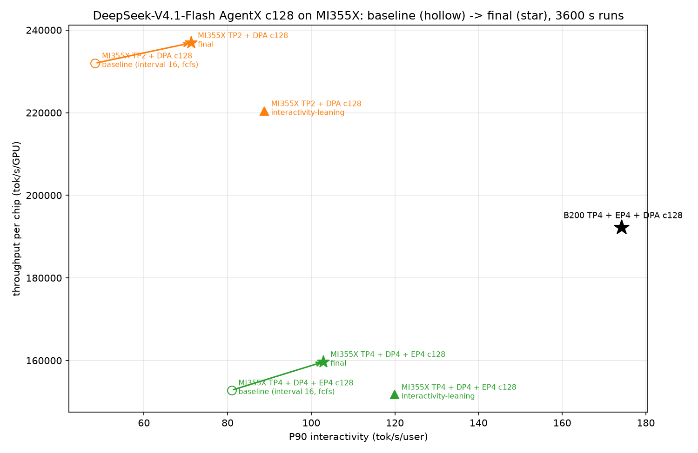

# MI355X 上 sglang + AKLR 的 DeepSeek-V4.1-Flash c128 优化报告

日期：2026-11-04（UTC+8）。范围：InferenceX AgentX 场景下的两个部署形态。

- 场景 1：TP2 + DPA，EP 关，CONC=128（2 卡）。
- 场景 2：TP4 + DP4 + EP4 + DPA，CONC=128（4 卡）。

## 0. 结果摘要

基线和最终版都是完整 3600 s 的 AgentX 压测；同一场景的基线和最终版在同一节点上运行。

| 场景 | 配置 | P90 interactivity | 吞吐/卡 | 平均 / P90 TTFT |
|---|---|---:|---:|---:|
| 场景 1 | 基线 | 48.3 | 231,981 | 5.0 / 12.5 s |
| 场景 1 | **最终版** | **71.3（+47.4%）** | **236,893（+2.1%）** | 7.3 / 3.5 s |
| 场景 1 | 偏 interactivity 版（interval 48） | 88.8（+83.7%） | 220,392（−5.0%） | 12.5 / 4.7 s |
| 场景 2 | 基线 | 81.0 | 152,798 | 2.1 / 5.0 s |
| 场景 2 | **最终版** | **103.0（+27.2%）** | **159,688（+4.5%）** | 2.6 / 2.8 s |
| 场景 2 | 偏 interactivity 版（interval 48） | 120.0（+48.1%） | 151,731（−0.7%） | 5.7 / 6.0 s |
| B200 | TP4 + EP4 + DPA c128（InferenceX，10-27） | 174.2 | 192,118 | — |

- 两个场景的最终版在两项指标上都优于基线。
- 相对 B200 c128：
  - 场景 1 最终版：吞吐/卡是 B200 的 123%，interactivity 从 28% 提高到 41%。
  - 场景 2 最终版：interactivity 从 47% 提高到 59%，吞吐/卡从 80% 提高到 83%。
  - 场景 2 的 interval 48 版本 interactivity 达到 B200 的 69%。
- 正确性：gsm8k 300 题（真实接受，temperature 0）。场景 1 最终版 98.0%（294/300），场景 2 最终版 97.7%（293/300），在以往 97.3%–99.0% 的波动范围内。

## 1. 最终配置

在原配置（InferenceX MI355X recipe 及本组补充的 c128 变体）基础上改动以下几项：

| 项 | 基线 | 最终版 | 作用 |
|---|---|---|---|
| `prefill-decode-interval` | 16 | 32（偏 interactivity 版为 48） | 减少 prefill 打断 decode 的次数 |
| `schedule-policy` | `fcfs` | `shortest-prefill-first` | 加大 interval 后必须配套，否则 prefill 排队严重 |
| `SGLANG_DSV41_ENGRAM_HOST_TABLE_LAYOUT` | `per_rank` | `shared` | Engram 查表不再需要跨 rank 的 all-reduce |
| `SGLANG_ENABLE_DP_GATHER_FP8` | 关 | 开 | prefill 的 DP gather 用 FP8 传输，数据量减半；需要下面的 AKLR 修复 |

**AKLR 代码改动（提交 02e7dcc1）：** `aklr/plugins/sglang/models/deepseek_v4/dp_routes.py` 新增一个路由。

- sglang 的 FP8 DP gather 调用 `_run_per_token_group_quant_8bit_kernel`，而它依赖的 group-quant kernel 只在 CUDA 上 import。ROCm 上开启 `SGLANG_ENABLE_DP_GATHER_FP8` 会报 `NameError`，服务卡在 503。
- 路由在 ROCm 上改用 sglang 自带的 Triton 实现（`_per_token_group_quant_8bit_raw`），只在服务 DSV4.1 且 sglang 没有该 kernel 时生效。
- 附带测试：`test_deepseek_v4_scope.py` 中的分派测试，以及 `test_deepseek_v4.py` 的路由清单。插件单测 423 passed，另有 7 个与 main 相同的已知失败。

配置文件：[opt_c128.yaml](opt_c128.yaml)（由 `/shared_nfs/limou/aklr_sweep/scripts/make_opt_recipe.py` 生成，base 为 InferenceX MI355X agentic recipe）。

| 变体 | 内容 |
|---|---|
| `s1_s32_es_g8` | 场景 1 最终版 |
| `s1_s48_es_g8` | 场景 1 偏 interactivity 版 |
| `s2_s32_es_g8` | 场景 2 最终版 |
| `s2_s48_es_g8` | 场景 2 偏 interactivity 版 |

## 2. 方法

- **完整压测：** 基线与最终版跑完整的 3600 s。
- **A/B：** 每一步只改一项，对照组和变体在同一节点、同一轮里并行跑，用 InferenceX 快速模式（`AIPERF_EXPERIMENTAL_FAST=1`，1200 s，每条 lane 1 个 warmup 请求），一个点约 25 分钟。
  - 快速模式重复性好：同一配置在两轮中分别是 70.0 / 233,729 和 70.1 / 234,389。
  - 但快速模式会低估调度参数的吞吐代价：interval 48 在快速模式下吞吐持平，在完整压测中是 −5%。调度参数的取舍以完整压测为准。
- **profile：** 用 decode profile（按 c128 时的实际在跑请求数）和 prefill profile（128K 冷启动）定位瓶颈。

## 3. 瓶颈定位（场景 1）

**decode：** c128 实际负载下，每 rank 约 33 个请求，每轮 33.9 ms。

| 部分 | 占比 |
|---|---:|
| MoE | 约 41% |
| DP 通信（all-gather + reduce-scatter + 拷贝） | 约 14% |
| FP8 / BF16 GEMM | 约 16% |
| attention + indexer | 约 9.5% |
| mHC 与其余小 kernel | 约 15% |

每层 all-gather 约 4 MB、耗时约 50 µs，折合约 80 GB/s，正好是 GPU 对之间单条 xGMI 链路的带宽。TP2 的两张卡之间只有一条链路，DP 通信受链路带宽限制。

**prefill：** 128K 冷启动，每 rank 16K 的 chunk。

| 部分 | 占比 |
|---|---:|
| RCCL 通信（DP gatherv / reduce-scatterv，每次约 3.1 ms） | 约 46% |
| MoE | 约 19% |
| attention | 约 12% |

每个 chunk 每层要搬约 168 MB，同样卡在单链路上。

**prefill 打断 decode：** c128 时每 rank 约一半的时间在做 prefill。DPA 下各 rank 锁步执行，任一 rank 做 prefill 都会拖住其他 rank 的 decode，所以 `prefill-decode-interval` 是最大的杠杆。

## 4. A/B 过程

**场景 1**（快速模式；每行的对照组与变体在同一轮）：

| 改动 | 对照：interactivity / 吞吐 | 改动后 | Δ interactivity | Δ 吞吐 | 结论 |
|---|---:|---:|---:|---:|---|
| aiter batched GEMM + 融合逆 RoPE + 本地共享专家 | 68.4 / 229,497 | 68.7 / 230,574 | +0.4% | +0.5% | 噪声，不采用 |
| Engram `shared` 布局 | 68.4 / 229,497 | 70.0 / 233,729 | +2.4% | +1.8% | 采用 |
| 去掉 SPF（interval 32 + fcfs） | 68.4 / 229,497 | 65.5 / 187,029 | −4.2% | −18.5% | SPF 必需 |
| prefill chunk 每 rank 32K（原 16K） | 70.1 / 234,389 | 56.0 / 215,427 | −20.1% | −8.1% | 不采用 |
| interval 48（对 32） | 70.1 / 234,389 | 84.3 / 234,145 | +20.2% | −0.1% | 完整压测为 −5% 吞吐，作为偏 interactivity 版 |
| interval 24（对 32） | 69.4 / 232,304 | 57.9 / 226,212 | −16.5% | −2.6% | 不采用 |
| FP8 prefill DP gather | 69.5 / 230,831 | 70.9 / 232,883 | +1.9% | +0.9% | 采用 |

完整压测（第一轮）：interval 32 + SPF 为 70.4 / 221,883，interval 48 + SPF 为 87.3 / 207,478，对照基线 48.7 / 227,684。

**场景 2**（快速模式）：

| 改动 | 对照 | 改动后 | Δ interactivity | Δ 吞吐 | 结论 |
|---|---:|---:|---:|---:|---|
| interval 32 + SPF | 79.3 / 136,371 | 98.2 / 141,226 | +23.8% | +3.6% | 采用（两点相邻两轮） |
| ROCm MegaMoE（在 interval 32 + SPF 上） | 98.2 / 141,226 | 83.8 / 126,625 | −14.7% | −10.3% | 不采用 |
| Engram `shared` 布局 | 98.8 / 142,377 | 100.9 / 143,531 | +2.1% | +0.8% | 采用 |
| FP8 prefill DP gather | 100.8 / 143,350 | 102.6 / 144,864 | +1.9% | +1.1% | 采用 |

## 5. 试过但没有采用的方向

| 方向 | 结果 | 原因 |
|---|---|---|
| ROCm MegaMoE（`--moe-a2a-backend megamoe`，AITER `MegaMoEV2` + MoRI） | 完整压测 60.1 / 124,559，比基线低 26% / 18% | ROCm 上有两个前提：DSV4.1 必须 `--language-model-only`，DPA 下必须关闭 SWA bounded replay。per_rank 的 Engram 表在 MegaMoE 下会崩，必须改用 shared 布局。`MegaMoEV2` 在这个镜像里效率不足 |
| aiter `mega_moe_tp`（DPA + TP-MoE 的单 kernel 融合） | 未接入 | 这个镜像（torch 2.11 + HIP 7.15）里 torch 分配的显存不能导出 `hipIpcGetMemHandle`。改用 `hipMalloc` 后功能测试全部通过，但每层耗时 2.5–15 ms，glm5 形状同样慢，远高于真实服务中 MoE 层约 0.3 ms |
| 两批重叠（TBO） | 不可用 | sglang 明确不支持在 DeepSeek-V4.1 上开启 |
| 加大 prefill chunk、interval 24、三个环境开关 | 见第 4 节 | 变差或噪声 |

## 6. 与 B200 的剩余差距与后续方向

- **场景 1 的单链路通信。** TP2 的 DP 通信在 decode 中占约 14%、在 prefill 中约 46%。目前只有 prefill 的 gather 用了 FP8，reduce-scatter 和 decode 的 gather 仍是 BF16。后续可在 AKLR 中做 decode 的 FP8 gather，以及量化压缩的 reduce-scatter。
- **decode 的非 MoE 开销。** 小 GEMM 和 mHC 等小 kernel 约占 30%。DPA 下 AKLR mono 不可用，需要 DP 模式的融合 kernel。
- **MoE 和 EP 融合。** B200 用 DeepGEMM MegaMoE；ROCm 上现有的 `MegaMoEV2` 和 `mega_moe_tp` 在这个镜像里都不可用或退化，需要跟进更新的 aiter / sglang 镜像后再评估。
- **调度。** interval 是 interactivity 与吞吐之间的旋钮，可根据目标在 32–48 之间选。

## 附录

- 每个测点：`/shared_nfs/limou/aklr_sweep/runs/<RID>/`（`headline.json`、服务端与客户端日志、AKLR 导出）。
  - 完整压测：`fin_s1_*`、`oB1_s2_base`、`fin_s2_*`、`oB1_s2_mega`。
  - A/B：`oA2_*` 至 `oA5_*`、`oB2_*` 至 `oB5_*`。
  - gsm8k：`gsm_s1_s32_es_g8`、`gsm_s2_s32_es_g8`。
- profile：`/shared_nfs/limou/aklr_sweep/prof/pf_s1_base_n66.summary.txt`（decode）、`/shared_nfs/limou/aklr_sweep/prof/pf_s1_s32_prefill.summary.txt`（prefill）。
- 脚本（`/shared_nfs/limou/aklr_sweep/scripts/`）：`make_opt_recipe.py`、`opt_report.py`、`serve_profile.sh`、`serve_prefill_profile.sh`；A/B 快速模式开关为 `AB_FAST=1`。
- 节点：crsuse2-m2m-v3-085（场景 1）、crsuse2-m2m-v3-074（场景 2），已释放。
