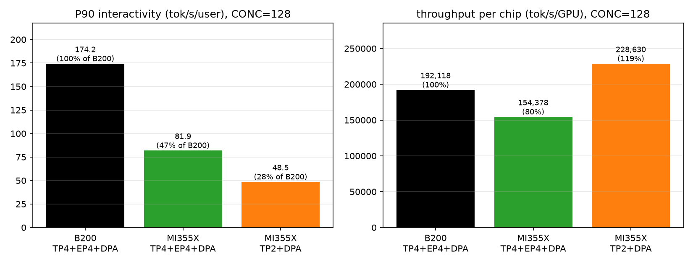
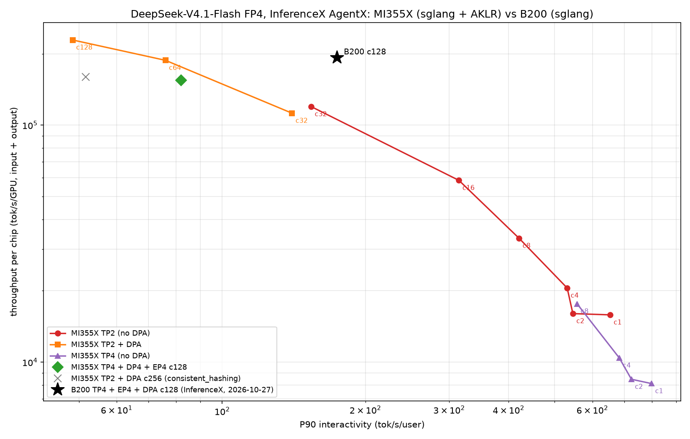

# DeepSeek-V4.1-Flash 高并发（CONC=128 / 256）推理：AMD MI355X 与 NVIDIA B200 差距分析

日期：2026-11-04（UTC+8）。作者：AKLR DSV4.1 插件工作组。

## 0. 摘要

- **CONC=128 时，MI355X（sglang + AKLR）的每卡吞吐已经可以高于 B200，但 P90 interactivity 只有 B200 的 28%–47%。**
  - TP2 + DPA（2 卡）：吞吐/卡 228,630，是 B200 的 119%；interactivity 48.5，是 B200 的 28%。
  - TP4 + DP4 + EP4 + DPA（4 卡，与 B200 同形态）：吞吐/卡 154,378（80%）；interactivity 81.9（47%）。
- **两个指标的差距是同一个根因：decode 每轮（DSpark 草稿 + 验证）时间。** MI355X 的 P90 每轮时间约 41–43 ms，B200 约 20 ms。AgentX 带 think time，吞吐对 decode 速度不敏感，所以吞吐只差 20%，interactivity 差一倍以上。
- **差距不在硬件。** 两边 HBM 带宽都是 8 TB/s，FP4 算力相当，MI355X 显存更大（288 GB 对 180 GB）。按专家权重的读取量估算，两边 decode 每轮的下限都约 9 ms：B200 跑到了下限的约 2 倍，MI355X 约 4 倍。
- **MI355X 多出来的时间主要来自三处，按影响排序：**
  1. prefill 打断 decode：每个 rank 约 27% 的时间在做 prefill，DPA 下各 rank 锁步，打断会传给所有 rank。
  2. decode 的非 MoE 开销：小 kernel 多、小 GEMM 多、DP 通信没有融合。
  3. MoE 和 EP 通信没有像 B200 的 MegaMoE 那样融合成一个 kernel。
- **CONC=256：** MI355X TP2 + DPA 已超过 prefill 能力，吞吐反而低于 c128；应改用 TP4 + DP4 + EP4。B200 c256 没有数据可比。
- **ROCm 上已有对应的融合 kernel，但这次的测点都还没用上：** sglang 的 ROCm MegaMoE（AITER `MegaMoEV2`）、aiter 的 `mega_moe_tp`（DPA + TP-MoE 的单 kernel 融合）和 `mega_mhc`。这是下一步优化的重点。

## 1. 测试条件

| 项 | MI355X | B200 |
|---|---|---|
| 场景 | InferenceX AgentX `dsv41flash-fp4-*-sglang-agentic-dspark`，thinking on，DSpark block 5，golden acceptance 3.51，每点 3600 s | 同左 |
| 镜像 | `lmsysorg/sglang-rocm:v0.5.22-rocm10-mi35x-20261021` + AKLR 插件（`060a0685`） | `lmsysorg/sglang:nightly-dev-cu13-20261026-8252e3af` |
| 数据来源 | 本组在 crsuse2-m2m 集群上复现的 InferenceX 单节点流程 | InferenceX 公布结果，2026-10-27 |
| 配置 | InferenceX MI355X recipe；c128/c256 DP 点和 TP4-DEP4 点由本组按同一模板补充（见附录） | InferenceX `b200-fp4-mtp/agentic.yaml` 的 `override_dep4_c128` |

指标定义：P90 interactivity = 1000 / P90 TPOT（tok/s/user）；throughput_per_chip = (输入 + 输出) tok/s / 卡数。

## 2. 压测数据

### 2.1 CONC=128 对比

| 配置 | 卡数 | P90 interactivity | 吞吐/卡 | 输入/卡 | 输出/卡 | GPU 缓存命中 | 平均 TTFT |
|---|---:|---:|---:|---:|---:|---:|---:|
| **B200 TP4 + EP4 + DPA**（HiCache） | 4 | **174.2** | **192,118** | 190,649 | 1,469 | 95.5% | — |
| MI355X TP4 + DP4 + EP4 + DPA | 4 | 81.9 | 154,378 | 153,145 | 1,233 | 96.3% | 1.9 s |
| MI355X TP4 + DP4 + EP4 + DPA + HiCache | 4 | 80.0 | 152,517 | 151,298 | 1,219 | 96.3% | 2.1 s |
| MI355X TP2 + DPA | 2 | 48.5 | 228,630 | 226,697 | 1,933 | 95% | 5.7 s |

### 2.2 MI355X 全部测点与 B200 c128

| MI355X 配置 | 卡数 | 每卡会话 | P90 interactivity | 吞吐/卡 | e2e | TTFT | GPU 缓存命中 |
|---|---:|---:|---:|---:|---:|---:|---:|
| TP2，c32 | 2 | 16 | 153.9 | 119,644 | 5.2 s | 0.8 s | 97% |
| TP2 + DPA，c32 | 2 | 16 | 140.2 | 112,243 | 6.3 s | 1.0 s | 97% |
| TP2 + DPA，c64 | 2 | 32 | 76.0 | 187,623 | 11.0 s | 1.2 s | 97% |
| TP2 + DPA，c128 | 2 | 64 | 48.5 | 228,630 | 23.3 s | 5.7 s | 95% |
| TP4 + DP4 + EP4，c128 | 4 | 32 | 81.9 | 154,378 | 12.5 s | 1.9 s | 96% |
| TP2 + DPA，c256，`cache_aware` 路由 | 2 | 128 | 56.8 | 70,985 | 265 s | 251 s | 71% |
| TP2 + DPA，c256，`consistent_hashing` 路由 | 2 | 128 | 51.7 | 159,545 | 113 s | 95 s | 90% |

AKLR 开、关对比（同节点同时段）：c128 TP2 + DPA 为 48.5 / 228,630 对 46.6 / 225,618（+4.0% / +1.3%）；c256 两种路由下吞吐差异在 −3.5% 到 −1.6% 之间，属于噪声范围（prefill 瓶颈下 decode 加速不起作用）。

## 3. 差距拆解

### 3.1 吞吐差距来自 e2e，e2e 差距来自 decode

AgentX 是带 think time 的闭环负载：

\[
\text{tput/chip} \approx \frac{\text{CONC}}{G}\times\frac{\overline{\text{ISL}}}{\text{think}+\text{e2e}}
\]

| 项 | B200 c128 | MI355X TP4-DEP4 c128 |
|---|---:|---:|
| 完成请求数 / 3600 s | 约 2.05 万（由公布的输出 token 总数 21.3M ÷ 平均输出 1,040 推算） | 17,197 |
| 每会话每小时请求数 | 约 160 | 134 |
| 每轮请求周期（3600 ÷ 上一行） | 约 22.5 s | 26.9 s |
| think 时间（同一 trace） | 约 14.4 s | 14.4 s |
| e2e | 约 8 s（推算） | 12.5 s |
| P90 每轮时间（3.51 token ÷ interactivity） | 约 20 ms | 约 43 ms（日志实测 P90 41.5 ms，中位数 33.5 ms） |

e2e 从 12.5 s 降到约 8 s，每会话请求数多约 19%；会话推进更快、后续轮次上下文更长，平均 ISL 再高约 4%。两项相乘约 +24%，与实测吞吐差距吻合。**结论：两个指标要一起追，抓手都是 decode 每轮的时间。**

### 3.2 硬件下限两边相同

DSV4.1-Flash：40 层 MoE，384 个路由专家取 top-6，`moe_intermediate_size` 2304，每个专家 FP4 约 18.8 MB；attention 只有 1 个潜在 KV head（MQA 风格），head_dim 512。

c128 时每个 rank 约 12 个请求在 decode，整个实例每轮约 280 个 token，几乎会用到全部 384 个专家。EP4 下每张卡每轮要读约 71 GB 专家权重，在 8 TB/s 下约 9 ms。B200 的 HBM 带宽也是 8 TB/s，下限相同。

| | 每轮下限（估） | P90 每轮 | 相对下限 |
|---|---:|---:|---:|
| B200 | 约 9 ms | 约 20 ms | 约 2.2× |
| MI355X | 约 9 ms | 约 41–43 ms | 约 4.6× |

### 3.3 MI355X 多出来的时间在哪里

**(1) prefill 打断 decode（已确认）**

| 测点 | 每 rank 新 prefill（tok/s） | 占单 rank prefill 上限（约 2 万 tok/s）的比例 |
|---|---:|---:|
| TP2 + DPA c64 | 5,400–6,900 | 27%–34% |
| TP2 + DPA c128 | 10,300 | 约 51% |
| TP4 + DP4 + EP4 c128 | 5,200–5,800 | 约 27% |

- prefill 上限来自 c256 饱和时的实测：每个 rank 持续排队，新 prefill 稳定在约 2 万 tok/s。
- DPA 下 MoE 层需要所有 rank 同步，任一 rank 做 prefill 都会拖住其他 rank 的 decode。每个请求的 TPOT 包含这些停顿，P90 每轮时间比中位数高 24% 也主要来自这里。
- 调度参数对比：MI355X `prefill-decode-interval 16`、`schedule-policy fcfs`；B200 为 48、`shortest-prefill-first`。

**(2) decode 的非 MoE 开销（有 profile 依据）**

MI355X TP2 + DPA，每 rank 约 13 个请求时的一轮 decode（22.4 ms，GPU 忙碌率 97%）：

| 部分 | 占比 | 主要 kernel |
|---|---:|---|
| MoE | 约 41% | `mfma_moe1_silu_mul_afp8_wfp4` 24%、`gemm2_a4w4` 13%、排序与量化约 5% |
| FP8 / BF16 小 GEMM | 约 16% | `_batched_gemm_bf16_fp8`、`_gemm_afp8wfp8` 若干 |
| DP 通信 | 约 8% | `aiter::reduce_scatter_split_first_dim`、`aiter::allgather_vec`，另有拷入通信缓冲区约 2% |
| attention + indexer | 约 7% | `_sparse_mla`、`pa_mqa_logits_fp4_rowgroup` |
| 其余小 kernel | 约 20% | mHC 边界、RMSNorm/Sinkhorn、elementwise 等，每层约 30 个 4–8 µs 的 kernel |

- GPU 忙碌率 97%，问题不在 launch 间隙，而在 kernel 数量多、单个效率低。
- MoE 每个专家只分到约 4 个 token，却按 32 行 tile 计算，补零浪费明显，带宽利用率估计只有六七成。

**(3) MoE 与 EP 通信没有融合（推测，有配置依据）**

B200 在 c48 以上用 `--moe-a2a-backend megamoe`（DeepGEMM MegaMoE）。MI355X 这次的 TP4-DEP4 测点用的是默认的 `none`，EP 实际退化成 all-gather + reduce-scatter，通信没有和计算重叠。

**(4) 互联（推测，次要）**

B200 通过 NVSwitch，每张卡到任意对端都是全带宽。MI355X 是 8 卡全互联，任意两卡之间只有一条 xGMI 链路，TP4 时每卡只用到 7 条中的 3 条。每层通信消息只有几 MB，主要受延迟限制，影响小于前三项。

**(5) AKLR mono kernel 在 DPA 下不可用**

AKLR 的 mono kernel 在 TP2、低并发时带来 10–30% 的 decode 加速，但它只支持纯 TP、不超过 48 行的 decode，高并发的 DPA 形态用不上（见第 5 节）。

## 4. 配置差异：B200 c128 与 MI355X TP4-DEP4 c128

| 项 | B200（`override_dep4_c128`） | MI355X（本组 TP4-DEP4） |
|---|---|---|
| 并行 | TP4 / DP4 / EP4，DPA | 同左 |
| MoE 路径 | `megamoe`（融合 EP 分发 + FP4 GEMM + 合并）+ `flashinfer_mxfp4` | `moe-a2a-backend none`（all-gather + EP MoE + reduce-scatter） |
| attention | `trtllm` | `dsv4`（aiter / Triton） |
| KV cache | FP8 | FP8 |
| FP4 indexer | — | `enable_deepseek_v4_fp4_indexer=False` |
| prefill chunk（每 rank） | 65536 / 4 = 16384 | TP4-DEP4：32768 / 4 = 8192（TP2 + DPA：32768 / 2 = 16384） |
| `prefill-decode-interval` | 48 | 16 |
| `schedule-policy` | `shortest-prefill-first` | `fcfs` |
| HiCache | 开，`hicache-ratio 2`，`direct` / `page_first_direct` | 关（另测一组开，ratio 2，默认 IO 后端） |
| `max-running-requests` / decode graph | 256 / 64 | 256 / 64 |
| 路由 | `cache_aware` | `cache_aware` |
| monokernel | 不用 | 不可用（DPA） |

## 5. 融合 kernel 的覆盖范围

### 5.1 AKLR mono kernel

| | 支持 | 原因 |
|---|---|---|
| decode / DSpark verify（目标模型与草稿模型） | 是 | 每次最多 48 行（8 请求 × 6 token），TP2/TP4 |
| prefill、混合批次、超过 48 行的 decode | 否 | 走 sglang 原生路径 |
| DPA | 否 | attention 按 head 做 TP 切分，各卡处理同一批请求；DPA 要求每卡全 head、各卡请求不同，进入 MoE 前要汇总各卡的行，规模远超 48 行 |
| EP | 否 | MoE 在每个专家内部按中间维度切分；小批次下 EP 负载不均，收益为负 |

sglang 的 monokernel 接口有 `DP_ATTENTION`、`EXPERT_PARALLEL` 特性开关，AKLR 规格只声明了投机解码。这属于设计范围不覆盖，不是原理上做不到：kernel 内跨卡推送加 epoch 同步的机制可以复用，但要支持高并发，需要把 GEMV 风格的阶段改成 GEMM tile。

### 5.2 B200 用到的 Mega 系列 kernel

sglang 集成了 DeepSeek 开源的 MegaAttention、MegaMoE、MegaGate、Mega-mHC。B200 这份配置实际用到两个：

| kernel | B200 启用的并发点 | 覆盖 | 不覆盖 |
|---|---|---|---|
| MegaMoE（`--moe-a2a-backend megamoe`，DeepGEMM `fp8_fp4_mega_moe`） | c48–c256 | 一个 kernel 完成 EP 分发、gate/up GEMM、SwiGLU、down GEMM、合并；FP4 权重 × FP8 激活；NVLink 对称内存，通信与计算重叠；每 rank token 数不超过上限（16384 = 65536 / DP4）时，prefill 和 decode 都走 | 路由 gate 和 top-k、共享专家（另一条 stream 并行）、attention |
| Mega-mHC prefill（`SGLANG_OPT_DSV41_MEGA_MHC_PREFILL=1`） | c4–c24 | prefill 时融合 mHC 边界的残差更新、collapse/RMSNorm 和下一子层的混合统计 | decode |

B200 不用整层 mono kernel，高并发下靠 MoE + EP 通信的融合，加上成熟的单算子 kernel 和 CUDA graph。

### 5.3 ROCm 上已有的对应实现

| 实现 | 位置 | 本镜像是否包含 | 适用场景 |
|---|---|---|---|
| ROCm MegaMoE（AITER FlyDSL `MegaMoEV2` + MoRI 对称内存） | sglang `mega_moe_flydsl.py`，`--moe-a2a-backend megamoe` + `SGLANG_AMD_USE_FLYDSL_MEGA_MOE=1` | 是（sglang 2026-10-21） | DPA + EP（TP4-DEP4） |
| `mega_moe_tp`（单 kernel：DP all-gather + TP-MoE + reduce-scatter，可融合下一层 norm/量化） | aiter `ops/flydsl/kernels/mega_moe_tp`，gfx950，号称大并发 1.4–1.6× | 是（aiter 2026-10-17）；sglang 尚未接入 | DPA + TP-MoE（TP2 + DPA） |
| `mega_mhc`（单 launch 的 Mega-mHC） | aiter `ops/flydsl/kernels/mega_mhc.py` | 是；sglang 只在 CUDA 上接了 DeepGEMM 版 | prefill / decode 的 mHC 边界 |
| MoRI EP（`--moe-a2a-backend mori`） | sglang | 是 | EP all-to-all |

sglang cookbook §3.6 给出了 MI355X 上 DP8 + EP8 + MegaMoE 的 agentic 配置（V4-Pro-0813，镜像 `-rocm720-mi35x-20261028`），可作为参数参考。

## 6. TP2 还是 TP4

- **每 rank 负载相同时，TP4 并不让单卡变快。** TP2 + DPA c64 与 TP4 + DP4 + EP4 c128 每个 rank 都约 12–14 个请求，decode 每轮中位数分别为 32.0 ms 和 33.5 ms。TP4 的作用只是同一 CONC 下每卡会话数减半；在 pareto 图上两者基本是同一条曲线的平移，TP4 还多付一点通信和负载不均的代价。
- **MI355X 能跑 TP2，B200 不能。** 专家权重约 290 GB，TP2 每卡约 145 GB；B200 只有 180 GB，最低只能 TP4。这是 MI355X 在每卡吞吐上的结构性优势：c128 TP2 + DPA 已比 B200 c128 高 19%。

| 并发 | 推荐形态 |
|---|---|
| ≤ c32 | TP2，不开 DPA（可用 AKLR mono） |
| c64–c128 | TP2 + DPA，EP 关（每卡吞吐最高） |
| ≥ c256 | TP4 + DP4 + EP4，会话绑定路由（TP2 prefill 饱和） |

## 7. 优化方向

| 优先级 | 方向 | 针对 | 预期 |
|---|---|---|---|
| 1 | 调度参数：`prefill-decode-interval`、`shortest-prefill-first`、`stream-interval` | prefill 打断 | 成本最低 |
| 2 | 场景 TP4-DEP4：ROCm MegaMoE（`MegaMoEV2`）+ FP4 indexer 等 cookbook 参数 | MoE + EP 通信 | 对标 B200 MegaMoE |
| 3 | 场景 TP2 + DPA：经 AKLR 接入 aiter `mega_moe_tp`（`ag_rs` 模式，融合尾部 norm/量化） | MoE + DP 通信 + 小 kernel | aiter 号称 1.4–1.6× |
| 4 | Mega-mHC（aiter `mega_mhc`）、长上下文 prefill 效率 | 小 kernel、prefill | |
| 5 | DP 模式的 mono kernel | 整层融合 | 数周级别 |

## 8. 11-04 优化后的结果

详见 [MI355X_c128_optimization.md](MI355X_c128_optimization.md)。都是完整 3600 s 压测：

| 场景 | 基线 | 最终版 | 相对 B200（interactivity / 吞吐） |
|---|---:|---:|---:|
| TP2 + DPA c128 | 48.3 / 231,981 | 71.3 / 236,893（+47.4% / +2.1%） | 41% / 123% |
| TP4 + DP4 + EP4 c128 | 81.0 / 152,798 | 103.0 / 159,688（+27.2% / +4.5%） | 59% / 83% |
| TP4 + DP4 + EP4 c128，interval 48 | — | 120.0 / 151,731（+48.1% / −0.7%） | 69% / 79% |

- 主要来自调度参数：`prefill-decode-interval` 32 + `shortest-prefill-first`。小幅收益来自 Engram `shared` 布局和 FP8 prefill DP gather（后者经 AKLR 修复了 ROCm 上的 bug）。
- ROCm MegaMoE 在本镜像里是退化的（−26% / −18%）。aiter `mega_moe_tp` 受 IPC 显存分配问题和性能问题影响，暂不可用。
- 新确认的瓶颈：TP2 的 DP 通信受单条 xGMI 链路限制，decode 约占 14%、prefill 约占 46%。

## 附录

- MI355X 每个测点的服务端日志、客户端结果、AKLR 导出：`/shared_nfs/limou/aklr_sweep/runs/<测点>/`。
  - TP2 / TP4：`opt_tp*`；TP2 + DPA c32/c64：`dpnew_tp2_c*_dp`；c128/c256：`aklr2_tp2_c128_dp`、`aklr2_tp2_c256_dp(_ch)`；TP4-DEP4：`aklr2_dep4_c128(_hicache)`。
- 补充的配置：`/shared_nfs/limou/aklr_sweep/recipes/agentic_dp_hiconc.yaml`（TP2 + DPA c128/c256）、`/shared_nfs/limou/aklr_sweep/recipes/agentic_dep4.yaml`（TP4-DEP4 c128）。
- profile：`/shared_nfs/limou/aklr_sweep/prof/dp_aklr_n26.summary.txt`。
- 图：`/shared_nfs/limou/aklr_sweep/scripts/plot_gap.py`。
