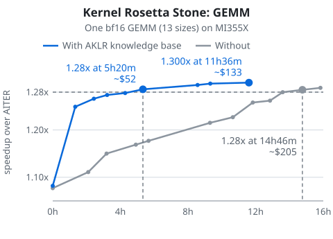
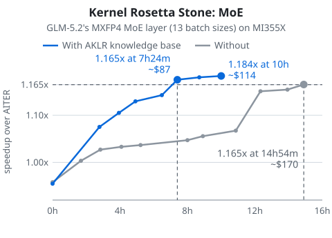

# Cut the time and cost of tuning AMD GPU kernels with AI agents: AKLR's knowledge base and skills

On two real tasks, an AI agent given AKLR's knowledge base, skills and existing kernels reached the same speed-up as an agent without them in **a third to a half of the time and a quarter to a half of the agent spend**:

- **a matrix multiply (GEMM):** 1.28x in **5 hours 20 minutes and an estimated $52**, against **14 hours 46 minutes and an estimated $205** without them;
- **the mixture-of-experts (MoE) layer of GLM-5.2:** 1.165x, the best the run without help reached in 15 hours, in **7 hours 24 minutes and an estimated $87**, against **14 hours 54 minutes and $170**.

Each speed-up is over AITER (the kernel library these tasks are scored against), averaged over the task's 13 sizes.

AKLR is a repository of AMD GPU kernels, with tools that check each kernel for correctness and time it. Its knowledge base and skills hand an agent what is already known about fast AMD kernels, so it does not have to find it out by trial. AKLR gives your agent:

- the **Kernel Rosetta Stone**, its knowledge base: a written guide for agents that write AMD GPU kernels;
- **skills**: instructions an agent loads for one job, such as running a whole optimization;
- **existing kernels**: working code to adapt.

## Why kernel work with AI agents is slow and costly

An optimizing agent works in rounds: plan a change, write the kernel, check it is still correct, time it, and keep the change only if it beats the best so far by more than the noise. With KernelForge, the tool that runs these agent rounds on an AKLR task, a round takes 20 to 70 minutes, and in earlier runs on a GEMM (general matrix multiply) the agent cost about $10 an hour. Without help, an agent can spend some of those paid rounds rediscovering what is already written down.

## What is in the knowledge base and skills

**The knowledge base** ([SKILL.md](../harness/skills/aklr-kb/SKILL.md)) brings together tips from handwritten kernels, AMD architecture and CDNA4 instruction-set (ISA) documents, and real examples. It centers on FlyDSL, a GPU kernel language. As of 2026-11-05 it has:

- **123 pages**: by operator (GEMM; MoE and grouped GEMM; attention), 16 case studies of delivered kernels, recurring performance patterns and pitfalls, profiling, notes on writing kernels in FlyDSL, Triton and HIP, and 36 pages on the gfx950 GPU and its CDNA4 instruction set (ISA);
- **1,204 findings**, each recording how it was measured and where it came from.

**Existing kernels** (178 in the GEMM test below, 168 in the MoE test), which the knowledge base points agents to, let an agent adapt working code when a new task resembles an old one.

**Skills** in `harness/skills/`:

| Skill | What it does for you |
|---|---|
| `aklr-kb` | Gives your agent the knowledge base, with how to write it in FlyDSL, Triton (and Gluon) and HIP in its `flydsl/`, `triton/` and `hip/` folders; KernelForge runs set up by `forge_task` load it by default (see below) |
| `forge-loop-campaign` | Has an agent run a whole KernelForge optimization of one AKLR task: prepare, run, watch, stop or resume, review, deliver |
| `geak-campaign` | Runs such a campaign with GEAK (`AMD-AGI/GEAK`), another agent-driven optimizer, instead of KernelForge |

FlyDSL's own skills, kernel code cleanup among them, are linked from `aklr-kb/flydsl/guides.md`. Both results below were measured with the knowledge base as it was before it was reorganized into `aklr-kb`.

## What it saved on two tasks

### Task 1: a GEMM

The task: a bf16 GEMM (out = a @ b^T, N = 16384, K = 2048) written in FlyDSL, for 13 values of M (1, 2, 4, ..., 4096); AKLR calls each one a workload. AKLR had no kernel for this shape, and the knowledge base never mentions it. The same KernelForge agent (Claude Opus 5.5) ran twice on one MI355X machine, one GPU each: once with the knowledge base, skills and existing kernels (budget 12 hours), once with all three removed (budget 24 hours). The score is the speed-up over AITER averaged over the 13 workloads (1.0 = as fast as AITER); both runs started at about 1.08.

Best score so far (higher is better):

| Time since start | With AKLR's help | Without |
|---|---|---|
| start | 1.082 | 1.077 |
| 2 h | 1.249 | 1.077 |
| 4 h | 1.274 | 1.150 |
| 8 h | 1.286 | 1.177 |
| 12 h | 1.300 (run ended at 11h36m) | 1.258 |
| 15h50m | (ended) | 1.289 (its best) |

- **To reach 1.28x:** 5h20m and about $52 with AKLR's help; 14h46m and about $205 without. About $150 saved (spend estimated, see below).
- **After the same 8 hours:** 1.286x against 1.177x, a score about 9% higher.
- **At the end:** with help, the run finished at 1.300x after 11h36m and about $133, when its budget ran out. Without help, the best was 1.289x after 15h50m and about $230: about $100 more and about 4 more hours, and still slightly below.

#### How the agent used the knowledge base

The agent gets the knowledge base's entry page at the start of every round, and that page tells it to look first for a delivered kernel of the same kind. In this run:

- **It found a close match.** Before writing any code, the agent's profiling report named the knowledge base's case study of earlier bf16 GEMMs as the nearest match. The case study explains how those kernels were built, what each technique was worth, and where each kernel is in AKLR.
- **It adapted instead of starting over.** In its first round the agent took the kernel that case study names for N = 18432, K = 1536, adapted it to this shape and used it for the small sizes (M ≤ 128). That one round lifted the score by 15.4%. The kernel brought along techniques the case study describes, such as staggering where each workgroup starts along K and non-temporal cache hints on B. The agent without help built on library kernels such as hipBLASLt's and AITER's, and found these techniques on its own, one at a time, over many hours.
- **It kept looking things up.** In later rounds the agent went back to the knowledge base's pages on small-M GEMMs and on cache-control instructions to decide what to tune next. Where the knowledge base recorded that a design had been slower before, the agent limited the time it spent on it.

This was measured on one GEMM with one run each way, and at the largest sizes (M ≥ 1024) neither run improved on AITER. The knowledge base and the existing kernels were given together; here the knowledge base is what led the agent to the kernel it adapted, so this run cannot say how either would do alone. Spend to 1.28x is an estimate: each run's measured total spend, scaled by the share of it spent by the time that run reached 1.28x.

### Task 2: the MoE layer of GLM-5.2

The task: GLM-5.2's mixture-of-experts layer as each GPU runs it when the model is split across four GPUs: 4-bit (MXFP4) weights, 257 experts of which each token uses 9, hidden size 6144, for 13 batch sizes (1, 2, 4, ..., 4096 tokens). Both runs started from a kernel that only calls AITER's MoE, so they started just below AITER (about 0.96). Neither run had a kernel for this model's MoE to copy: we removed all of them from both copies of AKLR and squashed each copy's history into one commit. The same KernelForge agent (Claude Opus 5.5) ran twice on one MI355X machine at the same time, one GPU each, for 15 hours each: once with the knowledge base, skills and AKLR's other 168 kernels, once with all three removed.

Best score so far (higher is better):

| Time since start | With AKLR's help | Without |
|---|---|---|
| start | 0.955 | 0.958 |
| 2 h | 0.955 | 1.003 |
| 4 h | 1.105 | 1.027 |
| 7h24m | 1.176 (past 1.165) | 1.037 |
| 8 h | 1.176 | 1.047 |
| 10 h | 1.184 | 1.056 |
| 14h54m | | 1.165 (run ended) |

- **To reach 1.165x**, the best the run without help reached: 7h24m and about $87 with AKLR's help; 14h54m and $170 without. About half the time and half the spend.
- **After the same 8 hours:** 1.176x against 1.047x.

#### How the agent used the knowledge base

- **It found related earlier work.** 35 minutes in, before writing any code, the agent's profiling report cited the knowledge base's case study of earlier MoE kernels with the same weight format: GLM-5.2's MoE as split across eight GPUs (a smaller shape per GPU), and two variants with fewer experts. Their code had been removed from both runs, but the case study still recorded what had worked: at 1 token, skip the routing sort and run the layer in two launches, measured at 2.47x over AITER.
- **It built on that in its first round.** The agent wrote such a two-launch path for 1, 2 and 4 tokens, taking the weight-layout details from another AKLR MoE kernel of a different shape. That round lifted the score from 0.955 to 1.075. The agent without help wrote the same kind of two-launch path in its tenth round, 12h20m in.
- **It kept looking things up.** In later rounds the agent went back to the knowledge base's pages on MoE decode, small-batch GEMMs and grouped GEMMs for MoE.

This was one run each way. Here the knowledge base's notes were closer to the task than in the GEMM test: they covered the same model's MoE at a different split and pointed straight at the first round's idea. That is what the knowledge base is for, carrying earlier work to a new shape; how much it helps depends on how close its notes are to the task. The knowledge base and the existing kernels were again given together. Spend to 1.165x with help is estimated the same way as for the GEMM; without help it is that run's whole measured spend, since it reached 1.165x in its last round.

## How to use it

1. Read [forge_task.md](forge_task.md). You start from an AKLR schema, a JSON file that defines one kernel task and the workloads it must serve. `forge_task prepare` turns the schema into a KernelForge task and a script that runs it; for a FlyDSL kernel, that run gets the knowledge base by default (through KernelForge's `--skill-dir` option).
2. To let an agent drive the whole campaign, have it load the [forge-loop-campaign](../harness/skills/forge-loop-campaign/SKILL.md) skill. To run the campaign with GEAK instead of KernelForge, use [geak-campaign](../harness/skills/geak-campaign/SKILL.md).
3. Tuning a FlyDSL kernel by hand or with your own agent: start at the knowledge base's [SKILL.md](../harness/skills/aklr-kb/SKILL.md).
