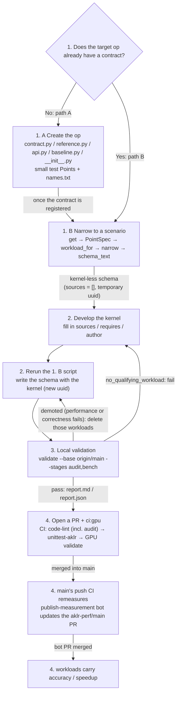

# Ops tutorial: adding a kernel to an AKLR op

This tutorial adds a kernel to an op in `aklr/ops/`, from the op's definition to a merged kernel. Its example is `fused_moe`, the experts of an MoE layer (the computation AITER's `fused_moe` does), at the shapes of GLM-5's MoE layer. The [plugin tutorial](plugin_tutorial.md) continues with the same layer and optimizes beyond this op's boundary.

## Concepts

Contract: **a contract is the complete definition of an op.** It is an `OpContract` constant in `aklr/ops/<op>/contract.py`, registered in that module's `CONTRACTS` (the registry discovers it automatically).

Schema: **a schema is a JSON file.** It narrows an op's `OpContract` to one scenario (fixed dtypes, const axes, attrs, layout), lists the workloads that scenario serves (concrete values of the var axes), and embeds the kernel source. Schemas live at `aklr/ops/<op>/impls/<language>/<name>/<uuid>.json`. The schema is the interface agreement between AKLR and other kernel-generation tools.

## Workflow



| Step | Key actions | Output |
|---|---|---|
| 1. A contract does not exist | Create `contract.py`/`reference.py`/`api.py`/`baseline.py`/`__init__.py` and small test Points, update `names.txt`, then narrow as in 1. B | New op package + kernel-less schema |
| 1. B contract exists | `get` → `PointSpec` → `workload_for` → `narrow(sources=[])` → `schema_text()` | kernel-less schema (temporary uuid) |
| 2. Develop the kernel | Fill in `kernel.sources` (optionally `requires`, `author`), then rerun the 1. B script | Schema with the kernel (new uuid) |
| 3. Local validation | `python -m aklr validate --base origin/main --stages audit,bench <schema>`; check the demoted list and delete the workloads that miss the bar | `aklr_validation/report.md`, `report.json` |
| 4. PR/CI/write-back | Add `ci:gpu` to the PR; after merge, a bot PR writes back the measurements | Kernel merged into the main branch |

## 1. Generate a kernel-less schema

### 1. A contract does not exist: create the contract

Following `harness/skills/aklr-port-generated-kernels/references/new-op.md` in the repository, implement these files in order:

1. `contract.py`: defines `OpContract` and `CONTRACTS` (the registry discovers them automatically); `op_type` is the directory name `<op>`; name things by their mathematical meaning; with several outputs, none may be called `out`; give every output `error_bounds`, and give the contract a `determinism`.
2. `reference.py`: a float64 `<contract>_reference(point, row_major_args, to_float64)`.
3. `api.py`: an `@api(<CONTRACT>)` stub (the body may only be `...`).
4. `baseline.py`: one `<contract>_baseline` per contract that has a baseline. It takes the api's arguments (passed as the call's keyword arguments), imports AITER or SGLang inside the function, and returns the outputs the same way the api does; for an unsupported call it raises `NotImplementedError` (bench reports `baseline_failed`). Without this function the op is its own baseline, and the kernel has nothing to beat.
5. `__init__.py`: exports the api.
6. Add each contract's base small Point to `SMALL_POINTS` in `tests/ops/cases.py`, in contract order, then run `AKLR_UPDATE_NAMES=1 pytest tests/ops/test_contracts.py` to regenerate `tests/ops/names.txt` and commit it with the rest.

Only non-`.md` changes under `aklr/core/` make CI test **all** committed schemas (`aklr/core/validation/stages/validation_scope.py`). A new `aklr/ops/<op>` is not among them: it is tested by change set, so only the schemas in the change are tested (the last section of `new-op.md` says all schemas are tested; that is outdated, and `validation_scope.py` is authoritative). Open it as a separate PR from the kernel.

### 1. B contract exists: generate the concrete schema

Pin the scenario (const axes, dtypes, attrs, layout) and list the var-axis values to serve. These values come from the real workloads. Call `ContractRegistry.default().get(...)`, `PointSpec`, `workload_for`, `narrow(..., kernel={"sources": []})` and `schema_text()` in turn, and write the result to `op_dir(contract.op_package) / schema.relative_path()`. You can start from the script template below (angle brackets are placeholders; for a complete runnable script, see the example below):


```python
from aklr.core.contract.locate import op_dir
from aklr.core.contract.registry import ContractRegistry
from aklr.core.contract.spec import PointSpec

# Get the contract
c = ContractRegistry.default().get("<op>@<version>")
# Fix the scenario: axes gives the const axes (the var axis is only a placeholder), attrs the attrs, dtypes each tensor's dtype, layout_variant_name the layout
p = PointSpec(
    contract_id="<op>@<version>",
    axes={"<var axis>": <placeholder>, "<const axis>": <value>, ...},
    dtypes={"<tensor>": "<dtype>", ...},  # set optional tensors that are absent to None
    attrs={"<attr>": <value>, ...},
    layout_variant_name="<layout>")
# Build one workload per var-axis value ({}: scalars take their defaults)
workloads = [c.workload_for(p.model_copy(update={"axes": {**p.axes, "<var axis>": t}}), {}) for t in (<v1>, <v2>, ...)]
# Narrow to a schema; sources=[] means kernel-less; fill in language/targets/entry_point for the contract and target hardware
s = c.narrow(p, workloads=workloads, kernel={"language": "<flydsl|triton|hip>", "targets": [{"arch": "<arch>", "hardware": "<hardware>"}],
                                            "entry_point": "<entry file>::run", "requires": {}, "author": "", "sources": []})
# Output path: this uuid belongs to the kernel-less version only and is temporary
path = op_dir(c.op_package) / s.relative_path()
# Write out schema_text()
path.parent.mkdir(parents=True, exist_ok=True)
path.write_text(s.schema_text(), encoding="utf-8")
```

## 2. Develop the concrete kernel

When developing the kernel, change only three fields in the kernel section: `kernel.sources`, `kernel.requires` and `kernel.author`. The author chooses the workloads in the script; every other field is derived from the contract.

- `sources`: for flydsl/triton the entry is `kernel.py::run`, and other files may only be imported relatively; hip uses `.hip`/`.h`, with the entry `kernel.hip::run`. The entry file must start with a docstring describing the kernel (a leading comment for hip). Writing it out with `narrow(..., kernel=...)` + `schema_text()` is recommended. Path rules:
  - flydsl/triton: a Python kernel is a flat package, so a path may not contain `/`, and there may be no `__init__.py`;
  - hip: nested directories are allowed, e.g. `include/utils.h`;
- `requires`: toolchain version constraints, e.g. `{"triton": ">=3.8"}`.
- `author`: the author's name.

Once every source field is filled in, rerun the 1.B script (replace `"sources": []` with `[SourceFile(path=..., content=...), ...]`, importing `SourceFile` from `aklr.core.contract.spec`; see the step 1 script in the example), which writes a schema file with a new uuid.

## 3. Local validation

Local validation checks that the schema is well-formed and that the kernel's performance meets the bar for merging.

```bash
python -m aklr validate --base origin/main --stages audit,bench aklr/ops/<op>/impls/<lang>/<name>/<uuid>.json
```

- **audit**: checks that the text equals `schema_text()`, naming, consistency with the contract, path/uuid, domain, scalars, duplicates, measurement fields, and audits the source
- **bench**:
  - Correctness: for each workload, compares against the reference implementation on inputs sampled from the declared distributions;
  - Performance: compares against the baseline over multiple rounds under CUDA graph.

**Thresholds**: every Point of a new kernel must reach ≥ **1.02** over the baseline (`<contract>_baseline` in `aklr/ops/<op>/baseline.py`) and ≥ **0.99** against the kernel already serving it, and runtime serving requires ≥ `AKLR_MIN_SPEEDUP` (default **1.03**). A Point that misses the bar is only recorded in the report's demoted list and does not fail validate. The demoted list holds both performance misses and correctness failures (such as `numeric_mismatch`, `build_failed`, `candidate_crash`, which CI writes as `accuracy: failed`); both kinds need handling. Only when not a single workload qualifies does the schema report `no_qualifying_workload`.

## 4. PR and CI

**PR rules**:
- Write the body following `.github/pull_request_template.md`. Add `ci:gpu` to both kernel and code PRs, and the PR must come from a branch of this repository (PRs from forks do not run GPU jobs); a kernel PR pastes the results from 3.;
- The code for a new op (`contract.py` and the rest, which counts as code) goes in its own PR; the kernel-less schema (called contract in the template) and the schema with the kernel each fill in their own section of the template.
- Do not write `accuracy`/`speedup` in a submitted PR (writing them by hand reports `perf_edited`). After merge, main's push CI remeasures and `publish-measurement` updates the `aklr-perf/main` bot PR; only after that bot PR is squash-merged under its own title do the workloads carry `accuracy`/`speedup`.

**CI rules**:
- code-lint (CPU: pre-commit, `export check`, `validate --stages audit`) → unittest-aklr (GPU: all of pytest) → validation (GPU: `validate --base <merge base> --stages audit,bench,e2e`, run only when there are schemas to bench; e2e serves the models of `scenarios.yaml` AKLR off and on and compares their accuracy).
- Only non-`.md` changes under `aklr/core/` test all schemas; any other change (schemas, docs, a new `aklr/ops/<op>`, and so on) tests only the schemas in the change set (`validation_scope.py`).

## 5. Runtime dispatch

When the api is called, if the call's Point is in the workloads of a loaded schema (one whose `targets`/`requires` match this machine), and that workload's `accuracy` is not `failed` and its `speedup ≥ AKLR_MIN_SPEEDUP` (default 1.03), that kernel runs.

In every other case no kernel runs: the api returns a `FallbackReason`, and the caller runs its own implementation.

| `FallbackReason` | Trigger |
|---|---|
| `no_schema` | No schema is loaded |
| `disabled` | Turned off by `AKLR_DISABLE` |
| `out_of_contract` | No Point describes this call |
| `no_workload` | The call's Point is not in the workloads of any loaded schema (e.g. the value of `<var axis>` is not in the list) |
| `not_measured` | Not measured yet |
| `inaccurate` | The measurement is `failed` |
| `not_qualified` | Measured and passed, but speedup < `AKLR_MIN_SPEEDUP` (default 1.03) |
| `not_warmed` | Inside graph capture, and the Point has never run outside a graph |

## Example: adding a fused MoE schema

How the example steps map to the sections above: steps 0 and 1 correspond to 1. B, step 2 to writing the kernel in §2, step 3 first runs the §2 rerun script and then the §3 validation, and steps 4 and 5 correspond to §4.

**0. Choose the scenario.** What `fused_moe@1.0` (`FUSED_MOE` in `aklr/ops/fused_moe/contract.py`) does: it routes each token to its top-k experts, runs the two projections, and combines the results. The weights are always MXFP4.

- axes: var axis `n_tokens` (1–65536); const axes `model_dim`, `inter_dim` (both multiples of 128), `n_experts`, `topk`, `global_experts`; derived axes `gate_up_rows = 2 * inter_dim`, `model_blocks = model_dim // 32`, `inter_blocks = inter_dim // 32`.
- attrs: `activation` (silu/gelu/situv2/swiglu), `quant_type` (only `per_1x32`), `doweight_stage1`, `gate_mode` (separated/interleave), `has_expert_mask`, `act_quant` (4/8), plus two optional attrs, `has_num_local_tokens` and `has_swiglu_limit`.
- Inputs: `hidden_states` (bf16/fp16, `(n_tokens, model_dim)`); `w1` (fp4 `float4_e2m1`, `(n_experts, gate_up_rows, model_dim)`, gate rows first, then up rows) and `w2` (fp4, `(n_experts, model_dim, inter_dim)`); `w1_scale`/`w2_scale` (e8m0, one value per 1×32 block).
- Routing inputs: `topk_weights` (fp32/bf16/fp16) and `topk_ids` (int32/int64, distinct within each row), both of shape `(n_tokens, topk)`.
- layout: `row_major`, `shuffled_16x16` (w1/w2 get a 16×16 preshuffle, and both scales are shuffled and padded to (256, 8); detected when `w1.is_shuffled` and `w2.is_shuffled` are true and `w1_scale.ndim == 3`), `gate_up_interleaved`.
- Accuracy requirements: SQNR of `out` ≥ 13 dB; `determinism` is `bounded`, with a `max_violation_fraction` of 1e-3.

Fix GLM-5's MXFP4 MoE layer at TP8: `model_dim=6144`; `n_experts=257`, the 256 routed experts plus the shared one, which sglang appends as the last expert; `topk=9`, 8 routed experts plus the shared one; `inter_dim=256`, GLM-5's 2048 split over 8 GPUs; without EP (`global_experts=1`, `expert_mask`/`num_local_tokens` absent). The attrs are `silu`, `per_1x32`, `doweight_stage1=False`, `separated`, `act_quant=4`; the dtypes are bf16 activations, fp32 `topk_weights` and int32 `topk_ids`; the layout is `shuffled_16x16`. This scenario is already in the repository, so what you generate can be checked against the committed file.

**1. Generate the kernel-less schema.** Put the script outside the clone and run it from the repository root. With no arguments it writes the kernel-less definition; with one kernel-directory argument it fills `kernel.sources` with the sources in that directory (step 3 reuses this).

```python
# ~/make_moe_schema.py
import sys
from pathlib import Path

from aklr.core.contract.locate import op_dir
from aklr.core.contract.registry import ContractRegistry
from aklr.core.contract.spec import PointSpec, SourceFile

contract = ContractRegistry.default().get("fused_moe@1.0")
base = PointSpec(
    contract_id="fused_moe@1.0",
    axes={"n_tokens": 1, "model_dim": 6144, "n_experts": 257, "topk": 9, "inter_dim": 256, "global_experts": 1},
    dtypes={"hidden_states": "bfloat16", "w1": "float4_e2m1", "w2": "float4_e2m1", "topk_weights": "float32",
            "topk_ids": "int32", "w1_scale": "float8_e8m0", "w2_scale": "float8_e8m0",
            "expert_mask": None, "num_local_tokens": None, "out": "bfloat16"},
    attrs={"activation": "silu", "quant_type": "per_1x32", "doweight_stage1": False, "gate_mode": "separated",
           "has_expert_mask": False, "has_num_local_tokens": False, "has_swiglu_limit": False, "act_quant": 4},
    layout_variant_name="shuffled_16x16")
workloads = [contract.workload_for(base.model_copy(update={"axes": {**base.axes, "n_tokens": t}}), {})
             for t in (1, 2, 4, 8, 16, 32, 64, 128, 256, 512, 1024, 2048, 4096)]  # silu has no scalars
kernel = {"language": "flydsl", "targets": [{"arch": "gfx950", "hardware": "MI355X"}],
          "entry_point": "kernel.py::run", "sources": []}
if len(sys.argv) > 1:                                                          # step 2: fill in the kernel
    kernel["sources"] = [SourceFile(path=p.name, content=p.read_text(encoding="utf-8"))
                         for p in sorted(Path(sys.argv[1]).glob("*.py"))]      # paths must be ascending and unique
    if not kernel["sources"]:
        sys.exit(f"no .py files in {sys.argv[1]}")
    kernel["author"] = "<your name>"                                           # optional
schema = contract.narrow(base, workloads=workloads, kernel=kernel)
path = op_dir(contract.op_package) / schema.relative_path()
path.parent.mkdir(parents=True, exist_ok=True)
path.write_text(schema.schema_text(), encoding="utf-8")
print(path)
```

Running `python ~/make_moe_schema.py` writes `aklr/ops/fused_moe/impls/flydsl/fused_moe_shuffled_16x16_model_dim6144_n_experts257_topk9_inter_dim256/<uuid0>.json` (`<uuid0>` belongs to the kernel-less version only and is temporary). Only `shuffled_16x16` appears in the name because it is not the first declared layout; every other attr/dtype is its first declared value and stays out of the name (the Names section of `aklr/ops/README.md`). Apart from `kernel.sources` and the measurement fields, the file equals the committed `aklr/ops/fused_moe/impls/flydsl/fused_moe_shuffled_16x16_model_dim6144_n_experts257_topk9_inter_dim256/1fee59821837c26f.json`. An excerpt of the new file:

```json
"axes": {"n_tokens": {"type": "var", ...}, "model_dim": {"type": "const", "value": 6144, ...}, "n_experts": {..., "value": 257}, "topk": {..., "value": 9},
         "inter_dim": {..., "value": 256}, "gate_up_rows": {..., "value": 512}, "model_blocks": {..., "value": 192}, "inter_blocks": {..., "value": 8}},
"attrs": {"activation": "silu", "quant_type": "per_1x32", "doweight_stage1": false, "gate_mode": "separated", "has_expert_mask": false, "act_quant": 4},
"inputs": {"hidden_states": {"shape": ["n_tokens", "model_dim"], "dtype": "bfloat16", ...}, "w1": {"shape": ["n_experts", "gate_up_rows", "model_dim"], "dtype": "float4_e2m1", ...},
           "topk_ids": {"shape": ["n_tokens", "topk"], "dtype": "int32", "distribution": {"kind": "int_range", "lo": 0, "hi": 256, "distinct": true}, ...}, ...},
"workloads": [{"axes": {"n_tokens": 1}}, ..., {"axes": {"n_tokens": 4096}}],
"layout_variants": {"by_name": {"shuffled_16x16": {"layouts": {"w1": {"kind": "preshuffle", "tile": [16, 16]}, ...,
    "w1_scale": {"kind": "e8m0_scales", "block_size": 32, "pad_to": [256, 8], "shuffled": true}, ...}, ...}}},
"compare": {"max_violation_fraction": 0.001, "determinism": "bounded", "element_order": "fixed"},
"kernel": {"language": "flydsl", "targets": [{"arch": "gfx950", "hardware": "MI355X"}], "entry_point": "kernel.py::run", "sources": []}
```

**2. Develop the kernel.** Write the entry as `def run(*, hidden_states, w1, w2, topk_weights, topk_ids, w1_scale, w2_scale, activation, quant_type, doweight_stage1, gate_mode, act_quant, expert_mask, beta, linear_beta, out_dtype, out) -> None`, matching the existing kernels in the repository. In this scenario `expert_mask`, `beta` and `linear_beta` are passed as `None`; `w1`/`w2` and both scales arrive already in the shuffled layout; the result is written into `out`. Suppose the kernel source lives in ~/moe_kernel: the entry is kernel.py::run, the top level of the directory holds only the .py files the kernel uses, and step 3 reads all of them into sources.

```text
~/moe_kernel/
├── kernel.py        # entry: module docstring + def run(...); the reference 1fee… has only this one source file
├── helper_1.py      # hypothetical helper module: kernel.py imports it relatively with from .helper_1 import ...
└── helper_2.py      # same as above
```

**3. Local validation.** Once the kernel is written, rerun `make_moe_schema.py` to generate the final schema file `<uuid1>.json`

```bash
D=aklr/ops/fused_moe/impls/flydsl/fused_moe_shuffled_16x16_model_dim6144_n_experts257_topk9_inter_dim256
# ~/moe_kernel: the kernel source directory written in step 2 (contains the kernel.py::run entry file)
python ~/make_moe_schema.py ~/moe_kernel             # → $D/<uuid1>.json
rm $D/<uuid0>.json                                   # delete the original schema
python -m aklr validate --stages audit $D/<uuid1>.json   # optional: quick self-check without a GPU
python -m aklr validate --base origin/main --stages audit,bench $D/<uuid1>.json
```

**4. Open a PR to run CI** Push the code to the remote repository and open a PR. Add `ci:gpu` when opening it, paste the conclusion of the `report.md` from step 3 into the body, and state where the shapes and the `n_tokens` values come from. main's push CI remeasures, and then the `aklr-perf/main` bot PR writes back `accuracy`/`speedup` for the workloads kept in the PR; they take effect only after that bot PR merges.

**5. Complete the merge.** Once the PR has merged and then the `aklr-perf/main` bot PR carrying its measurements, dispatch serves the kernel at every workload whose speedup reaches `AKLR_MIN_SPEEDUP` (§5).

## Next

`fused_moe` covers only the experts of the MoE layer. The [plugin tutorial](plugin_tutorial.md) takes the whole layer, router and top-k included.
