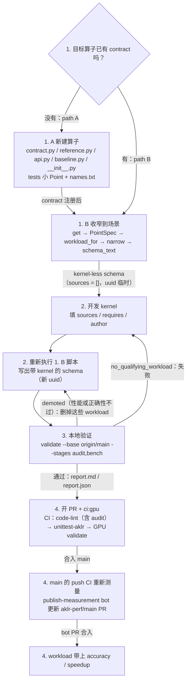

# Ops 教程：给 AKLR 算子添加 kernel

本教程演示如何给 `aklr/ops/` 中的算子添加 kernel，从定义算子一直到 kernel 合入。示例是 `fused_moe`，即 MoE 层的专家计算部分（AITER 的 `fused_moe` 所做的计算），使用 GLM-5 MoE 层的形状。[插件教程](plugin_tutorial.zh.md) 接着以同一个 MoE 层为例，说明如何越过这个算子的边界继续优化。

## 概念

Contract: **contract 是算子的完整定义。** 它是 `aklr/ops/<op>/contract.py` 里的一个 `OpContract` 常量，登记在该模块的 `CONTRACTS` 中（registry 会自动发现）。

Schema: **schema 是一个 JSON 文件。** 它把某个算子的 `OpContract` 收窄到一个场景（固定 dtype、常量轴、属性、布局），列出这个场景要服务的 workload（var 轴的具体取值），并内嵌 kernel 源码。schema 存放在 `aklr/ops/<op>/impls/<language>/<name>/<uuid>.json`。Schema 是 AKLR 与其他 kernel 生成工具交互的契约。

## 工作流程



| 步骤 | 关键动作 | 产出 |
|---|---|---|
| 1. A contract 不存在 | 新建 `contract.py`/`reference.py`/`api.py`/`baseline.py`/`__init__.py`、测试小 Point、更新 `names.txt`，再按 1. B 收窄 | 新算子包 + kernel-less schema |
| 1. B contract 已存在 | `get` → `PointSpec` → `workload_for` → `narrow(sources=[])` → `schema_text()` | kernel-less schema（uuid 临时） |
| 2. 开发 kernel | 填 `kernel.sources` 和 `requires`（可选 `author`），再重新执行 1. B 脚本 | 带 kernel 的 schema（新 uuid） |
| 3. 本地验证 | `python -m aklr validate --base origin/main --stages audit,bench <schema>`；看 demoted 列表，删掉不达标的 workload | `aklr_validation/report.md`、`report.json` |
| 4. PR/CI/写回 | PR 加 `ci:gpu`；合入后由 bot PR 写回测量值 | kernel 合入 main 分支 |

## 1. 生成 kernel-less schema

### 1. A contract 不存在：创建 contract

参考仓库里的 `harness/skills/aklr-port-generated-kernels/references/new-op.md` 依次实现以下文件：

1. `contract.py`：定义 `OpContract` 和 `CONTRACTS`（registry 会自动发现）；`op_type` 取目录名 `<op>`；按数学含义命名；多输出时不能有叫 `out` 的；每个输出给出 `error_bounds`，contract 给出 `determinism`。
2. `reference.py`：float64 的 `<contract>_reference(point, row_major_args, to_float64)`。
3. `api.py`：`@api(<CONTRACT>)` 存根（函数体只能是 `...`）。
4. `baseline.py`：每个有基线的 contract 一个 `<contract>_baseline`，接收 api 的参数（以调用的关键字参数传入），在函数内部 import AITER 或 SGLang，像 api 一样返回输出；不支持的调用抛 `NotImplementedError`（bench 报 `baseline_failed`）。没有这个函数时算子以自己为基线，kernel 没有要超过的对象。
5. `__init__.py`：导出 api。
6. 在 `tests/ops/cases.py` 的 `SMALL_POINTS` 中按 contract 顺序加入各 contract 的 base 小 Point，然后运行 `AKLR_UPDATE_NAMES=1 pytest tests/ops/test_contracts.py` 重新生成 `tests/ops/names.txt` 并一起提交。

只有 `aklr/core/` 下的非 `.md` 改动才会让 CI 测**全部**已提交 schema（`aklr/core/validation/stages/validation_scope.py`）；新建 `aklr/ops/<op>` 不在其中，按改动集合测试，只测改动里的 schema（`new-op.md` 末段说会测全部 schema，已过时，以 `validation_scope.py` 为准）。建议和 kernel 分开提 PR。

### 1. B contract 已存在：生成具体的 schema

钉死场景（常量轴、dtype、属性、布局），列出要服务的 var 轴取值。这些取值由实际 workload 确定。依次调用 `ContractRegistry.default().get(...)`、`PointSpec`、`workload_for`、`narrow(..., kernel={"sources": []}, models=[...])`、`schema_text()`，把结果写到 `op_dir(contract.op_package) / schema.relative_path()`。可以参考如下脚本模板（尖括号是占位符；完整可运行的例子见下方示例）：


```python
from aklr.core.contract.locate import op_dir
from aklr.core.contract.registry import ContractRegistry
from aklr.core.contract.spec import PointSpec

# 取 contract
c = ContractRegistry.default().get("<op>@<version>")
# 固定场景：axes 给常量轴（var 轴只是占位），attrs 给属性，dtypes 给各张量的 dtype，layout_variant_name 给布局
p = PointSpec(
    contract_id="<op>@<version>",
    axes={"<var 轴>": <占位值>, "<常量轴>": <值>, ...},
    dtypes={"<张量>": "<dtype>", ...},  # 不出现的可选张量填 None
    attrs={"<属性>": <值>, ...},
    layout_variant_name="<layout>")
# 为每个 var 轴取值生成一个 workload（{}：标量取默认值）
workloads = [c.workload_for(p.model_copy(update={"axes": {**p.axes, "<var 轴>": t}}), {}) for t in (<v1>, <v2>, ...)]
# 收窄成 schema；sources=[] 表示 kernel-less；language/targets/entry_point 按 contract 和目标硬件填写；
# models 填发出这些调用的模型（aklr/ops/README.md 的 Schema fields 一节）
s = c.narrow(p, workloads=workloads, kernel={"language": "<flydsl|triton|hip>", "targets": [{"arch": "<arch>", "hardware": "<hardware>"}],
                                            "entry_point": "<入口文件>::run", "requires": {}, "author": "", "sources": []},
             models=["<模型>"])
# 写入路径：这里的 uuid 只对应 kernel-less 版本，是临时的
path = op_dir(c.op_package) / s.relative_path()
# 写出 schema_text()
path.parent.mkdir(parents=True, exist_ok=True)
path.write_text(s.schema_text(), encoding="utf-8")
```

## 2. 开发具体 kernel

开发 kernel 时，kernel 段只修改三个字段：`kernel.sources`、`kernel.requires`、`kernel.author`；workloads 由作者在脚本里决定，其他字段由 contract 派生。

- `sources`：flydsl/triton，入口是 `kernel.py::run`，其他文件只能相对导入；hip 用 `.hip`/`.h`，入口是 `kernel.hip::run`。入口文件开头必须有描述 kernel 的 docstring（hip 为开头注释）。推荐用 `narrow(..., kernel=...)` + `schema_text()` 写出。path 规则：
  - flydsl/triton：Python kernel 是一个扁平包，path 里不能有 `/`，也不能有 `__init__.py`；
  - hip：可以用多级目录，如 `include/utils.h`；
- `requires`：工具链版本约束，必填。至少写上 kernel 自己的语言，以开发时用的版本作下限：`{"flydsl": ">=0.3.2"}`、`{"triton": ">=3.8"}` 或 `{"hip": ">=7.15"}`（torch 报告的 HIP 版本，不是 ROCm 版本：ROCm 10.0 里的 HIP 是 7.15）。没写的 kernel，`python -m aklr export check` 会报错；运行时，环境里的版本不满足 `requires` 的 kernel 会被跳过。
- `author`：作者署名。

source 字段全部填写完毕后，重新执行 1.B 脚本（把 `"sources": []` 换成 `[SourceFile(path=..., content=...), ...]`，`SourceFile` 从 `aklr.core.contract.spec` 导入，写法见示例第 1 步脚本），生成新 uuid 的 schema 文件。

## 3. 本地验证

本地验证目的是为了检验 schema 格式是否合法；kernel 的性能是否到达合入门槛。

```bash
python -m aklr validate --base origin/main --stages audit,bench aklr/ops/<op>/impls/<lang>/<name>/<uuid>.json
```

- **audit**：检查文本是否等于 `schema_text()`、命名、与 contract 的一致性、路径/uuid、domain、标量、重复项、测量字段，以及源码审计
- **bench**：
  - 正确性：对每个 workload 用分布采样的输入，参考实现进行比较；
  - 性能：在 CUDA graph 下与基线多轮对比。

**门槛**：新 kernel 的每个 Point 相对基线（`aklr/ops/<op>/baseline.py` 的 `<contract>_baseline`）要 ≥ **1.05**，相对已服务的 kernel 要 ≥ **0.99**，运行时服务要求 ≥ `AKLR_MIN_SPEEDUP`（默认 **1.05**）。不达标的 Point 只记进 report 的 demoted 列表，不会让 validate 失败；demoted 里既有性能不达标的，也有正确性不过的（如 `numeric_mismatch`、`build_failed`、`candidate_crash`，CI 会写成 `accuracy: failed`），两类都要处理。只有一个 workload 都不达标时，schema 才报 `no_qualifying_workload`。

## 4. PR 与 CI

**PR 规则**：
- 按 `.github/pull_request_template.md` 写正文。kernel 和 code PR 都加 `ci:gpu`（fork 的 PR，或作者没有 write 权限的 PR，GPU job 要等 maintainer 批准后才跑）；kernel PR 贴 3. 的结果；
- 新算子的代码（`contract.py` 等，属于 code）单独提 PR；kernel-less schema（模板里叫 contract）和带 kernel 的 schema 各按模板对应一节填写。
- 提交 PR 不写 `accuracy`/`speedup`（手写会报 `perf_edited`）。合入后，main 的 push CI 重新测量，`publish-measurement` 更新 `aklr-perf/main` bot PR；这个 bot PR 以它自己的标题 squash merge 后，workload 才带上 `accuracy`/`speedup`。

**CI 规则**：
- code-lint（CPU：pre-commit、`export check`、`validate --stages audit`）→ unittest-aklr（GPU：全部 pytest）→ validation（GPU：`validate --base <合并基> --stages audit,bench`，只在有要 bench 的 schema 时运行）。
- 只有 `aklr/core/` 下的非 `.md` 改动才测全部 schema，其他改动（schema、文档、新建 `aklr/ops/<op>` 等）只测改动集合里的 schema（`validation_scope.py`）。

## 5. 运行时分发

调用 api 时，如果这次调用的 Point 在某个已加载 schema（`targets`/`requires` 与本机匹配）的 workloads 里，且该 workload 的 `accuracy` 不是 `failed`、`speedup ≥ AKLR_MIN_SPEEDUP`（默认 1.05），就运行该 kernel。

其余情况不走 kernel：api 返回 `FallbackReason`，由调用方运行自己的实现。

| `FallbackReason` | 触发条件 |
|---|---|
| `no_schema` | 没有已加载的 schema |
| `disabled` | 被 `AKLR_DISABLE` 关掉 |
| `out_of_contract` | 没有任何 Point 描述这次调用 |
| `no_workload` | 这次调用的 Point 不在任何已加载 schema 的 workloads 里（如 `<var 轴>` 的取值不在列表里） |
| `not_measured` | 还没测量 |
| `inaccurate` | 测量结果为 `failed` |
| `not_qualified` | 已测且 passed，但 speedup < `AKLR_MIN_SPEEDUP`（默认 1.05） |
| `not_warmed` | 在 graph capture 中，而该 Point 从未在 graph 外跑过 |

## 示例：添加一个 fused MoE schema

示例步骤与上面的对应关系：第 0、1 步对应 1. B，第 2 步对应 §2 写 kernel，第 3 步先做 §2 的重跑脚本再做 §3 验证，第 4、5 步对应 §4。

**0. 选定场景。** `fused_moe@1.0`（`aklr/ops/fused_moe/contract.py` 的 `FUSED_MOE`）做的事：把每个 token 路由到 top-k 个 expert，跑完两次投影后合并。权重固定是 MXFP4。

- axes：var 轴 `n_tokens`（1–65536）；常量轴 `model_dim`、`inter_dim`（均为 128 的倍数）、`n_experts`、`topk`、`global_experts`；派生轴 `gate_up_rows = 2 * inter_dim`、`model_blocks = model_dim // 32`、`inter_blocks = inter_dim // 32`。
- attrs：`activation`（silu/gelu/situv2/swiglu）、`quant_type`（只有 `per_1x32`）、`doweight_stage1`、`gate_mode`（separated/interleave）、`has_expert_mask`、`act_quant`（4/8），以及两个 optional attr `has_num_local_tokens`、`has_swiglu_limit`。
- 输入：`hidden_states`（bf16/fp16，`(n_tokens, model_dim)`）；`w1`（fp4 `float4_e2m1`，`(n_experts, gate_up_rows, model_dim)`，gate 行在前、up 行在后）和 `w2`（fp4，`(n_experts, model_dim, inter_dim)`）；`w1_scale`/`w2_scale`（e8m0，每 1×32 块一个值）。
- 路由输入：`topk_weights`（fp32/bf16/fp16）和 `topk_ids`（int32/int64，每行互不相同），形状都是 `(n_tokens, topk)`。
- layout：`row_major`、`shuffled_16x16`（w1/w2 做 16×16 preshuffle，两个 scale 做 shuffle 并 pad 到 (256, 8)；检测条件是 `w1.is_shuffled`、`w2.is_shuffled` 为真且 `w1_scale.ndim == 3`）、`gate_up_interleaved`。
- 精度要求：`out` 的 SQNR ≥ 13 dB；`determinism` 是 `bounded`，`max_violation_fraction` 为 1e-3。

固定为 GLM-5 MXFP4 MoE 层在 TP8 下的形状：`model_dim=6144`；`n_experts=257`，即 256 个路由专家加 1 个共享专家，sglang 把共享专家追加为最后一个专家；`topk=9`，即 8 个路由专家加共享专家；`inter_dim=256`，即 GLM-5 的 2048 分到 8 张卡；不带 EP（`global_experts=1`，`expert_mask`/`num_local_tokens` 不存在）。attr 取 `silu`、`per_1x32`、`doweight_stage1=False`、`separated`、`act_quant=4`，dtype 取 bf16 激活、fp32 `topk_weights`、int32 `topk_ids`，layout 取 `shuffled_16x16`。仓库中已有这个场景，生成的结果可以和已提交的文件对照。

**1. 生成 kernel-less schema。** 把脚本放在 clone 外，在仓库根目录运行。不带参数时写出 kernel-less 定义；带一个 kernel 目录参数时，把目录里的源码填进 `kernel.sources`（第 3 步会复用）。

```python
# ~/make_moe_schema.py
import sys
from pathlib import Path

from aklr.core.contract.locate import op_dir
from aklr.core.contract.registry import ContractRegistry
from aklr.core.contract.spec import PointSpec, SourceFile

contract = ContractRegistry.default().get("fused_moe@1.0")
base = PointSpec(
    contract_id="fused_moe@1.0",
    axes={"n_tokens": 1, "model_dim": 6144, "n_experts": 257, "topk": 9, "inter_dim": 256, "global_experts": 1},
    dtypes={"hidden_states": "bfloat16", "w1": "float4_e2m1", "w2": "float4_e2m1", "topk_weights": "float32",
            "topk_ids": "int32", "w1_scale": "float8_e8m0", "w2_scale": "float8_e8m0",
            "expert_mask": None, "num_local_tokens": None, "out": "bfloat16"},
    attrs={"activation": "silu", "quant_type": "per_1x32", "doweight_stage1": False, "gate_mode": "separated",
           "has_expert_mask": False, "has_num_local_tokens": False, "has_swiglu_limit": False, "act_quant": 4},
    layout_variant_name="shuffled_16x16")
workloads = [contract.workload_for(base.model_copy(update={"axes": {**base.axes, "n_tokens": t}}), {})
             for t in (1, 2, 4, 8, 16, 32, 64, 128, 256, 512, 1024, 2048, 4096)]  # silu 下没有标量
kernel = {"language": "flydsl", "targets": [{"arch": "gfx950", "hardware": "MI355X"}],
          "entry_point": "kernel.py::run", "sources": []}
if len(sys.argv) > 1:                                                          # 第 2 步：填 kernel
    kernel["sources"] = [SourceFile(path=p.name, content=p.read_text(encoding="utf-8"))
                         for p in sorted(Path(sys.argv[1]).glob("*.py"))]      # 路径须升序且唯一
    if not kernel["sources"]:
        sys.exit(f"{sys.argv[1]} 下没有 .py")
    kernel["author"] = "<你的名字>"                                            # 可选
schema = contract.narrow(base, workloads=workloads, kernel=kernel, models=["glm-5.2"])  # 发出这些调用的模型
path = op_dir(contract.op_package) / schema.relative_path()
path.parent.mkdir(parents=True, exist_ok=True)
path.write_text(schema.schema_text(), encoding="utf-8")
print(path)
```

运行 `python ~/make_moe_schema.py`，会写出 `aklr/ops/fused_moe/impls/flydsl/fused_moe_shuffled_16x16_model_dim6144_n_experts257_topk9_inter_dim256/<uuid0>.json`（`<uuid0>` 只对应 kernel-less 版本，是临时的）。名字里只有 `shuffled_16x16`，因为它不是第一个声明的 layout；其余 attr/dtype 都是各自第一个声明的值，不进名字（`aklr/ops/README.md` 的 Names 一节）。除 `kernel.sources` 和测量字段外，文件内容与已提交的 `aklr/ops/fused_moe/impls/flydsl/fused_moe_shuffled_16x16_model_dim6144_n_experts257_topk9_inter_dim256/1fee59821837c26f.json` 完全相同。新文件节选：

```json
"models": ["glm-5.2"],
"axes": {"n_tokens": {"type": "var", ...}, "model_dim": {"type": "const", "value": 6144, ...}, "n_experts": {..., "value": 257}, "topk": {..., "value": 9},
         "inter_dim": {..., "value": 256}, "gate_up_rows": {..., "value": 512}, "model_blocks": {..., "value": 192}, "inter_blocks": {..., "value": 8}},
"attrs": {"activation": "silu", "quant_type": "per_1x32", "doweight_stage1": false, "gate_mode": "separated", "has_expert_mask": false, "act_quant": 4},
"inputs": {"hidden_states": {"shape": ["n_tokens", "model_dim"], "dtype": "bfloat16", ...}, "w1": {"shape": ["n_experts", "gate_up_rows", "model_dim"], "dtype": "float4_e2m1", ...},
           "topk_ids": {"shape": ["n_tokens", "topk"], "dtype": "int32", "distribution": {"kind": "int_range", "lo": 0, "hi": 256, "distinct": true}, ...}, ...},
"workloads": [{"axes": {"n_tokens": 1}}, ..., {"axes": {"n_tokens": 4096}}],
"layout_variants": {"by_name": {"shuffled_16x16": {"layouts": {"w1": {"kind": "preshuffle", "tile": [16, 16]}, ...,
    "w1_scale": {"kind": "e8m0_scales", "block_size": 32, "pad_to": [256, 8], "shuffled": true}, ...}, ...}}},
"compare": {"max_violation_fraction": 0.001, "determinism": "bounded", "element_order": "fixed"},
"kernel": {"language": "flydsl", "targets": [{"arch": "gfx950", "hardware": "MI355X"}], "entry_point": "kernel.py::run", "sources": []}
```

**2. 开发 kernel。** 入口写成 `def run(*, hidden_states, w1, w2, topk_weights, topk_ids, w1_scale, w2_scale, activation, quant_type, doweight_stage1, gate_mode, act_quant, expert_mask, beta, linear_beta, out_dtype, out) -> None`，与仓库已有 kernel 一致。本场景下 `expert_mask`、`beta`、`linear_beta` 传入的是 `None`；`w1`/`w2` 和两个 scale 到达时已经是 shuffle 后的布局；结果写进 `out`。假设，kernel 源码放在 ~/moe_kernel：入口是 kernel.py::run，目录第一层只放 kernel 用到的 .py，第 3 步会把它们全部读进 sources。

```text
~/moe_kernel/
├── kernel.py        # 入口：模块 docstring + def run(...)；参照 1fee… 只有这一个源文件
├── helper_1.py      # 假设的辅助模块：kernel.py 里用 from .helper_1 import ... 相对导入
└── helper_2.py      # 同上
```

**3. 本地验证。** kernel 写完后, 重新执行 `make_moe_schema.py`，生成最终的 schema 文件 `<uuid1>.json`

```bash
D=aklr/ops/fused_moe/impls/flydsl/fused_moe_shuffled_16x16_model_dim6144_n_experts257_topk9_inter_dim256
# ~/moe_kernel：第 2 步写好的 kernel 源码目录（含 kernel.py::run 入口文件）
python ~/make_moe_schema.py ~/moe_kernel             # → $D/<uuid1>.json
rm $D/<uuid0>.json                                   # 删除原本的 schema
python -m aklr validate --stages audit $D/<uuid1>.json   # 可选：无 GPU 时快速自检
python -m aklr validate --base origin/main --stages audit,bench $D/<uuid1>.json
```

**4. 提交 PR 跑 CI 测试** push代码到远程仓库开一个 PR。开 PR 时加 `ci:gpu`，正文贴第 3 步的 `report.md` 结论，并写明形状和 `n_tokens` 的来源。main 的 push CI 重新测量，再由 `aklr-perf/main` bot PR 写回 PR 里保留的那些 workload 的 `accuracy`/`speedup`，这个 bot PR 合入后才生效。

**5. 完成合入。** PR 合入、且携带其测量结果的 `aklr-perf/main` bot PR 也合入之后，凡是加速比达到 `AKLR_MIN_SPEEDUP` 的 workload，分发都会使用这个 kernel（§5）。

## 下一步

`fused_moe` 只覆盖 MoE 层的专家计算。[插件教程](plugin_tutorial.zh.md) 会把整个 MoE 层（含路由和 top-k）一起接管。
