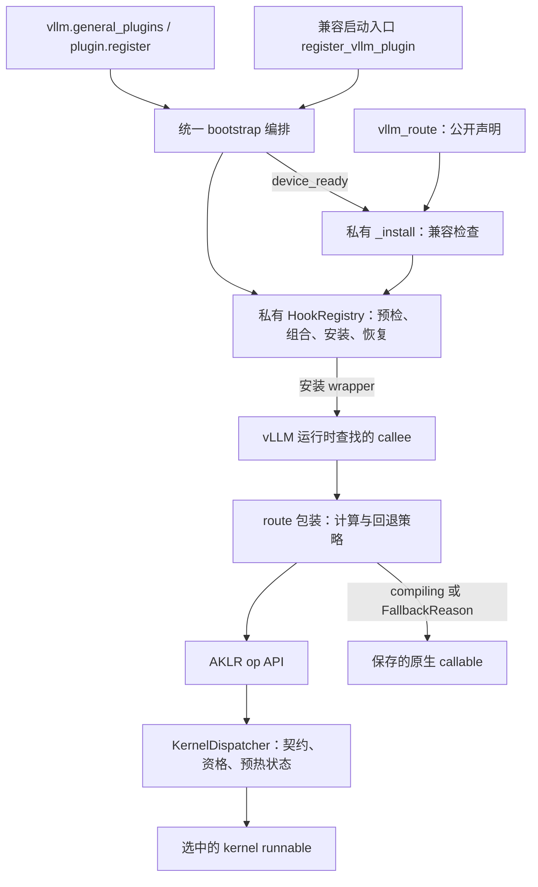
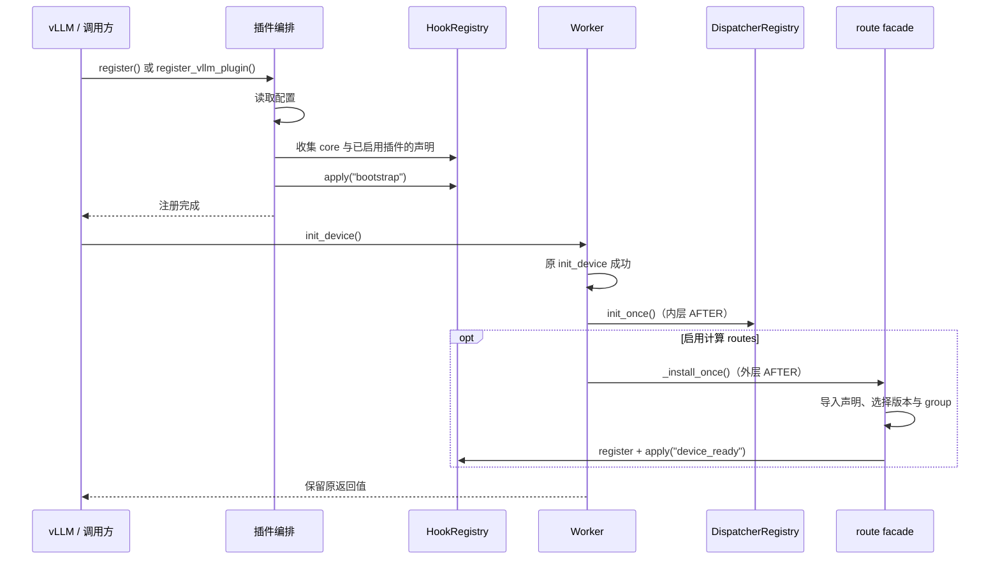
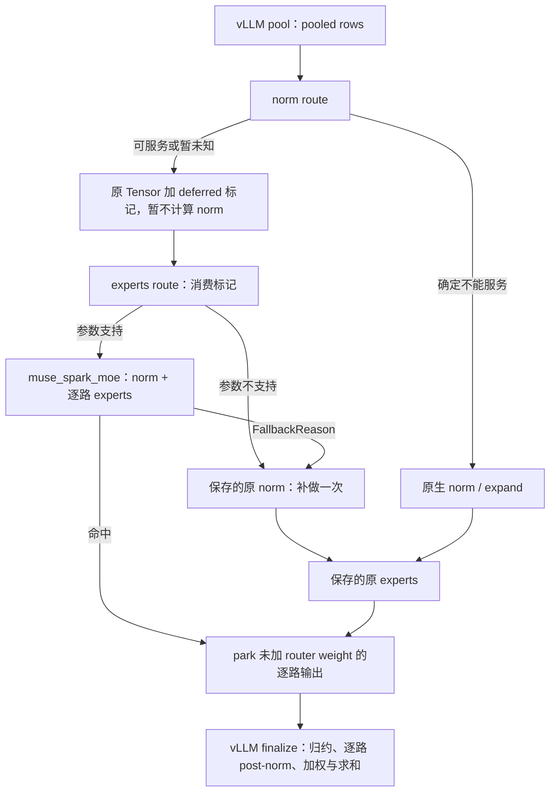

# AKLR vLLM 插件设计：vllm_route 与 Muse Spark 接入

日期：2026-11-10。代码基线：`dev/minimax-m31-vllm-plugin`，提交 `fe939f21dc4bd7426d0e73096e95e9f2b6f57721`，以及本次将 Hook 声明接口统一为 `vllm_route` 的改动。本文描述实现的架构、接口与边界，供人工代码审核；未来能力单独列于末尾。

设计采用**启动时分阶段安装、显式修改目标绑定、保存原函数回退**。对外只提供 `vllm_route` 声明 Hook；私有 HookRegistry 负责 Python 绑定的生命周期，vLLM facade 负责框架兼容性和 route 策略，AKLR dispatcher 负责算子契约、kernel 选择和执行。Muse 的 norm/experts 接入是该机制的一个具体适配案例。

## 1. 目标与范围

需要解决的问题是：分散的函数包装难以一致处理重复注册、方法绑定、关联安装、失败回滚和原生回退。特别是 Muse 将 norm 延迟到 experts 执行时，两个入口必须一起选择，回退还必须绕过已经安装的包装。

本版统一这些安装行为，扩展代码通过 `from aklr.plugins.vllm.hook import vllm_route` 声明计算入口。Registry、安装、原函数查询和版本读取均为内部实现，不作为第二套 Hook API 对外提供。所有实现位于 AKLR 内；插件启动时修改当前进程的 Python 属性绑定，不需要改写 vLLM 源文件。

`vllm.general_plugins` 使用的 `plugin.register()` 和既有 `register_vllm_plugin()` 负责启动插件；它们不是供扩展代码声明 Hook 的接口。Worker 生命周期包装由插件内部维护，不向 `vllm_route` 增加 bootstrap、BEFORE/AFTER 等通用注册参数。

本版不负责完整模型替换、权重或 KV cache 生命周期、自动算子融合、任意 EP 数据搬运，以及 serving 期间的动态切换。私有 Registry 可以包装类方法，但这不等于已经完成对应 module 的计算边界设计。

## 2. 架构与职责

| 层 | 主要职责 | 源码 |
| --- | --- | --- |
| 私有 Registry | 声明身份、hook 组合、绑定记录、阶段冻结、恢复 | [_hook_registry.py](../aklr/core/runtime/_hook_registry.py) |
| 启动编排 | 配置读取、收集 Worker hooks、安排 runtime 与 routes 初始化 | [插件入口](../aklr/plugins/vllm/__init__.py)、[core 入口](../aklr/core/runtime/dispatch/_vllm.py) |
| vLLM facade | 对外提供 `vllm_route`；内部完成版本选择、caller/参数检查、独占安装与原生回退 | [hook.py](../aklr/plugins/vllm/hook.py) |
| 业务适配 | 框架参数到 AKLR op 的映射，以及未覆盖行为的回退 | [GEMM](../aklr/plugins/vllm/layers/gemm.py)、[MoE](../aklr/plugins/vllm/layers/fused_moe.py)、[Muse](../aklr/plugins/vllm/models/muse_spark/api.py) |
| Dispatcher | 加载 schema、检查目标与依赖、建表、按 Point 调度、报告 fallback | [初始化](../aklr/core/runtime/dispatch/_registry.py)、[调用路径](../aklr/core/runtime/dispatch/_dispatcher.py) |
| Kernel | 执行契约规定的数值计算 | 各 op 的 `impls/` JSON |

`_hook_registry.py` 是私有模块，只依赖标准库，不理解 Tensor、vLLM、SGLang 或 `FallbackReason`。它的 `HookRegistry`、`HookSpec`、`HookType` 和 `KEEP_RESULT` 只供 AKLR 内部使用；业务异常是否回退、计算到哪里结束，都由上层决定。

core 启动入口在调用时懒导入插件 `_register()`，使两个启动入口使用同一编排；插件则调用私有 `_register_runtime_hook()` 收集 core 声明。这避免了两个入口分别提交同一阶段，也避免导入期的循环初始化。

## 3. 启动与运行生命周期

插件使用 `bootstrap` 和 `device_ready` 两个阶段。Registry 的 phase 本身是字符串；两阶段的先后关系由插件编排保证，没有通用依赖图。

bootstrap 安装的目标如下：

| hook ID | Worker 方法 | 类型 / order | 启用条件 |
| --- | --- | --- | --- |
| `vllm.runtime.init` | `init_device` | AFTER / 0 | 始终保留 core 初始化 |
| `vllm.plugin.routes` | `init_device` | AFTER / 10 | 插件 routes 启用 |
| `vllm.plugin.warmup` | `compile_or_warm_up_model` | AFTER / 0 | 插件 routes 启用 |
| `vllm.plugin.execute` | `execute_model` | AROUND / 0 | 插件 routes 启用 |

`init_device` 的两个 AFTER 从内向外执行，因此顺序是原设备初始化、dispatcher 初始化、计算 routes 安装。原设备初始化失败时，后两个步骤均不执行。

`AKLR_VLLM_PLUGIN=1` 且没有全局禁用时启用插件 routes；未设置、为 `0` 或 `AKLR_DISABLE=1` 时仍保留 core 初始化入口。Boolean 开关和有限的 `AKLR_MIN_SPEEDUP` 在 bootstrap 前校验；`AKLR_DISABLE` 中具体 contract ID 的格式在后续 dispatcher 初始化时校验。

配置保持不变时，两个启动入口可以任意顺序重复调用，已安装的 wrapper 身份不变。阶段提交之后改变开关不构成热切换接口。`plugin.register()` 将同步注册异常转换为 `SystemExit`；发生在后续 `Worker.init_device()` 中的 runtime/route 初始化异常从该调用直接传播。

`roomy` 仍在 `execute_model` 外围提供 CPython frame 空间，属于 vLLM 专属执行策略。补充 warmup 在 vLLM 自身 warmup 成功返回后执行，并且只在确有安装的 routes 时运行。

## 4. 公开声明与内部 Hook 实现

### 4.1 唯一公开 Hook 声明接口

扩展代码使用 `@vllm_route(caller, *callees, versions=..., group=...)`：`caller` 标识框架的调用位置，`callees` 指定实际改写的属性绑定，`versions` 列出经过测试的 vLLM 版本，`group` 将相互依赖的 routes 一起选择。route 函数使用原 callee 的参数，返回正常结果或 `FallbackReason`；后者由内部包装调用保存的原函数。完整例子见 [使用说明](vllm_hook_registry_mvp.zh.md)。

装饰器只收集声明并返回 route 函数，不立即改写目标。插件在设备就绪后调用私有 `_install()`，完成兼容性检查，将所选声明转为内部 `HookSpec`，再由 Registry 安装。扩展代码不需要自行注册第二遍，也不调用安装或恢复方法。

`hook.py` 只导出 `vllm_route`。`_install`、`_original`、`_vllm_version` 均为私有辅助函数；以下 Registry 字段与方法用于解释安装实现，不构成对外 API。

### 4.2 内部实现：声明与注册

内部 `HookSpec` 是不可变声明，主要字段如下：

| 字段 | 含义 / 默认值 |
| --- | --- |
| `hook_id` | 稳定、非空的声明 ID |
| `target` | 实际修改属性的完整路径 |
| `hook` | 同步 Python 回调 |
| `hook_type` | BEFORE、AFTER、AROUND、REPLACE；默认 AROUND |
| `phase` | 安装批次；默认 `device_ready` |
| `group` | 关联声明组；默认 `None` |
| `order` | 同目标组合顺序；默认 0 |
| `source` | 声明来源，供诊断使用 |
| `aliases` | 额外明确授权修改的模块绑定；默认空元组 |
| `exclusive` | 是否独占目标；默认 False |
| `validate` | 安装前检查实际原 callable 的回调；默认 None，以抛异常表示不兼容 |

`register(spec)` 只收集声明，不解析 target。相同 ID、相同完整定义可重复注册；同 ID 改定义会失败。因此重复注册时也需要保持 hook/validator 等 callable 的稳定身份。

Registry 的内部方法为 `register`、`apply(phase)`、`original(hook_id)`、`report()` 和 `restore(phase=None)`。`apply` 成功后冻结阶段，即使该阶段没有目标；再次 apply 会核对已安装对象的身份，不再套一层 wrapper。

### 4.3 内部实现：回调协议

| 类型 | 协议 | 返回含义 |
| --- | --- | --- |
| BEFORE | `hook(*args, **kwargs)` | None 保持参数，否则返回新的 `(args, kwargs)` |
| AFTER | `hook(result, *args, **kwargs)` | `KEEP_RESULT` 保持结果；其他值替换结果，包括 None |
| AROUND | `hook(next_fn, *args, **kwargs)` | 回调自行决定是否调用内层链及返回什么 |
| REPLACE | `hook(*args, **kwargs)` | 直接接管实现 |

AFTER 只在内层正常返回时执行，不是 finally。异常默认向调用者传播。四类专用闭包在安装时生成，每次调用不再判断 hook 类型。

每个目标最多一个 REPLACE，且它总在最内层。其他 hooks 按 `(order, hook_id)` 从内向外构造：若 A 排在 B 前，则结构为 `B(A(original))`。BEFORE 因而从外向内执行，AFTER 从内向外执行。

存在 `exclusive=True` 时，同目标的任何其他 hook 都会使预检失败，包括观察用途的 BEFORE/AFTER。当前所有 vLLM 计算 routes 都是独占的；本版没有“允许独占 hook 与指定伙伴混合”的额外白名单。

### 4.4 内部实现：内层链与原函数

`next_fn` 指向当前 hook 的内层链，可能包含其他 hook 或 REPLACE。`original(hook_id)` 返回本批安装前保存的 callable，绕过本批组合；它可能已经被外部代码包装，并不保证是最初的源码函数。

facade 的私有 `_original(route, callee=None)` 按 route/callee 索引，随后查询 Registry，供 Muse 等内置适配器协调多个原生调用。多目标 route 必须指定 callee。restore 后新的查询失败；重新安装后查询使用新保存的原函数。已经返回的函数引用无法被撤销。普通扩展 route 返回 `FallbackReason` 即可触发原生回退，不需要调用这个 helper。

## 5. 内部实现：安装记录、绑定与恢复

Registry 分开保存三类状态：`_specs` 是声明集合，`_applied` 是每阶段的安装记录，`_originals` 是 hook ID 到原函数的映射。每个 target 的记录包含所选 specs、原 callable 和实际修改的 bindings；每个 binding 保存 owner、属性名、原始对象、原来是否自有该属性、安装对象与路径。

### 5.1 预检与写入

一次 apply 的事务范围是整个 phase，不是单个 group：

1. 聚合该阶段的 target，检查非空 group 不跨阶段，以及 REPLACE/独占组合。
2. 解析全部目标与 aliases，保存原始属性；对实际会调用的原 callable 运行 validator。
3. 构造 wrapper，检查实际 `(id(owner), attr)` 槽位是否已被 target、alias 或已安装阶段占用。
4. 按目标的继承深度排序，从更具体的实例/子类到祖先逐个赋值，每次写入前后核对身份。
5. 全部成功后登记安装结果和原函数；任一赋值失败则尝试逆序恢复本批写入。

AITER 某些兼容模块在首次 import 时替换 `sys.modules` 中的自身入口，所以 owner 解析保留两次 `pkgutil.resolve_name`。兼容处理集中在 Registry，facade 不再重复解析 callee。

实现没有锁，多属性赋值也不是一次不可分割的交换。它提供启动阶段的预检和失败回滚，要求目标代码尚未开始并发执行。回滚不撤销声明、import 副作用、GPU 资源或已经发生的业务计算。

### 5.2 Python 绑定规则

| 目标形态 | 安装方式 |
| --- | --- |
| 普通模块函数 | 保存 callable，安装普通 wrapper |
| 类的普通方法 | 保留函数 descriptor 的实例绑定 |
| classmethod / staticmethod | 包装 `__func__` 后重新装上对应 descriptor |
| 类上的 builtin、partial、已绑定方法或无绑定 callable 对象 | 使用 `staticmethod(wrapper)`，避免额外传入 self |
| singleton 或 `ModuleType` 子类实例方法 | 保存 `getattr` 得到的绑定 callable，在实例上安装 wrapper |

目标直接定义的属性在 restore 时原样放回；通过继承获得的属性则删除本次新增的实例/子类属性，恢复查找关系。类整体 REPLACE、自定义 descriptor、异步/generator 目标和仅由 metaclass 提供的目标不在支持范围内。

父子类同批声明时各自包装批次开始前的原函数。例如同时声明 `Base.fn` 和继承它的 `Child.fn`，Child 的 wrapper 不自动叠加本批 Base 的 wrapper。只声明 Base 时，Child 则按正常继承查找使用 Base 的安装结果。该规则使行为不依赖类的路径名称。跨阶段冲突检查针对实际槽位，不是任意 MRO 依赖图分析。

### 5.3 Alias 和 group

aliases 仅接受显式模块属性，并要求其静态原对象 `is original`。原目标为 classmethod/staticmethod descriptor 时不接受 aliases。主目标与 aliases 一起提交和恢复；不会扫描所有模块，也不会追踪未来 import、闭包、局部变量、容器引用或已编译图。

core 中的 group 只限制同组声明不跨 phase，不定义“必须有哪些成员”。vLLM facade 负责对已经声明的成员进行整组版本选择；一个成员未测试则整组跳过。业务关联的完整性仍由声明该组的适配代码负责。

### 5.4 失败与 restore

赋值操作在执行前就记入 rollback 清单，因此“已经修改属性，然后抛异常”也能尝试恢复。恢复前先检查整个所选批次：当前位置必须仍为安装对象，或者已经回到原对象及原属性归属状态。发现第三方改写时，在恢复写入前报告冲突。

随后逆序执行 `setattr` 或 `delattr`。这些操作本身仍可能失败，届时会明确抛出恢复失败，不能保证任意自定义 setter 故障下都恢复完整。启动方不得将这种失败当作可继续服务的成功状态。

restore 用于受控启动失败或测试清理。成功后清除相应安装记录和原函数查询，保留声明，以便受控重新 apply；不重置 dispatcher、插件 `_install_once` 或 Muse 业务缓存。错误声明的修订通常需要重建 Registry。

## 6. vLLM facade 与当前 route 清单

`@vllm_route(caller, *callees, versions=..., group=...)` 将 route/callee 与 caller、版本、group 存为同一份声明。版本使用 `Version(...).public` 比较，只移除 local label，保留开发版编号。

私有 `_install()` 先通过 `_vllm_version()` 读取框架版本，选择所支持的声明，再检查 caller 的源码是否含有目标属性名加 `(`，并通过内部 `HookSpec.validate` 比较 route 与实际原 callable 的参数名称、顺序和 kind。默认值及类型注解不参与比较；classmethod 包含 cls，singleton 使用绑定后的签名。caller 子串检查是兼容性线索，不是运行期 caller 过滤或完整调用链证明：所有运行时查到被替换 callee 的调用都会受影响。

当前是 **6 个 route 函数、6 个不同 callee 绑定**。全部为 `device_ready / AROUND / exclusive=True`，版本白名单均为 `0.33.0rc1.dev910`。

| route | caller | 实际替换的 callee |
| --- | --- | --- |
| `_tgemm_mm` | `vllm.model_executor.layers.utils.rocm_unquantized_gemm_impl` | `aiter.tuned_gemm.tgemm.mm` |
| `_wv_split_krc` | `vllm.model_executor.layers.utils.rocm_unquantized_gemm_impl` | `vllm._custom_ops.wvSplitKrc` |
| `_fused_moe` | `vllm._aiter_ops._rocm_aiter_fused_moe_impl` | `aiter.fused_moe.fused_moe` |
| `_torch_linear` | `vllm.model_executor.layers.linear.ReplicatedLinear.forward` | `vllm.models.muse_spark.amd.model.MuseSparkTorchLinearMethod.apply` |
| `_defer_norm` | `vllm.models.muse_spark.amd.model.MuseSpark1xMoE._pool` | `vllm.models.muse_spark.amd.model.fused_rmsnorm_expand` |
| `_experts_apply` | `vllm.model_executor.layers.fused_moe.modular_kernel.FusedMoEKernelModularImpl._fused_experts` | `vllm.models.muse_spark.amd.muse_moe_runner.MuseSparkAiterExperts.apply` |

前两条和 Muse linear 接入 GEMM，`_fused_moe` 接入通用 fused MoE；最后两条同属 `muse_spark.norm_experts`，其余没有 group。

运行时 facade 的逻辑是：compiling 时直接调用保存的原函数；否则先调用 route，只有返回 `FallbackReason` 才回退。普通返回值，包括 None，都表示已处理。计算异常继续抛出，不会静默转成原生重试。

## 7. Muse Spark 的计算边界

Muse pooler/unpooler 的 linear route 独立调用 GEMM。norm/experts 这组则把 pre-expert norm 合并进 AKLR experts op，仍由 vLLM 完成后续 finalize。

### 7.1 数据流

`_defer_norm` 对无权重、input-scale、非 BF16 或空输入正常回退。其他情况查询该层/形状是否可服务；确定不能服务则执行原生 norm。可以服务或暂时未知时，在原 Tensor 上记录 `(norm_weight, eps, gain_center)`，把层加入 pending 集合，直接返回尚未归一化的同一 Tensor。

`_experts_apply` 消费该标记，删除 Tensor 属性并移除 pending 状态，再检查当前参数是否落在支持子集：要求 expert map、SILU、MXFP4 W4A4、连续输出，并排除 token metadata、输入 router weighting、相关输入 scale、bias 和 padding 等不支持形式。

AKLR op 接收 `[T,D]` pooled BF16 rows、norm 权重、`[T,K]` expert IDs、rank-local expert mask 及 MXFP4 weights/scales，输出 `[T,K,D]` 的逐路 BF16 结果；非本 rank 的路线写零。数学范围为 pre-expert RMSNorm 和各路 expert，**不包含 router weighting、post-expert norm 和路线求和**。具体 dtype、布局和公式见 [contract](../aklr/plugins/vllm/models/muse_spark/contract.py) 与 [reference](../aklr/plugins/vllm/models/muse_spark/reference.py)。

命中后，route 调用宿主 `_park_route_output(route_output.view_as(output))` 并返回 None，把逐路输出交给原生后续流程。不能用已经加权求和的普通 MoE 输出替代这一接口，因为 Muse 后续还需要逐路 post-expert norm。

### 7.2 原生回退

参数不受支持或 op miss 时，Muse 内置适配器先调用私有 `_original(_defer_norm)` 补做一次原生 norm/expand，再把返回值交给 `_original(_experts_apply)`，完整透传专家参数。这是内置适配器的协作协议，不是对外新增的回退 API；它使回退不依赖当前 canonical 模块属性或可变化的 `__wrapped__` 链。

没有 deferred 标记且没有 pending norm 时，experts route 正常回退；没有标记但存在 pending norm 时抛错，避免 Tensor 复制或 all-to-all 后的另一份数据被当作已归一化输入使用。

原生 norm/expand、park/finalize 的说明基于 vLLM `4fab5a07475822c6eaa971dceb2e2220d0446808` 的静态源码核对：norm 使用 `_muse_route_expanded` 交接展开 buffer；原 experts 可通过 `take_expanded()` 复用；finalize 按配置进行 TP reduction、逐路 post-norm、router weighting 和求和。这些原生机制由 vLLM 保持，静态核对不等于运行验证。

### 7.3 保留的状态与限制

| 状态 | 用途 |
| --- | --- |
| Tensor 的 `_aklr_muse_deferred_norm` | norm 与 experts 之间传递延迟参数 |
| `_PENDING` | 尚未消费 norm 的层 ID 集合 |
| `_EXPERTS[id(norm_weight)]` | 已观察到的专家配置或不可服务标记 |
| `_SERVES[(layer,T)]` | 是否服务该层/形状的缓存 |
| `_TOPK_IDS[(device,dtype,topk)]` | 资格查询使用的零 ID buffer |

`NOT_WARMED` 不缓存为永久否定结果，使后续 eager warmup 后仍可使用该 Point；其他 miss 会让相应层/形状停止继续 defer。成功路径的正资格缓存由后续 `_would_serve` 查询建立。

这些状态按进程共享，没有 per-request/per-call token，也没有由 Registry 管理的卸载/重载清理。成组选择避免当前两条声明只启用一条，但没有消除 Tensor 属性交接、并发重入、模型生命周期或 EP 搬运的约束。

## 8. Dispatcher、compile 与 GPU graph

dispatcher 初始化读取 schema，按设备目标与依赖筛选并构建 runnable，再按契约生成 FastKey 和调度表。实际调用从 shape/dtype 等契约信息生成 Point，查找合格 runnable；失败返回 `FallbackReason`，由 route 执行原生路径。

默认 `AKLR_MIN_SPEEDUP=1.03`。资格判断排除 `accuracy="failed"`，正门槛要求 speedup 达标；门槛不大于 0 时允许未测量 workload，没有 baseline 的 contract 使用门槛 0。因此“必须先有测量才会执行”只适用于相应的正门槛配置，不能写成所有配置下的保证。

需要分别理解三种执行情形：

- **torch.compile tracing**：facade 检测 `torch.compiler.is_compiling()`，直接执行保存的原函数，避免 Dynamo 跟踪 AKLR 调度分支。
- **eager / CUDA graph capture**：合格 runnable 对应的匹配 key 在 eager 成功运行后标记 warmed；capture 已匹配到合格 runnable、但该 key 尚未 warmed 时返回 `NOT_WARMED`。没有匹配或资格不满足时，仍返回 `NO_WORKLOAD`、`NOT_MEASURED` 等对应原因。
- **graph replay**：重放 capture 时记录的执行路径，不重新运行 Python route 选择。capture 中记录了原生回退，后续 warmup 不会自动改写那张图。

现有补充 warmup 由已服务的 GEMM shapes 驱动，位于 vLLM 原 warmup 之后；它没有补齐完整 MoE pre-capture 覆盖。hook 已安装、AKLR API 已命中、FlyDSL kernel 已命中、graph 已捕获该 kernel，是四个不同层面的事实。

## 9. 本分支的 kernel 设计取舍

MiniMax hidden-state GEMM 的大 M split-K 路径使用完整 FP32 partial planes，再由第二个 kernel 按既定顺序 fold。删除 FP24 有损压缩是为了避免有限 partial 被舍入成 Inf，以及相消后有效低位丢失。workspace 与 partial 存取流量增至原来的 4/3；当前表内最大 workspace 为 66 MiB，性能需要目标 GPU 重新测量。

小 MoE 只服务少于 256 tokens 的声明 workloads，删除了不可能被这些 workloads 使用的 Torch 展开路径；至少 256 tokens 由独立 schema 覆盖，小 schema 的直接越界调用明确报错。

两个 hidden-state GEMM schema 是混合后端：5 个小 M 和 6 个大 M workloads 通过 `torch.matmul` 执行，其余表内 Point 使用 FlyDSL。`kernel.language="flydsl"` 表示 builder 类型，不能单独作为实际后端命中的证据。源码变化后的 JSON 按内容哈希更名，避免复用旧内容对应的缓存标识。

完整 workload 列表、schema 链接与数值回归说明见 [kernel 覆盖文档](minimax_m31_kernel_coverage.zh.md)。三个修改的 schema 没有写入未经验证的测量数据；其默认正门槛配置下的未测量 Point 不会进入正常调度。

## 10. 可观测性、进程与信任边界

私有 `HookRegistry.report()` 提供 ID、target、type、phase、group、order、source、aliases、exclusive、registered/installed 和当前 PID，供受控诊断与测试使用。它读取安装记录，不重新验证目标是否被外部修改；重复 apply 和 restore 才执行相应身份检查。当前 report 不包含已验证的框架版本、原函数 identity、失败历史或 kernel 命中统计。

Registry 输出 INFO 逐目标安装日志；facade 输出 WARNING 安装数量摘要，并区分自身版本未测试和被同组成员阻止。运行问题应继续检查 dispatcher 的 fallback reason、设备/依赖、资格及 warmed 状态。

Registry、dispatcher、`_install_once` 和 Muse 缓存都是进程内状态，没有 fork 后自动重置或 PID ownership guard。新增进程启动方式需验证这些状态的继承与初始化，不能只清空某张表后重新安装。

target、callback、validator 与 kernel 源码均来自受信任的插件/仓库代码。Registry 不是执行不可信代码的沙箱，也不提供面向服务请求的动态 hook 管理接口。

## 11. 关键决策与验证

| 决策 | 原因与代价 |
| --- | --- |
| 仅公开 `vllm_route`，Registry 作为私有实现 | 扩展代码只声明计算入口；框架兼容、回退与安装生命周期由内部统一处理 |
| 整个 phase 预检和回滚 | 避免常见安装失败留下半套 hooks；不能代替并发锁或任意 setter 的强事务 |
| 计算 route 默认独占 | 避免外层 hook 静默跳过计算 route；需要组合时必须另行明确设计 |
| 保存原 callable，显式 aliases | 原生回退稳定、修改范围可审计；无法自动覆盖所有已保存引用 |
| 批次原函数与按继承深度安装 | 父子类行为确定、恢复可重现；不会隐式叠加本批父类 hook |
| 保留 Muse deferred 协议 | 将安装重构与数学链改造分开验证；Tensor/全局状态限制仍然存在 |
| 完整 FP32 partial | 保留数值相消；增加 workspace 和访存，需要重测性能 |

基线提交 `fe939f2` 在上一轮相关 CPU 测试中得到 **408 passed / 171 skipped**；当时修改的 Python 和内嵌 kernel 源码通过 Ruff、编译检查，schema 导出检查通过。这些结果对应 API 收口前的代码基线。

本次接口收口在 CPU 环境运行 `python -m pytest tests/core/runtime tests/plugins/vllm tests/plugins/sglang/test_hook.py -q`，结果为 **150 passed / 35 skipped**。修改涉及的 Python 文件通过 Ruff；导入检查确认 `hook.py` 只导出 `vllm_route`，旧公开 Registry 模块和 helper 名称已移除，框架插件入口仍能解析。生命周期测试通过公开装饰器声明计算入口，经真实内部安装流程验证设备就绪前后行为、版本选择和 `FallbackReason` 回退。

| 已有验证 | 覆盖范围 |
| --- | --- |
| [Registry 测试](../tests/core/runtime/test_hook_registry.py) | 回调协议、绑定、继承组合、别名、冲突、回滚、恢复与原入口生命周期 |
| [facade 测试](../tests/plugins/vllm/test_hook.py) | 版本/group、签名、fallback、classmethod、singleton、compiling 绕过 |
| [lifecycle 测试](../tests/plugins/vllm/test_lifecycle.py) | 公开装饰器到真实内部安装的链路、core/plugin 包装组合与调用顺序，使用 CPU Worker/dispatcher 替身 |
| [Muse 测试](../tests/plugins/vllm/test_muse_spark.py) | norm 恰好一次、saved-original 回退、逐路输出交接、关联预检失败 |
| [GEMM](../tests/ops/test_minimax_gemm.py) / [MoE](../tests/ops/test_minimax_moe.py) | 实际内嵌写入/fold 的数值回归、真实入口的后端选择与覆盖；gfx950 用例已加入但本环境跳过 |

CPU Muse 替身没有完整模拟 `_muse_route_expanded`、`take_expanded` 与原生 finalize。目标镜像仍需验证真实 vLLM/AITER ABI、数值、TP/EP 归约、eager/capture/replay、显存和端到端性能。H200 上的目录用于人工审核，不代表这些 gfx950/ROCm kernel 已在 H200 完成验收。

## 12. 后续扩展方向

下一步 module 适配应先定义完整输入、输出和生命周期边界，再决定哪些方法声明为 target。对 Muse，可进一步将 norm 与 experts 的参数交接变成显式 module 内部调用，减少依赖 Tensor 属性和进程全局 pending 状态；这需要重新验证原生 prepare/finalize、并行通信和 graph 行为。

class 整体替换、细粒度依赖图、受控范围 alias 扫描、fork 状态修复、async/generator 和运行期热切换均未实现。只有出现具体目标后再分别设计，不能直接由当前 `restore` 或方法包装能力推导为已支持。

操作示例见 [MVP 使用说明](vllm_hook_registry_mvp.zh.md)；本轮 reviewer 意见与修复映射见 [逐项修复记录](vllm_review_fixes_20261110.zh.md)。
