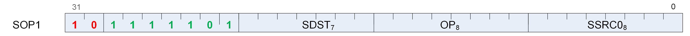
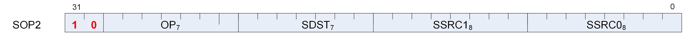
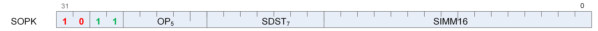
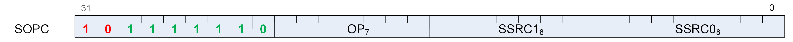
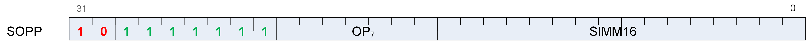

<!-- page 32 -->

# Chapter 5. Scalar ALU Operations

Scalar ALU (SALU) instructions operate on a single value per wavefront. These operations consist of 32-bit integer arithmetic and 32- or 64-bit bit-wise operations. The SALU also can perform operations directly on the Program Counter, allowing the program to create a call stack in SGPRs. Many operations also set the Scalar Condition Code bit (SCC) to indicate the result of a comparison, a carry-out, or whether the instruction result was zero.

## 5.1. SALU Instruction Formats

SALU instructions are encoded in one of five microcode formats, shown below:











Each of these instruction formats uses some of these fields:

|**Field**|**Description**|
|---|---|
|OP|Opcode: instruction to be executed.|
|SDST|Destination SGPR.|
|SSRC0|First source operand.|
|SSRC1|Second source operand.|
|SIMM16|Signed immediate 16-bit integer constant.|

The lists of similar instructions sometimes use a condensed form using curly braces { } to express a list of possible names. For example, S_AND_{B32, B64} defines two legal instructions: S_AND_B32 and S_AND_B64.

## 5.2. Scalar ALU Operands

Valid operands of SALU instructions are:

- SGPRs, including trap temporary SGPRs.

- Mode register.

- Status register (read-only).

- M0 register.

- TrapSts register.

- EXEC mask.

- VCC mask.

- SCC.

- PC.

- Inline constants: integers from -16 to 64, and a some floating point values.

- VCCZ, EXECZ, and SCC.

- Hardware registers.

- 32-bit literal constant.

<!-- page 33 -->

In the table below, 0-127 can be used as scalar sources or destinations; 128-255 can only be used as sources.

_Table 13. Scalar Operands_

<table>
<thead>
<tr><th></th><th>Code</th><th>Meaning</th><th>Description</th></tr>
</thead>
<tbody>
<tr><td rowspan="12">Scalar<br>Dest<br>(7 bits)</td><td>0 - 101</td><td>SGPR 0 to 101</td><td>Scalar GPRs</td></tr>
<tr><td>102</td><td>FLAT_SCRATCH_LO</td><td>Holds the low Dword of the flat-scratch memory descriptor</td></tr>
<tr><td>103</td><td>FLAT_SCRATCH_HI</td><td>Holds the high Dword of the flat-scratch memory descriptor</td></tr>
<tr><td>104</td><td>XNACK_MASK_LO</td><td>Holds the low Dword of the XNACK mask.</td></tr>
<tr><td>105</td><td>XNACK_MASK_HI</td><td>Holds the high Dword of the XNACK mask.</td></tr>
<tr><td>106</td><td>VCC_LO</td><td>Holds the low Dword of the vector condition code</td></tr>
<tr><td>107</td><td>VCC_HI</td><td>Holds the high Dword of the vector condition code</td></tr>
<tr><td>108-123</td><td>TTMP0 to TTMP15</td><td>Trap temps (privileged)</td></tr>
<tr><td>124</td><td>M0</td><td>Holds the low Dword of the flat-scratch memory descriptor</td></tr>
<tr><td>125</td><td>reserved</td><td>reserved</td></tr>
<tr><td>126</td><td>EXEC_LO</td><td>Execute mask, low Dword</td></tr>
<tr><td>127</td><td>EXEC_HI</td><td>Execute mask, high Dword</td></tr>
<tr><td></td><td>128</td><td>0</td><td>zero</td></tr>
<tr><td></td><td>129-192</td><td>int 1 to 64</td><td>Positive integer values.</td></tr>
<tr><td></td><td>193-208</td><td>int -1 to -16</td><td>Negative integer values.</td></tr>
<tr><td></td><td>209-234</td><td>reserved</td><td>Unused.</td></tr>
<tr><td></td><td>235</td><td>SHARED_BASE</td><td rowspan="4">Memory Aperture definition.</td></tr>
<tr><td></td><td>236</td><td>SHARED_LIMIT</td></tr>
<tr><td></td><td>237</td><td>PRIVATE_BASE</td></tr>
<tr><td></td><td>238</td><td>PRIVATE_LIMIT</td></tr>
<tr><td></td><td>239</td><td>Reserved</td><td>Reserved</td></tr>
<tr><td></td><td>240</td><td>0.5</td><td rowspan="9">single or double floats</td></tr>
<tr><td></td><td>241</td><td>-0.5</td></tr>
<tr><td></td><td>242</td><td>1.0</td></tr>
<tr><td></td><td>243</td><td>-1.0</td></tr>
<tr><td></td><td>244</td><td>2.0</td></tr>
<tr><td></td><td>245</td><td>-2.0</td></tr>
<tr><td></td><td>246</td><td>4.0</td></tr>
<tr><td></td><td>247</td><td>-4.0</td></tr>
<tr><td></td><td>248</td><td>1.0 / (2 * PI)</td></tr>
<tr><td></td><td>249-250</td><td>reserved</td><td>unused</td></tr>
<tr><td></td><td>251</td><td>VCCZ</td><td>{ zeros, VCCZ }</td></tr>
<tr><td></td><td>252</td><td>EXECZ</td><td>{ zeros, EXECZ }</td></tr>
<tr><td></td><td>253</td><td>SCC</td><td>{ zeros, SCC }</td></tr>
<tr><td></td><td>254</td><td>reserved</td><td>unused</td></tr>
<tr><td></td><td>255</td><td>Literal</td><td>constant 32-bit constant from instruction stream.</td></tr>
</tbody>
</table>

<!-- page 34 -->

The SALU cannot use VGPRs or LDS. SALU instructions can use a 32-bit literal constant. This constant is part of the instruction stream and is available to all SALU microcode formats except SOPP and SOPK. Literal constants are used by setting the source instruction field to "literal" (255), and then the following instruction dword is used as the source value.

If any source SGPR is out-of-range, the value of SGPR0 is used instead.

If the destination SGPR is out-of-range, no SGPR is written with the result. However, SCC and EXEC (for saveexec) are written.

If an instruction uses 64-bit data in SGPRs, the SGPR pair must be aligned to an even boundary. For example, it is legal to use SGPRs 2 and 3 or 8 and 9 (but not 11 and 12) to represent 64-bit data.

## 5.3. Scalar Condition Code (SCC)

The scalar condition code (SCC) is written as a result of executing most SALU instructions.

The SCC is set by many instructions:

- Compare operations: 1 = true.

- Arithmetic operations: 1 = carry out.

   - SCC = overflow for signed add and subtract operations. For add, overflow = both operands are of the same sign, and the MSB (sign bit) of the result is different than the sign of the operands. For subtract (AB), overflow = A and B have opposite signs and the resulting sign is not the same as the sign of A.

- Bit/logical operations: 1 = result was not zero.

## 5.4. Integer Arithmetic Instructions

This section describes the arithmetic operations supplied by the SALU. The table below shows the scalar integer arithmetic instructions:

_Table 14. Integer Arithmetic Instructions_

|**Instruction**|**Encoding**|**Sets SCC?**|**Operation**|
|---|---|---|---|
|S_ADD_I32|SOP2|y|D = S0 + S1, SCC = overflow.|
|S_ADD_U32|SOP2|y|D = S0 + S1, SCC = carry out.|
|S_ADDC_U32|SOP2|y|D = S0 + S1 + SCC = overflow.|
|S_SUB_I32|SOP2|y|D = S0 - S1, SCC = overflow.|
|S_SUB_U32|SOP2|y|D = S0 - S1, SCC = carry out.|
|S_SUBB_U32|SOP2|y|D = S0 - S1 - SCC = carry out.|
|S_ABSDIFF_I32|SOP2|y|D = abs (s1 - s2), SCC = result not zero.|
|S_MIN_I32<br>S_MIN_U32|SOP2|y|D = (S0 < S1) ? S0 : S1. SCC = 1 if S0 was min.|
|S_MAX_I32<br>S_MAX_U32|SOP2|y|D = (S0 > S1) ? S0 : S1. SCC = 1 if S0 was max.|
|S_MUL_I32|SOP2|n|D = S0 * S1. Low 32 bits of result.|
|S_ADDK_I32|SOPK|y|D = D + simm16, SCC = overflow. Sign extended version of simm16.|
|S_MULK_I32|SOPK|n|D = D * simm16. Return low 32bits. Sign extended version of simm16.|
|S_ABS_I32|SOP1|y|D.i = abs (S0.i). SCC=result not zero.|
|S_SEXT_I32_I8|SOP1|n|D = { 24{S0[7]}, S0[7:0] }.|
|S_SEXT_I32_I16|SOP1|n|D = { 16{S0[15]}, S0[15:0] }.|

<!-- page 35 -->

## 5.5. Conditional Instructions

Conditional instructions use the SCC flag to determine whether to perform the operation, or (for CSELECT) which source operand to use.

_Table 15. Conditional Instructions_

|**Instruction**|**Encoding**|**Sets SCC?**|**Operation**|
|---|---|---|---|
|S_CSELECT_{B32, B64}|SOP2|n|D = SCC ? S0 : S1.|
|S_CMOVK_I32|SOPK|n|if (SCC) D = signext(simm16).|
|S_CMOV_{B32,B64}|SOP1|n|if (SCC) D = S0, else NOP.|

## 5.6. Comparison Instructions

These instructions compare two values and set the SCC to 1 if the comparison yielded a TRUE result.

_Table 16. Conditional Instructions_

|**Instruction**|**Encoding**|**Sets SCC?**|**Operation**|
|---|---|---|---|
|S_CMP_EQ_U64, S_CMP_NE_U64|SOPC|y|Compare two 64-bit source values. SCC = S0 &lt;cond> S1.|
|S_CMP_{EQ,NE,GT,GE,LE,LT}_{I32,U32}|SOPC|y|Compare two source values. SCC = S0 &lt;cond> S1.|
|S_CMPK_{EQ,NE,GT,GE,LE,LT}_{I32,U32}|SOPK|y|Compare Dest SGPR to a constant. SCC = DST &lt;cond> simm16. simm16 is zero-extended (U32) or sign-extended (I32).|
|S_BITCMP0_{B32,B64}|SOPC|y|Test for "is a bit zero". SCC = !S0[S1].|
|S_BITCMP1_{B32,B64}|SOPC|y|Test for "is a bit one". SCC = S0[S1].|

## 5.7. Bit-Wise Instructions

Bit-wise instructions operate on 32- or 64-bit data without interpreting it has having a type. For bit-wise operations if noted in the table below, SCC is set if the result is nonzero.

_Table 17. Bit-Wise Instructions_

<!-- page 36 -->

|**Instruction**|**Encoding**|**Sets SCC?**|**Operation**|
|---|---|---|---|
|S_MOV_{B32,B64}|SOP1|n|D = S0|
|S_MOVK_I32|SOPK|n|D = signext(simm16)|
|{S_AND,S_OR,S_XOR}_{B32,B64}|SOP2|y|D = S0 & S1, S0 OR S1, S0 XOR S1|
|{S_ANDN2,S_ORN2}_{B32,B64}|SOP2|y|D = S0 & ~S1, S0 OR ~S1, S0 XOR ~S1,|
|{S_NAND,S_NOR,S_XNOR}_{B32,B64}|SOP2|y|D = ~(S0 & S1), ~(S0 OR S1), ~(S0 XOR S1)|
|S_LSHL_{B32,B64}|SOP2|y|D = S0 << S1[4:0], [5:0] for B64.|
|S_LSHR_{B32,B64}|SOP2|y|D = S0 >> S1[4:0], [5:0] for B64.|
|S_ASHR_{I32,I64}|SOP2|y|D = sext(S0 >> S1[4:0]) ([5:0] for I64).|
|S_BFM_{B32,B64}|SOP2|n|Bit field mask. D = ((1 << S0[4:0]) - 1) << S1[4:0].|
|S_BFE_U32, S_BFE_U64<br>S_BFE_I32, S_BFE_I64<br>(signed/unsigned)|SOP2|y|Bit Field Extract, then sign-extend result for I32/64 instructions.<br>S0 = data,<br>S1[5:0] = offset, S1[22:16]= width.|
|S_NOT_{B32,B64}|SOP1|y|D = ~S0.|
|S_WQM_{B32,B64}|SOP1|y|D = wholeQuadMode(S0). If any bit in a group of four is set to 1, set the resulting group of four bits all to 1.|
|S_QUADMASK_{B32,B64}|SOP1|y|D[0] = OR(S0[3:0]), D[1]=OR(S0[7:4]), etc.|
|S_BREV_{B32,B64}|SOP1|n|D = S0[0:31] are reverse bits.|
|S_BCNT0_I32_{B32,B64}|SOP1|y|D = CountZeroBits(S0).|
|S_BCNT1_I32_{B32,B64}|SOP1|y|D = CountOneBits(S0).|
|S_FF0_I32_{B32,B64}|SOP1|n|D = Bit position of first zero in S0 starting from LSB. -1 if not found.|
|S_FF1_I32_{B32,B64}|SOP1|n|D = Bit position of first one in S0 starting from LSB. -1 if not found.|
|S_FLBIT_I32_{B32,B64}|SOP1|n|Find last bit. D = the number of zeros before the first one starting from the MSB. Returns -1 if none.|
|S_FLBIT_I32<br>S_FLBIT_I32_I64|SOP1|n|Count how many bits in a row (from MSB to LSB) are the same as the sign bit. Return -1 if the input is zero or all 1’s (-1). 32-bit pseudo-code:<br>if (S0 == 0 \|\| S0 == -1) D = -1<br>else<br>D = 0<br>for (I = 31 .. 0)<br>if (S0[I] == S0[31])<br>D++<br>else break<br>This opcode behaves the same as V_FFBH_I32.|
|S_BITSET0_{B32,B64}|SOP1|n|D[S0[4:0], [5:0] for B64] = 0|
|S_BITSET1_{B32,B64}|SOP1|n|D[S0[4:0], [5:0] for B64] = 1|
|S_{and,or,xor,andn2,orn2,nand,nor,xnor}_SAVEEXEC_B64|SOP1|y|Save the EXEC mask, then apply a bit-wise operation to it.<br>D = EXEC<br>EXEC = S0 &lt;op> EXEC<br>SCC = (exec != 0)|
|S_{ANDN{1,2}_WREXEC_B64|SOP1|y|N1: EXEC, D = ~S0 & EXEC<br>N2: EXEC, D = S0 & ~EXEC<br>Both D and EXEC get the same result. SCC = (result != 0).|
|S_MOVRELS_{B32,B64}<br>S_MOVRELD_{B32,B64}|SOP1|n|Move a value into an SGPR relative to the value in M0.<br>MOVERELS: D = SGPR[S0+M0]<br>MOVERELD: SGPR[D+M0] = S0<br>Index must be even for 64. M0 is an unsigned index.|

<!-- page 37 -->

## 5.8. Access Instructions

These instructions access hardware internal registers.

_Table 18. Hardware Internal Registers_

|**Instruction**|**Encoding**|**Sets SCC?**|**Operation**|
|---|---|---|---|
|S_GETREG_B32|SOPK*|n|Read a hardware register into the LSBs of D.|
|S_SETREG_B32|SOPK*|n|Write the LSBs of D into a hardware register. (Note that D is a source SGPR.) Must add an S_NOP between two consecutive S_SETREG to the same register.|
|S_SETREG_IMM32_B32|SOPK*|n|S_SETREG where 32-bit data comes from a literal constant (so this is a 64-bit instruction format).|

The hardware register is specified in the DEST field of the instruction, using the values in the table above. Some bits of the DEST specify which register to read/write, but additional bits specify which bits in the register to read/write:

```
SIMM16 = {size[4:0], offset[4:0], hwRegId[5:0]}; offset is 0..31, size is 1..32.
```

_Table 19. Hardware Register Values_

|**Code**|**Register**|**Description**|
|---|---|---|
|0|reserved||
|1|MODE|R/W.|
|2|STATUS|Read only.|
|3|TRAPSTS|R/W.|
|4|HW_ID|Read only. Debug only.|
|5|GPR_ALLOC|Read only. {sgpr_size, sgpr_base, vgpr_size, vgpr_base }.|
|6|LDS_ALLOC|Read only. {lds_size, lds_base}.|
|7|IB_STS|Read only. {lgkm_cnt, exp_cnt, vm_cnt}.|
|8 - 15||reserved.|
|16|TBA_LO|Trap base address register [31:0].|
|17|TBA_HI|Trap base address register [47:32].|
|18|TMA_LO|Trap memory address register [31:0].|
|19|TMA_HI|Trap memory address register [47:32].|
|20|XCC_ID|ID of the XCC this wave is running on|
|21|PERF_SNAPSHOT_DATA|Stochastic Performance sampling data|
|22|PERF_SNAPSHOT_DATA1|Stochastic Performance sampling data1|
|23|PERF_SNAPSHOT_PC_LO|Stochastic Performance sampling program counter|
|24|PERF_SNAPSHOT_PC_HI|Stochastic Performance sampling program counter|

<!-- page 38 -->

_Table 20. IB_STS_

|**Code**|**Register**|**Description**|
|---|---|---|
|VM_CNT|23:22,<br>3:0|Number of VMEM instructions issued but not yet returned.|
|EXP_CNT|6:4|Number of GDS issued but have not yet read their data from VGPRs.|
|LGKM_CNT|11:8|LDS, GDS, Constant-memory and Message instructions issued-but-not-completed count.|

_Table 21. GPR_ALLOC_

|**Code**|**Register**|**Description**|
|---|---|---|
|VGPR_BASE|5:0|Physical address of first VGPR assigned to this wavefront, as [7:2]|
|VGPR_SIZE|11:6|Number of VGPRs assigned to this wavefront, as [7:2]. 0=4 VGPRs, 1=8 VGPRs, etc.|
|ACCV_OFF|17:12|Accumulation VGPR offset from VGPR_BASE, in units of 4 VGPRs.|
|SGPR_BASE|23:18|Physical address of first SGPR assigned to this wavefront, as [8:3].|
|SGPR_SIZE|27:24|Number of SGPRs assigned to this wave, as [7:4]. 0=16 SGPRs, 1=32 SGPRs, etc.|

_Table 22. LDS_ALLOC_

|**Code**|**Register**|**Description**|
|---|---|---|
|LDS_BASE|7:0|Physical address of first LDS location assigned to this wavefront, in units of 64 Dwords.|
|LDS_SIZE|20:12|Amount of LDS space assigned to this wavefront, in units of 64 Dwords.|
