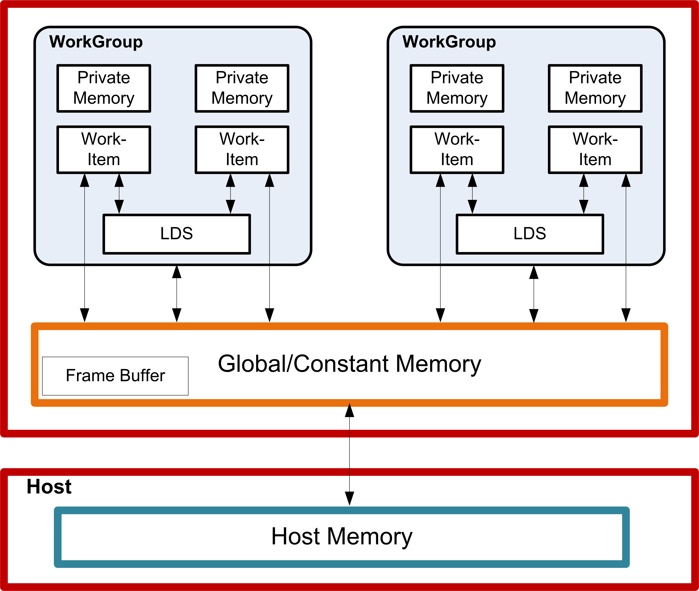
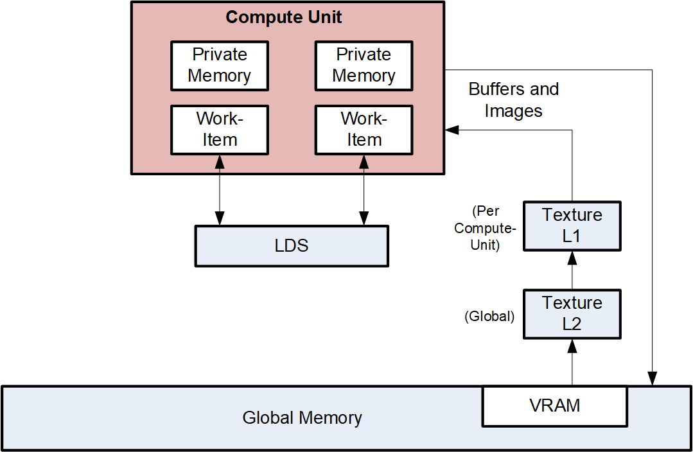

<!-- page 92 -->

# Chapter 11. Data Share Operations

Local data share (LDS) is a very low-latency, RAM scratchpad for temporary data with at least one order of magnitude higher effective bandwidth than direct, uncached global memory. It permits sharing of data between work-items in a work-group. Unlike read-only caches, the LDS permits high-speed write-to-read re-use of the memory space (full gather/read/load and scatter/write/store operations).

## 11.1. Overview

The figure below shows the conceptual framework of the LDS is integration into the memory of AMD Accelerators using OpenCL.



_Figure 6. High-Level Memory Configuration_

Physically located on-chip, directly next to the ALUs, the LDS can be approximately one order of magnitude faster than global memory (assuming no bank conflicts).

There are 64 kB memory per compute unit, segmented into 32 banks of 512 Dwords, each bank being 32bits wide. Dwords are placed in the banks serially, but all banks can execute a store or load simultaneously. One work-group can request up to 64 kB memory. Reads across wavefront are dispatched over four cycles in waterfall.

The high bandwidth of the LDS memory is achieved not only through its proximity to the ALUs, but also through simultaneous access to its memory banks. Thus, it is possible to concurrently execute 32 write or read instructions, each nominally 32-bits; extended instructions, read2/write2, can be 64-bits each. If, however, more than one access attempt is made to the same bank at the same time, a bank conflict occurs. In this case, for indexed and atomic operations, hardware prevents the attempted concurrent accesses to the same bank by

<!-- page 93 -->

turning them into serial accesses. This can decrease the effective bandwidth of the LDS. To help achieve optimal throughput (optimal efficiency), therefore, it is important to avoid bank conflicts. A knowledge of request scheduling and address mapping can be key to help achieving this.

## 11.2. Dataflow in Memory Hierarchy

The figure below is a conceptual diagram of the dataflow within the memory structure.



To load data into LDS from global memory, it is read from global memory and placed into the work-item’s registers; then, a store is performed to LDS. Similarly, to store data into global memory, data is read from LDS and placed into the workitem’s registers, then placed into global memory. To make effective use of the LDS, a kernel must perform many operations on what is transferred between global memory and LDS. It also is possible to load data from a memory buffer directly into LDS, bypassing VGPRs.

LDS atomics are performed in the LDS hardware. (Thus, although ALUs are not directly used for these operations, latency is incurred by the LDS executing this function.)

## 11.3. LDS Access

The LDS is accessed via indexed or atomic instructions.

### 11.3.1. Data Share Indexed and Atomic Access

Indexed and atomic operations supply a unique address per work-item from the VGPRs to the LDS, and supply or return unique data per work-item back to VGPRs. Due to the internal banked structure of LDS, operations can complete in as little as two cycles, or take as many 64 cycles, depending upon the number of bank conflicts (addresses that map to the same memory bank).

Indexed operations are simple LDS load and store operations that read data from, and return data to, VGPRs.

<!-- page 94 -->

Atomic operations are arithmetic operations that combine data from VGPRs and data in LDS, and write the result back to LDS. Atomic operations have the option of returning the LDS "pre-op" value to VGPRs.

The table below lists and briefly describes the LDS instruction fields.

_Table 56. LDS Instruction Fields_

|**Field**|**Size**|**Description**|
|---|---|---|
|OP|7|LDS opcode.|
|GDS|1|0 = LDS, 1 = GWS.|
|OFFSET0|8|Immediate offset, in bytes. Instructions with one address combine the offset fields into a single 16-bit unsigned offset: {offset1, offset0}. Instructions with two addresses (for example: READ2) use the offsets separately as two 8- bit unsigned offsets.|
|OFFSET1|8||
||VDST|8|
|VGPR to which result is written: either from LDS-load or atomic return value.|ADDR|8|
|VGPR that supplies the byte address offset.|DATA0|8|
|VGPR that supplies first data source.|DATA1|8|
|VGPR that supplies second data source.|( M0 )|32 Implied use of M0. M0[16:0] contains the byte-size of the LDS segment. This is used to clamp the final address.|

All LDS operations require that M0 be initialized prior to use. M0 contains a size value that can be used to restrict access to a subset of the allocated LDS range. If no clamping is wanted, set M0 to 0xFFFFFFFF.

_Table 57. LDS Indexed Load/Store_

|**Load / Store**|**Description**|
|---|---|
|DS_READ_{B32,B64,B96,B128,U8,I8,U16,I16}|Read one value per thread; sign extend to Dword, if signed.|
|DS_READ2_{B32,B64}|Read two values at unique addresses.|
|DS_READ2ST64_{B32,B64}|Read 2 values at unique addresses; offset *= 64.|
|DS_WRITE_{B32,B64,B96,B128,B8,B16}|Write one value.|
|DS_WRITE2_{B32,B64}|Write two values.|
|DS_WRITE2ST64_{B32,B64}|Write two values, offset *= 64.|
|DS_WRXCHG2_RTN_{B32,B64}|Exchange GPR with LDS-memory.|
|DS_WRXCHG2ST64_RTN_{B32,B64}|Exchange GPR with LDS-memory; offset *= 64.|
|DS_PERMUTE_B32|Forward permute. Does not write any LDS memory.<br>LDS[dst] = src0<br>returnVal = LDS[thread_id]<br>where thread_id is 0..63.|
|DS_BPERMUTE_B32|Backward permute. Does not actually write any LDS memory.<br>LDS[thread_id] = src0<br>where thread_id is 0..63, and returnVal = LDS[dst].|

**Single Address Instructions**

```
LDS_Addr = LDS_BASE + VGPR[ADDR] + {InstrOffset1,InstrOffset0}
```

**Double Address Instructions**

<!-- page 95 -->

```
LDS_Addr0 = LDS_BASE + VGPR[ADDR] + InstrOffset0*ADJ +
LDS_Addr1 = LDS_BASE + VGPR[ADDR] + InstrOffset1*ADJ
   Where ADJ = 4 for 8, 16 and 32-bit data types; and ADJ = 8 for 64-bit.
```

Note that LDS_ADDR1 is used only for READ2*, WRITE2*, and WREXCHG2*.

The address comes from VGPR, and both ADDR and InstrOffset are byte addresses.

At the time of wavefront creation, LDS_BASE is assigned to the physical LDS region owned by this wavefront or work-group.

Specify only one address by setting both offsets to the same value. This causes only one read or write to occur and uses only the first DATA0.

**LDS Atomic Ops**

DS_&lt;atomicOp> OP, GDS=0, OFFSET0, OFFSET1, VDST, ADDR, Data0, Data1

Data size is encoded in atomicOp: byte, word, Dword, or double.

LDS_Addr0 = LDS_BASE + VGPR[ADDR] + {InstrOffset1,InstrOffset0}

ADDR is a Dword address. VGPRs 0,1 and dst are double-GPRs for doubles data.

VGPR data sources can only be VGPRs or constant values, not SGPRs.

**Denormal** behavior for floating point atomics is controlled via the MODE register’s FP_DENORM field. The rounding mode is fixed at "round to nearest even".

## 11.4. GWS Programming Restriction

All GWS instructions must be immediately followed by:

```
    s_waitcnt 0
```

VGPRs used by any GWS instruction must be even.
