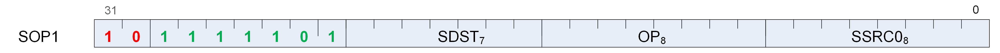

<!-- page 115 -->

## 12.3. SOP1 Instructions



Instructions in this format may use a 32-bit literal constant which occurs immediately after the instruction.

#### S_MOV_B32

Opcode: 0

Move scalar input into a scalar register.

```
D0.b32 = S0.b32
```

#### S_MOV_B64

Opcode: 1

Move scalar input into a scalar register.

```
D0.b64 = S0.b64
```

#### S_CMOV_B32

Opcode: 2

Move scalar input into a scalar register iff SCC is nonzero.

```
if SCC then
    D0.b32 = S0.b32
endif
```

#### S_CMOV_B64

Opcode: 3

Move scalar input into a scalar register iff SCC is nonzero.

```
if SCC then
    D0.b64 = S0.b64
endif
```

#### S_NOT_B32

Opcode: 4

Calculate bitwise negation on a scalar input, store the result into a scalar register and set SCC iff the result is nonzero.

<!-- page 116 -->

```
D0.u32 = ~S0.u32;
SCC = D0.u32 != 0U
```

#### S_NOT_B64

Opcode: 5

Calculate bitwise negation on a scalar input, store the result into a scalar register and set SCC iff the result is nonzero.

```
D0.u64 = ~S0.u64;
SCC = D0.u64 != 0ULL
```

#### S_WQM_B32

Opcode: 6

Given an active pixel mask in a scalar input, calculate whole quad mode mask for that input, store the result into a scalar register and set SCC iff the result is nonzero.

In whole quad mode, if any pixel in a quad is active then all pixels of the quad are marked active.

```
tmp = 0U;
declare i : 6'U;
for i in 6'0U : 6'31U do
    tmp[i] = S0.u32[i & 6'60U +: 6'4U] != 0U
endfor;
D0.u32 = tmp;
SCC = D0.u32 != 0U
```

#### S_WQM_B64

Opcode: 7

Given an active pixel mask in a scalar input, calculate whole quad mode mask for that input, store the result into a scalar register and set SCC iff the result is nonzero.

In whole quad mode, if any pixel in a quad is active then all pixels of the quad are marked active.

```
tmp = 0ULL;
declare i : 6'U;
for i in 6'0U : 6'63U do
    tmp[i] = S0.u64[i & 6'60U +: 6'4U] != 0ULL
endfor;
D0.u64 = tmp;
SCC = D0.u64 != 0ULL
```

<!-- page 117 -->

#### S_BREV_B32

Opcode: 8

Reverse the order of bits in a scalar input and store the result into a scalar register.

```
D0.u32[31 : 0] = S0.u32[0 : 31]
```

#### S_BREV_B64

Opcode: 9

Reverse the order of bits in a scalar input and store the result into a scalar register.

```
D0.u64[63 : 0] = S0.u64[0 : 63]
```

#### S_BCNT0_I32_B32

Opcode: 10

Count the number of "0" bits in a scalar input, store the result into a scalar register and set SCC iff the result is nonzero.

```
tmp = 0;
for i in 0 : 31 do
    tmp += S0.u32[i] == 1'0U ? 1 : 0
endfor;
D0.i32 = tmp;
SCC = D0.u32 != 0U
```

**Notes**

Functional examples:

```
S_BCNT0_I32_B32(0x00000000) => 32
S_BCNT0_I32_B32(0xcccccccc) => 16
S_BCNT0_I32_B32(0xffffffff) => 0
```

#### S_BCNT0_I32_B64

Opcode: 11

Count the number of "0" bits in a scalar input, store the result into a scalar register and set SCC iff the result is nonzero.

```
tmp = 0;
for i in 0 : 63 do
    tmp += S0.u64[i] == 1'0U ? 1 : 0
endfor;
D0.i32 = tmp;
SCC = D0.u64 != 0ULL
```

<!-- page 118 -->

#### S_BCNT1_I32_B32

Opcode: 12

Count the number of "1" bits in a scalar input, store the result into a scalar register and set SCC iff the result is nonzero.

```
tmp = 0;
for i in 0 : 31 do
    tmp += S0.u32[i] == 1'1U ? 1 : 0
endfor;
D0.i32 = tmp;
SCC = D0.u32 != 0U
```

**Notes**

Functional examples:

```
S_BCNT1_I32_B32(0x00000000) => 0
S_BCNT1_I32_B32(0xcccccccc) => 16
S_BCNT1_I32_B32(0xffffffff) => 32
```

#### S_BCNT1_I32_B64

Opcode: 13

Count the number of "1" bits in a scalar input, store the result into a scalar register and set SCC iff the result is nonzero.

```
tmp = 0;
for i in 0 : 63 do
    tmp += S0.u64[i] == 1'1U ? 1 : 0
endfor;
D0.i32 = tmp;
SCC = D0.u64 != 0ULL
```

#### S_FF0_I32_B32

Opcode: 14

Count the number of trailing "1" bits before the first "0" in a scalar input and store the result into a scalar register. Store -1 if there are no "0" bits in the input.

```
tmp = -1;
// Set if no zeros are found
for i in 0 : 31 do
    // Search from LSB
    if S0.u32[i] == 1'0U then
        tmp = i;
        break
    endif
endfor;
D0.i32 = tmp
```

<!-- page 119 -->

**Notes**

Functional examples:

```
S_FF0_I32_B32(0xaaaaaaaa) => 0
S_FF0_I32_B32(0x55555555) => 1
S_FF0_I32_B32(0x00000000) => 0
S_FF0_I32_B32(0xffffffff) => 0xffffffff
S_FF0_I32_B32(0xfffeffff) => 16
```

#### S_FF0_I32_B64

Opcode: 15

Count the number of trailing "1" bits before the first "0" in a scalar input and store the result into a scalar register. Store -1 if there are no "0" bits in the input.

```
tmp = -1;
// Set if no zeros are found
for i in 0 : 63 do
    // Search from LSB
    if S0.u64[i] == 1'0U then
        tmp = i;
        break
    endif
endfor;
D0.i32 = tmp
```

#### S_FF1_I32_B32

Opcode: 16

Count the number of trailing "0" bits before the first "1" in a scalar input and store the result into a scalar register. Store -1 if there are no "1" bits in the input.

```
tmp = -1;
// Set if no ones are found
for i in 0 : 31 do
    // Search from LSB
    if S0.u32[i] == 1'1U then
        tmp = i;
        break
    endif
endfor;
D0.i32 = tmp
```

<!-- page 120 -->

**Notes**

Functional examples:

```
S_FF1_I32_B32(0xaaaaaaaa) => 1
S_FF1_I32_B32(0x55555555) => 0
S_FF1_I32_B32(0x00000000) => 0xffffffff
S_FF1_I32_B32(0xffffffff) => 0
S_FF1_I32_B32(0x00010000) => 16
```

#### S_FF1_I32_B64

Opcode: 17

Count the number of trailing "0" bits before the first "1" in a scalar input and store the result into a scalar register. Store -1 if there are no "1" bits in the input.

```
tmp = -1;
// Set if no ones are found
for i in 0 : 63 do
    // Search from LSB
    if S0.u64[i] == 1'1U then
        tmp = i;
        break
    endif
endfor;
D0.i32 = tmp
```

#### S_FLBIT_I32_B32

Opcode: 18

Count the number of leading "0" bits before the first "1" in a scalar input and store the result into a scalar register. Store -1 if there are no "1" bits.

```
tmp = -1;
// Set if no ones are found
for i in 0 : 31 do
    // Search from MSB
    if S0.u32[31 - i] == 1'1U then
        tmp = i;
        break
    endif
endfor;
D0.i32 = tmp
```

<!-- page 121 -->

**Notes**

Functional examples:

```
S_FLBIT_I32_B32(0x00000000) => 0xffffffff
S_FLBIT_I32_B32(0x0000cccc) => 16
S_FLBIT_I32_B32(0xffff3333) => 0
S_FLBIT_I32_B32(0x7fffffff) => 1
S_FLBIT_I32_B32(0x80000000) => 0
S_FLBIT_I32_B32(0xffffffff) => 0
```

#### S_FLBIT_I32_B64

Opcode: 19

Count the number of leading "0" bits before the first "1" in a scalar input and store the result into a scalar register. Store -1 if there are no "1" bits.

```
tmp = -1;
// Set if no ones are found
for i in 0 : 63 do
    // Search from MSB
    if S0.u64[63 - i] == 1'1U then
        tmp = i;
        break
    endif
endfor;
D0.i32 = tmp
```

#### S_FLBIT_I32

Opcode: 20

Count the number of leading bits that are the same as the sign bit of a scalar input and store the result into a scalar register. Store -1 if all input bits are the same.

```
tmp = -1;
// Set if all bits are the same
for i in 1 : 31 do
    // Search from MSB
    if S0.u32[31 - i] != S0.u32[31] then
        tmp = i;
        break
    endif
endfor;
D0.i32 = tmp
```

**Notes**

Functional examples:

<!-- page 122 -->

```
S_FLBIT_I32(0x00000000) => 0xffffffff
S_FLBIT_I32(0x0000cccc) => 16
S_FLBIT_I32(0xffff3333) => 16
S_FLBIT_I32(0x7fffffff) => 1
S_FLBIT_I32(0x80000000) => 1
S_FLBIT_I32(0xffffffff) => 0xffffffff
```

#### S_FLBIT_I32_I64

Opcode: 21

Count the number of leading bits that are the same as the sign bit of a scalar input and store the result into a scalar register. Store -1 if all input bits are the same.

```
tmp = -1;
// Set if all bits are the same
for i in 1 : 63 do
    // Search from MSB
    if S0.u64[63 - i] != S0.u64[63] then
        tmp = i;
        break
    endif
endfor;
D0.i32 = tmp
```

#### S_SEXT_I32_I8

Opcode: 22

Sign extend a signed 8 bit scalar input to 32 bits and store the result into a scalar register.

```
D0.i32 = 32'I(signext(S0.i8))
```

#### S_SEXT_I32_I16

Opcode: 23

Sign extend a signed 16 bit scalar input to 32 bits and store the result into a scalar register.

```
D0.i32 = 32'I(signext(S0.i16))
```

#### S_BITSET0_B32

Opcode: 24

Given a bit offset in a scalar input, set the indicated bit in the destination scalar register to 0.

<!-- page 123 -->

```
D0.u32[S0.u32[4 : 0]] = 1'0U
```

#### S_BITSET0_B64

Opcode: 25

Given a bit offset in a scalar input, set the indicated bit in the destination scalar register to 0.

```
D0.u64[S0.u32[5 : 0]] = 1'0U
```

#### S_BITSET1_B32

Opcode: 26

Given a bit offset in a scalar input, set the indicated bit in the destination scalar register to 1.

```
D0.u32[S0.u32[4 : 0]] = 1'1U
```

#### S_BITSET1_B64

Opcode: 27

Given a bit offset in a scalar input, set the indicated bit in the destination scalar register to 1.

```
D0.u64[S0.u32[5 : 0]] = 1'1U
```

#### S_GETPC_B64

Opcode: 28

Store the address of the next instruction to a scalar register.

The byte address of the instruction immediately _following_ this instruction is saved to the destination.

```
D0.i64 = PC + 4LL
```

**Notes**

This instruction must be 4 bytes.

#### S_SETPC_B64

Opcode: 29

Jump to an address specified in a scalar register.

<!-- page 124 -->

The argument is a byte address of the instruction to jump to.

```
PC = S0.i64
```

#### S_SWAPPC_B64

Opcode: 30

Store the address of the next instruction to a scalar register and then jump to an address specified in the scalar input.

The argument is a byte address of the instruction to jump to. The byte address of the instruction immediately _following_ this instruction is saved to the destination.

```
jump_addr = S0.i64;
D0.i64 = PC + 4LL;
PC = jump_addr.i64
```

**Notes**

This instruction must be 4 bytes.

#### S_RFE_B64

Opcode: 31

Return from the exception handler. Clear the wave's PRIV bit and then jump to an address specified by the scalar input.

The argument is a byte address of the instruction to jump to; this address is likely derived from the state passed into the trap handler.

This instruction may only be used within a trap handler.

```
WAVE_STATUS.PRIV = 1'0U;
PC = S0.i64
```

#### S_AND_SAVEEXEC_B64

Opcode: 32

Calculate bitwise AND on the scalar input and the EXEC mask, store the calculated result into the EXEC mask, set SCC iff the calculated result is nonzero and store the _original_ value of the EXEC mask into the scalar destination register.

The original EXEC mask is saved to the destination SGPRs before the bitwise operation is performed.

```
saveexec = EXEC.u64;
EXEC.u64 = (S0.u64 & EXEC.u64);
D0.u64 = saveexec.u64;
SCC = EXEC.u64 != 0ULL
```

<!-- page 125 -->

#### S_OR_SAVEEXEC_B64

Opcode: 33

Calculate bitwise OR on the scalar input and the EXEC mask, store the calculated result into the EXEC mask, set SCC iff the calculated result is nonzero and store the _original_ value of the EXEC mask into the scalar destination register.

The original EXEC mask is saved to the destination SGPRs before the bitwise operation is performed.

```
saveexec = EXEC.u64;
EXEC.u64 = (S0.u64 | EXEC.u64);
D0.u64 = saveexec.u64;
SCC = EXEC.u64 != 0ULL
```

#### S_XOR_SAVEEXEC_B64

Opcode: 34

Calculate bitwise XOR on the scalar input and the EXEC mask, store the calculated result into the EXEC mask, set SCC iff the calculated result is nonzero and store the _original_ value of the EXEC mask into the scalar destination register.

The original EXEC mask is saved to the destination SGPRs before the bitwise operation is performed.

```
saveexec = EXEC.u64;
EXEC.u64 = (S0.u64 ^ EXEC.u64);
D0.u64 = saveexec.u64;
SCC = EXEC.u64 != 0ULL
```

#### S_ANDN2_SAVEEXEC_B64

Opcode: 35

Calculate bitwise AND on the scalar input and the negation of the EXEC mask, store the calculated result into the EXEC mask, set SCC iff the calculated result is nonzero and store the _original_ value of the EXEC mask into the scalar destination register.

The original EXEC mask is saved to the destination SGPRs before the bitwise operation is performed.

```
saveexec = EXEC.u64;
EXEC.u64 = (S0.u64 & ~EXEC.u64);
D0.u64 = saveexec.u64;
SCC = EXEC.u64 != 0ULL
```

<!-- page 126 -->

#### S_ORN2_SAVEEXEC_B64

Opcode: 36

Calculate bitwise OR on the scalar input and the negation of the EXEC mask, store the calculated result into the EXEC mask, set SCC iff the calculated result is nonzero and store the _original_ value of the EXEC mask into the scalar destination register.

The original EXEC mask is saved to the destination SGPRs before the bitwise operation is performed.

```
saveexec = EXEC.u64;
EXEC.u64 = (S0.u64 | ~EXEC.u64);
D0.u64 = saveexec.u64;
SCC = EXEC.u64 != 0ULL
```

#### S_NAND_SAVEEXEC_B64

Opcode: 37

Calculate bitwise NAND on the scalar input and the EXEC mask, store the calculated result into the EXEC mask, set SCC iff the calculated result is nonzero and store the _original_ value of the EXEC mask into the scalar destination register.

```
saveexec = EXEC.u64;
EXEC.u64 = ~(S0.u64 & EXEC.u64);
D0.u64 = saveexec.u64;
SCC = EXEC.u64 != 0ULL
```

#### S_NOR_SAVEEXEC_B64

Opcode: 38

Calculate bitwise NOR on the scalar input and the EXEC mask, store the calculated result into the EXEC mask, set SCC iff the calculated result is nonzero and store the _original_ value of the EXEC mask into the scalar destination register.

```
saveexec = EXEC.u64;
EXEC.u64 = ~(S0.u64 | EXEC.u64);
D0.u64 = saveexec.u64;
SCC = EXEC.u64 != 0ULL
```

#### S_XNOR_SAVEEXEC_B64

Opcode: 39

Calculate bitwise XNOR on the scalar input and the EXEC mask, store the calculated result into the EXEC mask, set SCC iff the calculated result is nonzero and store the _original_ value of the EXEC mask into the scalar destination register.

<!-- page 127 -->

```
saveexec = EXEC.u64;
EXEC.u64 = ~(S0.u64 ^ EXEC.u64);
D0.u64 = saveexec.u64;
SCC = EXEC.u64 != 0ULL
```

#### S_QUADMASK_B32

Opcode: 40

Reduce a pixel mask from the scalar input into a quad mask, store the result in a scalar register and set SCC iff the result is nonzero.

```
tmp = 0U;
for i in 0 : 7 do
    tmp[i] = S0.u32[i * 4 +: 4] != 0U
endfor;
D0.u32 = tmp;
SCC = D0.u32 != 0U
```

**Notes**

To perform the inverse operation see S_BITREPLICATE_B64_B32.

#### S_QUADMASK_B64

Opcode: 41

Reduce a pixel mask from the scalar input into a quad mask, store the result in a scalar register and set SCC iff the result is nonzero.

```
tmp = 0ULL;
for i in 0 : 15 do
    tmp[i] = S0.u64[i * 4 +: 4] != 0ULL
endfor;
D0.u64 = tmp;
SCC = D0.u64 != 0ULL
```

**Notes**

To perform the inverse operation see S_BITREPLICATE_B64_B32.

#### S_MOVRELS_B32

Opcode: 42

Move data from a relatively-indexed scalar register into another scalar register.

```
addr = SRC0.u32;
// Raw value from instruction
addr += M0.u32[31 : 0];
D0.b32 = SGPR[addr].b32
```

<!-- page 128 -->

**Notes**

Example: The following instruction sequence performs the move s5 <= s17:

```
    s_mov_b32 m0, 10
    s_movrels_b32 s5, s7
```

#### S_MOVRELS_B64

Opcode: 43

Move data from a relatively-indexed scalar register into another scalar register.

The index in M0.u and the operand address in SRC0.u must be even for this operation.

```
addr = SRC0.u32;
// Raw value from instruction
addr += M0.u32[31 : 0];
D0.b64 = SGPR[addr].b64
```

#### S_MOVRELD_B32

Opcode: 44

Move data from a scalar input into a relatively-indexed scalar register.

```
addr = DST.u32;
// Raw value from instruction
addr += M0.u32[31 : 0];
SGPR[addr].b32 = S0.b32
```

**Notes**

Example: The following instruction sequence performs the move s15 <= s7:

```
    s_mov_b32 m0, 10
    s_movreld_b32 s5, s7
```

#### S_MOVRELD_B64

Opcode: 45

Move data from a scalar input into a relatively-indexed scalar register.

<!-- page 129 -->

The index in M0.u and the operand address in DST.u must be even for this operation.

```
addr = DST.u32;
// Raw value from instruction
addr += M0.u32[31 : 0];
SGPR[addr].b64 = S0.b64
```

#### S_CBRANCH_JOIN

Opcode: 46

Conditional branch join point (end of conditional branch block).

S0 is saved CSP value. See S_CBRANCH_G_FORK and S_CBRANCH_I_FORK for related instructions.

```
saved_csp = S0.u32;
if WAVE_MODE.CSP.u32 == saved_csp then
    PC += 4LL;
    // Second time to JOIN: continue with program.
else
    WAVE_MODE.CSP -= 3'1U;
    // First time to JOIN; jump to other FORK path.
    { PC, EXEC } = SGPR[WAVE_MODE.CSP.u32 * 4U].b128;
    // Read 128 bits from 4 consecutive SGPRs.
endif
```

#### S_ABS_I32

Opcode: 48

Compute the absolute value of a scalar input, store the result into a scalar register and set SCC iff the result is nonzero.

```
D0.i32 = S0.i32 < 0 ? -S0.i32 : S0.i32;
SCC = D0.i32 != 0
```

**Notes**

Functional examples:

```
S_ABS_I32(0x00000001) => 0x00000001
S_ABS_I32(0x7fffffff) => 0x7fffffff
S_ABS_I32(0x80000000) => 0x80000000     // Note this is negative!
S_ABS_I32(0x80000001) => 0x7fffffff
S_ABS_I32(0x80000002) => 0x7ffffffe
S_ABS_I32(0xffffffff) => 0x00000001
```

<!-- page 130 -->

#### S_SET_GPR_IDX_IDX

Opcode: 50

Set the index used in vector GPR indexing.

S_SET_GPR_IDX_ON, S_SET_GPR_IDX_OFF, S_SET_GPR_IDX_MODE and S_SET_GPR_IDX_IDX are related instructions.

```
M0[7 : 0] = S0.u32[7 : 0].b8
```

#### S_ANDN1_SAVEEXEC_B64

Opcode: 51

Calculate bitwise AND on the EXEC mask and the negation of the scalar input, store the calculated result into the EXEC mask, set SCC iff the calculated result is nonzero and store the _original_ value of the EXEC mask into the scalar destination register.

The original EXEC mask is saved to the destination SGPRs before the bitwise operation is performed.

```
saveexec = EXEC.u64;
EXEC.u64 = (~S0.u64 & EXEC.u64);
D0.u64 = saveexec.u64;
SCC = EXEC.u64 != 0ULL
```

#### S_ORN1_SAVEEXEC_B64

Opcode: 52

Calculate bitwise OR on the EXEC mask and the negation of the scalar input, store the calculated result into the EXEC mask, set SCC iff the calculated result is nonzero and store the _original_ value of the EXEC mask into the scalar destination register.

The original EXEC mask is saved to the destination SGPRs before the bitwise operation is performed.

```
saveexec = EXEC.u64;
EXEC.u64 = (~S0.u64 | EXEC.u64);
D0.u64 = saveexec.u64;
SCC = EXEC.u64 != 0ULL
```

#### S_ANDN1_WREXEC_B64

Opcode: 53

Calculate bitwise AND on the EXEC mask and the negation of the scalar input, store the calculated result into the EXEC mask and also into the scalar destination register, and set SCC iff the calculated result is nonzero.

Unlike the SAVEEXEC series of opcodes, the value written to destination SGPRs is the result of the bitwise-op result. EXEC and the destination SGPRs have the same value at the end of this instruction. This instruction is intended to help accelerate waterfalling.

<!-- page 131 -->

```
EXEC.u64 = (~S0.u64 & EXEC.u64);
D0.u64 = EXEC.u64;
SCC = EXEC.u64 != 0ULL
```

#### S_ANDN2_WREXEC_B64

Opcode: 54

Calculate bitwise AND on the scalar input and the negation of the EXEC mask, store the calculated result into the EXEC mask and also into the scalar destination register, and set SCC iff the calculated result is nonzero.

Unlike the SAVEEXEC series of opcodes, the value written to destination SGPRs is the result of the bitwise-op result. EXEC and the destination SGPRs have the same value at the end of this instruction. This instruction is intended to help accelerate waterfalling.

```
EXEC.u64 = (S0.u64 & ~EXEC.u64);
D0.u64 = EXEC.u64;
SCC = EXEC.u64 != 0ULL
```

**Notes**

In particular, the following sequence of waterfall code is optimized by using a WREXEC instead of two separate scalar ops:

```
    // V0 holds the index value per lane
    // save exec mask for restore at the end
    s_mov_b64 s2, exec
    // exec mask of remaining (unprocessed) threads
    s_mov_b64 s4, exec
    loop:
    // get the index value for the first active lane
    v_readfirstlane_b32  s0, v0
    // find all other lanes with same index value
    v_cmpx_eq s0, v0
    <OP>        // do the operation using the current EXEC mask. S0 holds the index.
    // mask out thread that was just executed
    // s_andn2_b64  s4, s4, exec
    // s_mov_b64    exec, s4
    s_andn2_wrexec_b64 s4, s4     // replaces above 2 ops
    // repeat until EXEC==0
    s_cbranch_scc1  loop
    s_mov_b64    exec, s2
```

#### S_BITREPLICATE_B64_B32

Opcode: 55

Substitute each bit of a 32 bit scalar input with two instances of itself and store the result into a 64 bit scalar register.

<!-- page 132 -->

```
tmp = S0.u32;
for i in 0 : 31 do
    D0.u64[i * 2] = tmp[i];
    D0.u64[i * 2 + 1] = tmp[i]
endfor
```

**Notes**

This opcode can be used to convert a quad mask into a pixel mask; given quad mask in s0, the following sequence produces a pixel mask in s2:

```
    s_bitreplicate_b64 s2, s0
    s_bitreplicate_b64 s2, s2
```

To perform the inverse operation see S_QUADMASK_B64.
