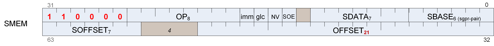

## 12.6. SMEM Instructions



#### S_LOAD_DWORD

Opcode: 0

Load 32 bits of data from the scalar memory into a scalar register.

```
addr = CalcScalarGlobalAddr(SBASE.b32, SOFFSET.b32, OFFSET.i32);
SDATA[31 : 0] = MEM[addr].b32
```

**Notes**

If the offset is specified as an SGPR, the SGPR contains an UNSIGNED BYTE offset (the 2 LSBs are ignored).

If the offset is specified as an immediate 21-bit constant, the constant is a SIGNED BYTE offset.

#### S_LOAD_DWORDX2

Opcode: 1

Load 64 bits of data from the scalar memory into a scalar register.

```
addr = CalcScalarGlobalAddr(SBASE.b32, SOFFSET.b32, OFFSET.i32);
SDATA[31 : 0] = MEM[addr].b32;
SDATA[63 : 32] = MEM[addr + 4U].b32
```

**Notes**

If the offset is specified as an SGPR, the SGPR contains an UNSIGNED BYTE offset (the 2 LSBs are ignored).

<!-- page 147 -->

If the offset is specified as an immediate 21-bit constant, the constant is a SIGNED BYTE offset.

#### S_LOAD_DWORDX4

Opcode: 2

Load 128 bits of data from the scalar memory into a scalar register.

```
addr = CalcScalarGlobalAddr(SBASE.b32, SOFFSET.b32, OFFSET.i32);
SDATA[31 : 0] = MEM[addr].b32;
SDATA[63 : 32] = MEM[addr + 4U].b32;
SDATA[95 : 64] = MEM[addr + 8U].b32;
SDATA[127 : 96] = MEM[addr + 12U].b32
```

**Notes**

If the offset is specified as an SGPR, the SGPR contains an UNSIGNED BYTE offset (the 2 LSBs are ignored).

If the offset is specified as an immediate 21-bit constant, the constant is a SIGNED BYTE offset.

#### S_LOAD_DWORDX8

Opcode: 3

Load 256 bits of data from the scalar memory into a scalar register.

```
addr = CalcScalarGlobalAddr(SBASE.b32, SOFFSET.b32, OFFSET.i32);
SDATA[31 : 0] = MEM[addr].b32;
SDATA[63 : 32] = MEM[addr + 4U].b32;
SDATA[95 : 64] = MEM[addr + 8U].b32;
SDATA[127 : 96] = MEM[addr + 12U].b32;
SDATA[159 : 128] = MEM[addr + 16U].b32;
SDATA[191 : 160] = MEM[addr + 20U].b32;
SDATA[223 : 192] = MEM[addr + 24U].b32;
SDATA[255 : 224] = MEM[addr + 28U].b32
```

**Notes**

If the offset is specified as an SGPR, the SGPR contains an UNSIGNED BYTE offset (the 2 LSBs are ignored).

If the offset is specified as an immediate 21-bit constant, the constant is a SIGNED BYTE offset.

#### S_LOAD_DWORDX16

Opcode: 4

Load 512 bits of data from the scalar memory into a scalar register.

```
addr = CalcScalarGlobalAddr(SBASE.b32, SOFFSET.b32, OFFSET.i32);
SDATA[31 : 0] = MEM[addr].b32;
SDATA[63 : 32] = MEM[addr + 4U].b32;
SDATA[95 : 64] = MEM[addr + 8U].b32;
SDATA[127 : 96] = MEM[addr + 12U].b32;
SDATA[159 : 128] = MEM[addr + 16U].b32;
SDATA[191 : 160] = MEM[addr + 20U].b32;
SDATA[223 : 192] = MEM[addr + 24U].b32;
SDATA[255 : 224] = MEM[addr + 28U].b32;
SDATA[287 : 256] = MEM[addr + 32U].b32;
SDATA[319 : 288] = MEM[addr + 36U].b32;
SDATA[351 : 320] = MEM[addr + 40U].b32;
SDATA[383 : 352] = MEM[addr + 44U].b32;
SDATA[415 : 384] = MEM[addr + 48U].b32;
SDATA[447 : 416] = MEM[addr + 52U].b32;
SDATA[479 : 448] = MEM[addr + 56U].b32;
SDATA[511 : 480] = MEM[addr + 60U].b32
```

<!-- page 148 -->

**Notes**

If the offset is specified as an SGPR, the SGPR contains an UNSIGNED BYTE offset (the 2 LSBs are ignored).

If the offset is specified as an immediate 21-bit constant, the constant is a SIGNED BYTE offset.

#### S_SCRATCH_LOAD_DWORD

Opcode: 5

Load 32 bits of data from the scalar scratch aperture into a scalar register.

```
addr = CalcScalarScratchAddr(SBASE.b32, SOFFSET.b32, OFFSET.i32);
SDATA[31 : 0] = MEM[addr].b32
```

**Notes**

If the offset is specified as an SGPR, the SGPR contains an UNSIGNED 64-byte offset, consistent with other scratch operations.

If the offset is specified as an immediate 21-bit constant, the constant is a SIGNED BYTE offset.

#### S_SCRATCH_LOAD_DWORDX2

Opcode: 6

Load 64 bits of data from the scalar scratch aperture into a scalar register.

```
addr = CalcScalarScratchAddr(SBASE.b32, SOFFSET.b32, OFFSET.i32);
SDATA[31 : 0] = MEM[addr].b32;
SDATA[63 : 32] = MEM[addr + 4U].b32
```

**Notes**

If the offset is specified as an SGPR, the SGPR contains an UNSIGNED 64-byte offset, consistent with other scratch operations.

<!-- page 149 -->

If the offset is specified as an immediate 21-bit constant, the constant is a SIGNED BYTE offset.

#### S_SCRATCH_LOAD_DWORDX4

Opcode: 7

Load 128 bits of data from the scalar scratch aperture into a scalar register.

```
addr = CalcScalarScratchAddr(SBASE.b32, SOFFSET.b32, OFFSET.i32);
SDATA[31 : 0] = MEM[addr].b32;
SDATA[63 : 32] = MEM[addr + 4U].b32;
SDATA[95 : 64] = MEM[addr + 8U].b32;
SDATA[127 : 96] = MEM[addr + 12U].b32
```

**Notes**

If the offset is specified as an SGPR, the SGPR contains an UNSIGNED 64-byte offset, consistent with other scratch operations.

If the offset is specified as an immediate 21-bit constant, the constant is a SIGNED BYTE offset.

#### S_BUFFER_LOAD_DWORD

Opcode: 8

Load 32 bits of data from a scalar buffer surface into a scalar register.

```
addr = CalcScalarBufferAddr(SBASE.b32, SOFFSET.b32, OFFSET.i32);
SDATA[31 : 0] = MEM[addr].b32
```

**Notes**

If the offset is specified as an SGPR, the SGPR contains an UNSIGNED BYTE offset (the 2 LSBs are ignored).

If the offset is specified as an immediate 21-bit constant, the constant is a SIGNED BYTE offset.

#### S_BUFFER_LOAD_DWORDX2

Opcode: 9

Load 64 bits of data from a scalar buffer surface into a scalar register.

```
addr = CalcScalarBufferAddr(SBASE.b32, SOFFSET.b32, OFFSET.i32);
SDATA[31 : 0] = MEM[addr].b32;
SDATA[63 : 32] = MEM[addr + 4U].b32
```

**Notes**

If the offset is specified as an SGPR, the SGPR contains an UNSIGNED BYTE offset (the 2 LSBs are ignored).

<!-- page 150 -->

If the offset is specified as an immediate 21-bit constant, the constant is a SIGNED BYTE offset.

#### S_BUFFER_LOAD_DWORDX4

Opcode: 10

Load 128 bits of data from a scalar buffer surface into a scalar register.

```
addr = CalcScalarBufferAddr(SBASE.b32, SOFFSET.b32, OFFSET.i32);
SDATA[31 : 0] = MEM[addr].b32;
SDATA[63 : 32] = MEM[addr + 4U].b32;
SDATA[95 : 64] = MEM[addr + 8U].b32;
SDATA[127 : 96] = MEM[addr + 12U].b32
```

**Notes**

If the offset is specified as an SGPR, the SGPR contains an UNSIGNED BYTE offset (the 2 LSBs are ignored).

If the offset is specified as an immediate 21-bit constant, the constant is a SIGNED BYTE offset.

#### S_BUFFER_LOAD_DWORDX8

Opcode: 11

Load 256 bits of data from a scalar buffer surface into a scalar register.

```
addr = CalcScalarBufferAddr(SBASE.b32, SOFFSET.b32, OFFSET.i32);
SDATA[31 : 0] = MEM[addr].b32;
SDATA[63 : 32] = MEM[addr + 4U].b32;
SDATA[95 : 64] = MEM[addr + 8U].b32;
SDATA[127 : 96] = MEM[addr + 12U].b32;
SDATA[159 : 128] = MEM[addr + 16U].b32;
SDATA[191 : 160] = MEM[addr + 20U].b32;
SDATA[223 : 192] = MEM[addr + 24U].b32;
SDATA[255 : 224] = MEM[addr + 28U].b32
```

**Notes**

If the offset is specified as an SGPR, the SGPR contains an UNSIGNED BYTE offset (the 2 LSBs are ignored).

If the offset is specified as an immediate 21-bit constant, the constant is a SIGNED BYTE offset.

#### S_BUFFER_LOAD_DWORDX16

Opcode: 12

Load 512 bits of data from a scalar buffer surface into a scalar register.

```
addr = CalcScalarBufferAddr(SBASE.b32, SOFFSET.b32, OFFSET.i32);
SDATA[31 : 0] = MEM[addr].b32;
SDATA[63 : 32] = MEM[addr + 4U].b32;
SDATA[95 : 64] = MEM[addr + 8U].b32;
SDATA[127 : 96] = MEM[addr + 12U].b32;
SDATA[159 : 128] = MEM[addr + 16U].b32;
SDATA[191 : 160] = MEM[addr + 20U].b32;
SDATA[223 : 192] = MEM[addr + 24U].b32;
SDATA[255 : 224] = MEM[addr + 28U].b32;
SDATA[287 : 256] = MEM[addr + 32U].b32;
SDATA[319 : 288] = MEM[addr + 36U].b32;
SDATA[351 : 320] = MEM[addr + 40U].b32;
SDATA[383 : 352] = MEM[addr + 44U].b32;
SDATA[415 : 384] = MEM[addr + 48U].b32;
SDATA[447 : 416] = MEM[addr + 52U].b32;
SDATA[479 : 448] = MEM[addr + 56U].b32;
SDATA[511 : 480] = MEM[addr + 60U].b32
```

<!-- page 151 -->

**Notes**

If the offset is specified as an SGPR, the SGPR contains an UNSIGNED BYTE offset (the 2 LSBs are ignored).

If the offset is specified as an immediate 21-bit constant, the constant is a SIGNED BYTE offset.

#### S_STORE_DWORD

Opcode: 16

Store 32 bits of data from a scalar register into the scalar memory.

```
addr = CalcScalarGlobalAddr(SBASE.b32, SOFFSET.b32, OFFSET.i32);
MEM[addr].b32 = SDATA[31 : 0]
```

**Notes**

If the offset is specified as an SGPR, the SGPR contains an UNSIGNED BYTE offset (the 2 LSBs are ignored).

If the offset is specified as an immediate 21-bit constant, the constant is a SIGNED BYTE offset.

#### S_STORE_DWORDX2

Opcode: 17

Store 64 bits of data from a scalar register into the scalar memory.

```
addr = CalcScalarGlobalAddr(SBASE.b32, SOFFSET.b32, OFFSET.i32);
MEM[addr].b32 = SDATA[31 : 0];
MEM[addr + 4U].b32 = SDATA[63 : 32]
```

**Notes**

If the offset is specified as an SGPR, the SGPR contains an UNSIGNED BYTE offset (the 2 LSBs are ignored).

If the offset is specified as an immediate 21-bit constant, the constant is a SIGNED BYTE offset.

<!-- page 152 -->

#### S_STORE_DWORDX4

Opcode: 18

Store 128 bits of data from a scalar register into the scalar memory.

```
addr = CalcScalarGlobalAddr(SBASE.b32, SOFFSET.b32, OFFSET.i32);
MEM[addr].b32 = SDATA[31 : 0];
MEM[addr + 4U].b32 = SDATA[63 : 32];
MEM[addr + 8U].b32 = SDATA[95 : 64];
MEM[addr + 12U].b32 = SDATA[127 : 96]
```

**Notes**

If the offset is specified as an SGPR, the SGPR contains an UNSIGNED BYTE offset (the 2 LSBs are ignored).

If the offset is specified as an immediate 21-bit constant, the constant is a SIGNED BYTE offset.

#### S_SCRATCH_STORE_DWORD

Opcode: 21

Store 32 bits of data from a scalar register into the scalar scratch aperture.

```
addr = CalcScalarScratchAddr(SBASE.b32, SOFFSET.b32, OFFSET.i32);
MEM[addr].b32 = SDATA[31 : 0]
```

**Notes**

If the offset is specified as an SGPR, the SGPR contains an UNSIGNED 64-byte offset, consistent with other scratch operations.

If the offset is specified as an immediate 21-bit constant, the constant is a SIGNED BYTE offset.

#### S_SCRATCH_STORE_DWORDX2

Opcode: 22

Store 64 bits of data from a scalar register into the scalar scratch aperture.

```
addr = CalcScalarScratchAddr(SBASE.b32, SOFFSET.b32, OFFSET.i32);
MEM[addr].b32 = SDATA[31 : 0];
MEM[addr + 4U].b32 = SDATA[63 : 32]
```

**Notes**

If the offset is specified as an SGPR, the SGPR contains an UNSIGNED 64-byte offset, consistent with other scratch operations.

<!-- page 153 -->

If the offset is specified as an immediate 21-bit constant, the constant is a SIGNED BYTE offset.

#### S_SCRATCH_STORE_DWORDX4

Opcode: 23

Store 128 bits of data from a scalar register into the scalar scratch aperture.

```
addr = CalcScalarScratchAddr(SBASE.b32, SOFFSET.b32, OFFSET.i32);
MEM[addr].b32 = SDATA[31 : 0];
MEM[addr + 4U].b32 = SDATA[63 : 32];
MEM[addr + 8U].b32 = SDATA[95 : 64];
MEM[addr + 12U].b32 = SDATA[127 : 96]
```

**Notes**

If the offset is specified as an SGPR, the SGPR contains an UNSIGNED 64-byte offset, consistent with other scratch operations.

If the offset is specified as an immediate 21-bit constant, the constant is a SIGNED BYTE offset.

#### S_BUFFER_STORE_DWORD

Opcode: 24

Store 32 bits of data from a scalar register into a scalar buffer surface.

```
addr = CalcScalarBufferAddr(SBASE.b32, SOFFSET.b32, OFFSET.i32);
MEM[addr].b32 = SDATA[31 : 0]
```

**Notes**

If the offset is specified as an SGPR, the SGPR contains an UNSIGNED BYTE offset (the 2 LSBs are ignored).

If the offset is specified as an immediate 21-bit constant, the constant is a SIGNED BYTE offset.

#### S_BUFFER_STORE_DWORDX2

Opcode: 25

Store 64 bits of data from a scalar register into a scalar buffer surface.

```
addr = CalcScalarBufferAddr(SBASE.b32, SOFFSET.b32, OFFSET.i32);
MEM[addr].b32 = SDATA[31 : 0];
MEM[addr + 4U].b32 = SDATA[63 : 32]
```

**Notes**

If the offset is specified as an SGPR, the SGPR contains an UNSIGNED BYTE offset (the 2 LSBs are ignored).

<!-- page 154 -->

If the offset is specified as an immediate 21-bit constant, the constant is a SIGNED BYTE offset.

#### S_BUFFER_STORE_DWORDX4

Opcode: 26

Store 128 bits of data from a scalar register into a scalar buffer surface.

```
addr = CalcScalarBufferAddr(SBASE.b32, SOFFSET.b32, OFFSET.i32);
MEM[addr].b32 = SDATA[31 : 0];
MEM[addr + 4U].b32 = SDATA[63 : 32];
MEM[addr + 8U].b32 = SDATA[95 : 64];
MEM[addr + 12U].b32 = SDATA[127 : 96]
```

**Notes**

If the offset is specified as an SGPR, the SGPR contains an UNSIGNED BYTE offset (the 2 LSBs are ignored).

If the offset is specified as an immediate 21-bit constant, the constant is a SIGNED BYTE offset.

#### S_DCACHE_INV

Opcode: 32

Invalidate the scalar (L0) data cache.

#### S_DCACHE_WB

Opcode: 33

Write back dirty data in the scalar (L0) data cache.

#### S_DCACHE_INV_VOL

Opcode: 34

Invalidate the scalar (L0) data cache volatile lines.

#### S_DCACHE_WB_VOL

Opcode: 35

Write back dirty data in the scalar (L0) data cache volatile lines.

#### S_MEMTIME

Opcode: 36

Return current 64-bit timestamp.

<!-- page 155 -->

#### S_MEMREALTIME

Opcode: 37

Return current 64-bit RTC.

#### S_DCACHE_DISCARD

Opcode: 40

Discard one dirty scalar (L0) data cache line. A cache line is 64 bytes.

Typically, dirty cachelines (one which have been written by the shader) are written back to memory, but this instruction allows the shader to invalidate and not write back cachelines which it has previously written. This is a performance optimization to be used when the shader knows it no longer needs that data.

Address is calculated the same as S_STORE_DWORD, except the 6 LSBs are ignored to get the 64 byte aligned address. LGKM count is incremented by 1 for this opcode.

#### S_DCACHE_DISCARD_X2

Opcode: 41

Discard two consecutive dirty scalar (L0) data cache lines. A cache line is 64 bytes.

Typically, dirty cachelines (one which have been written by the shader) are written back to memory, but this instruction allows the shader to invalidate and not write back cachelines which it has previously written. This is a performance optimization to be used when the shader knows it no longer needs that data.

Address is calculated the same as S_STORE_DWORD, except the 6 LSBs are ignored to get the 64 byte aligned address. LGKM count is incremented by 2 for this opcode.

#### S_BUFFER_ATOMIC_SWAP

Opcode: 64

Swap an unsigned 32-bit integer value in the data register with a location in a scalar buffer surface.

```
addr = CalcScalarBufferAddr(SBASE.b32, SOFFSET.b32, OFFSET.i32);
tmp = MEM[addr].b32;
MEM[addr].b32 = DATA.b32;
RETURN_DATA.b32 = tmp
```

#### S_BUFFER_ATOMIC_CMPSWAP

Opcode: 65

Compare two unsigned 32-bit integer values stored in the data comparison register and a location in a scalar buffer surface. Modify the memory location with a value in the data source register iff the comparison is equal.

```
addr = CalcScalarBufferAddr(SBASE.b32, SOFFSET.b32, OFFSET.i32);
tmp = MEM[addr].u32;
src = DATA[31 : 0].u32;
cmp = DATA[63 : 32].u32;
MEM[addr].u32 = tmp == cmp ? src : tmp;
RETURN_DATA.u32 = tmp
```

<!-- page 156 -->

#### S_BUFFER_ATOMIC_ADD

Opcode: 66

Add two unsigned 32-bit integer values stored in the data register and a location in a scalar buffer surface.

```
addr = CalcScalarBufferAddr(SBASE.b32, SOFFSET.b32, OFFSET.i32);
tmp = MEM[addr].u32;
MEM[addr].u32 += DATA.u32;
RETURN_DATA.u32 = tmp
```

#### S_BUFFER_ATOMIC_SUB

Opcode: 67

Subtract an unsigned 32-bit integer value stored in the data register from a value stored in a location in a scalar buffer surface.

```
addr = CalcScalarBufferAddr(SBASE.b32, SOFFSET.b32, OFFSET.i32);
tmp = MEM[addr].u32;
MEM[addr].u32 -= DATA.u32;
RETURN_DATA.u32 = tmp
```

#### S_BUFFER_ATOMIC_SMIN

Opcode: 68

Select the minimum of two signed 32-bit integer inputs, given two values stored in the data register and a location in a scalar buffer surface. Update the scalar buffer with the selected value.

```
addr = CalcScalarBufferAddr(SBASE.b32, SOFFSET.b32, OFFSET.i32);
tmp = MEM[addr].i32;
src = DATA.i32;
MEM[addr].i32 = src < tmp ? src : tmp;
RETURN_DATA.i32 = tmp
```

#### S_BUFFER_ATOMIC_UMIN

Opcode: 69

Select the minimum of two unsigned 32-bit integer inputs, given two values stored in the data register and a location in a scalar buffer surface. Update the scalar buffer with the selected value.

```
addr = CalcScalarBufferAddr(SBASE.b32, SOFFSET.b32, OFFSET.i32);
tmp = MEM[addr].u32;
src = DATA.u32;
MEM[addr].u32 = src < tmp ? src : tmp;
RETURN_DATA.u32 = tmp
```

<!-- page 157 -->

#### S_BUFFER_ATOMIC_SMAX

Opcode: 70

Select the maximum of two signed 32-bit integer inputs, given two values stored in the data register and a location in a scalar buffer surface. Update the scalar buffer with the selected value.

```
addr = CalcScalarBufferAddr(SBASE.b32, SOFFSET.b32, OFFSET.i32);
tmp = MEM[addr].i32;
src = DATA.i32;
MEM[addr].i32 = src >= tmp ? src : tmp;
RETURN_DATA.i32 = tmp
```

#### S_BUFFER_ATOMIC_UMAX

Opcode: 71

Select the maximum of two unsigned 32-bit integer inputs, given two values stored in the data register and a location in a scalar buffer surface. Update the scalar buffer with the selected value.

```
addr = CalcScalarBufferAddr(SBASE.b32, SOFFSET.b32, OFFSET.i32);
tmp = MEM[addr].u32;
src = DATA.u32;
MEM[addr].u32 = src >= tmp ? src : tmp;
RETURN_DATA.u32 = tmp
```

#### S_BUFFER_ATOMIC_AND

Opcode: 72

Calculate bitwise AND given two unsigned 32-bit integer values stored in the data register and a location in a scalar buffer surface.

```
addr = CalcScalarBufferAddr(SBASE.b32, SOFFSET.b32, OFFSET.i32);
tmp = MEM[addr].b32;
MEM[addr].b32 = (tmp & DATA.b32);
RETURN_DATA.b32 = tmp
```

#### S_BUFFER_ATOMIC_OR

Opcode: 73

Calculate bitwise OR given two unsigned 32-bit integer values stored in the data register and a location in a scalar buffer surface.

<!-- page 158 -->

```
addr = CalcScalarBufferAddr(SBASE.b32, SOFFSET.b32, OFFSET.i32);
tmp = MEM[addr].b32;
MEM[addr].b32 = (tmp | DATA.b32);
RETURN_DATA.b32 = tmp
```

#### S_BUFFER_ATOMIC_XOR

Opcode: 74

Calculate bitwise XOR given two unsigned 32-bit integer values stored in the data register and a location in a scalar buffer surface.

```
addr = CalcScalarBufferAddr(SBASE.b32, SOFFSET.b32, OFFSET.i32);
tmp = MEM[addr].b32;
MEM[addr].b32 = (tmp ^ DATA.b32);
RETURN_DATA.b32 = tmp
```

#### S_BUFFER_ATOMIC_INC

Opcode: 75

Increment an unsigned 32-bit integer value from a location in a scalar buffer surface with wraparound to 0 if the value exceeds a value in the data register.

```
addr = CalcScalarBufferAddr(SBASE.b32, SOFFSET.b32, OFFSET.i32);
tmp = MEM[addr].u32;
src = DATA.u32;
MEM[addr].u32 = tmp >= src ? 0U : tmp + 1U;
RETURN_DATA.u32 = tmp
```

#### S_BUFFER_ATOMIC_DEC

Opcode: 76

Decrement an unsigned 32-bit integer value from a location in a scalar buffer surface with wraparound to a value in the data register if the decrement yields a negative value.

```
addr = CalcScalarBufferAddr(SBASE.b32, SOFFSET.b32, OFFSET.i32);
tmp = MEM[addr].u32;
src = DATA.u32;
MEM[addr].u32 = ((tmp == 0U) || (tmp > src)) ? src : tmp - 1U;
RETURN_DATA.u32 = tmp
```

#### S_BUFFER_ATOMIC_SWAP_X2

Opcode: 96

Swap an unsigned 64-bit integer value in the data register with a location in a scalar buffer surface.

<!-- page 159 -->

```
addr = CalcScalarBufferAddr(SBASE.b32, SOFFSET.b32, OFFSET.i32);
tmp = MEM[addr].b64;
MEM[addr].b64 = DATA.b64;
RETURN_DATA.b64 = tmp
```

#### S_BUFFER_ATOMIC_CMPSWAP_X2

Opcode: 97

Compare two unsigned 64-bit integer values stored in the data comparison register and a location in a scalar buffer surface. Modify the memory location with a value in the data source register iff the comparison is equal.

```
addr = CalcScalarBufferAddr(SBASE.b32, SOFFSET.b32, OFFSET.i32);
tmp = MEM[addr].u64;
src = DATA[63 : 0].u64;
cmp = DATA[127 : 64].u64;
MEM[addr].u64 = tmp == cmp ? src : tmp;
RETURN_DATA.u64 = tmp
```

#### S_BUFFER_ATOMIC_ADD_X2

Opcode: 98

Add two unsigned 64-bit integer values stored in the data register and a location in a scalar buffer surface.

```
addr = CalcScalarBufferAddr(SBASE.b32, SOFFSET.b32, OFFSET.i32);
tmp = MEM[addr].u64;
MEM[addr].u64 += DATA.u64;
RETURN_DATA.u64 = tmp
```

#### S_BUFFER_ATOMIC_SUB_X2

Opcode: 99

Subtract an unsigned 64-bit integer value stored in the data register from a value stored in a location in a scalar buffer surface.

```
addr = CalcScalarBufferAddr(SBASE.b32, SOFFSET.b32, OFFSET.i32);
tmp = MEM[addr].u64;
MEM[addr].u64 -= DATA.u64;
RETURN_DATA.u64 = tmp
```

#### S_BUFFER_ATOMIC_SMIN_X2

Opcode: 100

Select the minimum of two signed 64-bit integer inputs, given two values stored in the data register and a location in a scalar buffer surface. Update the scalar buffer with the selected value.

<!-- page 160 -->

```
addr = CalcScalarBufferAddr(SBASE.b32, SOFFSET.b32, OFFSET.i32);
tmp = MEM[addr].i64;
src = DATA.i64;
MEM[addr].i64 = src < tmp ? src : tmp;
RETURN_DATA.i64 = tmp
```

#### S_BUFFER_ATOMIC_UMIN_X2

Opcode: 101

Select the minimum of two unsigned 64-bit integer inputs, given two values stored in the data register and a location in a scalar buffer surface. Update the scalar buffer with the selected value.

```
addr = CalcScalarBufferAddr(SBASE.b32, SOFFSET.b32, OFFSET.i32);
tmp = MEM[addr].u64;
src = DATA.u64;
MEM[addr].u64 = src < tmp ? src : tmp;
RETURN_DATA.u64 = tmp
```

#### S_BUFFER_ATOMIC_SMAX_X2

Opcode: 102

Select the maximum of two signed 64-bit integer inputs, given two values stored in the data register and a location in a scalar buffer surface. Update the scalar buffer with the selected value.

```
addr = CalcScalarBufferAddr(SBASE.b32, SOFFSET.b32, OFFSET.i32);
tmp = MEM[addr].i64;
src = DATA.i64;
MEM[addr].i64 = src >= tmp ? src : tmp;
RETURN_DATA.i64 = tmp
```

#### S_BUFFER_ATOMIC_UMAX_X2

Opcode: 103

Select the maximum of two unsigned 64-bit integer inputs, given two values stored in the data register and a location in a scalar buffer surface. Update the scalar buffer with the selected value.

```
addr = CalcScalarBufferAddr(SBASE.b32, SOFFSET.b32, OFFSET.i32);
tmp = MEM[addr].u64;
src = DATA.u64;
MEM[addr].u64 = src >= tmp ? src : tmp;
RETURN_DATA.u64 = tmp
```

#### S_BUFFER_ATOMIC_AND_X2

Opcode: 104

<!-- page 161 -->

Calculate bitwise AND given two unsigned 64-bit integer values stored in the data register and a location in a scalar buffer surface.

```
addr = CalcScalarBufferAddr(SBASE.b32, SOFFSET.b32, OFFSET.i32);
tmp = MEM[addr].b64;
MEM[addr].b64 = (tmp & DATA.b64);
RETURN_DATA.b64 = tmp
```

#### S_BUFFER_ATOMIC_OR_X2

Opcode: 105

Calculate bitwise OR given two unsigned 64-bit integer values stored in the data register and a location in a scalar buffer surface.

```
addr = CalcScalarBufferAddr(SBASE.b32, SOFFSET.b32, OFFSET.i32);
tmp = MEM[addr].b64;
MEM[addr].b64 = (tmp | DATA.b64);
RETURN_DATA.b64 = tmp
```

#### S_BUFFER_ATOMIC_XOR_X2

Opcode: 106

Calculate bitwise XOR given two unsigned 64-bit integer values stored in the data register and a location in a scalar buffer surface.

```
addr = CalcScalarBufferAddr(SBASE.b32, SOFFSET.b32, OFFSET.i32);
tmp = MEM[addr].b64;
MEM[addr].b64 = (tmp ^ DATA.b64);
RETURN_DATA.b64 = tmp
```

#### S_BUFFER_ATOMIC_INC_X2

Opcode: 107

Increment an unsigned 64-bit integer value from a location in a scalar buffer surface with wraparound to 0 if the value exceeds a value in the data register.

```
addr = CalcScalarBufferAddr(SBASE.b32, SOFFSET.b32, OFFSET.i32);
tmp = MEM[addr].u64;
src = DATA.u64;
MEM[addr].u64 = tmp >= src ? 0ULL : tmp + 1ULL;
RETURN_DATA.u64 = tmp
```

#### S_BUFFER_ATOMIC_DEC_X2

Opcode: 108

<!-- page 162 -->

Decrement an unsigned 64-bit integer value from a location in a scalar buffer surface with wraparound to a value in the data register if the decrement yields a negative value.

```
addr = CalcScalarBufferAddr(SBASE.b32, SOFFSET.b32, OFFSET.i32);
tmp = MEM[addr].u64;
src = DATA.u64;
MEM[addr].u64 = ((tmp == 0ULL) || (tmp > src)) ? src : tmp - 1ULL;
RETURN_DATA.u64 = tmp
```

#### S_ATOMIC_SWAP

Opcode: 128

Swap an unsigned 32-bit integer value in the data register with a location in the scalar memory.

```
addr = CalcScalarGlobalAddr(SBASE.b32, SOFFSET.b32, OFFSET.i32);
tmp = MEM[addr].b32;
MEM[addr].b32 = DATA.b32;
RETURN_DATA.b32 = tmp
```

#### S_ATOMIC_CMPSWAP

Opcode: 129

Compare two unsigned 32-bit integer values stored in the data comparison register and a location in the scalar memory. Modify the memory location with a value in the data source register iff the comparison is equal.

```
addr = CalcScalarGlobalAddr(SBASE.b32, SOFFSET.b32, OFFSET.i32);
tmp = MEM[addr].u32;
src = DATA[31 : 0].u32;
cmp = DATA[63 : 32].u32;
MEM[addr].u32 = tmp == cmp ? src : tmp;
RETURN_DATA.u32 = tmp
```

#### S_ATOMIC_ADD

Opcode: 130

Add two unsigned 32-bit integer values stored in the data register and a location in the scalar memory.

```
addr = CalcScalarGlobalAddr(SBASE.b32, SOFFSET.b32, OFFSET.i32);
tmp = MEM[addr].u32;
MEM[addr].u32 += DATA.u32;
RETURN_DATA.u32 = tmp
```

#### S_ATOMIC_SUB

Opcode: 131

<!-- page 163 -->

Subtract an unsigned 32-bit integer value stored in the data register from a value stored in a location in the scalar memory.

```
addr = CalcScalarGlobalAddr(SBASE.b32, SOFFSET.b32, OFFSET.i32);
tmp = MEM[addr].u32;
MEM[addr].u32 -= DATA.u32;
RETURN_DATA.u32 = tmp
```

#### S_ATOMIC_SMIN

Opcode: 132

Select the minimum of two signed 32-bit integer inputs, given two values stored in the data register and a location in the scalar memory. Update the scalar memory with the selected value.

```
addr = CalcScalarGlobalAddr(SBASE.b32, SOFFSET.b32, OFFSET.i32);
tmp = MEM[addr].i32;
src = DATA.i32;
MEM[addr].i32 = src < tmp ? src : tmp;
RETURN_DATA.i32 = tmp
```

#### S_ATOMIC_UMIN

Opcode: 133

Select the minimum of two unsigned 32-bit integer inputs, given two values stored in the data register and a location in the scalar memory. Update the scalar memory with the selected value.

```
addr = CalcScalarGlobalAddr(SBASE.b32, SOFFSET.b32, OFFSET.i32);
tmp = MEM[addr].u32;
src = DATA.u32;
MEM[addr].u32 = src < tmp ? src : tmp;
RETURN_DATA.u32 = tmp
```

#### S_ATOMIC_SMAX

Opcode: 134

Select the maximum of two signed 32-bit integer inputs, given two values stored in the data register and a location in the scalar memory. Update the scalar memory with the selected value.

```
addr = CalcScalarGlobalAddr(SBASE.b32, SOFFSET.b32, OFFSET.i32);
tmp = MEM[addr].i32;
src = DATA.i32;
MEM[addr].i32 = src >= tmp ? src : tmp;
RETURN_DATA.i32 = tmp
```

<!-- page 164 -->

#### S_ATOMIC_UMAX

Opcode: 135

Select the maximum of two unsigned 32-bit integer inputs, given two values stored in the data register and a location in the scalar memory. Update the scalar memory with the selected value.

```
addr = CalcScalarGlobalAddr(SBASE.b32, SOFFSET.b32, OFFSET.i32);
tmp = MEM[addr].u32;
src = DATA.u32;
MEM[addr].u32 = src >= tmp ? src : tmp;
RETURN_DATA.u32 = tmp
```

#### S_ATOMIC_AND

Opcode: 136

Calculate bitwise AND given two unsigned 32-bit integer values stored in the data register and a location in the scalar memory.

```
addr = CalcScalarGlobalAddr(SBASE.b32, SOFFSET.b32, OFFSET.i32);
tmp = MEM[addr].b32;
MEM[addr].b32 = (tmp & DATA.b32);
RETURN_DATA.b32 = tmp
```

#### S_ATOMIC_OR

Opcode: 137

Calculate bitwise OR given two unsigned 32-bit integer values stored in the data register and a location in the scalar memory.

```
addr = CalcScalarGlobalAddr(SBASE.b32, SOFFSET.b32, OFFSET.i32);
tmp = MEM[addr].b32;
MEM[addr].b32 = (tmp | DATA.b32);
RETURN_DATA.b32 = tmp
```

#### S_ATOMIC_XOR

Opcode: 138

Calculate bitwise XOR given two unsigned 32-bit integer values stored in the data register and a location in the scalar memory.

```
addr = CalcScalarGlobalAddr(SBASE.b32, SOFFSET.b32, OFFSET.i32);
tmp = MEM[addr].b32;
MEM[addr].b32 = (tmp ^ DATA.b32);
RETURN_DATA.b32 = tmp
```

<!-- page 165 -->

#### S_ATOMIC_INC

Opcode: 139

Increment an unsigned 32-bit integer value from a location in the scalar memory with wraparound to 0 if the value exceeds a value in the data register.

```
addr = CalcScalarGlobalAddr(SBASE.b32, SOFFSET.b32, OFFSET.i32);
tmp = MEM[addr].u32;
src = DATA.u32;
MEM[addr].u32 = tmp >= src ? 0U : tmp + 1U;
RETURN_DATA.u32 = tmp
```

#### S_ATOMIC_DEC

Opcode: 140

Decrement an unsigned 32-bit integer value from a location in the scalar memory with wraparound to a value in the data register if the decrement yields a negative value.

```
addr = CalcScalarGlobalAddr(SBASE.b32, SOFFSET.b32, OFFSET.i32);
tmp = MEM[addr].u32;
src = DATA.u32;
MEM[addr].u32 = ((tmp == 0U) || (tmp > src)) ? src : tmp - 1U;
RETURN_DATA.u32 = tmp
```

#### S_ATOMIC_SWAP_X2

Opcode: 160

Swap an unsigned 64-bit integer value in the data register with a location in the scalar memory.

```
addr = CalcScalarGlobalAddr(SBASE.b32, SOFFSET.b32, OFFSET.i32);
tmp = MEM[addr].b64;
MEM[addr].b64 = DATA.b64;
RETURN_DATA.b64 = tmp
```

#### S_ATOMIC_CMPSWAP_X2

Opcode: 161

Compare two unsigned 64-bit integer values stored in the data comparison register and a location in the scalar memory. Modify the memory location with a value in the data source register iff the comparison is equal.

```
addr = CalcScalarGlobalAddr(SBASE.b32, SOFFSET.b32, OFFSET.i32);
tmp = MEM[addr].u64;
src = DATA[63 : 0].u64;
cmp = DATA[127 : 64].u64;
MEM[addr].u64 = tmp == cmp ? src : tmp;
RETURN_DATA.u64 = tmp
```

<!-- page 166 -->

#### S_ATOMIC_ADD_X2

Opcode: 162

Add two unsigned 64-bit integer values stored in the data register and a location in the scalar memory.

```
addr = CalcScalarGlobalAddr(SBASE.b32, SOFFSET.b32, OFFSET.i32);
tmp = MEM[addr].u64;
MEM[addr].u64 += DATA.u64;
RETURN_DATA.u64 = tmp
```

#### S_ATOMIC_SUB_X2

Opcode: 163

Subtract an unsigned 64-bit integer value stored in the data register from a value stored in a location in the scalar memory.

```
addr = CalcScalarGlobalAddr(SBASE.b32, SOFFSET.b32, OFFSET.i32);
tmp = MEM[addr].u64;
MEM[addr].u64 -= DATA.u64;
RETURN_DATA.u64 = tmp
```

#### S_ATOMIC_SMIN_X2

Opcode: 164

Select the minimum of two signed 64-bit integer inputs, given two values stored in the data register and a location in the scalar memory. Update the scalar memory with the selected value.

```
addr = CalcScalarGlobalAddr(SBASE.b32, SOFFSET.b32, OFFSET.i32);
tmp = MEM[addr].i64;
src = DATA.i64;
MEM[addr].i64 = src < tmp ? src : tmp;
RETURN_DATA.i64 = tmp
```

#### S_ATOMIC_UMIN_X2

Opcode: 165

Select the minimum of two unsigned 64-bit integer inputs, given two values stored in the data register and a location in the scalar memory. Update the scalar memory with the selected value.

```
addr = CalcScalarGlobalAddr(SBASE.b32, SOFFSET.b32, OFFSET.i32);
tmp = MEM[addr].u64;
src = DATA.u64;
MEM[addr].u64 = src < tmp ? src : tmp;
RETURN_DATA.u64 = tmp
```

<!-- page 167 -->

#### S_ATOMIC_SMAX_X2

Opcode: 166

Select the maximum of two signed 64-bit integer inputs, given two values stored in the data register and a location in the scalar memory. Update the scalar memory with the selected value.

```
addr = CalcScalarGlobalAddr(SBASE.b32, SOFFSET.b32, OFFSET.i32);
tmp = MEM[addr].i64;
src = DATA.i64;
MEM[addr].i64 = src >= tmp ? src : tmp;
RETURN_DATA.i64 = tmp
```

#### S_ATOMIC_UMAX_X2

Opcode: 167

Select the maximum of two unsigned 64-bit integer inputs, given two values stored in the data register and a location in the scalar memory. Update the scalar memory with the selected value.

```
addr = CalcScalarGlobalAddr(SBASE.b32, SOFFSET.b32, OFFSET.i32);
tmp = MEM[addr].u64;
src = DATA.u64;
MEM[addr].u64 = src >= tmp ? src : tmp;
RETURN_DATA.u64 = tmp
```

#### S_ATOMIC_AND_X2

Opcode: 168

Calculate bitwise AND given two unsigned 64-bit integer values stored in the data register and a location in the scalar memory.

```
addr = CalcScalarGlobalAddr(SBASE.b32, SOFFSET.b32, OFFSET.i32);
tmp = MEM[addr].b64;
MEM[addr].b64 = (tmp & DATA.b64);
RETURN_DATA.b64 = tmp
```

#### S_ATOMIC_OR_X2

Opcode: 169

Calculate bitwise OR given two unsigned 64-bit integer values stored in the data register and a location in the scalar memory.

```
addr = CalcScalarGlobalAddr(SBASE.b32, SOFFSET.b32, OFFSET.i32);
tmp = MEM[addr].b64;
MEM[addr].b64 = (tmp | DATA.b64);
RETURN_DATA.b64 = tmp
```

<!-- page 168 -->

#### S_ATOMIC_XOR_X2

Opcode: 170

Calculate bitwise XOR given two unsigned 64-bit integer values stored in the data register and a location in the scalar memory.

```
addr = CalcScalarGlobalAddr(SBASE.b32, SOFFSET.b32, OFFSET.i32);
tmp = MEM[addr].b64;
MEM[addr].b64 = (tmp ^ DATA.b64);
RETURN_DATA.b64 = tmp
```

#### S_ATOMIC_INC_X2

Opcode: 171

Increment an unsigned 64-bit integer value from a location in the scalar memory with wraparound to 0 if the value exceeds a value in the data register.

```
addr = CalcScalarGlobalAddr(SBASE.b32, SOFFSET.b32, OFFSET.i32);
tmp = MEM[addr].u64;
src = DATA.u64;
MEM[addr].u64 = tmp >= src ? 0ULL : tmp + 1ULL;
RETURN_DATA.u64 = tmp
```

#### S_ATOMIC_DEC_X2

Opcode: 172

Decrement an unsigned 64-bit integer value from a location in the scalar memory with wraparound to a value in the data register if the decrement yields a negative value.

```
addr = CalcScalarGlobalAddr(SBASE.b32, SOFFSET.b32, OFFSET.i32);
tmp = MEM[addr].u64;
src = DATA.u64;
MEM[addr].u64 = ((tmp == 0ULL) || (tmp > src)) ? src : tmp - 1ULL;
RETURN_DATA.u64 = tmp
```
