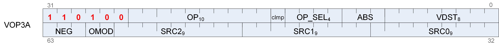
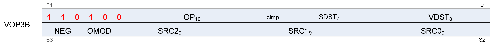

## 12.8. VOP1 Instructions


Instructions in this format may use a 32-bit literal constant, DPP or SDWA which occurs immediately after the instruction.

#### V_NOP

Opcode: 0

Do nothing.

**Notes**

This instruction can be used to insert a single-cycle bubble in the vector ALU pipeline. For multiple cycles repeat this opcode.

#### V_MOV_B32

Opcode: 1

Move 32-bit data from a vector input into a vector register.

```
D0.b32 = S0.b32
```

**Notes**

Floating-point modifiers are valid for this instruction if S0 is a 32-bit floating point value. This instruction is suitable for negating or taking the absolute value of a floating-point value.

Functional examples:

```
    v_mov_b32 v0, v1    // Move into v0 from v1
    v_mov_b32 v0, -v1   // Set v0 to the negation of v1
    v_mov_b32 v0, abs(v1)   // Set v0 to the absolute value of v1
```

<!-- page 187 -->

#### V_READFIRSTLANE_B32

Opcode: 2

Read the scalar value in the lowest active lane of the input vector register and store it into a scalar register.

```
declare lane : 32'I;
if EXEC == 0x0LL then
    lane = 0;
    // Force lane 0 if all lanes are disabled
else
    lane = s_ff1_i32_b64(EXEC);
    // Lowest active lane
endif;
D0.b32 = VGPR[lane][SRC0.u32]
```

**Notes**

Overrides EXEC mask for the VGPR read. Input and output modifiers not supported; this is an untyped operation.

#### V_CVT_I32_F64

Opcode: 3

Convert from a double-precision float input to a signed 32-bit integer value and store the result into a vector register.

```
D0.i32 = f64_to_i32(S0.f64)
```

**Notes**

0.5ULP accuracy, out-of-range floating point values (including infinity) saturate. NAN is converted to 0.

Generation of the INEXACT exception is controlled by the CLAMP bit. INEXACT exceptions are enabled for this conversion iff CLAMP == 1.

#### V_CVT_F64_I32

Opcode: 4

Convert from a signed 32-bit integer input to a double-precision float value and store the result into a vector register.

```
D0.f64 = i32_to_f64(S0.i32)
```

<!-- page 188 -->

**Notes**

0ULP accuracy.

#### V_CVT_F32_I32

Opcode: 5

Convert from a signed 32-bit integer input to a single-precision float value and store the result into a vector register.

```
D0.f32 = i32_to_f32(S0.i32)
```

**Notes**

0.5ULP accuracy.

#### V_CVT_F32_U32

Opcode: 6

Convert from an unsigned 32-bit integer input to a single-precision float value and store the result into a vector register.

```
D0.f32 = u32_to_f32(S0.u32)
```

**Notes**

0.5ULP accuracy.

#### V_CVT_U32_F32

Opcode: 7

Convert from a single-precision float input to an unsigned 32-bit integer value and store the result into a vector register.

```
D0.u32 = f32_to_u32(S0.f32)
```

**Notes**

1ULP accuracy, out-of-range floating point values (including infinity) saturate. NAN is converted to 0.

Generation of the INEXACT exception is controlled by the CLAMP bit. INEXACT exceptions are enabled for this conversion iff CLAMP == 1.

<!-- page 189 -->

#### V_CVT_I32_F32

Opcode: 8

Convert from a single-precision float input to a signed 32-bit integer value and store the result into a vector register.

```
D0.i32 = f32_to_i32(S0.f32)
```

**Notes**

1ULP accuracy, out-of-range floating point values (including infinity) saturate. NAN is converted to 0.

Generation of the INEXACT exception is controlled by the CLAMP bit. INEXACT exceptions are enabled for this conversion iff CLAMP == 1.

#### V_CVT_F16_F32

Opcode: 10

Convert from a single-precision float input to a half-precision float value and store the result into a vector register.

```
D0.f16 = f32_to_f16(S0.f32)
```

**Notes**

0.5ULP accuracy, supports input modifiers and creates FP16 denormals when appropriate. Flush denorms on output if specified based on DP denorm mode. Output rounding based on DP rounding mode.

#### V_CVT_F32_F16

Opcode: 11

Convert from a half-precision float input to a single-precision float value and store the result into a vector register.

```
D0.f32 = f16_to_f32(S0.f16)
```

**Notes**

0ULP accuracy, FP16 denormal inputs are accepted. Flush denorms on input if specified based on DP denorm mode.

#### V_CVT_RPI_I32_F32

Opcode: 12

Convert from a single-precision float input to a signed 32-bit integer value using round to nearest integer semantics (ignore the default rounding mode) and store the result into a vector register.

<!-- page 190 -->

```
D0.i32 = f32_to_i32(floor(S0.f32 + 0.5F))
```

**Notes**

0.5ULP accuracy, denormals are supported.

#### V_CVT_FLR_I32_F32

Opcode: 13

Convert from a single-precision float input to a signed 32-bit integer value using round-down semantics (ignore the default rounding mode) and store the result into a vector register.

```
D0.i32 = f32_to_i32(floor(S0.f32))
```

**Notes**

1ULP accuracy, denormals are supported.

#### V_CVT_OFF_F32_I4

Opcode: 14

Convert from a signed 4-bit integer input to a single-precision float value using an offset table and store the result into a vector register.

Used for interpolation in shader. Lookup table on S0[3:0]:

S0 binary Result 1000 -0.5000f 1001 -0.4375f 1010 -0.3750f 1011 -0.3125f 1100 -0.2500f 1101 -0.1875f 1110 -0.1250f 1111 -0.0625f 0000 +0.0000f 0001 +0.0625f 0010 +0.1250f 0011 +0.1875f 0100 +0.2500f 0101 +0.3125f 0110 +0.3750f 0111 +0.4375f

```
declare CVT_OFF_TABLE : 32'F[16];
D0.f32 = CVT_OFF_TABLE[S0.u32[3 : 0]]
```

<!-- page 191 -->

#### V_CVT_F32_F64

Opcode: 15

Convert from a double-precision float input to a single-precision float value and store the result into a vector register.

```
D0.f32 = f64_to_f32(S0.f64)
```

**Notes**

0.5ULP accuracy, denormals are supported.

#### V_CVT_F64_F32

Opcode: 16

Convert from a single-precision float input to a double-precision float value and store the result into a vector register.

```
D0.f64 = f32_to_f64(S0.f32)
```

**Notes**

0ULP accuracy, denormals are supported.

#### V_CVT_F32_UBYTE0

Opcode: 17

Convert an unsigned byte in byte 0 of the input to a single-precision float value and store the result into a vector register.

```
D0.f32 = u32_to_f32(S0[7 : 0].u32)
```

#### V_CVT_F32_UBYTE1

Opcode: 18

Convert an unsigned byte in byte 1 of the input to a single-precision float value and store the result into a vector register.

```
D0.f32 = u32_to_f32(S0[15 : 8].u32)
```

#### V_CVT_F32_UBYTE2

Opcode: 19

<!-- page 192 -->

Convert an unsigned byte in byte 2 of the input to a single-precision float value and store the result into a vector register.

```
D0.f32 = u32_to_f32(S0[23 : 16].u32)
```

#### V_CVT_F32_UBYTE3

Opcode: 20

Convert an unsigned byte in byte 3 of the input to a single-precision float value and store the result into a vector register.

```
D0.f32 = u32_to_f32(S0[31 : 24].u32)
```

#### V_CVT_U32_F64

Opcode: 21

Convert from a double-precision float input to an unsigned 32-bit integer value and store the result into a vector register.

```
D0.u32 = f64_to_u32(S0.f64)
```

**Notes**

0.5ULP accuracy, out-of-range floating point values (including infinity) saturate. NAN is converted to 0.

Generation of the INEXACT exception is controlled by the CLAMP bit. INEXACT exceptions are enabled for this conversion iff CLAMP == 1.

#### V_CVT_F64_U32

Opcode: 22

Convert from an unsigned 32-bit integer input to a double-precision float value and store the result into a vector register.

```
D0.f64 = u32_to_f64(S0.u32)
```

**Notes**

0ULP accuracy.

#### V_TRUNC_F64

Opcode: 23

<!-- page 193 -->

Compute the integer part of a double-precision float input using round toward zero semantics and store the result in floating point format into a vector register.

```
D0.f64 = trunc(S0.f64)
```

#### V_CEIL_F64

Opcode: 24

Round the double-precision float input up to next integer and store the result in floating point format into a vector register.

```
D0.f64 = trunc(S0.f64);
if ((S0.f64 > 0.0) && (S0.f64 != D0.f64)) then
    D0.f64 += 1.0
endif
```

#### V_RNDNE_F64

Opcode: 25

Round the double-precision float input to the nearest even integer and store the result in floating point format into a vector register.

```
D0.f64 = floor(S0.f64 + 0.5);
if (isEven(floor(S0.f64)) && (fract(S0.f64) == 0.5)) then
    D0.f64 -= 1.0
endif
```

#### V_FLOOR_F64

Opcode: 26

Round the double-precision float input down to previous integer and store the result in floating point format into a vector register.

```
D0.f64 = trunc(S0.f64);
if ((S0.f64 < 0.0) && (S0.f64 != D0.f64)) then
    D0.f64 += -1.0
endif
```

#### V_FRACT_F32

Opcode: 27

Compute the fractional portion of a single-precision float input and store the result in floating point format into a vector register.

<!-- page 194 -->

```
D0.f32 = S0.f32 + -floor(S0.f32)
```

**Notes**

0.5ULP accuracy, denormals are accepted.

This is intended to comply with the DX specification of fract where the function behaves like an extension of integer modulus; be aware this may differ from how fract() is defined in other domains. For example: fract(-1.2) = 0.8 in DX.

Obey round mode, result clamped to 0x3f7fffff.

#### V_TRUNC_F32

Opcode: 28

Compute the integer part of a single-precision float input using round toward zero semantics and store the result in floating point format into a vector register.

```
D0.f32 = trunc(S0.f32)
```

#### V_CEIL_F32

Opcode: 29

Round the single-precision float input up to next integer and store the result in floating point format into a vector register.

```
D0.f32 = trunc(S0.f32);
if ((S0.f32 > 0.0F) && (S0.f32 != D0.f32)) then
    D0.f32 += 1.0F
endif
```

#### V_RNDNE_F32

Opcode: 30

Round the single-precision float input to the nearest even integer and store the result in floating point format into a vector register.

```
D0.f32 = floor(S0.f32 + 0.5F);
if (isEven(64'F(floor(S0.f32))) && (fract(S0.f32) == 0.5F)) then
    D0.f32 -= 1.0F
endif
```

<!-- page 195 -->

#### V_FLOOR_F32

Opcode: 31

Round the single-precision float input down to previous integer and store the result in floating point format into a vector register.

```
D0.f32 = trunc(S0.f32);
if ((S0.f32 < 0.0F) && (S0.f32 != D0.f32)) then
    D0.f32 += -1.0F
endif
```

#### V_EXP_F32

Opcode: 32

Calculate 2 raised to the power of the single-precision float input and store the result into a vector register.

```
D0.f32 = pow(2.0F, S0.f32)
```

**Notes**

1ULP accuracy, denormals are flushed.

Functional examples:

```
V_EXP_F32(0xff800000) => 0x00000000     // exp(-INF) = 0
V_EXP_F32(0x80000000) => 0x3f800000     // exp(-0.0) = 1
V_EXP_F32(0x7f800000) => 0x7f800000     // exp(+INF) = +INF
```

#### V_LOG_F32

Opcode: 33

Calculate the base 2 logarithm of the single-precision float input and store the result into a vector register.

```
D0.f32 = log2(S0.f32)
```

**Notes**

1ULP accuracy, denormals are flushed.

Functional examples:

```
V_LOG_F32(0xff800000) => 0xffc00000     // log(-INF) = NAN
V_LOG_F32(0xbf800000) => 0xffc00000     // log(-1.0) = NAN
V_LOG_F32(0x80000000) => 0xff800000     // log(-0.0) = -INF
V_LOG_F32(0x00000000) => 0xff800000     // log(+0.0) = -INF
V_LOG_F32(0x3f800000) => 0x00000000     // log(+1.0) = 0
V_LOG_F32(0x7f800000) => 0x7f800000     // log(+INF) = +INF
```

<!-- page 196 -->

#### V_RCP_F32

Opcode: 34

Calculate the reciprocal of the single-precision float input using IEEE rules and store the result into a vector register.

```
D0.f32 = 1.0F / S0.f32
```

**Notes**

1ULP accuracy. Accuracy converges to < 0.5ULP when using the Newton-Raphson method and 2 FMA operations. Denormals are flushed.

Functional examples:

```
V_RCP_F32(0xff800000) => 0x80000000     // rcp(-INF) = -0
V_RCP_F32(0xc0000000) => 0xbf000000     // rcp(-2.0) = -0.5
V_RCP_F32(0x80000000) => 0xff800000     // rcp(-0.0) = -INF
V_RCP_F32(0x00000000) => 0x7f800000     // rcp(+0.0) = +INF
V_RCP_F32(0x7f800000) => 0x00000000     // rcp(+INF) = +0
```

#### V_RCP_IFLAG_F32

Opcode: 35

Calculate the reciprocal of the vector float input in a manner suitable for integer division and store the result into a vector register. This opcode is intended for use as part of an integer division macro.

```
D0.f32 = 1.0F / S0.f32;
// Can only raise integer DIV_BY_ZERO exception
```

**Notes**

Can raise integer DIV_BY_ZERO exception but cannot raise floating-point exceptions. To be used in an integer reciprocal macro by the compiler with one of the sequences listed below (depending on signed or unsigned operation).

Unsigned usage: CVT_F32_U32 RCP_IFLAG_F32 MUL_F32 (2**32 - 1) CVT_U32_F32

Signed usage: CVT_F32_I32

<!-- page 197 -->

RCP_IFLAG_F32 MUL_F32 (2**31 - 1) CVT_I32_F32

#### V_RSQ_F32

Opcode: 36

Calculate the reciprocal of the square root of the single-precision float input using IEEE rules and store the result into a vector register.

```
D0.f32 = 1.0F / sqrt(S0.f32)
```

**Notes**

1ULP accuracy, denormals are flushed.

Functional examples:

```
V_RSQ_F32(0xff800000) => 0xffc00000     // rsq(-INF) = NAN
V_RSQ_F32(0x80000000) => 0xff800000     // rsq(-0.0) = -INF
V_RSQ_F32(0x00000000) => 0x7f800000     // rsq(+0.0) = +INF
V_RSQ_F32(0x40800000) => 0x3f000000     // rsq(+4.0) = +0.5
V_RSQ_F32(0x7f800000) => 0x00000000     // rsq(+INF) = +0
```

#### V_RCP_F64

Opcode: 37

Calculate the reciprocal of the double-precision float input using IEEE rules and store the result into a vector register.

```
D0.f64 = 1.0 / S0.f64
```

**Notes**

This opcode has (2**29)ULP accuracy and supports denormals.

#### V_RSQ_F64

Opcode: 38

Calculate the reciprocal of the square root of the double-precision float input using IEEE rules and store the result into a vector register.

```
D0.f64 = 1.0 / sqrt(S0.f64)
```

<!-- page 198 -->

**Notes**

This opcode has (2**29)ULP accuracy and supports denormals.

#### V_SQRT_F32

Opcode: 39

Calculate the square root of the single-precision float input using IEEE rules and store the result into a vector register.

```
D0.f32 = sqrt(S0.f32)
```

**Notes**

1ULP accuracy, denormals are flushed.

Functional examples:

```
V_SQRT_F32(0xff800000) => 0xffc00000     // sqrt(-INF) = NAN
V_SQRT_F32(0x80000000) => 0x80000000     // sqrt(-0.0) = -0
V_SQRT_F32(0x00000000) => 0x00000000     // sqrt(+0.0) = +0
V_SQRT_F32(0x40800000) => 0x40000000     // sqrt(+4.0) = +2.0
V_SQRT_F32(0x7f800000) => 0x7f800000     // sqrt(+INF) = +INF
```

#### V_SQRT_F64

Opcode: 40

Calculate the square root of the double-precision float input using IEEE rules and store the result into a vector register.

```
D0.f64 = sqrt(S0.f64)
```

**Notes**

This opcode has (2**29)ULP accuracy and supports denormals.

#### V_SIN_F32

Opcode: 41

Calculate the trigonometric sine of a single-precision float value using IEEE rules and store the result into a vector register. The operand is calculated by scaling the vector input by 2 PI.

```
D0.f32 = sin(S0.f32 * 32'F(PI * 2.0))
```

<!-- page 199 -->

**Notes**

Denormals are supported. Full range input is supported.

Functional examples:

```
V_SIN_F32(0xff800000) => 0xffc00000     // sin(-INF) = NAN
V_SIN_F32(0xff7fffff) => 0x00000000     // -MaxFloat, finite
V_SIN_F32(0x80000000) => 0x80000000     // sin(-0.0) = -0
V_SIN_F32(0x3e800000) => 0x3f800000     // sin(0.25) = 1
V_SIN_F32(0x7f800000) => 0xffc00000     // sin(+INF) = NAN
```

#### V_COS_F32

Opcode: 42

Calculate the trigonometric cosine of a single-precision float value using IEEE rules and store the result into a vector register. The operand is calculated by scaling the vector input by 2 PI.

```
D0.f32 = cos(S0.f32 * 32'F(PI * 2.0))
```

**Notes**

Denormals are supported. Full range input is supported.

Functional examples:

```
V_COS_F32(0xff800000) => 0xffc00000     // cos(-INF) = NAN
V_COS_F32(0xff7fffff) => 0x3f800000     // -MaxFloat, finite
V_COS_F32(0x80000000) => 0x3f800000     // cos(-0.0) = 1
V_COS_F32(0x3e800000) => 0x00000000     // cos(0.25) = 0
V_COS_F32(0x7f800000) => 0xffc00000     // cos(+INF) = NAN
```

#### V_NOT_B32

Opcode: 43

Calculate bitwise negation on a vector input and store the result into a vector register.

```
D0.u32 = ~S0.u32
```

**Notes**

Input and output modifiers not supported.

#### V_BFREV_B32

Opcode: 44

<!-- page 200 -->

Reverse the order of bits in a vector input and store the result into a vector register.

```
D0.u32[31 : 0] = S0.u32[0 : 31]
```

**Notes**

Input and output modifiers not supported.

#### V_FFBH_U32

Opcode: 45

Count the number of leading "0" bits before the first "1" in a vector input and store the result into a vector register. Store -1 if there are no "1" bits.

```
D0.i32 = -1;
// Set if no ones are found
for i in 0 : 31 do
    // Search from MSB
    if S0.u32[31 - i] == 1'1U then
        D0.i32 = i;
        break
    endif
endfor
```

**Notes**

Functional examples:

```
V_FFBH_U32(0x00000000) => 0xffffffff
V_FFBH_U32(0x800000ff) => 0
V_FFBH_U32(0x100000ff) => 3
V_FFBH_U32(0x0000ffff) => 16
V_FFBH_U32(0x00000001) => 31
```

#### V_FFBL_B32

Opcode: 46

Count the number of trailing "0" bits before the first "1" in a vector input and store the result into a vector register. Store -1 if there are no "1" bits in the input.

```
D0.i32 = -1;
// Set if no ones are found
for i in 0 : 31 do
    // Search from LSB
    if S0.u32[i] == 1'1U then
        D0.i32 = i;
        break
    endif
endfor
```

<!-- page 201 -->

**Notes**

Functional examples:

```
V_FFBL_B32(0x00000000) => 0xffffffff
V_FFBL_B32(0xff000001) => 0
V_FFBL_B32(0xff000008) => 3
V_FFBL_B32(0xffff0000) => 16
V_FFBL_B32(0x80000000) => 31
```

#### V_FFBH_I32

Opcode: 47

Count the number of leading bits that are the same as the sign bit of a vector input and store the result into a vector register. Store -1 if all input bits are the same.

```
D0.i32 = -1;
// Set if all bits are the same
for i in 1 : 31 do
    // Search from MSB
    if S0.i32[31 - i] != S0.i32[31] then
        D0.i32 = i;
        break
    endif
endfor
```

**Notes**

Functional examples:

```
V_FFBH_I32(0x00000000) => 0xffffffff
V_FFBH_I32(0x40000000) => 1
V_FFBH_I32(0x80000000) => 1
V_FFBH_I32(0x0fffffff) => 4
V_FFBH_I32(0xffff0000) => 16
V_FFBH_I32(0xfffffffe) => 31
V_FFBH_I32(0xffffffff) => 0xffffffff
```

#### V_FREXP_EXP_I32_F64

Opcode: 48

Extract the exponent of a double-precision float input and store the result as a signed 32-bit integer into a vector register.

```
if ((S0.f64 == +INF) || (S0.f64 == -INF) || isNAN(S0.f64)) then
    D0.i32 = 0
else
    D0.i32 = exponent(S0.f64) - 1023 + 1
endif
```

<!-- page 202 -->

**Notes**

This operation satisfies the invariant S0.f64 = significand * (2 ** exponent). See also V_FREXP_MANT_F64, which returns the significand. See the C library function frexp() for more information.

#### V_FREXP_MANT_F64

Opcode: 49

Extract the binary significand, or mantissa, of a double-precision float input and store the result as a double-precision float into a vector register.

```
if ((S0.f64 == +INF) || (S0.f64 == -INF) || isNAN(S0.f64)) then
    D0.f64 = S0.f64
else
    D0.f64 = mantissa(S0.f64)
endif
```

**Notes**

This operation satisfies the invariant S0.f64 = significand * (2 ** exponent). Result range is in (-1.0,-0.5][0.5,1.0) in normal cases. See also V_FREXP_EXP_I32_F64, which returns integer exponent. See the C library function frexp() for more information.

#### V_FRACT_F64

Opcode: 50

Compute the fractional portion of a double-precision float input and store the result in floating point format into a vector register.

```
D0.f64 = S0.f64 + -floor(S0.f64)
```

**Notes**

0.5ULP accuracy, denormals are accepted.

This is intended to comply with the DX specification of fract where the function behaves like an extension of integer modulus; be aware this may differ from how fract() is defined in other domains. For example: fract(-1.2) = 0.8 in DX.

Obey round mode, result clamped to 0x3fefffffffffffff.

<!-- page 203 -->

#### V_FREXP_EXP_I32_F32

Opcode: 51

Extract the exponent of a single-precision float input and store the result as a signed 32-bit integer into a vector register.

```
if ((64'F(S0.f32) == +INF) || (64'F(S0.f32) == -INF) || isNAN(64'F(S0.f32))) then
    D0.i32 = 0
else
    D0.i32 = exponent(S0.f32) - 127 + 1
endif
```

**Notes**

This operation satisfies the invariant S0.f32 = significand * (2 ** exponent). See also V_FREXP_MANT_F32, which returns the significand. See the C library function frexp() for more information.

#### V_FREXP_MANT_F32

Opcode: 52

Extract the binary significand, or mantissa, of a single-precision float input and store the result as a single-precision float into a vector register.

```
if ((64'F(S0.f32) == +INF) || (64'F(S0.f32) == -INF) || isNAN(64'F(S0.f32))) then
    D0.f32 = S0.f32
else
    D0.f32 = mantissa(S0.f32)
endif
```

**Notes**

This operation satisfies the invariant S0.f32 = significand * (2 ** exponent). Result range is in (-1.0,-0.5][0.5,1.0) in normal cases. See also V_FREXP_EXP_I32_F32, which returns integer exponent. See the C library function frexp() for more information.

#### V_CLREXCP

Opcode: 53

Clear this wave's exception state in the vector ALU.

#### V_MOV_B64

Opcode: 56

Move data from a 64-bit vector input into a vector register.

```
D0.b64 = S0.b64
```

<!-- page 204 -->

**Notes**

Floating-point modifiers are valid for this instruction if S0.u64 is a 64-bit floating point value. This instruction is suitable for negating or taking the absolute value of a floating-point value.

#### V_CVT_F16_U16

Opcode: 57

Convert from an unsigned 16-bit integer input to a half-precision float value and store the result into a vector register.

```
D0.f16 = u16_to_f16(S0.u16)
```

**Notes**

0.5ULP accuracy, supports denormals, rounding, exception flags and saturation.

#### V_CVT_F16_I16

Opcode: 58

Convert from a signed 16-bit integer input to a half-precision float value and store the result into a vector register.

```
D0.f16 = i16_to_f16(S0.i16)
```

**Notes**

0.5ULP accuracy, supports denormals, rounding, exception flags and saturation.

#### V_CVT_U16_F16

Opcode: 59

Convert from a half-precision float input to an unsigned 16-bit integer value and store the result into a vector register.

```
D0.u16 = f16_to_u16(S0.f16)
```

**Notes**

1ULP accuracy, supports rounding, exception flags and saturation. FP16 denormals are accepted. Conversion is done with truncation.

Generation of the INEXACT exception is controlled by the CLAMP bit. INEXACT exceptions are enabled for this conversion iff CLAMP == 1.

<!-- page 205 -->

#### V_CVT_I16_F16

Opcode: 60

Convert from a half-precision float input to a signed 16-bit integer value and store the result into a vector register.

```
D0.i16 = f16_to_i16(S0.f16)
```

**Notes**

1ULP accuracy, supports rounding, exception flags and saturation. FP16 denormals are accepted. Conversion is done with truncation.

Generation of the INEXACT exception is controlled by the CLAMP bit. INEXACT exceptions are enabled for this conversion iff CLAMP == 1.

#### V_RCP_F16

Opcode: 61

Calculate the reciprocal of the half-precision float input using IEEE rules and store the result into a vector register.

```
D0.f16 = 16'1.0 / S0.f16
```

**Notes**

1ULP accuracy.

Functional examples:

```
V_RCP_F16(0xfc00) => 0x8000     // rcp(-INF) = -0
V_RCP_F16(0xc000) => 0xb800     // rcp(-2.0) = -0.5
V_RCP_F16(0x8000) => 0xfc00     // rcp(-0.0) = -INF
V_RCP_F16(0x0000) => 0x7c00     // rcp(+0.0) = +INF
V_RCP_F16(0x7c00) => 0x0000     // rcp(+INF) = +0
```

#### V_SQRT_F16

Opcode: 62

Calculate the square root of the half-precision float input using IEEE rules and store the result into a vector register.

```
D0.f16 = sqrt(S0.f16)
```

**Notes**

<!-- page 206 -->

1ULP accuracy, denormals are supported.

Functional examples:

```
V_SQRT_F16(0xfc00) => 0xfe00     // sqrt(-INF) = NAN
V_SQRT_F16(0x8000) => 0x8000     // sqrt(-0.0) = -0
V_SQRT_F16(0x0000) => 0x0000     // sqrt(+0.0) = +0
V_SQRT_F16(0x4400) => 0x4000     // sqrt(+4.0) = +2.0
V_SQRT_F16(0x7c00) => 0x7c00     // sqrt(+INF) = +INF
```

#### V_RSQ_F16

Opcode: 63

Calculate the reciprocal of the square root of the half-precision float input using IEEE rules and store the result into a vector register.

```
D0.f16 = 16'1.0 / sqrt(S0.f16)
```

**Notes**

1ULP accuracy, denormals are supported.

Functional examples:

```
V_RSQ_F16(0xfc00) => 0xfe00     // rsq(-INF) = NAN
V_RSQ_F16(0x8000) => 0xfc00     // rsq(-0.0) = -INF
V_RSQ_F16(0x0000) => 0x7c00     // rsq(+0.0) = +INF
V_RSQ_F16(0x4400) => 0x3800     // rsq(+4.0) = +0.5
V_RSQ_F16(0x7c00) => 0x0000     // rsq(+INF) = +0
```

#### V_LOG_F16

Opcode: 64

Calculate the base 2 logarithm of the half-precision float input and store the result into a vector register.

```
D0.f16 = log2(S0.f16)
```

**Notes**

1ULP accuracy, denormals are supported.

Functional examples:

```
V_LOG_F16(0xfc00) => 0xfe00     // log(-INF) = NAN
V_LOG_F16(0xbc00) => 0xfe00     // log(-1.0) = NAN
V_LOG_F16(0x8000) => 0xfc00     // log(-0.0) = -INF
V_LOG_F16(0x0000) => 0xfc00     // log(+0.0) = -INF
V_LOG_F16(0x3c00) => 0x0000     // log(+1.0) = 0
V_LOG_F16(0x7c00) => 0x7c00     // log(+INF) = +INF
```

<!-- page 207 -->

#### V_EXP_F16

Opcode: 65

Calculate 2 raised to the power of the half-precision float input and store the result into a vector register.

```
D0.f16 = pow(16'2.0, S0.f16)
```

**Notes**

1ULP accuracy, denormals are supported.

Functional examples:

```
V_EXP_F16(0xfc00) => 0x0000     // exp(-INF) = 0
V_EXP_F16(0x8000) => 0x3c00     // exp(-0.0) = 1
V_EXP_F16(0x7c00) => 0x7c00     // exp(+INF) = +INF
```

#### V_FREXP_MANT_F16

Opcode: 66

Extract the binary significand, or mantissa, of a half-precision float input and store the result as a half-precision float into a vector register.

```
if ((64'F(S0.f16) == +INF) || (64'F(S0.f16) == -INF) || isNAN(64'F(S0.f16))) then
    D0.f16 = S0.f16
else
    D0.f16 = mantissa(S0.f16)
endif
```

**Notes**

This operation satisfies the invariant S0.f16 = significand * (2 ** exponent). Result range is in (-1.0,-0.5][0.5,1.0) in normal cases. See also V_FREXP_EXP_I16_F16, which returns integer exponent. See the C library function frexp() for more information.

#### V_FREXP_EXP_I16_F16

Opcode: 67

Extract the exponent of a half-precision float input and store the result as a signed 16-bit integer into a vector register.

<!-- page 208 -->

```
if ((64'F(S0.f16) == +INF) || (64'F(S0.f16) == -INF) || isNAN(64'F(S0.f16))) then
    D0.i16 = 16'0
else
    D0.i16 = 16'I(exponent(S0.f16) - 15 + 1)
endif
```

**Notes**

This operation satisfies the invariant S0.f16 = significand * (2 ** exponent). See also V_FREXP_MANT_F16, which returns the significand. See the C library function frexp() for more information.

#### V_FLOOR_F16

Opcode: 68

Round the half-precision float input down to previous integer and store the result in floating point format into a vector register.

```
D0.f16 = trunc(S0.f16);
if ((S0.f16 < 16'0.0) && (S0.f16 != D0.f16)) then
    D0.f16 += -16'1.0
endif
```

#### V_CEIL_F16

Opcode: 69

Round the half-precision float input up to next integer and store the result in floating point format into a vector register.

```
D0.f16 = trunc(S0.f16);
if ((S0.f16 > 16'0.0) && (S0.f16 != D0.f16)) then
    D0.f16 += 16'1.0
endif
```

#### V_TRUNC_F16

Opcode: 70

Compute the integer part of a half-precision float input using round toward zero semantics and store the result in floating point format into a vector register.

```
D0.f16 = trunc(S0.f16)
```

#### V_RNDNE_F16

Opcode: 71

<!-- page 209 -->

Round the half-precision float input to the nearest even integer and store the result in floating point format into a vector register.

```
D0.f16 = floor(S0.f16 + 16'0.5);
if (isEven(64'F(floor(S0.f16))) && (fract(S0.f16) == 16'0.5)) then
    D0.f16 -= 16'1.0
endif
```

#### V_FRACT_F16

Opcode: 72

Compute the fractional portion of a half-precision float input and store the result in floating point format into a vector register.

```
D0.f16 = S0.f16 + -floor(S0.f16)
```

**Notes**

0.5ULP accuracy, denormals are accepted.

This is intended to comply with the DX specification of fract where the function behaves like an extension of integer modulus; be aware this may differ from how fract() is defined in other domains. For example: fract(-1.2) = 0.8 in DX.

#### V_SIN_F16

Opcode: 73

Calculate the trigonometric sine of a half-precision float value using IEEE rules and store the result into a vector register. The operand is calculated by scaling the vector input by 2 PI.

```
D0.f16 = sin(S0.f16 * 16'F(PI * 2.0))
```

**Notes**

Denormals are supported. Full range input is supported.

Functional examples:

```
V_SIN_F16(0xfc00) => 0xfe00     // sin(-INF) = NAN
V_SIN_F16(0xfbff) => 0x0000     // Most negative finite FP16
V_SIN_F16(0x8000) => 0x8000     // sin(-0.0) = -0
V_SIN_F16(0x3400) => 0x3c00     // sin(0.25) = 1
V_SIN_F16(0x7bff) => 0x0000     // Most positive finite FP16
V_SIN_F16(0x7c00) => 0xfe00     // sin(+INF) = NAN
```

<!-- page 210 -->

#### V_COS_F16

Opcode: 74

Calculate the trigonometric cosine of a half-precision float value using IEEE rules and store the result into a vector register. The operand is calculated by scaling the vector input by 2 PI.

```
D0.f16 = cos(S0.f16 * 16'F(PI * 2.0))
```

**Notes**

Denormals are supported. Full range input is supported.

Functional examples:

```
V_COS_F16(0xfc00) => 0xfe00     // cos(-INF) = NAN
V_COS_F16(0xfbff) => 0x3c00     // Most negative finite FP16
V_COS_F16(0x8000) => 0x3c00     // cos(-0.0) = 1
V_COS_F16(0x3400) => 0x0000     // cos(0.25) = 0
V_COS_F16(0x7bff) => 0x3c00     // Most positive finite FP16
V_COS_F16(0x7c00) => 0xfe00     // cos(+INF) = NAN
```

#### V_CVT_NORM_I16_F16

Opcode: 77

Convert from a half-precision float input to a signed normalized short and store the result into a vector register.

```
D0.i16 = f16_to_snorm(S0.f16)
```

**Notes**

0.5ULP accuracy, supports rounding, exception flags and saturation, denormals are supported.

#### V_CVT_NORM_U16_F16

Opcode: 78

Convert from a half-precision float input to an unsigned normalized short and store the result into a vector register.

```
D0.u16 = f16_to_unorm(S0.f16)
```

**Notes**

0.5ULP accuracy, supports rounding, exception flags and saturation, denormals are supported.

<!-- page 211 -->

#### V_SAT_PK_U8_I16

Opcode: 79

Given 2 signed 16-bit integer inputs, saturate each input over an unsigned 8-bit integer range, pack the resulting values into a packed 16-bit value and store the result into a vector register.

```
SAT8 = lambda(n) (
    if n <= 16'0 then
        return 8'0U
    elsif n >= 16'255 then
        return 8'255U
    else
        return n[7 : 0].u8
    endif);
tmp = 16'0;
tmp[7 : 0].u8 = SAT8(S0[15 : 0].i16);
tmp[15 : 8].u8 = SAT8(S0[31 : 16].i16);
D0.b16 = tmp.b16
```

**Notes**

Used for 4x16bit data packed as 4x8bit data.

#### V_SWAP_B32

Opcode: 81

Swap the values in two vector registers.

```
tmp = D0.b32;
D0.b32 = S0.b32;
S0.b32 = tmp
```

**Notes**

Input and output modifiers not supported; this is an untyped operation.

#### V_ACCVGPR_MOV_B32

Opcode: 82

Move data from one accumulator register to another accumulator register.

#### V_CVT_F32_FP8

Opcode: 84

Convert from an FP8 float input to a single-precision float value and store the result into a vector register.

```
if SDWA_SRC0_SEL == BYTE1.b3 then
    D0.f32 = fp8_to_f32(S0[15 : 8].fp8)
elsif SDWA_SRC0_SEL == BYTE2.b3 then
    D0.f32 = fp8_to_f32(S0[23 : 16].fp8)
elsif SDWA_SRC0_SEL == BYTE3.b3 then
    D0.f32 = fp8_to_f32(S0[31 : 24].fp8)
else
    // BYTE0 implied
    D0.f32 = fp8_to_f32(S0[7 : 0].fp8)
endif
```

<!-- page 212 -->

**Notes**

SDWA encoding allows SRC0_SEL to control which byte of S0 is converted. Only the BYTE selects of SRC0_SEL are legal. If this instruction is not encoded in SDWA then BYTE0 is implied.

#### V_CVT_F32_BF8

Opcode: 85

Convert from a BF8 float input to a single-precision float value and store the result into a vector register.

```
if SDWA_SRC0_SEL == BYTE1.b3 then
    D0.f32 = bf8_to_f32(S0[15 : 8].bf8)
elsif SDWA_SRC0_SEL == BYTE2.b3 then
    D0.f32 = bf8_to_f32(S0[23 : 16].bf8)
elsif SDWA_SRC0_SEL == BYTE3.b3 then
    D0.f32 = bf8_to_f32(S0[31 : 24].bf8)
else
    // BYTE0 implied
    D0.f32 = bf8_to_f32(S0[7 : 0].bf8)
endif
```

**Notes**

SDWA encoding allows SRC0_SEL to control which byte of S0 is converted. Only the BYTE selects of SRC0_SEL are legal. If this instruction is not encoded in SDWA then BYTE0 is implied.

#### V_CVT_PK_F32_FP8

Opcode: 86

Convert from a packed 2-component FP8 float input to a packed single-precision float value and store the result into a vector register.

```
tmp = SDWA_SRC0_SEL[1 : 0] == WORD1.b2 ? S0[31 : 16] : S0[15 : 0];
D0[31 : 0].f32 = fp8_to_f32(tmp[7 : 0].fp8);
D0[63 : 32].f32 = fp8_to_f32(tmp[15 : 8].fp8)
```

**Notes**

SDWA encoding allows SRC0_SEL to control which word of S0 is converted. Only the WORD selects of SRC0_SEL are legal. If this instruction is not encoded in SDWA then WORD0 is implied.

<!-- page 213 -->

#### V_CVT_PK_F32_BF8

Opcode: 87

Convert from a packed 2-component BF8 float input to a packed single-precision float value and store the result into a vector register.

```
tmp = SDWA_SRC0_SEL[1 : 0] == WORD1.b2 ? S0[31 : 16] : S0[15 : 0];
D0[31 : 0].f32 = bf8_to_f32(tmp[7 : 0].bf8);
D0[63 : 32].f32 = bf8_to_f32(tmp[15 : 8].bf8)
```

**Notes**

SDWA encoding allows SRC0_SEL to control which word of S0 is converted. Only the WORD selects of SRC0_SEL are legal. If this instruction is not encoded in SDWA then WORD0 is implied.

<!-- page 214 -->

### 12.8.1. VOP1 using VOP3 encoding

Instructions in this format may also be encoded as VOP3. This allows access to the extra control bits (e.g. ABS, OMOD) in exchange for not being able to use a literal constant. The VOP3 opcode is: VOP2 opcode + 0x140.




