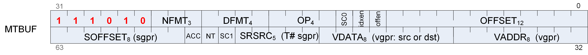

<!-- page 477 -->

## 12.14. MTBUF Instructions

The bitfield map of the MTBUF format is:



```
    where:

    OFFSET  = Unsigned immediate byte offset.
    OFFEN   = Send offset either as VADDR or as zero.
    IDXEN   = Send index either as VADDR or as zero.
    LDS     = Data is transferred between LDS and Memory, not VGPRs.
    OP      = Instruction Opcode.
    DFMT    = Data format for typed buffer.
    NFMT    = Number format for typed buffer.
    VADDR   = VGPR address source.
    VDATA   = Vector GPR for read/write result.
    SRSRC   = Scalar GPR that specifies resource constant.
    SOFFSET = Unsigned byte offset from an SGPR.
    SC      = Scope
    NT      = Non-Temporal
    ACC     = Return to ACC VGPRs
```

#### TBUFFER_LOAD_FORMAT_X

Opcode: 0

Load 1-component formatted data from a buffer surface, convert the data to 32 bit integral or floating point format, then store the result into a vector register. The instruction specifies the data format of the surface, overriding the resource descriptor.

```
addr = CalcBufferAddr(VADDR.b32, SRSRC.b32, SOFFSET.b32, OFFSET.b32);
VDATA[31 : 0].b32 = ConvertFromFormat(MEM[addr + ChannelOffsetX()]);
// Mem access size depends on format
```

#### TBUFFER_LOAD_FORMAT_XY

Opcode: 1

Load 2-component formatted data from a buffer surface, convert the data to 32 bit integral or floating point format, then store the result into a vector register. The instruction specifies the data format of the surface, overriding the resource descriptor.

```
addr = CalcBufferAddr(VADDR.b32, SRSRC.b32, SOFFSET.b32, OFFSET.b32);
VDATA[31 : 0].b32 = ConvertFromFormat(MEM[addr + ChannelOffsetX()]);
// Mem access size depends on format
VDATA[63 : 32].b32 = ConvertFromFormat(MEM[addr + ChannelOffsetY()])
```

<!-- page 478 -->

#### TBUFFER_LOAD_FORMAT_XYZ

Opcode: 2

Load 3-component formatted data from a buffer surface, convert the data to 32 bit integral or floating point format, then store the result into a vector register. The instruction specifies the data format of the surface, overriding the resource descriptor.

```
addr = CalcBufferAddr(VADDR.b32, SRSRC.b32, SOFFSET.b32, OFFSET.b32);
VDATA[31 : 0].b32 = ConvertFromFormat(MEM[addr + ChannelOffsetX()]);
// Mem access size depends on format
VDATA[63 : 32].b32 = ConvertFromFormat(MEM[addr + ChannelOffsetY()]);
VDATA[95 : 64].b32 = ConvertFromFormat(MEM[addr + ChannelOffsetZ()])
```

#### TBUFFER_LOAD_FORMAT_XYZW

Opcode: 3

Load 4-component formatted data from a buffer surface, convert the data to 32 bit integral or floating point format, then store the result into a vector register. The instruction specifies the data format of the surface, overriding the resource descriptor.

```
addr = CalcBufferAddr(VADDR.b32, SRSRC.b32, SOFFSET.b32, OFFSET.b32);
VDATA[31 : 0].b32 = ConvertFromFormat(MEM[addr + ChannelOffsetX()]);
// Mem access size depends on format
VDATA[63 : 32].b32 = ConvertFromFormat(MEM[addr + ChannelOffsetY()]);
VDATA[95 : 64].b32 = ConvertFromFormat(MEM[addr + ChannelOffsetZ()]);
VDATA[127 : 96].b32 = ConvertFromFormat(MEM[addr + ChannelOffsetW()])
```

#### TBUFFER_STORE_FORMAT_X

Opcode: 4

Convert 32 bits of data from vector input registers into 1-component formatted data and store the data into a buffer surface. The instruction specifies the data format of the surface, overriding the resource descriptor.

```
addr = CalcBufferAddr(VADDR.b32, SRSRC.b32, SOFFSET.b32, OFFSET.b32);
MEM[addr + ChannelOffsetX()] = ConvertToFormat(VDATA[31 : 0].b32);
// Mem access size depends on format
```

#### TBUFFER_STORE_FORMAT_XY

Opcode: 5

Convert 64 bits of data from vector input registers into 2-component formatted data and store the data into a buffer surface. The instruction specifies the data format of the surface, overriding the resource descriptor.

```
addr = CalcBufferAddr(VADDR.b32, SRSRC.b32, SOFFSET.b32, OFFSET.b32);
MEM[addr + ChannelOffsetX()] = ConvertToFormat(VDATA[31 : 0].b32);
// Mem access size depends on format
MEM[addr + ChannelOffsetY()] = ConvertToFormat(VDATA[63 : 32].b32)
```

<!-- page 479 -->

#### TBUFFER_STORE_FORMAT_XYZ

Opcode: 6

Convert 96 bits of data from vector input registers into 3-component formatted data and store the data into a buffer surface. The instruction specifies the data format of the surface, overriding the resource descriptor.

```
addr = CalcBufferAddr(VADDR.b32, SRSRC.b32, SOFFSET.b32, OFFSET.b32);
MEM[addr + ChannelOffsetX()] = ConvertToFormat(VDATA[31 : 0].b32);
// Mem access size depends on format
MEM[addr + ChannelOffsetY()] = ConvertToFormat(VDATA[63 : 32].b32);
MEM[addr + ChannelOffsetZ()] = ConvertToFormat(VDATA[95 : 64].b32)
```

#### TBUFFER_STORE_FORMAT_XYZW

Opcode: 7

Convert 128 bits of data from vector input registers into 4-component formatted data and store the data into a buffer surface. The instruction specifies the data format of the surface, overriding the resource descriptor.

```
addr = CalcBufferAddr(VADDR.b32, SRSRC.b32, SOFFSET.b32, OFFSET.b32);
MEM[addr + ChannelOffsetX()] = ConvertToFormat(VDATA[31 : 0].b32);
// Mem access size depends on format
MEM[addr + ChannelOffsetY()] = ConvertToFormat(VDATA[63 : 32].b32);
MEM[addr + ChannelOffsetZ()] = ConvertToFormat(VDATA[95 : 64].b32);
MEM[addr + ChannelOffsetW()] = ConvertToFormat(VDATA[127 : 96].b32)
```

#### TBUFFER_LOAD_FORMAT_D16_X

Opcode: 8

Load 1-component formatted data from a buffer surface, convert the data to packed 16 bit integral or floating point format, then store the result into a vector register. The instruction specifies the data format of the surface, overriding the resource descriptor.

```
addr = CalcBufferAddr(VADDR.b32, SRSRC.b32, SOFFSET.b32, OFFSET.b32);
VDATA[15 : 0].b16 = 16'B(ConvertFromFormat(MEM[addr + ChannelOffsetX()]));
// Mem access size depends on format
// VDATA[31:16].b16 is preserved.
```

#### TBUFFER_LOAD_FORMAT_D16_XY

Opcode: 9

Load 2-component formatted data from a buffer surface, convert the data to packed 16 bit integral or floating point format, then store the result into a vector register. The instruction specifies the data format of the surface, overriding the resource descriptor.

<!-- page 480 -->

```
addr = CalcBufferAddr(VADDR.b32, SRSRC.b32, SOFFSET.b32, OFFSET.b32);
VDATA[15 : 0].b16 = 16'B(ConvertFromFormat(MEM[addr + ChannelOffsetX()]));
// Mem access size depends on format
VDATA[31 : 16].b16 = 16'B(ConvertFromFormat(MEM[addr + ChannelOffsetY()]))
```

#### TBUFFER_LOAD_FORMAT_D16_XYZ

Opcode: 10

Load 3-component formatted data from a buffer surface, convert the data to packed 16 bit integral or floating point format, then store the result into a vector register. The instruction specifies the data format of the surface, overriding the resource descriptor.

```
addr = CalcBufferAddr(VADDR.b32, SRSRC.b32, SOFFSET.b32, OFFSET.b32);
VDATA[15 : 0].b16 = 16'B(ConvertFromFormat(MEM[addr + ChannelOffsetX()]));
// Mem access size depends on format
VDATA[31 : 16].b16 = 16'B(ConvertFromFormat(MEM[addr + ChannelOffsetY()]));
VDATA[47 : 32].b16 = 16'B(ConvertFromFormat(MEM[addr + ChannelOffsetZ()]));
// VDATA[63:48].b16 is preserved.
```

#### TBUFFER_LOAD_FORMAT_D16_XYZW

Opcode: 11

Load 4-component formatted data from a buffer surface, convert the data to packed 16 bit integral or floating point format, then store the result into a vector register. The instruction specifies the data format of the surface, overriding the resource descriptor.

```
addr = CalcBufferAddr(VADDR.b32, SRSRC.b32, SOFFSET.b32, OFFSET.b32);
VDATA[15 : 0].b16 = 16'B(ConvertFromFormat(MEM[addr + ChannelOffsetX()]));
// Mem access size depends on format
VDATA[31 : 16].b16 = 16'B(ConvertFromFormat(MEM[addr + ChannelOffsetY()]));
VDATA[47 : 32].b16 = 16'B(ConvertFromFormat(MEM[addr + ChannelOffsetZ()]));
VDATA[63 : 48].b16 = 16'B(ConvertFromFormat(MEM[addr + ChannelOffsetW()]))
```

#### TBUFFER_STORE_FORMAT_D16_X

Opcode: 12

Convert 16 bits of data from vector input registers into 1-component formatted data and store the data into a buffer surface. The instruction specifies the data format of the surface, overriding the resource descriptor.

```
addr = CalcBufferAddr(VADDR.b32, SRSRC.b32, SOFFSET.b32, OFFSET.b32);
MEM[addr + ChannelOffsetX()] = ConvertToFormat(32'B(VDATA[15 : 0].b16));
// Mem access size depends on format
```

<!-- page 481 -->

#### TBUFFER_STORE_FORMAT_D16_XY

Opcode: 13

Convert 32 bits of data from vector input registers into 2-component formatted data and store the data into a buffer surface. The instruction specifies the data format of the surface, overriding the resource descriptor.

```
addr = CalcBufferAddr(VADDR.b32, SRSRC.b32, SOFFSET.b32, OFFSET.b32);
MEM[addr + ChannelOffsetX()] = ConvertToFormat(32'B(VDATA[15 : 0].b16));
// Mem access size depends on format
MEM[addr + ChannelOffsetY()] = ConvertToFormat(32'B(VDATA[31 : 16].b16))
```

#### TBUFFER_STORE_FORMAT_D16_XYZ

Opcode: 14

Convert 48 bits of data from vector input registers into 3-component formatted data and store the data into a buffer surface. The instruction specifies the data format of the surface, overriding the resource descriptor.

```
addr = CalcBufferAddr(VADDR.b32, SRSRC.b32, SOFFSET.b32, OFFSET.b32);
MEM[addr + ChannelOffsetX()] = ConvertToFormat(32'B(VDATA[15 : 0].b16));
// Mem access size depends on format
MEM[addr + ChannelOffsetY()] = ConvertToFormat(32'B(VDATA[31 : 16].b16));
MEM[addr + ChannelOffsetZ()] = ConvertToFormat(32'B(VDATA[47 : 32].b16))
```

#### TBUFFER_STORE_FORMAT_D16_XYZW

Opcode: 15

Convert 64 bits of data from vector input registers into 4-component formatted data and store the data into a buffer surface. The instruction specifies the data format of the surface, overriding the resource descriptor.

```
addr = CalcBufferAddr(VADDR.b32, SRSRC.b32, SOFFSET.b32, OFFSET.b32);
MEM[addr + ChannelOffsetX()] = ConvertToFormat(32'B(VDATA[15 : 0].b16));
// Mem access size depends on format
MEM[addr + ChannelOffsetY()] = ConvertToFormat(32'B(VDATA[31 : 16].b16));
MEM[addr + ChannelOffsetZ()] = ConvertToFormat(32'B(VDATA[47 : 32].b16));
MEM[addr + ChannelOffsetW()] = ConvertToFormat(32'B(VDATA[63 : 48].b16))
```
