<!-- page 520 -->

# Chapter 13. Microcode Formats

This section specifies the microcode formats. The definitions can be used to simplify compilation by providing standard templates and enumeration names for the various instruction formats.

Endian Order - The CDNA architecture addresses memory and registers using little endian byte-ordering and bit-ordering. Multi-byte values are stored with their least-significant (low-order) byte (LSB) at the lowest byte address, and they are illustrated with their LSB at the right side. Byte values are stored with their least-significant (low-order) bit (lsb) at the lowest bit address, and they are illustrated with their lsb at the right side.

The table below summarizes the microcode formats and their widths. The sections that follow provide details

_Table 63. Summary of Microcode Formats_

|**Microcode Formats**|**Reference**|**Width (bits)**|
|---|---|---|
|**Scalar ALU and Control Formats**|||
|SOP2|SOP2|32|
|SOP1|SOP1||
|SOPK|SOPK||
|SOPP|SOPP||
|SOPC|SOPC||
|**Scalar Memory Format**|||
|SMEM|SMEM|64|
|**Vector ALU Format**|||
|VOP1|VOP1|32|
|VOP2|VOP2|32|
|VOPC|VOPC|32|
|VOP3A|VOP3A|64|
|VOP3B|VOP3B|64|
|VOP3P|VOP3P|64|
|VOP3P-MAI|VOP3P-MAI|64|
|DPP|DPP|32|
|SDWA|VOP2|32|
|**LDS/GWS Format**|||
|DS|DS|64|
|**Vector Memory Buffer Formats**|||
|MTBUF|MTBUF|64|
|MUBUF|MUBUF|64|
|**Flat Formats**|||
|FLAT|FLAT|64|
|GLOBAL|GLOBAL|64|
|SCRATCH|SCRATCH|64|

The field-definition tables that accompany the descriptions in the sections below use the following notation.

- int(2) - A two-bit field that specifies an unsigned integer value.

- enum(7) - A seven-bit field that specifies an enumerated set of values (in this case, a set of up to 27 values). The number of valid values can be less than the maximum.

The default value of all fields is zero. Any bitfield not identified is assumed to be reserved.

<!-- page 521 -->

**Instruction Suffixes**

Most instructions include a suffix which indicates the data type the instruction handles. This suffix may also include a number which indicate the size of the data.

For example: "F32" indicates "32-bit floating point data", or "B16" is "16-bit binary data".

- B = binary

- F = floating point

- U = unsigned integer

- S = signed integer

When more than one data-type specifier occurs in an instruction, the last one is the result type and size, and the earlier one(s) is/are input data type and size.

## 13.1. Scalar ALU and Control Formats

### 13.1.1. SOP2

Scalar format with Two inputs, one output

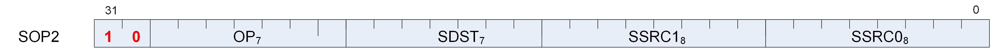

|**Format**|SOP2|
|---|---|
|**Description**|This is a scalar instruction with two inputs and one output. Can be followed by a 32-bit literal constant.|

_Table 64. SOP2 Fields_

<!-- page 522 -->

|**Field Name**|**Bits**|**Format or Description**|
|---|---|---|
|SSRC0|[7:0]|Source 0. First operand for the instruction.|
||0 - 101|SGPR0 to SGPR101: Scalar general-purpose registers.|
||102|FLAT_SCRATCH_LO.|
||103|FLAT_SCRATCH_HI.|
||104|XNACK_MASK_LO.|
||105|XNACK_MASK_HI.|
||106|VCC_LO: vcc[31:0].|
||107|VCC_HI: vcc[63:32].|
||108-123|TTMP0 - TTMP15: Trap handler temporary register.|
||124|M0. Memory register 0.|
||125|Reserved|
||126|EXEC_LO: exec[31:0].|
||127|EXEC_HI: exec[63:32].|
||128|0.|
||129-192|Signed integer 1 to 64.|
||193-208|Signed integer -1 to -16.|
||209-234|Reserved.|
||235|SHARED_BASE (Memory Aperture definition).|
||236|SHARED_LIMIT (Memory Aperture definition).|
||237|PRIVATE_BASE (Memory Aperture definition).|
||238|PRIVATE_LIMIT (Memory Aperture definition).|
||239|RESERVED .|
||240|0.5.|
||241|-0.5.|
||242|1.0.|
||243|-1.0.|
||244|2.0.|
||245|-2.0.|
||246|4.0.|
||247|-4.0.|
||248|1/(2*PI).|
||249 - 250|Reserved.|
||251|VCCZ.|
||252|EXECZ.|
||253|SCC.|
||254|Reserved.|
||255|Literal constant.|
|SSRC1|[15:8]|Second scalar source operand. Same codes as SSRC0, above.|
|SDST|[22:16]|Scalar destination. Same codes as SSRC0, above except only codes 0-127 are valid.|
|OP|[29:23]|See Opcode table below.|
|ENCODING|[31:30]|Must be: 10|

_Table 65. SOP2 Opcodes_

|**Opcode #**|**Name**|**Opcode #**|**Name**|
|---|---|---|---|
|0|S_ADD_U32|26|S_XNOR_B32|
|1|S_SUB_U32|27|S_XNOR_B64|
|2|S_ADD_I32|28|S_LSHL_B32|
|3|S_SUB_I32|29|S_LSHL_B64|
|4|S_ADDC_U32|30|S_LSHR_B32|
|5|S_SUBB_U32|31|S_LSHR_B64|
|6|S_MIN_I32|32|S_ASHR_I32|
|7|S_MIN_U32|33|S_ASHR_I64|
|8|S_MAX_I32|34|S_BFM_B32|
|9|S_MAX_U32|35|S_BFM_B64|
|10|S_CSELECT_B32|36|S_MUL_I32|
|11|S_CSELECT_B64|37|S_BFE_U32|
|12|S_AND_B32|38|S_BFE_I32|
|13|S_AND_B64|39|S_BFE_U64|
|14|S_OR_B32|40|S_BFE_I64|
|15|S_OR_B64|41|S_CBRANCH_G_FORK|
|16|S_XOR_B32|42|S_ABSDIFF_I32|
|17|S_XOR_B64|44|S_MUL_HI_U32|
|18|S_ANDN2_B32|45|S_MUL_HI_I32|
|19|S_ANDN2_B64|46|S_LSHL1_ADD_U32|
|20|S_ORN2_B32|47|S_LSHL2_ADD_U32|
|21|S_ORN2_B64|48|S_LSHL3_ADD_U32|
|22|S_NAND_B32|49|S_LSHL4_ADD_U32|
|23|S_NAND_B64|50|S_PACK_LL_B32_B16|
|24|S_NOR_B32|51|S_PACK_LH_B32_B16|
|25|S_NOR_B64|52|S_PACK_HH_B32_B16|

<!-- page 523 -->

### 13.1.2. SOPK

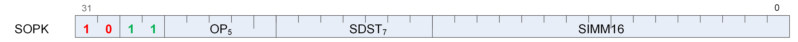

|**Format**|SOPK|
|---|---|
|**Description**|This is a scalar instruction with one 16-bit signed immediate (SIMM16) input and a single destination. Instructions which take 2 inputs use the destination as the second input.|

_Table 66. SOPK Fields_

|**Field Name**|**Bits**|**Format or Description**|
|---|---|---|
|SIMM16|[15:0]|Signed immediate 16-bit value.|
|SDST|[22:16]|Scalar destination, and can provide second source operand.|
||0 - 101|SGPR0 to SGPR101: Scalar general-purpose registers.|
||102|FLAT_SCRATCH_LO.|
||103|FLAT_SCRATCH_HI.|
||104|XNACK_MASK_LO.|
||105|XNACK_MASK_HI.|
||106|VCC_LO: vcc[31:0].|
||107|VCC_HI: vcc[63:32].|
||108-123|TTMP0 - TTMP15: Trap handler temporary register.|
||124|M0. Memory register 0.|
||125|Reserved|
||126|EXEC_LO: exec[31:0].|
||127|EXEC_HI: exec[63:32].|
|OP|[27:23]|See Opcode table below.|
|ENCODING|[31:28]|Must be: 1011|

<!-- page 524 -->

_Table 67. SOPK Opcodes_

|**Opcode #**|**Name**|**Opcode #**|**Name**|
|---|---|---|---|
|0|S_MOVK_I32|11|S_CMPK_GE_U32|
|1|S_CMOVK_I32|12|S_CMPK_LT_U32|
|2|S_CMPK_EQ_I32|13|S_CMPK_LE_U32|
|3|S_CMPK_LG_I32|14|S_ADDK_I32|
|4|S_CMPK_GT_I32|15|S_MULK_I32|
|5|S_CMPK_GE_I32|16|S_CBRANCH_I_FORK|
|6|S_CMPK_LT_I32|17|S_GETREG_B32|
|7|S_CMPK_LE_I32|18|S_SETREG_B32|
|8|S_CMPK_EQ_U32|20|S_SETREG_IMM32_B32|
|9|S_CMPK_LG_U32|21|S_CALL_B64|
|10|S_CMPK_GT_U32|||

### 13.1.3. SOP1

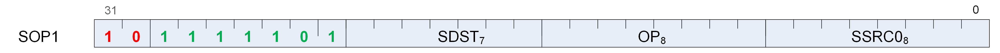

|**Format**|SOP1|
|---|---|
|**Description**|This is a scalar instruction with two inputs and one output. Can be followed by a 32-bit literal constant.|

_Table 68. SOP1 Fields_

<!-- page 525 -->

|**Field Name**|**Bits**|**Format or Description**|
|---|---|---|
|SSRC0|[7:0]|Source 0. First operand for the instruction.|
||0 - 101|SGPR0 to SGPR101: Scalar general-purpose registers.|
||102|FLAT_SCRATCH_LO.|
||103|FLAT_SCRATCH_HI.|
||104|XNACK_MASK_LO.|
||105|XNACK_MASK_HI.|
||106|VCC_LO: vcc[31:0].|
||107|VCC_HI: vcc[63:32].|
||108-123|TTMP0 - TTMP15: Trap handler temporary register.|
||124|M0. Memory register 0.|
||125|Reserved|
||126|EXEC_LO: exec[31:0].|
||127|EXEC_HI: exec[63:32].|
||128|0.|
||129-192|Signed integer 1 to 64.|
||193-208|Signed integer -1 to -16.|
||209-234|Reserved.|
||235|SHARED_BASE (Memory Aperture definition).|
||236|SHARED_LIMIT (Memory Aperture definition).|
||237|PRIVATE_BASE (Memory Aperture definition).|
||238|PRIVATE_LIMIT (Memory Aperture definition).|
||239|RESERVED .|
||240|0.5.|
||241|-0.5.|
||242|1.0.|
||243|-1.0.|
||244|2.0.|
||245|-2.0.|
||246|4.0.|
||247|-4.0.|
||248|1/(2*PI).|
||249 - 250|Reserved.|
||251|VCCZ.|
||252|EXECZ.|
||253|SCC.|
||254|Reserved.|
||255|Literal constant.|
|OP|[15:8]|See Opcode table below.|
|SDST|[22:16]|Scalar destination. Same codes as SSRC0, above except only codes 0-127 are valid.|
|ENCODING|[31:23]|Must be: 10_1111101|

_Table 69. SOP1 Opcodes_

|**Opcode #**|**Name**|**Opcode #**|**Name**|
|---|---|---|---|
|0|S_MOV_B32|27|S_BITSET1_B64|
|1|S_MOV_B64|28|S_GETPC_B64|
|2|S_CMOV_B32|29|S_SETPC_B64|
|3|S_CMOV_B64|30|S_SWAPPC_B64|
|4|S_NOT_B32|31|S_RFE_B64|
|5|S_NOT_B64|32|S_AND_SAVEEXEC_B64|
|6|S_WQM_B32|33|S_OR_SAVEEXEC_B64|
|7|S_WQM_B64|34|S_XOR_SAVEEXEC_B64|
|8|S_BREV_B32|35|S_ANDN2_SAVEEXEC_B64|
|9|S_BREV_B64|36|S_ORN2_SAVEEXEC_B64|
|10|S_BCNT0_I32_B32|37|S_NAND_SAVEEXEC_B64|
|11|S_BCNT0_I32_B64|38|S_NOR_SAVEEXEC_B64|
|12|S_BCNT1_I32_B32|39|S_XNOR_SAVEEXEC_B64|
|13|S_BCNT1_I32_B64|40|S_QUADMASK_B32|
|14|S_FF0_I32_B32|41|S_QUADMASK_B64|
|15|S_FF0_I32_B64|42|S_MOVRELS_B32|
|16|S_FF1_I32_B32|43|S_MOVRELS_B64|
|17|S_FF1_I32_B64|44|S_MOVRELD_B32|
|18|S_FLBIT_I32_B32|45|S_MOVRELD_B64|
|19|S_FLBIT_I32_B64|46|S_CBRANCH_JOIN|
|20|S_FLBIT_I32|48|S_ABS_I32|
|21|S_FLBIT_I32_I64|50|S_SET_GPR_IDX_IDX|
|22|S_SEXT_I32_I8|51|S_ANDN1_SAVEEXEC_B64|
|23|S_SEXT_I32_I16|52|S_ORN1_SAVEEXEC_B64|
|24|S_BITSET0_B32|53|S_ANDN1_WREXEC_B64|
|25|S_BITSET0_B64|54|S_ANDN2_WREXEC_B64|
|26|S_BITSET1_B32|55|S_BITREPLICATE_B64_B32|

<!-- page 526 -->

### 13.1.4. SOPC

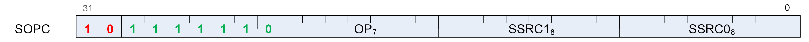

|**Format**|SOPC|
|---|---|
|**Description**|This is a scalar instruction with two inputs which are compared and produces SCC as a result. Can be followed by a 32-bit literal constant.|

_Table 70. SOPC Fields_

<!-- page 527 -->

|**Field Name**|**Bits**|**Format or Description**|
|---|---|---|
|SSRC0|[7:0]|Source 0. First operand for the instruction.|
||0 - 101|SGPR0 to SGPR101: Scalar general-purpose registers.|
||102|FLAT_SCRATCH_LO.|
||103|FLAT_SCRATCH_HI.|
||104|XNACK_MASK_LO.|
||105|XNACK_MASK_HI.|
||106|VCC_LO: vcc[31:0].|
||107|VCC_HI: vcc[63:32].|
||108-123|TTMP0 - TTMP15: Trap handler temporary register.|
||124|M0. Memory register 0.|
||125|Reserved|
||126|EXEC_LO: exec[31:0].|
||127|EXEC_HI: exec[63:32].|
||128|0.|
||129-192|Signed integer 1 to 64.|
||193-208|Signed integer -1 to -16.|
||209-234|Reserved.|
||235|SHARED_BASE (Memory Aperture definition).|
||236|SHARED_LIMIT (Memory Aperture definition).|
||237|PRIVATE_BASE (Memory Aperture definition).|
||238|PRIVATE_LIMIT (Memory Aperture definition).|
||239|RESERVED .|
||240|0.5.|
||241|-0.5.|
||242|1.0.|
||243|-1.0.|
||244|2.0.|
||245|-2.0.|
||246|4.0.|
||247|-4.0.|
||248|1/(2*PI).|
||249 - 250|Reserved.|
||251|VCCZ.|
||252|EXECZ.|
||253|SCC.|
||254|Reserved.|
||255|Literal constant.|
|SSRC1|[15:8]|Second scalar source operand. Same codes as SSRC0, above.|
|OP|[22:16]|See Opcode table below.|
|ENCODING|[31:23]|Must be: 10_1111110|

_Table 71. SOPC Opcodes_

|**Opcode #**|**Name**|**Opcode #**|**Name**|
|---|---|---|---|
|0|S_CMP_EQ_I32|10|S_CMP_LT_U32|
|1|S_CMP_LG_I32|11|S_CMP_LE_U32|
|2|S_CMP_GT_I32|12|S_BITCMP0_B32|
|3|S_CMP_GE_I32|13|S_BITCMP1_B32|
|4|S_CMP_LT_I32|14|S_BITCMP0_B64|
|5|S_CMP_LE_I32|15|S_BITCMP1_B64|
|6|S_CMP_EQ_U32|16|S_SETVSKIP|
|7|S_CMP_LG_U32|17|S_SET_GPR_IDX_ON|
|8|S_CMP_GT_U32|18|S_CMP_EQ_U64|
|9|S_CMP_GE_U32|19|S_CMP_LG_U64|

<!-- page 528 -->

### 13.1.5. SOPP

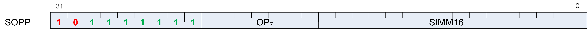

|**Format**|SOPP|
|---|---|
|**Description**|This is a scalar instruction with one 16-bit signed immediate (SIMM16) input.|

_Table 72. SOPP Fields_

|**Field Name**|**Bits**|**Format or Description**|
|---|---|---|
|SIMM16|[15:0]|Signed immediate 16-bit value.|
|OP|[22:16]|See Opcode table below.|
|ENCODING|[31:23]|Must be: 10_1111111|

_Table 73. SOPP Opcodes_

|**Opcode #**|**Name**|**Opcode #**|**Name**|
|---|---|---|---|
|0|S_NOP|15|S_SETPRIO|
|1|S_ENDPGM|16|S_SENDMSG|
|2|S_BRANCH|17|S_SENDMSGHALT|
|3|S_WAKEUP|18|S_TRAP|
|4|S_CBRANCH_SCC0|19|S_ICACHE_INV|
|5|S_CBRANCH_SCC1|20|S_INCPERFLEVEL|
|6|S_CBRANCH_VCCZ|21|S_DECPERFLEVEL|
|7|S_CBRANCH_VCCNZ|22|S_TTRACEDATA|
|8|S_CBRANCH_EXECZ|23|S_CBRANCH_CDBGSYS|
|9|S_CBRANCH_EXECNZ|24|S_CBRANCH_CDBGUSER|
|10|S_BARRIER|25|S_CBRANCH_CDBGSYS_OR_USER|
|11|S_SETKILL|26|S_CBRANCH_CDBGSYS_AND_USER|
|12|S_WAITCNT|27|S_ENDPGM_SAVED|
|13|S_SETHALT|28|S_SET_GPR_IDX_OFF|
|14|S_SLEEP|29|S_SET_GPR_IDX_MODE|

## 13.2. Scalar Memory Format

### 13.2.1. SMEM

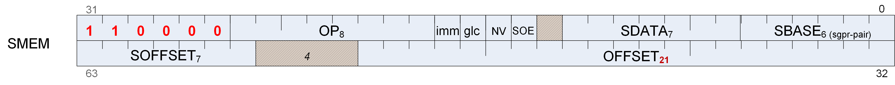

<!-- page 529 -->

|**Format**|SMEM|
|---|---|
|**Description**|Scalar Memory data load/store|

_Table 74. SMEM Fields_

|**Field Name**|**Bits**|**Format or Description**|
|---|---|---|
|SBASE|[5:0]|SGPR-pair which provides base address or SGPR-quad which provides V#. (LSB of SGPR address is omitted).|
|SDATA|[12:6]|SGPR which provides write data or accepts return data.|
|SOE|[14]|Scalar offset enable.|
|NV|[15]|Non-volatile|
|GLC|[16]|Globally memory Coherent. Force bypass of L1 and L2 cache, or for atomics, cause pre-op value to be returned.|
|IMM|[17]|Immediate enable.|
|OP|[25:18]|See Opcode table below.|
|ENCODING|[31:26]|Must be: 110000|
|OFFSET|[52:32]|An immediate signed byte offset, or the address of an SGPR holding the unsigned byte offset. Signed offsets only work with S_LOAD/STORE.|
|SOFFSET|[63:57]|SGPR offset. Used only when SOFFSET_EN = 1 May only specify an SGPR or M0.|

_Table 75. SMEM Opcodes_

|**Opcode #**|**Name**|**Opcode #**|**Name**|
|---|---|---|---|
|0|S_LOAD_DWORD|75|S_BUFFER_ATOMIC_INC|
|1|S_LOAD_DWORDX2|76|S_BUFFER_ATOMIC_DEC|
|2|S_LOAD_DWORDX4|96|S_BUFFER_ATOMIC_SWAP_X2|
|3|S_LOAD_DWORDX8|97|S_BUFFER_ATOMIC_CMPSWAP_X2|
|4|S_LOAD_DWORDX16|98|S_BUFFER_ATOMIC_ADD_X2|
|5|S_SCRATCH_LOAD_DWORD|99|S_BUFFER_ATOMIC_SUB_X2|
|6|S_SCRATCH_LOAD_DWORDX2|100|S_BUFFER_ATOMIC_SMIN_X2|
|7|S_SCRATCH_LOAD_DWORDX4|101|S_BUFFER_ATOMIC_UMIN_X2|
|8|S_BUFFER_LOAD_DWORD|102|S_BUFFER_ATOMIC_SMAX_X2|
|9|S_BUFFER_LOAD_DWORDX2|103|S_BUFFER_ATOMIC_UMAX_X2|
|10|S_BUFFER_LOAD_DWORDX4|104|S_BUFFER_ATOMIC_AND_X2|
|11|S_BUFFER_LOAD_DWORDX8|105|S_BUFFER_ATOMIC_OR_X2|
|12|S_BUFFER_LOAD_DWORDX16|106|S_BUFFER_ATOMIC_XOR_X2|
|16|S_STORE_DWORD|107|S_BUFFER_ATOMIC_INC_X2|
|17|S_STORE_DWORDX2|108|S_BUFFER_ATOMIC_DEC_X2|
|18|S_STORE_DWORDX4|128|S_ATOMIC_SWAP|
|21|S_SCRATCH_STORE_DWORD|129|S_ATOMIC_CMPSWAP|
|22|S_SCRATCH_STORE_DWORDX2|130|S_ATOMIC_ADD|
|23|S_SCRATCH_STORE_DWORDX4|131|S_ATOMIC_SUB|
|24|S_BUFFER_STORE_DWORD|132|S_ATOMIC_SMIN|
|25|S_BUFFER_STORE_DWORDX2|133|S_ATOMIC_UMIN|
|26|S_BUFFER_STORE_DWORDX4|134|S_ATOMIC_SMAX|
|32|S_DCACHE_INV|135|S_ATOMIC_UMAX|
|33|S_DCACHE_WB|136|S_ATOMIC_AND|
|34|S_DCACHE_INV_VOL|137|S_ATOMIC_OR|
|35|S_DCACHE_WB_VOL|138|S_ATOMIC_XOR|
|36|S_MEMTIME|139|S_ATOMIC_INC|
|37|S_MEMREALTIME|140|S_ATOMIC_DEC|
|40|S_DCACHE_DISCARD|160|S_ATOMIC_SWAP_X2|
|41|S_DCACHE_DISCARD_X2|161|S_ATOMIC_CMPSWAP_X2|
|64|S_BUFFER_ATOMIC_SWAP|162|S_ATOMIC_ADD_X2|
|65|S_BUFFER_ATOMIC_CMPSWAP|163|S_ATOMIC_SUB_X2|
|66|S_BUFFER_ATOMIC_ADD|164|S_ATOMIC_SMIN_X2|
|67|S_BUFFER_ATOMIC_SUB|165|S_ATOMIC_UMIN_X2|
|68|S_BUFFER_ATOMIC_SMIN|166|S_ATOMIC_SMAX_X2|
|69|S_BUFFER_ATOMIC_UMIN|167|S_ATOMIC_UMAX_X2|
|70|S_BUFFER_ATOMIC_SMAX|168|S_ATOMIC_AND_X2|
|71|S_BUFFER_ATOMIC_UMAX|169|S_ATOMIC_OR_X2|
|72|S_BUFFER_ATOMIC_AND|170|S_ATOMIC_XOR_X2|
|73|S_BUFFER_ATOMIC_OR|171|S_ATOMIC_INC_X2|
|74|S_BUFFER_ATOMIC_XOR|172|S_ATOMIC_DEC_X2|

<!-- page 530 -->

## 13.3. Vector ALU Formats

### 13.3.1. VOP2

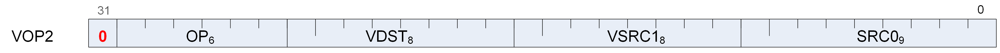

|**Format**|VOP2|
|---|---|
|**Description**|Vector ALU format with two operands|

_Table 76. VOP2 Fields_

<!-- page 531 -->

|**Field Name**|**Bits**|**Format or Description**|
|---|---|---|
|SRC0|[8:0]|Source 0. First operand for the instruction.|
||0 - 101|SGPR0 to SGPR101: Scalar general-purpose registers.|
||102|FLAT_SCRATCH_LO.|
||103|FLAT_SCRATCH_HI.|
||104|XNACK_MASK_LO.|
||105|XNACK_MASK_HI.|
||106|VCC_LO: vcc[31:0].|
||107|VCC_HI: vcc[63:32].|
||108-123|TTMP0 - TTMP15: Trap handler temporary register.|
||124|M0. Memory register 0.|
||125|Reserved|
||126|EXEC_LO: exec[31:0].|
||127|EXEC_HI: exec[63:32].|
||128|0.|
||129-192|Signed integer 1 to 64.|
||193-208|Signed integer -1 to -16.|
||209-234|Reserved.|
||235|SHARED_BASE (Memory Aperture definition).|
||236|SHARED_LIMIT (Memory Aperture definition).|
||237|PRIVATE_BASE (Memory Aperture definition).|
||238|PRIVATE_LIMIT (Memory Aperture definition).|
||239|RESERVED .|
||240|0.5.|
||241|-0.5.|
||242|1.0.|
||243|-1.0.|
||244|2.0.|
||245|-2.0.|
||246|4.0.|
||247|-4.0.|
||248|1/(2*PI).|
||249|SDWA|
||250|DPP|
||251|VCCZ.|
||252|EXECZ.|
||253|SCC.|
||254|Reserved.|
||255|Literal constant.|
||256 - 511|VGPR 0 - 255|
|VSRC1|[16:9]|VGPR which provides the second operand.|
|VDST|[24:17]|Destination VGPR.|
|OP|[30:25]|See Opcode table below.|
|ENCODING|[31]|Must be: 0|

_Table 77. VOP2 Opcodes_

|**Opcode #**|**Name**|**Opcode #**|**Name**|
|---|---|---|---|
|0|V_CNDMASK_B32|32|V_SUB_F16|
|1|V_ADD_F32|33|V_SUBREV_F16|
|2|V_SUB_F32|34|V_MUL_F16|
|3|V_SUBREV_F32|35|V_MAC_F16|
|4|V_FMAC_F64|36|V_MADMK_F16|
|5|V_MUL_F32|37|V_MADAK_F16|
|6|V_MUL_I32_I24|38|V_ADD_U16|
|7|V_MUL_HI_I32_I24|39|V_SUB_U16|
|8|V_MUL_U32_U24|40|V_SUBREV_U16|
|9|V_MUL_HI_U32_U24|41|V_MUL_LO_U16|
|10|V_MIN_F32|42|V_LSHLREV_B16|
|11|V_MAX_F32|43|V_LSHRREV_B16|
|12|V_MIN_I32|44|V_ASHRREV_I16|
|13|V_MAX_I32|45|V_MAX_F16|
|14|V_MIN_U32|46|V_MIN_F16|
|15|V_MAX_U32|47|V_MAX_U16|
|16|V_LSHRREV_B32|48|V_MAX_I16|
|17|V_ASHRREV_I32|49|V_MIN_U16|
|18|V_LSHLREV_B32|50|V_MIN_I16|
|19|V_AND_B32|51|V_LDEXP_F16|
|20|V_OR_B32|52|V_ADD_U32|
|21|V_XOR_B32|53|V_SUB_U32|
|23|V_FMAMK_F32|54|V_SUBREV_U32|
|24|V_FMAAK_F32|55|V_DOT2C_F32_F16|
|25|V_ADD_CO_U32|56|V_DOT2C_I32_I16|
|26|V_SUB_CO_U32|57|V_DOT4C_I32_I8|
|27|V_SUBREV_CO_U32|58|V_DOT8C_I32_I4|
|28|V_ADDC_CO_U32|59|V_FMAC_F32|
|29|V_SUBB_CO_U32|60|V_PK_FMAC_F16|
|30|V_SUBBREV_CO_U32|61|V_XNOR_B32|
|31|V_ADD_F16|||

<!-- page 532 -->

### 13.3.2. VOP1

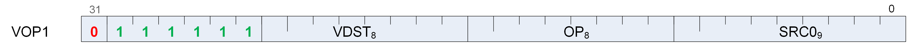

|**Format**|VOP1|
|---|---|
|**Description**|Vector ALU format with one operand|

_Table 78. VOP1 Fields_

<!-- page 533 -->

|**Field Name**|**Bits**|**Format or Description**|
|---|---|---|
|SRC0|[8:0]|Source 0. First operand for the instruction.|
||0 - 101|SGPR0 to SGPR101: Scalar general-purpose registers.|
||102|FLAT_SCRATCH_LO.|
||103|FLAT_SCRATCH_HI.|
||104|XNACK_MASK_LO.|
||105|XNACK_MASK_HI.|
||106|VCC_LO: vcc[31:0].|
||107|VCC_HI: vcc[63:32].|
||108-123|TTMP0 - TTMP15: Trap handler temporary register.|
||124|M0. Memory register 0.|
||125|Reserved|
||126|EXEC_LO: exec[31:0].|
||127|EXEC_HI: exec[63:32].|
||128|0.|
||129-192|Signed integer 1 to 64.|
||193-208|Signed integer -1 to -16.|
||209-234|Reserved.|
||235|SHARED_BASE (Memory Aperture definition).|
||236|SHARED_LIMIT (Memory Aperture definition).|
||237|PRIVATE_BASE (Memory Aperture definition).|
||238|PRIVATE_LIMIT (Memory Aperture definition).|
||239|RESERVED .|
||240|0.5.|
||241|-0.5.|
||242|1.0.|
||243|-1.0.|
||244|2.0.|
||245|-2.0.|
||246|4.0.|
||247|-4.0.|
||248|1/(2*PI).|
||249|SDWA|
||250|DPP|
||251|VCCZ.|
||252|EXECZ.|
||253|SCC.|
||254|Reserved.|
||255|Literal constant.|
||256 - 511|VGPR 0 - 255|
|OP|[16:9]|See Opcode table below.|
|VDST|[24:17]|Destination VGPR.|
|ENCODING|[31:25]|Must be: 0_111111|

_Table 79. VOP1 Opcodes_

|**Opcode #**|**Name**|**Opcode #**|**Name**|
|---|---|---|---|
|0|V_NOP|42|V_COS_F32|
|1|V_MOV_B32|43|V_NOT_B32|
|2|V_READFIRSTLANE_B32|44|V_BFREV_B32|
|3|V_CVT_I32_F64|45|V_FFBH_U32|
|4|V_CVT_F64_I32|46|V_FFBL_B32|
|5|V_CVT_F32_I32|47|V_FFBH_I32|
|6|V_CVT_F32_U32|48|V_FREXP_EXP_I32_F64|
|7|V_CVT_U32_F32|49|V_FREXP_MANT_F64|
|8|V_CVT_I32_F32|50|V_FRACT_F64|
|10|V_CVT_F16_F32|51|V_FREXP_EXP_I32_F32|
|11|V_CVT_F32_F16|52|V_FREXP_MANT_F32|
|12|V_CVT_RPI_I32_F32|53|V_CLREXCP|
|13|V_CVT_FLR_I32_F32|56|V_MOV_B64|
|14|V_CVT_OFF_F32_I4|57|V_CVT_F16_U16|
|15|V_CVT_F32_F64|58|V_CVT_F16_I16|
|16|V_CVT_F64_F32|59|V_CVT_U16_F16|
|17|V_CVT_F32_UBYTE0|60|V_CVT_I16_F16|
|18|V_CVT_F32_UBYTE1|61|V_RCP_F16|
|19|V_CVT_F32_UBYTE2|62|V_SQRT_F16|
|20|V_CVT_F32_UBYTE3|63|V_RSQ_F16|
|21|V_CVT_U32_F64|64|V_LOG_F16|
|22|V_CVT_F64_U32|65|V_EXP_F16|
|23|V_TRUNC_F64|66|V_FREXP_MANT_F16|
|24|V_CEIL_F64|67|V_FREXP_EXP_I16_F16|
|25|V_RNDNE_F64|68|V_FLOOR_F16|
|26|V_FLOOR_F64|69|V_CEIL_F16|
|27|V_FRACT_F32|70|V_TRUNC_F16|
|28|V_TRUNC_F32|71|V_RNDNE_F16|
|29|V_CEIL_F32|72|V_FRACT_F16|
|30|V_RNDNE_F32|73|V_SIN_F16|
|31|V_FLOOR_F32|74|V_COS_F16|
|32|V_EXP_F32|77|V_CVT_NORM_I16_F16|
|33|V_LOG_F32|78|V_CVT_NORM_U16_F16|
|34|V_RCP_F32|79|V_SAT_PK_U8_I16|
|35|V_RCP_IFLAG_F32|81|V_SWAP_B32|
|36|V_RSQ_F32|82|V_ACCVGPR_MOV_B32|
|37|V_RCP_F64|84|V_CVT_F32_FP8|
|38|V_RSQ_F64|85|V_CVT_F32_BF8|
|39|V_SQRT_F32|86|V_CVT_PK_F32_FP8|
|40|V_SQRT_F64|87|V_CVT_PK_F32_BF8|
|41|V_SIN_F32|||

<!-- page 534 -->

### 13.3.3. VOPC

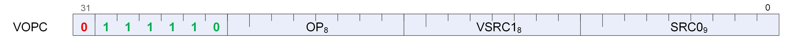

|**Format**|VOPC|
|---|---|
|**Description**|Vector instruction taking two inputs and producing a comparison result. Can be followed by a 32- bit literal constant. Vector Comparison operations are divided into three groups: • those which can use any one of 16 comparison operations, • those which can use any one of 8, and • those which have a single comparison operation.|

<!-- page 535 -->

The final opcode number is determined by adding the base for the opcode family plus the offset from the compare op. Every compare instruction writes a result to VCC (for VOPC) or an SGPR (for VOP3). Additionally, compare instruction have variants that also writes to the EXEC mask. The destination of the compare result is VCC when encoded using the VOPC format, and can be an arbitrary SGPR when encoded in the VOP3 format.

**Comparison Operations**

_Table 80. Comparison Operations_

|**Compare Operation**|**Opcode Offset**|**Description**|
|---|---|---|
|Sixteen Compare Operations (OP16)|||
|F|0|D.u = 0|
|LT|1|D.u = (S0 < S1)|
|EQ|2|D.u = (S0 == S1)|
|LE|3|D.u = (S0 <= S1)|
|GT|4|D.u = (S0 > S1)|
|LG|5|D.u = (S0 <> S1)|
|GE|6|D.u = (S0 >= S1)|
|O|7|D.u = (!isNaN(S0) && !isNaN(S1))|
|U|8|D.u = (!isNaN(S0) \|\| !isNaN(S1))|
|NGE|9|D.u = !(S0 >= S1)|
|NLG|10|D.u = !(S0 <> S1)|
|NGT|11|D.u = !(S0 > S1)|
|NLE|12|D.u = !(S0 <= S1)|
|NEQ|13|D.u = !(S0 == S1)|
|NLT|14|D.u = !(S0 < S1)|
|TRU|15|D.u = 1|
|Eight Compare Operations (OP8)|||
|F|0|D.u = 0|
|LT|1|D.u = (S0 < S1)|
|EQ|2|D.u = (S0 == S1)|
|LE|3|D.u = (S0 <= S1)|
|GT|4|D.u = (S0 > S1)|
|LG|5|D.u = (S0 <> S1)|
|GE|6|D.u = (S0 >= S1)|
|TRU|7|D.u = 1|

_Table 81. VOPC Fields_

<!-- page 536 -->

|**Field Name**|**Bits**|**Format or Description**|
|---|---|---|
|SRC0|[8:0]|Source 0. First operand for the instruction.|
||0 - 101|SGPR0 to SGPR101: Scalar general-purpose registers.|
||102|FLAT_SCRATCH_LO.|
||103|FLAT_SCRATCH_HI.|
||104|XNACK_MASK_LO.|
||105|XNACK_MASK_HI.|
||106|VCC_LO: vcc[31:0].|
||107|VCC_HI: vcc[63:32].|
||108-123|TTMP0 - TTMP15: Trap handler temporary register.|
||124|M0. Memory register 0.|
||125|Reserved|
||126|EXEC_LO: exec[31:0].|
||127|EXEC_HI: exec[63:32].|
||128|0.|
||129-192|Signed integer 1 to 64.|
||193-208|Signed integer -1 to -16.|
||209-234|Reserved.|
||235|SHARED_BASE (Memory Aperture definition).|
||236|SHARED_LIMIT (Memory Aperture definition).|
||237|PRIVATE_BASE (Memory Aperture definition).|
||238|PRIVATE_LIMIT (Memory Aperture definition).|
||239|RESERVED .|
||240|0.5.|
||241|-0.5.|
||242|1.0.|
||243|-1.0.|
||244|2.0.|
||245|-2.0.|
||246|4.0.|
||247|-4.0.|
||248|1/(2*PI).|
||249|SDWA|
||250|DPP|
||251|VCCZ.|
||252|EXECZ.|
||253|SCC.|
||254|Reserved.|
||255|Literal constant.|
||256 - 511|VGPR 0 - 255|
|VSRC1|[16:9]|VGPR which provides the second operand.|
|OP|[24:17]|See Opcode table below.|
|ENCODING|[31:25]|Must be: 0_111110|

_Table 82. VOPC Opcodes_

|**Opcode #**|**Name**|**Opcode #**|**Name**|
|---|---|---|---|
|16|V_CMP_CLASS_F32|125|V_CMPX_NEQ_F64|
|17|V_CMPX_CLASS_F32|126|V_CMPX_NLT_F64|
|18|V_CMP_CLASS_F64|127|V_CMPX_TRU_F64|
|19|V_CMPX_CLASS_F64|160|V_CMP_F_I16|
|20|V_CMP_CLASS_F16|161|V_CMP_LT_I16|
|21|V_CMPX_CLASS_F16|162|V_CMP_EQ_I16|
|32|V_CMP_F_F16|163|V_CMP_LE_I16|
|33|V_CMP_LT_F16|164|V_CMP_GT_I16|
|34|V_CMP_EQ_F16|165|V_CMP_NE_I16|
|35|V_CMP_LE_F16|166|V_CMP_GE_I16|
|36|V_CMP_GT_F16|167|V_CMP_T_I16|
|37|V_CMP_LG_F16|168|V_CMP_F_U16|
|38|V_CMP_GE_F16|169|V_CMP_LT_U16|
|39|V_CMP_O_F16|170|V_CMP_EQ_U16|
|40|V_CMP_U_F16|171|V_CMP_LE_U16|
|41|V_CMP_NGE_F16|172|V_CMP_GT_U16|
|42|V_CMP_NLG_F16|173|V_CMP_NE_U16|
|43|V_CMP_NGT_F16|174|V_CMP_GE_U16|
|44|V_CMP_NLE_F16|175|V_CMP_T_U16|
|45|V_CMP_NEQ_F16|176|V_CMPX_F_I16|
|46|V_CMP_NLT_F16|177|V_CMPX_LT_I16|
|47|V_CMP_TRU_F16|178|V_CMPX_EQ_I16|
|48|V_CMPX_F_F16|179|V_CMPX_LE_I16|
|49|V_CMPX_LT_F16|180|V_CMPX_GT_I16|
|50|V_CMPX_EQ_F16|181|V_CMPX_NE_I16|
|51|V_CMPX_LE_F16|182|V_CMPX_GE_I16|
|52|V_CMPX_GT_F16|183|V_CMPX_T_I16|
|53|V_CMPX_LG_F16|184|V_CMPX_F_U16|
|54|V_CMPX_GE_F16|185|V_CMPX_LT_U16|
|55|V_CMPX_O_F16|186|V_CMPX_EQ_U16|
|56|V_CMPX_U_F16|187|V_CMPX_LE_U16|
|57|V_CMPX_NGE_F16|188|V_CMPX_GT_U16|
|58|V_CMPX_NLG_F16|189|V_CMPX_NE_U16|
|59|V_CMPX_NGT_F16|190|V_CMPX_GE_U16|
|60|V_CMPX_NLE_F16|191|V_CMPX_T_U16|
|61|V_CMPX_NEQ_F16|192|V_CMP_F_I32|
|62|V_CMPX_NLT_F16|193|V_CMP_LT_I32|
|63|V_CMPX_TRU_F16|194|V_CMP_EQ_I32|
|64|V_CMP_F_F32|195|V_CMP_LE_I32|
|65|V_CMP_LT_F32|196|V_CMP_GT_I32|
|66|V_CMP_EQ_F32|197|V_CMP_NE_I32|
|67|V_CMP_LE_F32|198|V_CMP_GE_I32|
|68|V_CMP_GT_F32|199|V_CMP_T_I32|
|69|V_CMP_LG_F32|200|V_CMP_F_U32|
|70|V_CMP_GE_F32|201|V_CMP_LT_U32|
|71|V_CMP_O_F32|202|V_CMP_EQ_U32|
|72|V_CMP_U_F32|203|V_CMP_LE_U32|
|73|V_CMP_NGE_F32|204|V_CMP_GT_U32|
|74|V_CMP_NLG_F32|205|V_CMP_NE_U32|
|75|V_CMP_NGT_F32|206|V_CMP_GE_U32|
|76|V_CMP_NLE_F32|207|V_CMP_T_U32|
|77|V_CMP_NEQ_F32|208|V_CMPX_F_I32|
|78|V_CMP_NLT_F32|209|V_CMPX_LT_I32|
|79|V_CMP_TRU_F32|210|V_CMPX_EQ_I32|
|80|V_CMPX_F_F32|211|V_CMPX_LE_I32|
|81|V_CMPX_LT_F32|212|V_CMPX_GT_I32|
|82|V_CMPX_EQ_F32|213|V_CMPX_NE_I32|
|83|V_CMPX_LE_F32|214|V_CMPX_GE_I32|
|84|V_CMPX_GT_F32|215|V_CMPX_T_I32|
|85|V_CMPX_LG_F32|216|V_CMPX_F_U32|
|86|V_CMPX_GE_F32|217|V_CMPX_LT_U32|
|87|V_CMPX_O_F32|218|V_CMPX_EQ_U32|
|88|V_CMPX_U_F32|219|V_CMPX_LE_U32|
|89|V_CMPX_NGE_F32|220|V_CMPX_GT_U32|
|90|V_CMPX_NLG_F32|221|V_CMPX_NE_U32|
|91|V_CMPX_NGT_F32|222|V_CMPX_GE_U32|
|92|V_CMPX_NLE_F32|223|V_CMPX_T_U32|
|93|V_CMPX_NEQ_F32|224|V_CMP_F_I64|
|94|V_CMPX_NLT_F32|225|V_CMP_LT_I64|
|95|V_CMPX_TRU_F32|226|V_CMP_EQ_I64|
|96|V_CMP_F_F64|227|V_CMP_LE_I64|
|97|V_CMP_LT_F64|228|V_CMP_GT_I64|
|98|V_CMP_EQ_F64|229|V_CMP_NE_I64|
|99|V_CMP_LE_F64|230|V_CMP_GE_I64|
|100|V_CMP_GT_F64|231|V_CMP_T_I64|
|101|V_CMP_LG_F64|232|V_CMP_F_U64|
|102|V_CMP_GE_F64|233|V_CMP_LT_U64|
|103|V_CMP_O_F64|234|V_CMP_EQ_U64|
|104|V_CMP_U_F64|235|V_CMP_LE_U64|
|105|V_CMP_NGE_F64|236|V_CMP_GT_U64|
|106|V_CMP_NLG_F64|237|V_CMP_NE_U64|
|107|V_CMP_NGT_F64|238|V_CMP_GE_U64|
|108|V_CMP_NLE_F64|239|V_CMP_T_U64|
|109|V_CMP_NEQ_F64|240|V_CMPX_F_I64|
|110|V_CMP_NLT_F64|241|V_CMPX_LT_I64|
|111|V_CMP_TRU_F64|242|V_CMPX_EQ_I64|
|112|V_CMPX_F_F64|243|V_CMPX_LE_I64|
|113|V_CMPX_LT_F64|244|V_CMPX_GT_I64|
|114|V_CMPX_EQ_F64|245|V_CMPX_NE_I64|
|115|V_CMPX_LE_F64|246|V_CMPX_GE_I64|
|116|V_CMPX_GT_F64|247|V_CMPX_T_I64|
|117|V_CMPX_LG_F64|248|V_CMPX_F_U64|
|118|V_CMPX_GE_F64|249|V_CMPX_LT_U64|
|119|V_CMPX_O_F64|250|V_CMPX_EQ_U64|
|120|V_CMPX_U_F64|251|V_CMPX_LE_U64|
|121|V_CMPX_NGE_F64|252|V_CMPX_GT_U64|
|122|V_CMPX_NLG_F64|253|V_CMPX_NE_U64|
|123|V_CMPX_NGT_F64|254|V_CMPX_GE_U64|
|124|V_CMPX_NLE_F64|255|V_CMPX_T_U64|

<!-- page 537 -->

<!-- page 538 -->

<!-- page 539 -->

### 13.3.4. VOP3A

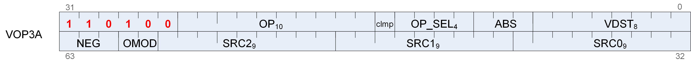

|**Format**|VOP3A|
|---|---|
|**Description**|Vector ALU format with three operands|

_Table 83. VOP3A Fields_

|**Field Name**|**Bits**|**Format or Description**|
|---|---|---|
|VDST|[7:0]|Destination VGPR|
|ABS|[10:8]|Absolute value of input. [8] = src0, [9] = src1, [10] = src2|
|OPSEL|[14:11]|Operand select for 16-bit data. 0 = select low half, 1 = select high half. [11] = src0, [12] = src1, [13] = src2, [14] = dest.|
|CLMP|[15]|Clamp output|
|OP|[25:16]|Opcode. See next table.|
|ENCODING|[31:26]|Must be: 110100|
|SRC0|[40:32]|Source 0. First operand for the instruction.|
||0 - 101|SGPR0 to SGPR101: Scalar general-purpose registers.|
||102|FLAT_SCRATCH_LO.|
||103|FLAT_SCRATCH_HI.|
||104|XNACK_MASK_LO.|
||105|XNACK_MASK_HI.|
||106|VCC_LO: vcc[31:0].|
||107|VCC_HI: vcc[63:32].|
||108-123|TTMP0 - TTMP15: Trap handler temporary register.|
||124|M0. Memory register 0.|
||125|Reserved|
||126|EXEC_LO: exec[31:0].|
||127|EXEC_HI: exec[63:32].|
||128|0.|
||129-192|Signed integer 1 to 64.|
||193-208|Signed integer -1 to -16.|
||209-234|Reserved.|
||235|SHARED_BASE (Memory Aperture definition).|
||236|SHARED_LIMIT (Memory Aperture definition).|
||237|PRIVATE_BASE (Memory Aperture definition).|
||238|PRIVATE_LIMIT (Memory Aperture definition).|
||239|Reserved.|
||240|0.5.|
||241|-0.5.|
||242|1.0.|
||243|-1.0.|
||244|2.0.|
||245|-2.0.|
||246|4.0.|
||247|-4.0.|
||248|1/(2*PI).|
||249|SDWA|
||250|DPP|
||251|VCCZ.|
||252|EXECZ.|
||253|SCC.|
||254|Reserved.|
||255|Literal constant.|
||256 - 511|VGPR 0 - 255|
|SRC1|[49:41]|Second input operand. Same options as SRC0.|
|SRC2|[58:50]|Third input operand. Same options as SRC0.|
|OMOD|[60:59]|Output Modifier: 0=none, 1=*2, 2=*4, 3=div-2|
|NEG|[63:61]|Negate input. [61] = src0, [62] = src1, [63] = src2|

<!-- page 540 -->

_Table 84. VOP3A Opcodes_

|**Opcode #**|**Name**|**Opcode #**|**Name**|
|---|---|---|---|
|384|V_NOP|659|V_BFM_B32|
|385|V_MOV_B32|660|V_CVT_PKNORM_I16_F32|
|386|V_READFIRSTLANE_B32|661|V_CVT_PKNORM_U16_F32|
|387|V_CVT_I32_F64|662|V_CVT_PKRTZ_F16_F32|
|388|V_CVT_F64_I32|663|V_CVT_PK_U16_U32|
|389|V_CVT_F32_I32|664|V_CVT_PK_I16_I32|
|390|V_CVT_F32_U32|665|V_CVT_PKNORM_I16_F16|
|391|V_CVT_U32_F32|666|V_CVT_PKNORM_U16_F16|
|392|V_CVT_I32_F32|668|V_ADD_I32|
|394|V_CVT_F16_F32|669|V_SUB_I32|
|395|V_CVT_F32_F16|670|V_ADD_I16|
|396|V_CVT_RPI_I32_F32|671|V_SUB_I16|
|397|V_CVT_FLR_I32_F32|672|V_PACK_B32_F16|
|398|V_CVT_OFF_F32_I4|673|V_MUL_LEGACY_F32|
|399|V_CVT_F32_F64|674|V_CVT_PK_FP8_F32|
|400|V_CVT_F64_F32|675|V_CVT_PK_BF8_F32|
|401|V_CVT_F32_UBYTE0|676|V_CVT_SR_FP8_F32|
|402|V_CVT_F32_UBYTE1|677|V_CVT_SR_BF8_F32|
|403|V_CVT_F32_UBYTE2|16|V_CMP_CLASS_F32|
|404|V_CVT_F32_UBYTE3|17|V_CMPX_CLASS_F32|
|405|V_CVT_U32_F64|18|V_CMP_CLASS_F64|
|406|V_CVT_F64_U32|19|V_CMPX_CLASS_F64|
|407|V_TRUNC_F64|20|V_CMP_CLASS_F16|
|408|V_CEIL_F64|21|V_CMPX_CLASS_F16|
|409|V_RNDNE_F64|32|V_CMP_F_F16|
|410|V_FLOOR_F64|33|V_CMP_LT_F16|
|411|V_FRACT_F32|34|V_CMP_EQ_F16|
|412|V_TRUNC_F32|35|V_CMP_LE_F16|
|413|V_CEIL_F32|36|V_CMP_GT_F16|
|414|V_RNDNE_F32|37|V_CMP_LG_F16|
|415|V_FLOOR_F32|38|V_CMP_GE_F16|
|416|V_EXP_F32|39|V_CMP_O_F16|
|417|V_LOG_F32|40|V_CMP_U_F16|
|418|V_RCP_F32|41|V_CMP_NGE_F16|
|419|V_RCP_IFLAG_F32|42|V_CMP_NLG_F16|
|420|V_RSQ_F32|43|V_CMP_NGT_F16|
|421|V_RCP_F64|44|V_CMP_NLE_F16|
|422|V_RSQ_F64|45|V_CMP_NEQ_F16|
|423|V_SQRT_F32|46|V_CMP_NLT_F16|
|424|V_SQRT_F64|47|V_CMP_TRU_F16|
|425|V_SIN_F32|48|V_CMPX_F_F16|
|426|V_COS_F32|49|V_CMPX_LT_F16|
|427|V_NOT_B32|50|V_CMPX_EQ_F16|
|428|V_BFREV_B32|51|V_CMPX_LE_F16|
|429|V_FFBH_U32|52|V_CMPX_GT_F16|
|430|V_FFBL_B32|53|V_CMPX_LG_F16|
|431|V_FFBH_I32|54|V_CMPX_GE_F16|
|432|V_FREXP_EXP_I32_F64|55|V_CMPX_O_F16|
|433|V_FREXP_MANT_F64|56|V_CMPX_U_F16|
|434|V_FRACT_F64|57|V_CMPX_NGE_F16|
|435|V_FREXP_EXP_I32_F32|58|V_CMPX_NLG_F16|
|436|V_FREXP_MANT_F32|59|V_CMPX_NGT_F16|
|437|V_CLREXCP|60|V_CMPX_NLE_F16|
|440|V_MOV_B64|61|V_CMPX_NEQ_F16|
|441|V_CVT_F16_U16|62|V_CMPX_NLT_F16|
|442|V_CVT_F16_I16|63|V_CMPX_TRU_F16|
|443|V_CVT_U16_F16|64|V_CMP_F_F32|
|444|V_CVT_I16_F16|65|V_CMP_LT_F32|
|445|V_RCP_F16|66|V_CMP_EQ_F32|
|446|V_SQRT_F16|67|V_CMP_LE_F32|
|447|V_RSQ_F16|68|V_CMP_GT_F32|
|448|V_LOG_F16|69|V_CMP_LG_F32|
|449|V_EXP_F16|70|V_CMP_GE_F32|
|450|V_FREXP_MANT_F16|71|V_CMP_O_F32|
|451|V_FREXP_EXP_I16_F16|72|V_CMP_U_F32|
|452|V_FLOOR_F16|73|V_CMP_NGE_F32|
|453|V_CEIL_F16|74|V_CMP_NLG_F32|
|454|V_TRUNC_F16|75|V_CMP_NGT_F32|
|455|V_RNDNE_F16|76|V_CMP_NLE_F32|
|456|V_FRACT_F16|77|V_CMP_NEQ_F32|
|457|V_SIN_F16|78|V_CMP_NLT_F32|
|458|V_COS_F16|79|V_CMP_TRU_F32|
|461|V_CVT_NORM_I16_F16|80|V_CMPX_F_F32|
|462|V_CVT_NORM_U16_F16|81|V_CMPX_LT_F32|
|463|V_SAT_PK_U8_I16|82|V_CMPX_EQ_F32|
|465|V_SWAP_B32|83|V_CMPX_LE_F32|
|466|V_ACCVGPR_MOV_B32|84|V_CMPX_GT_F32|
|468|V_CVT_F32_FP8|85|V_CMPX_LG_F32|
|469|V_CVT_F32_BF8|86|V_CMPX_GE_F32|
|470|V_CVT_PK_F32_FP8|87|V_CMPX_O_F32|
|471|V_CVT_PK_F32_BF8|88|V_CMPX_U_F32|
|256|V_CNDMASK_B32|89|V_CMPX_NGE_F32|
|257|V_ADD_F32|90|V_CMPX_NLG_F32|
|258|V_SUB_F32|91|V_CMPX_NGT_F32|
|259|V_SUBREV_F32|92|V_CMPX_NLE_F32|
|260|V_FMAC_F64|93|V_CMPX_NEQ_F32|
|261|V_MUL_F32|94|V_CMPX_NLT_F32|
|262|V_MUL_I32_I24|95|V_CMPX_TRU_F32|
|263|V_MUL_HI_I32_I24|96|V_CMP_F_F64|
|264|V_MUL_U32_U24|97|V_CMP_LT_F64|
|265|V_MUL_HI_U32_U24|98|V_CMP_EQ_F64|
|266|V_MIN_F32|99|V_CMP_LE_F64|
|267|V_MAX_F32|100|V_CMP_GT_F64|
|268|V_MIN_I32|101|V_CMP_LG_F64|
|269|V_MAX_I32|102|V_CMP_GE_F64|
|270|V_MIN_U32|103|V_CMP_O_F64|
|271|V_MAX_U32|104|V_CMP_U_F64|
|272|V_LSHRREV_B32|105|V_CMP_NGE_F64|
|273|V_ASHRREV_I32|106|V_CMP_NLG_F64|
|274|V_LSHLREV_B32|107|V_CMP_NGT_F64|
|275|V_AND_B32|108|V_CMP_NLE_F64|
|276|V_OR_B32|109|V_CMP_NEQ_F64|
|277|V_XOR_B32|110|V_CMP_NLT_F64|
|287|V_ADD_F16|111|V_CMP_TRU_F64|
|288|V_SUB_F16|112|V_CMPX_F_F64|
|289|V_SUBREV_F16|113|V_CMPX_LT_F64|
|290|V_MUL_F16|114|V_CMPX_EQ_F64|
|291|V_MAC_F16|115|V_CMPX_LE_F64|
|294|V_ADD_U16|116|V_CMPX_GT_F64|
|295|V_SUB_U16|117|V_CMPX_LG_F64|
|296|V_SUBREV_U16|118|V_CMPX_GE_F64|
|297|V_MUL_LO_U16|119|V_CMPX_O_F64|
|298|V_LSHLREV_B16|120|V_CMPX_U_F64|
|299|V_LSHRREV_B16|121|V_CMPX_NGE_F64|
|300|V_ASHRREV_I16|122|V_CMPX_NLG_F64|
|301|V_MAX_F16|123|V_CMPX_NGT_F64|
|302|V_MIN_F16|124|V_CMPX_NLE_F64|
|303|V_MAX_U16|125|V_CMPX_NEQ_F64|
|304|V_MAX_I16|126|V_CMPX_NLT_F64|
|305|V_MIN_U16|127|V_CMPX_TRU_F64|
|306|V_MIN_I16|160|V_CMP_F_I16|
|307|V_LDEXP_F16|161|V_CMP_LT_I16|
|308|V_ADD_U32|162|V_CMP_EQ_I16|
|309|V_SUB_U32|163|V_CMP_LE_I16|
|310|V_SUBREV_U32|164|V_CMP_GT_I16|
|311|V_DOT2C_F32_F16|165|V_CMP_NE_I16|
|312|V_DOT2C_I32_I16|166|V_CMP_GE_I16|
|313|V_DOT4C_I32_I8|167|V_CMP_T_I16|
|314|V_DOT8C_I32_I4|168|V_CMP_F_U16|
|315|V_FMAC_F32|169|V_CMP_LT_U16|
|316|V_PK_FMAC_F16|170|V_CMP_EQ_U16|
|317|V_XNOR_B32|171|V_CMP_LE_U16|
|450|V_MAD_I32_I24|172|V_CMP_GT_U16|
|451|V_MAD_U32_U24|173|V_CMP_NE_U16|
|452|V_CUBEID_F32|174|V_CMP_GE_U16|
|453|V_CUBESC_F32|175|V_CMP_T_U16|
|454|V_CUBETC_F32|176|V_CMPX_F_I16|
|455|V_CUBEMA_F32|177|V_CMPX_LT_I16|
|456|V_BFE_U32|178|V_CMPX_EQ_I16|
|457|V_BFE_I32|179|V_CMPX_LE_I16|
|458|V_BFI_B32|180|V_CMPX_GT_I16|
|459|V_FMA_F32|181|V_CMPX_NE_I16|
|460|V_FMA_F64|182|V_CMPX_GE_I16|
|461|V_LERP_U8|183|V_CMPX_T_I16|
|462|V_ALIGNBIT_B32|184|V_CMPX_F_U16|
|463|V_ALIGNBYTE_B32|185|V_CMPX_LT_U16|
|464|V_MIN3_F32|186|V_CMPX_EQ_U16|
|465|V_MIN3_I32|187|V_CMPX_LE_U16|
|466|V_MIN3_U32|188|V_CMPX_GT_U16|
|467|V_MAX3_F32|189|V_CMPX_NE_U16|
|468|V_MAX3_I32|190|V_CMPX_GE_U16|
|469|V_MAX3_U32|191|V_CMPX_T_U16|
|470|V_MED3_F32|192|V_CMP_F_I32|
|471|V_MED3_I32|193|V_CMP_LT_I32|
|472|V_MED3_U32|194|V_CMP_EQ_I32|
|473|V_SAD_U8|195|V_CMP_LE_I32|
|474|V_SAD_HI_U8|196|V_CMP_GT_I32|
|475|V_SAD_U16|197|V_CMP_NE_I32|
|476|V_SAD_U32|198|V_CMP_GE_I32|
|477|V_CVT_PK_U8_F32|199|V_CMP_T_I32|
|478|V_DIV_FIXUP_F32|200|V_CMP_F_U32|
|479|V_DIV_FIXUP_F64|201|V_CMP_LT_U32|
|482|V_DIV_FMAS_F32|202|V_CMP_EQ_U32|
|483|V_DIV_FMAS_F64|203|V_CMP_LE_U32|
|484|V_MSAD_U8|204|V_CMP_GT_U32|
|485|V_QSAD_PK_U16_U8|205|V_CMP_NE_U32|
|486|V_MQSAD_PK_U16_U8|206|V_CMP_GE_U32|
|487|V_MQSAD_U32_U8|207|V_CMP_T_U32|
|490|V_MAD_LEGACY_F16|208|V_CMPX_F_I32|
|491|V_MAD_LEGACY_U16|209|V_CMPX_LT_I32|
|492|V_MAD_LEGACY_I16|210|V_CMPX_EQ_I32|
|493|V_PERM_B32|211|V_CMPX_LE_I32|
|494|V_FMA_LEGACY_F16|212|V_CMPX_GT_I32|
|495|V_DIV_FIXUP_LEGACY_F16|213|V_CMPX_NE_I32|
|496|V_CVT_PKACCUM_U8_F32|214|V_CMPX_GE_I32|
|497|V_MAD_U32_U16|215|V_CMPX_T_I32|
|498|V_MAD_I32_I16|216|V_CMPX_F_U32|
|499|V_XAD_U32|217|V_CMPX_LT_U32|
|500|V_MIN3_F16|218|V_CMPX_EQ_U32|
|501|V_MIN3_I16|219|V_CMPX_LE_U32|
|502|V_MIN3_U16|220|V_CMPX_GT_U32|
|503|V_MAX3_F16|221|V_CMPX_NE_U32|
|504|V_MAX3_I16|222|V_CMPX_GE_U32|
|505|V_MAX3_U16|223|V_CMPX_T_U32|
|506|V_MED3_F16|224|V_CMP_F_I64|
|507|V_MED3_I16|225|V_CMP_LT_I64|
|508|V_MED3_U16|226|V_CMP_EQ_I64|
|509|V_LSHL_ADD_U32|227|V_CMP_LE_I64|
|510|V_ADD_LSHL_U32|228|V_CMP_GT_I64|
|511|V_ADD3_U32|229|V_CMP_NE_I64|
|512|V_LSHL_OR_B32|230|V_CMP_GE_I64|
|513|V_AND_OR_B32|231|V_CMP_T_I64|
|514|V_OR3_B32|232|V_CMP_F_U64|
|515|V_MAD_F16|233|V_CMP_LT_U64|
|516|V_MAD_U16|234|V_CMP_EQ_U64|
|517|V_MAD_I16|235|V_CMP_LE_U64|
|518|V_FMA_F16|236|V_CMP_GT_U64|
|519|V_DIV_FIXUP_F16|237|V_CMP_NE_U64|
|520|V_LSHL_ADD_U64|238|V_CMP_GE_U64|
|640|V_ADD_F64|239|V_CMP_T_U64|
|641|V_MUL_F64|240|V_CMPX_F_I64|
|642|V_MIN_F64|241|V_CMPX_LT_I64|
|643|V_MAX_F64|242|V_CMPX_EQ_I64|
|644|V_LDEXP_F64|243|V_CMPX_LE_I64|
|645|V_MUL_LO_U32|244|V_CMPX_GT_I64|
|646|V_MUL_HI_U32|245|V_CMPX_NE_I64|
|647|V_MUL_HI_I32|246|V_CMPX_GE_I64|
|648|V_LDEXP_F32|247|V_CMPX_T_I64|
|649|V_READLANE_B32|248|V_CMPX_F_U64|
|650|V_WRITELANE_B32|249|V_CMPX_LT_U64|
|651|V_BCNT_U32_B32|250|V_CMPX_EQ_U64|
|652|V_MBCNT_LO_U32_B32|251|V_CMPX_LE_U64|
|653|V_MBCNT_HI_U32_B32|252|V_CMPX_GT_U64|
|655|V_LSHLREV_B64|253|V_CMPX_NE_U64|
|656|V_LSHRREV_B64|254|V_CMPX_GE_U64|
|657|V_ASHRREV_I64|255|V_CMPX_T_U64|
|658|V_TRIG_PREOP_F64|||

<!-- page 541 -->

<!-- page 542 -->

<!-- page 543 -->

<!-- page 544 -->

<!-- page 545 -->

### 13.3.5. VOP3B

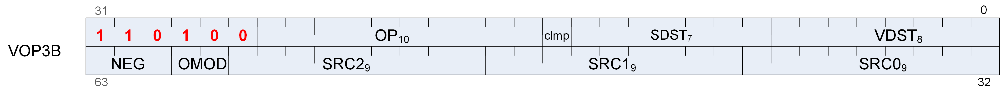

|**Format**|VOP3B|
|---|---|
|**Description**|Vector ALU format with three operands and a scalar result. This encoding is used only for a few opcodes.|

This encoding allows specifying a unique scalar destination, and is used only for the opcodes listed below. All other opcodes use VOP3A.

- V_ADD_CO_U32

- V_SUB_CO_U32

- V_SUBREV_CO_U32

- V_ADDC_CO_U32

- V_SUBB_CO_U32

- V_SUBBREV_CO_U32

- V_DIV_SCALE_F32

- V_DIV_SCALE_F64

- V_MAD_U64_U32

<!-- page 546 -->

- V_MAD_I64_I32

_Table 85. VOP3B Fields_

|**Field Name**|**Bits**|**Format or Description**|
|---|---|---|
|VDST|[7:0]|Destination VGPR|
|SDST|[14:8]|Scalar destination|
|CLMP|[15]|Clamp result|
|OP|[25:16]|Opcode. see next table.|
|ENCODING|[31:26]|Must be: 110100|
|SRC0|[40:32]|Source 0. First operand for the instruction.|
||0 - 101|SGPR0 to SGPR101: Scalar general-purpose registers.|
||102|FLAT_SCRATCH_LO.|
||103|FLAT_SCRATCH_HI.|
||104|XNACK_MASK_LO.|
||105|XNACK_MASK_HI.|
||106|VCC_LO: vcc[31:0].|
||107|VCC_HI: vcc[63:32].|
||108-123|TTMP0 - TTMP15: Trap handler temporary register.|
||124|M0. Memory register 0.|
||125|Reserved|
||126|EXEC_LO: exec[31:0].|
||127|EXEC_HI: exec[63:32].|
||128|0.|
||129-192|Signed integer 1 to 64.|
||193-208|Signed integer -1 to -16.|
||209-234|Reserved.|
||235|SHARED_BASE (Memory Aperture definition).|
||236|SHARED_LIMIT (Memory Aperture definition).|
||237|PRIVATE_BASE (Memory Aperture definition).|
||238|PRIVATE_LIMIT (Memory Aperture definition).|
||239|Reserved.|
||240|0.5.|
||241|-0.5.|
||242|1.0.|
||243|-1.0.|
||244|2.0.|
||245|-2.0.|
||246|4.0.|
||247|-4.0.|
||248|1/(2*PI).|
||249|SDWA|
||250|DPP|
||251|VCCZ.|
||252|EXECZ.|
||253|SCC.|
||254|Reserved.|
||255|Literal constant.|
||256 - 511|VGPR 0 - 255|
|SRC1|[49:41]|Second input operand. Same options as SRC0.|
|SRC2|[58:50]|Third input operand. Same options as SRC0.|
|OMOD|[60:59]|Output Modifier: 0=none, 1=*2, 2=*4, 3=div-2|
|NEG|[63:61]|Negate input. [61] = src0, [62] = src1, [63] = src2|

_Table 86. VOP3B Opcodes_

<!-- page 547 -->

|**Opcode #**|**Name**|**Opcode #**|**Name**|
|---|---|---|---|
|281|V_ADD_CO_U32|286|V_SUBBREV_CO_U32|
|282|V_SUB_CO_U32|480|V_DIV_SCALE_F32|
|283|V_SUBREV_CO_U32|481|V_DIV_SCALE_F64|
|284|V_ADDC_CO_U32|488|V_MAD_U64_U32|
|285|V_SUBB_CO_U32|489|V_MAD_I64_I32|

### 13.3.6. VOP3P

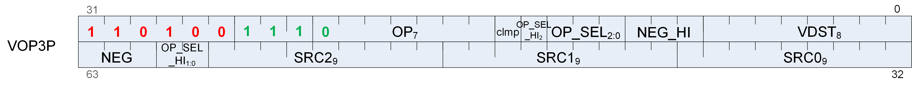

|**Format**|VOP3P|
|---|---|
|**Description**|Vector ALU format taking one, two or three pairs of 16 bit inputs and producing two 16-bit outputs (packed into 1 dword).|

_Table 87. VOP3P Fields_

|**Field Name**|**Bits**|**Format or Description**|
|---|---|---|
|VDST|[7:0]|Destination VGPR|
|NEG_HI|[10:8]|Negate sources 0,1,2 of the high 16-bits.|
|OPSEL|[13:11]|Select low or high for low sources 0=[11], 1=[12], 2=[13].|
|OPSEL_HI2|[14]|Select low or high for high sources 0=[14], 1=[60], 2=[59].|
|CLMP|[15]|1 = clamp result.|
|OP|[22:16]|Opcode. see next table.|
|ENCODING|[31:24]|Must be: 110100111|
|SRC0|[40:32]|Source 0. First operand for the instruction.|
||0 - 101|SGPR0 to SGPR101: Scalar general-purpose registers.|
||102|FLAT_SCRATCH_LO.|
||103|FLAT_SCRATCH_HI.|
||104|XNACK_MASK_LO.|
||105|XNACK_MASK_HI.|
||106|VCC_LO: vcc[31:0].|
||107|VCC_HI: vcc[63:32].|
||108-123|TTMP0 - TTMP15: Trap handler temporary register.|
||124|M0. Memory register 0.|
||125|Reserved|
||126|EXEC_LO: exec[31:0].|
||127|EXEC_HI: exec[63:32].|
||128|0.|
||129-192|Signed integer 1 to 64.|
||193-208|Signed integer -1 to -16.|
||209-234|Reserved.|
||235|SHARED_BASE (Memory Aperture definition).|
||236|SHARED_LIMIT (Memory Aperture definition).|
||237|PRIVATE_BASE (Memory Aperture definition).|
||238|PRIVATE_LIMIT (Memory Aperture definition).|
||239|Reserved.|
||240|0.5.|
||241|-0.5.|
||242|1.0.|
||243|-1.0.|
||244|2.0.|
||245|-2.0.|
||246|4.0.|
||247|-4.0.|
||248|1/(2*PI).|
||249|SDWA|
||250|DPP|
||251|VCCZ.|
||252|EXECZ.|
||253|SCC.|
||254|Reserved.|
||255|Literal constant.|
||256 - 511|VGPR 0 - 255|
|SRC1|[49:41]|Second input operand. Same options as SRC0.|
|SRC2|[58:50]|Third input operand. Same options as SRC0.|
|OPSEL_HI|[60:59]|See OP_SEL_HI2.|
|NEG|[63:61]|Negate input for low 16-bits of sources. [61] = src0, [62] = src1, [63] = src2|

<!-- page 548 -->

#### 13.3.6.1. VOP3P-MAI

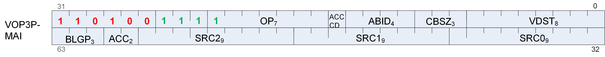

_Table 88. VOP3P-MAI Fields_

<!-- page 549 -->

|**Field Name**|**Bits**|**Format or Description**|
|---|---|---|
|VDST|[7:0]|Destination VGPR|
|CBSZ|[10:8]|Control Broadcast Size: Broadcast one chosen block of the A matrix to the input of 2CBSZ other blocks of matrix multiplication. Legal values = 0-4, but must not be greater than log2(blocks) for any MFMA instruction. The block ID to broadcast comes from ABID. Defines the number of blocks that can do a broadcast within a group. Legal values = 0-4. The block ID of this group comes from ABID.|
|ABID|[14:11]|A-matrix Broadcast Identifier: When CBSZ is set to a non-zero value, within each contiguous set of 2CBSZ blocks, this chooses which block of A to broadcast to the matrix multiplication inputs of the others.|
|ACC_CD|[15]|Indicates that SRC-C and VDST use ACC VGPRs. For SMFMAC ops, ACC_CD affects only the D matrix, and the compression indices, held in SRC2, come from Arch VGPRs.|
|OP|[22:16]|Opcode. see next table.|
|ENCODING|[31:24]|Must be: 110100111|
|SRC0|[40:32]|Source 0. First operand for the instruction.|
||0 - 107|Reserved.|
||128|0.|
||129-192|Signed integer 1 to 64.|
||193-208|Signed integer -1 to -16.|
||209-239|Reserved.|
||240|0.5. (float32)|
||241|-0.5.(float32)|
||242|1.0. (float32)|
||243|-1.0. (float32)|
||244|2.0. (float32)|
||245|-2.0. (float32)|
||246|4.0. (float32)|
||247|-4.0. (float32)|
||248|1/(2*PI). (float32)|
||249 - 255|Reserved|
||256 - 511|VGPR 0 - 255|
|SRC1|[49:41]|Second input operand. Same options as SRC0.|
|SRC2|[58:50]|Third input operand. Same options as SRC0.|
|ACC|[60:59]|ACC[0] : 0 = read SRC-A from Arch VGPR; 1 = read SRC-A from Acc VGPR. ACC[1] : 0 = read SRC-B from Arch VGPR; 1 = read SRC-B from Acc VGPR.|
|BLGP|[63:61]|“B”-Matrix Lane-Group Pattern. Controls how to swizzle the matrix lane groups (LG) in VGPRs when doing matrix multiplication by controlling the swizzle muxes. For V_MFMA_F64_4X4X4F64 and V_MFMA_F64_16X16X4F64 this field specifies the NEG modifier instead of BLGP.|

_Table 89. VOP3P Opcodes_

|**Opcode #**|**Name**|**Opcode #**|**Name**|
|---|---|---|---|
|0|V_PK_MAD_I16|73|V_MFMA_F32_16X16X4_4B_F16|
|1|V_PK_MUL_LO_U16|74|V_MFMA_F32_4X4X4_16B_F16|
|2|V_PK_ADD_I16|76|V_MFMA_F32_32X32X8_F16|
|3|V_PK_SUB_I16|77|V_MFMA_F32_16X16X16_F16|
|4|V_PK_LSHLREV_B16|80|V_MFMA_I32_32X32X4_2B_I8|
|5|V_PK_LSHRREV_B16|81|V_MFMA_I32_16X16X4_4B_I8|
|6|V_PK_ASHRREV_I16|82|V_MFMA_I32_4X4X4_16B_I8|
|7|V_PK_MAX_I16|86|V_MFMA_I32_32X32X16_I8|
|8|V_PK_MIN_I16|87|V_MFMA_I32_16X16X32_I8|
|9|V_PK_MAD_U16|88|V_ACCVGPR_READ|
|10|V_PK_ADD_U16|89|V_ACCVGPR_WRITE|
|11|V_PK_SUB_U16|93|V_MFMA_F32_32X32X4_2B_BF16|
|12|V_PK_MAX_U16|94|V_MFMA_F32_16X16X4_4B_BF16|
|13|V_PK_MIN_U16|95|V_MFMA_F32_4X4X4_16B_BF16|
|14|V_PK_FMA_F16|96|V_MFMA_F32_32X32X8_BF16|
|15|V_PK_ADD_F16|97|V_MFMA_F32_16X16X16_BF16|
|16|V_PK_MUL_F16|98|V_SMFMAC_F32_16X16X32_F16|
|17|V_PK_MIN_F16|100|V_SMFMAC_F32_32X32X16_F16|
|18|V_PK_MAX_F16|102|V_SMFMAC_F32_16X16X32_BF16|
|32|V_MAD_MIX_F32|104|V_SMFMAC_F32_32X32X16_BF16|
|33|V_MAD_MIXLO_F16|106|V_SMFMAC_I32_16X16X64_I8|
|34|V_MAD_MIXHI_F16|108|V_SMFMAC_I32_32X32X32_I8|
|35|V_DOT2_F32_F16|110|V_MFMA_F64_16X16X4_F64|
|38|V_DOT2_I32_I16|111|V_MFMA_F64_4X4X4_4B_F64|
|39|V_DOT2_U32_U16|112|V_MFMA_F32_16X16X32_BF8_BF8|
|40|V_DOT4_I32_I8|113|V_MFMA_F32_16X16X32_BF8_FP8|
|41|V_DOT4_U32_U8|114|V_MFMA_F32_16X16X32_FP8_BF8|
|42|V_DOT8_I32_I4|115|V_MFMA_F32_16X16X32_FP8_FP8|
|43|V_DOT8_U32_U4|116|V_MFMA_F32_32X32X16_BF8_BF8|
|48|V_PK_FMA_F32|117|V_MFMA_F32_32X32X16_BF8_FP8|
|49|V_PK_MUL_F32|118|V_MFMA_F32_32X32X16_FP8_BF8|
|50|V_PK_ADD_F32|119|V_MFMA_F32_32X32X16_FP8_FP8|
|51|V_PK_MOV_B32|120|V_SMFMAC_F32_16X16X64_BF8_BF8|
|62|V_MFMA_F32_16X16X8_XF32|121|V_SMFMAC_F32_16X16X64_BF8_FP8|
|63|V_MFMA_F32_32X32X4_XF32|122|V_SMFMAC_F32_16X16X64_FP8_BF8|
|64|V_MFMA_F32_32X32X1_2B_F32|123|V_SMFMAC_F32_16X16X64_FP8_FP8|
|65|V_MFMA_F32_16X16X1_4B_F32|124|V_SMFMAC_F32_32X32X32_BF8_BF8|
|66|V_MFMA_F32_4X4X1_16B_F32|125|V_SMFMAC_F32_32X32X32_BF8_FP8|
|68|V_MFMA_F32_32X32X2_F32|126|V_SMFMAC_F32_32X32X32_FP8_BF8|
|69|V_MFMA_F32_16X16X4_F32|127|V_SMFMAC_F32_32X32X32_FP8_FP8|
|72|V_MFMA_F32_32X32X4_2B_F16|||

<!-- page 550 -->

### 13.3.7. SDWA

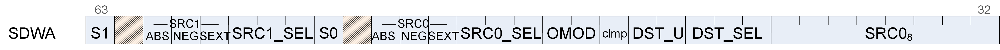

|**Format**|SDWA|
|---|---|
|**Description**|Sub-Dword Addressing. This is a second dword which can follow VOP1 or VOP2 instructions (in place of a literal constant) to control selection of sub-dword (16-bit) operands. Use of SDWA is indicated by assigning the SRC0 field to SDWA, and then the actual VGPR used as source-zero is determined in SDWA instruction word.|

_Table 90. SDWA Fields_

<!-- page 551 -->

|**Field Name**|**Bits**|**Format or Description**|
|---|---|---|
|SRC0|[39:32]|Real SRC0 operand (VGPR).|
|DST_SEL|[42:40]|Select the data destination: 0-3 = reserved 4 = data[15:0] 5 = data[31:16] 6 = data[31:0] 7 = reserved|
|DST_U|[44:43]|Destination format: what do with the bits in the VGPR that are not selected by DST_SEL: 0 = pad with zeros + 1 = sign extend upper / zero lower 2 = preserve (don’t modify) 3 = reserved|
|CLMP|[45]|1 = clamp result|
|OMOD|[47:46]|Output modifiers (see VOP3). [46] = low half, [47] = high half|
|SRC0_SEL|[50:48]|Source 0 select. Same options as DST_SEL.|
|SRC0_SEXT|[51]|Sign extend modifier for source 0.|
|SRC0_NEG|[52]|1 = negate source 0.|
|SRC0_ABS|[53]|1 = Absolute value of source 0.|
|S0|[55]|0 = source 0 is VGPR, 1 = is SGPR.|
|SRC1_SEL|[58:56]|Same options as SRC0_SEL.|
|SRC1_SEXT|[59]|Sign extend modifier for source 1.|
|SRC1_NEG|[60]|1 = negate source 1.|
|SRC1_ABS|[61]|1 = Absolute value of source 1.|
|S1|[63]|0 = source 1 is VGPR, 1 = is SGPR.|

### 13.3.8. SDWAB

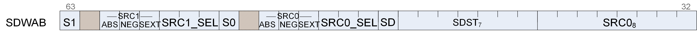

|**Format**|SDWAB|
|---|---|
|**Description**|Sub-Dword Addressing. This is a second dword which can follow VOPC instructions (in place of a literal constant) to control selection of sub-dword (16-bit) operands. Use of SDWA is indicated by assigning the SRC0 field to SDWA, and then the actual VGPR used as source-zero is determined in SDWA instruction word. This version has a scalar destination.|

_Table 91. SDWAB Fields_

|**Field Name**|**Bits**|**Format or Description**|
|---|---|---|
|SRC0|[39:32]|Real SRC0 operand (VGPR).|
|SDST|[46:40]|Scalar GPR destination.|
|SD|[47]|Scalar destination type: 0 = VCC, 1 = normal SGPR.|
|SRC0_SEL|[50:48]|Source 0 select. Same options as DST_SEL.|
|SRC0_SEXT|[51]|Sign extend modifier for source 0.|
|SRC0_NEG|[52]|1 = negate source 0.|
|SRC0_ABS|[53]|1 = Absolute value of source 0.|
|S0|[55]|0 = source 0 is VGPR, 1 = is SGPR.|
|SRC1_SEL|[58:56]|Same options as SRC0_SEL.|
|SRC1_SEXT|[59]|Sign extend modifier for source 1.|
|SRC1_NEG|[60]|1 = negate source 1.|
|SRC1_ABS|[61]|1 = Absolute value of source 1.|
|S1|[63]|0 = source 1 is VGPR, 1 = is SGPR.|

<!-- page 552 -->

### 13.3.9. DPP

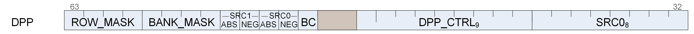

|**Format**|DPP|
|---|---|
|**Description**|Data Parallel Primitives. This is a second dword which can follow VOP1, VOP2 or VOPC instructions (in place of a literal constant) to control selection of data from other lanes.|

_Table 92. DPP Fields_

|**Field Name**|**Bits**|**Format or Description**|
|---|---|---|
|SRC0|[39:32]|Real SRC0 operand (VGPR).|
|DPP_CTRL|[48:40]|See next table: "DPP_CTRL Enumeration"|
|BC|[51]|Bounds Control: 0 = do not write when source is out of range, 1 = write.|
|SRC0_NEG|[52]|1 = negate source 0.|
|SRC0_ABS|[53]|1 = Absolute value of source 0.|
|SRC1_NEG|[54]|1 = negate source 1.|
|SRC1_ABS|[55]|1 = Absolute value of source 1.|
|BANK_MASK|[59:56]|Bank Mask Applies to the VGPR destination write only, does not impact the thread mask when fetching source VGPR data. 27==0: lanes[12:15, 28:31, 44:47, 60:63] are disabled 26==0: lanes[8:11, 24:27, 40:43, 56:59] are disabled 25==0: lanes[4:7, 20:23, 36:39, 52:55] are disabled 24==0: lanes[0:3, 16:19, 32:35, 48:51] are disabled Notice: the term "bank" here is not the same as we used for the VGPR bank.|
|ROW_MASK|[63:60]|Row Mask Applies to the VGPR destination write only, does not impact the thread mask when fetching source VGPR data. 31==0: lanes[63:48] are disabled (wave 64 only) 30==0: lanes[47:32] are disabled (wave 64 only) 29==0: lanes[31:16] are disabled 28==0: lanes[15:0] are disabled|

_Table 93. DPP_CTRL Enumeration_

|**DPP_Cntl Enumeration**|**Hex Value**|**Function**|**Description**|
|---|---|---|---|
|DPP_QUAD_PERM*|000-0FF|pix[n].srca = pix[(n&0x3c)+ dpp_cntl[n%4*2+1 : n%4*2]].srca|Full permute of four threads.|
|DPP_UNUSED|100|Undefined|Reserved.|
|DPP_ROW_SL*|101-10F|if ((n & 0xf) < (16-cntl[3:0])) pix[n].srca = pix[n + cntl[3:0]].srca else use bound_cntl|Row shift left by 1-15 threads.|
|DPP_ROW_SR*|111-11F|if ((n&0xf) >= cntl[3:0]) pix[n].srca = pix[n - cntl[3:0]].srca else use bound_cntl|Row shift right by 1-15 threads.|
|DPP_ROW_RR*|121-12F|if ((n&0xf) >= cnt[3:0]) pix[n].srca = pix[n - cntl[3:0]].srca else pix[n].srca = pix[n + 16 - cntl[3:0]].srca|Row rotate right by 1-15 threads.|
|DPP_WF_SL1*|130|if (n<63) pix[n].srca = pix[n+1].srca else use bound_cntl|Wavefront left shift by 1 thread.|
|DPP_WF_RL1*|134|if (n<63) pix[n].srca = pix[n+1].srca else pix[n].srca = pix[0].srca|Wavefront left rotate by 1 thread.|
|DPP_WF_SR1*|138|if (n>0) pix[n].srca = pix[n-1].srca else use bound_cntl|Wavefront right shift by 1 thread.|
|DPP_WF_RR1*|13C|if (n>0) pix[n].srca = pix[n-1].srca else pix[n].srca = pix[63].srca|Wavefront right rotate by 1 thread.|
|DPP_ROW_MIRROR*|140|pix[n].srca = pix[15-(n&f)].srca|Mirror threads within row.|
|DPP_ROW_HALF_MIRROR*|141|pix[n].srca = pix[7-(n&7)].srca|Mirror threads within row (8 threads).|
|DPP_ROW_BCAST15*|142|if (n>15) pix[n].srca = pix[n & 0x30 - 1].srca|Broadcast 15th thread of each row to next row.|
|DPP_ROW_BCAST31*|143|if (n>31) pix[n].srca = pix[n & 0x20 - 1].srca|Broadcast thread 31 to rows 2 and 3.|
|DPP_ROW*|150 - 15F|pix[n].srca = pix[(n & 0xfffffff0)+count].srca;|Broadcast thread 0-15 within a row to the whole row.|

<!-- page 553 -->

Note that for 64-bit input data the only legal DPP type is "DPP_ROW*".

## 13.4. LDS and GWS format

### 13.4.1. DS

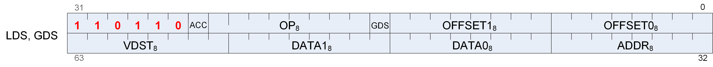

|**Format**|LDS and GDS|
|---|---|
|**Description**|Local and Global Data Sharing instructions|

_Table 94. DS Fields_

|**Field Name**|**Bits**|**Format or Description**|
|---|---|---|
|OFFSET0|[7:0]|First address offset|
|OFFSET1|[15:8]|Second address offset. For some opcodes this is concatenated with OFFSET0.|
|GDS|[16]|1=GWS, 0=LDS operation.|
|OP|[24:17]|See Opcode table below.|
|ACC|[25]|VDST is Accumulation VGPR|
|ENCODING|[31:26]|Must be: 110110|
|ADDR|[39:32]|VGPR which supplies the address.|
|DATA0|[47:40]|First data VGPR.|
|DATA1|[55:48]|Second data VGPR.|
|VDST|[63:56]|Destination VGPR when results returned to VGPRs.|

<!-- page 554 -->

_Table 95. DS Opcodes_

|**Opcode #**|**Name**|**Opcode #**|**Name**|
|---|---|---|---|
|0|DS_ADD_U32|69|DS_MIN_I64|
|1|DS_SUB_U32|70|DS_MAX_I64|
|2|DS_RSUB_U32|71|DS_MIN_U64|
|3|DS_INC_U32|72|DS_MAX_U64|
|4|DS_DEC_U32|73|DS_AND_B64|
|5|DS_MIN_I32|74|DS_OR_B64|
|6|DS_MAX_I32|75|DS_XOR_B64|
|7|DS_MIN_U32|76|DS_MSKOR_B64|
|8|DS_MAX_U32|77|DS_WRITE_B64|
|9|DS_AND_B32|78|DS_WRITE2_B64|
|10|DS_OR_B32|79|DS_WRITE2ST64_B64|
|11|DS_XOR_B32|80|DS_CMPST_B64|
|12|DS_MSKOR_B32|81|DS_CMPST_F64|
|13|DS_WRITE_B32|82|DS_MIN_F64|
|14|DS_WRITE2_B32|83|DS_MAX_F64|
|15|DS_WRITE2ST64_B32|84|DS_WRITE_B8_D16_HI|
|16|DS_CMPST_B32|85|DS_WRITE_B16_D16_HI|
|17|DS_CMPST_F32|86|DS_READ_U8_D16|
|18|DS_MIN_F32|87|DS_READ_U8_D16_HI|
|19|DS_MAX_F32|88|DS_READ_I8_D16|
|20|DS_NOP|89|DS_READ_I8_D16_HI|
|21|DS_ADD_F32|90|DS_READ_U16_D16|
|23|DS_PK_ADD_F16|91|DS_READ_U16_D16_HI|
|24|DS_PK_ADD_BF16|92|DS_ADD_F64|
|29|DS_WRITE_ADDTID_B32|96|DS_ADD_RTN_U64|
|30|DS_WRITE_B8|97|DS_SUB_RTN_U64|
|31|DS_WRITE_B16|98|DS_RSUB_RTN_U64|
|32|DS_ADD_RTN_U32|99|DS_INC_RTN_U64|
|33|DS_SUB_RTN_U32|100|DS_DEC_RTN_U64|
|34|DS_RSUB_RTN_U32|101|DS_MIN_RTN_I64|
|35|DS_INC_RTN_U32|102|DS_MAX_RTN_I64|
|36|DS_DEC_RTN_U32|103|DS_MIN_RTN_U64|
|37|DS_MIN_RTN_I32|104|DS_MAX_RTN_U64|
|38|DS_MAX_RTN_I32|105|DS_AND_RTN_B64|
|39|DS_MIN_RTN_U32|106|DS_OR_RTN_B64|
|40|DS_MAX_RTN_U32|107|DS_XOR_RTN_B64|
|41|DS_AND_RTN_B32|108|DS_MSKOR_RTN_B64|
|42|DS_OR_RTN_B32|109|DS_WRXCHG_RTN_B64|
|43|DS_XOR_RTN_B32|110|DS_WRXCHG2_RTN_B64|
|44|DS_MSKOR_RTN_B32|111|DS_WRXCHG2ST64_RTN_B64|
|45|DS_WRXCHG_RTN_B32|112|DS_CMPST_RTN_B64|
|46|DS_WRXCHG2_RTN_B32|113|DS_CMPST_RTN_F64|
|47|DS_WRXCHG2ST64_RTN_B32|114|DS_MIN_RTN_F64|
|48|DS_CMPST_RTN_B32|115|DS_MAX_RTN_F64|
|49|DS_CMPST_RTN_F32|118|DS_READ_B64|
|50|DS_MIN_RTN_F32|119|DS_READ2_B64|
|51|DS_MAX_RTN_F32|120|DS_READ2ST64_B64|
|52|DS_WRAP_RTN_B32|124|DS_ADD_RTN_F64|
|53|DS_ADD_RTN_F32|126|DS_CONDXCHG32_RTN_B64|
|54|DS_READ_B32|152|DS_GWS_SEMA_RELEASE_ALL|
|55|DS_READ2_B32|153|DS_GWS_INIT|
|56|DS_READ2ST64_B32|154|DS_GWS_SEMA_V|
|57|DS_READ_I8|155|DS_GWS_SEMA_BR|
|58|DS_READ_U8|156|DS_GWS_SEMA_P|
|59|DS_READ_I16|157|DS_GWS_BARRIER|
|60|DS_READ_U16|182|DS_READ_ADDTID_B32|
|61|DS_SWIZZLE_B32|183|DS_PK_ADD_RTN_F16|
|62|DS_PERMUTE_B32|184|DS_PK_ADD_RTN_BF16|
|63|DS_BPERMUTE_B32|189|DS_CONSUME|
|64|DS_ADD_U64|190|DS_APPEND|
|65|DS_SUB_U64|222|DS_WRITE_B96|
|66|DS_RSUB_U64|223|DS_WRITE_B128|
|67|DS_INC_U64|254|DS_READ_B96|
|68|DS_DEC_U64|255|DS_READ_B128|

<!-- page 555 -->

## 13.5. Vector Memory Buffer Formats

There are two memory buffer instruction formats:

**MTBUF**

typed buffer access (data type is defined by the instruction)

**MUBUF**

untyped buffer access (data type is defined by the buffer / resource-constant)

### 13.5.1. MTBUF

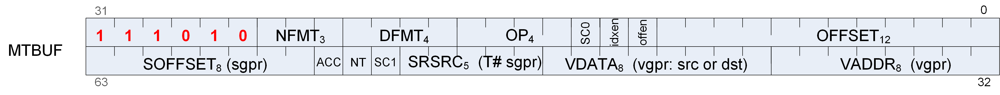

|**Format**|MTBUF|
|---|---|
|**Description**|Memory Typed-Buffer Instructions|

_Table 96. MTBUF Fields_

|**Field Name**|**Bits**|**Format or Description**|
|---|---|---|
|OFFSET|[11:0]|Address offset, unsigned byte.|
|OFFEN|[12]|1 = enable offset VGPR, 0 = use zero for address offset|
|IDXEN|[13]|1 = enable index VGPR, 0 = use zero for address index|
|SC0|[14]|Scope bit 0|
|OP|[18:15]|Opcode. See table below.|
|DFMT|22:19|Data Format of data in memory buffer: 0 invalid 1 8 2 16 3 8_8 4 32 5 16_16 6 10_11_11 8 10_10_10_2 9 2_10_10_10 10 8_8_8_8 11 32_32 12 16_16_16_16 13 32_32_32 14 32_32_32_32|
|NFMT|25:23|Numeric format of data in memory: 0 unorm 1 snorm 2 uscaled 3 sscaled 4 uint 5 sint 6 reserved 7 float|
|ENCODING|[31:26]|Must be: 111010|
|VADDR|[39:32]|Address of VGPR to supply first component of address (offset or index). When both index and offset are used, index is in the first VGPR and offset in the second.|
|VDATA|[47:40]|Address of VGPR to supply first component of write data or receive first component of read-data.|
|SRSRC|[52:48]|SGPR to supply V# (resource constant) in 4 or 8 consecutive SGPRs. It is missing 2 LSB’s of SGPR-address since must be aligned to 4.|
|SC1|[53]|Scope bit 1|
|NT|[54]|Non-Temporal|
|ACC|[55]|VDATA is Accumulation VGPR|
|SOFFSET|[63:56]|Address offset, unsigned byte.|

<!-- page 556 -->

_Table 97. MTBUF Opcodes_

|**Opcode #**|**Name**|**Opcode #**|**Name**|
|---|---|---|---|
|0|TBUFFER_LOAD_FORMAT_X|8|TBUFFER_LOAD_FORMAT_D16_X|
|1|TBUFFER_LOAD_FORMAT_XY|9|TBUFFER_LOAD_FORMAT_D16_XY|
|2|TBUFFER_LOAD_FORMAT_XYZ|10|TBUFFER_LOAD_FORMAT_D16_XYZ|
|3|TBUFFER_LOAD_FORMAT_XYZW|11|TBUFFER_LOAD_FORMAT_D16_XYZW|
|4|TBUFFER_STORE_FORMAT_X|12|TBUFFER_STORE_FORMAT_D16_X|
|5|TBUFFER_STORE_FORMAT_XY|13|TBUFFER_STORE_FORMAT_D16_XY|
|6|TBUFFER_STORE_FORMAT_XYZ|14|TBUFFER_STORE_FORMAT_D16_XYZ|
|7|TBUFFER_STORE_FORMAT_XYZW|15|TBUFFER_STORE_FORMAT_D16_XYZW|

<!-- page 557 -->

### 13.5.2. MUBUF

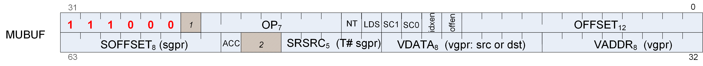

|**Format**|MUBUF|
|---|---|
|**Description**|Memory Untyped-Buffer Instructions|

_Table 98. MUBUF Fields_

|**Field Name**|**Bits**|**Format or Description**|
|---|---|---|
|OFFSET|[11:0]|Address offset, unsigned byte.|
|OFFEN|[12]|1 = enable offset VGPR, 0 = use zero for address offset|
|IDXEN|[13]|1 = enable index VGPR, 0 = use zero for address index|
|SC0|[14]|Scope bit 0|
|SC1|[15]|Scope bit 1|
|LDS|[16]|0 = normal, 1 = transfer data between LDS and memory instead of VGPRs and memory.|
|NT|[17]|Non-Temporal|
|OP|[24:18]|Opcode. See table below.|
|ENCODING|[31:26]|Must be: 111000|
|VADDR|[39:32]|Address of VGPR to supply first component of address (offset or index). When both index and offset are used, index is in the first VGPR and offset in the second.|
|VDATA|[47:40]|Address of VGPR to supply first component of write data or receive first component of read-data.|
|SRSRC|[52:48]|SGPR to supply V# (resource constant) in 4 or 8 consecutive SGPRs. It is missing 2 LSB’s of SGPR-address since must be aligned to 4.|
|ACC|[55]|VDATA is Accumulation VGPR|
|SOFFSET|[63:56]|Address offset, unsigned byte.|

_Table 99. MUBUF Opcodes_

|**Opcode #**|**Name**|**Opcode #**|**Name**|
|---|---|---|---|
|0|BUFFER_LOAD_FORMAT_X|37|BUFFER_LOAD_SHORT_D16_HI|
|1|BUFFER_LOAD_FORMAT_XY|38|BUFFER_LOAD_FORMAT_D16_HI_X|
|2|BUFFER_LOAD_FORMAT_XYZ|39|BUFFER_STORE_FORMAT_D16_HI_X|
|3|BUFFER_LOAD_FORMAT_XYZW|40|BUFFER_WBL2|
|4|BUFFER_STORE_FORMAT_X|41|BUFFER_INV|
|5|BUFFER_STORE_FORMAT_XY|64|BUFFER_ATOMIC_SWAP|
|6|BUFFER_STORE_FORMAT_XYZ|65|BUFFER_ATOMIC_CMPSWAP|
|7|BUFFER_STORE_FORMAT_XYZW|66|BUFFER_ATOMIC_ADD|
|8|BUFFER_LOAD_FORMAT_D16_X|67|BUFFER_ATOMIC_SUB|
|9|BUFFER_LOAD_FORMAT_D16_XY|68|BUFFER_ATOMIC_SMIN|
|10|BUFFER_LOAD_FORMAT_D16_XYZ|69|BUFFER_ATOMIC_UMIN|
|11|BUFFER_LOAD_FORMAT_D16_XYZW|70|BUFFER_ATOMIC_SMAX|
|12|BUFFER_STORE_FORMAT_D16_X|71|BUFFER_ATOMIC_UMAX|
|13|BUFFER_STORE_FORMAT_D16_XY|72|BUFFER_ATOMIC_AND|
|14|BUFFER_STORE_FORMAT_D16_XYZ|73|BUFFER_ATOMIC_OR|
|15|BUFFER_STORE_FORMAT_D16_XYZW|74|BUFFER_ATOMIC_XOR|
|16|BUFFER_LOAD_UBYTE|75|BUFFER_ATOMIC_INC|
|17|BUFFER_LOAD_SBYTE|76|BUFFER_ATOMIC_DEC|
|18|BUFFER_LOAD_USHORT|77|BUFFER_ATOMIC_ADD_F32|
|19|BUFFER_LOAD_SSHORT|78|BUFFER_ATOMIC_PK_ADD_F16|
|20|BUFFER_LOAD_DWORD|79|BUFFER_ATOMIC_ADD_F64|
|21|BUFFER_LOAD_DWORDX2|80|BUFFER_ATOMIC_MIN_F64|
|22|BUFFER_LOAD_DWORDX3|81|BUFFER_ATOMIC_MAX_F64|
|23|BUFFER_LOAD_DWORDX4|96|BUFFER_ATOMIC_SWAP_X2|
|24|BUFFER_STORE_BYTE|97|BUFFER_ATOMIC_CMPSWAP_X2|
|25|BUFFER_STORE_BYTE_D16_HI|98|BUFFER_ATOMIC_ADD_X2|
|26|BUFFER_STORE_SHORT|99|BUFFER_ATOMIC_SUB_X2|
|27|BUFFER_STORE_SHORT_D16_HI|100|BUFFER_ATOMIC_SMIN_X2|
|28|BUFFER_STORE_DWORD|101|BUFFER_ATOMIC_UMIN_X2|
|29|BUFFER_STORE_DWORDX2|102|BUFFER_ATOMIC_SMAX_X2|
|30|BUFFER_STORE_DWORDX3|103|BUFFER_ATOMIC_UMAX_X2|
|31|BUFFER_STORE_DWORDX4|104|BUFFER_ATOMIC_AND_X2|
|32|BUFFER_LOAD_UBYTE_D16|105|BUFFER_ATOMIC_OR_X2|
|33|BUFFER_LOAD_UBYTE_D16_HI|106|BUFFER_ATOMIC_XOR_X2|
|34|BUFFER_LOAD_SBYTE_D16|107|BUFFER_ATOMIC_INC_X2|
|35|BUFFER_LOAD_SBYTE_D16_HI|108|BUFFER_ATOMIC_DEC_X2|
|36|BUFFER_LOAD_SHORT_D16|||

<!-- page 558 -->

## 13.6. Flat Formats

Flat memory instructions come in three versions: FLAT:: memory address (per work-item) may be in global memory, scratch (private) memory or shared memory (LDS) GLOBAL:: same as FLAT, but assumes all memory addresses are global memory. SCRATCH:: same as FLAT, but assumes all memory addresses are scratch (private) memory.

The microcode format is identical for each, and only the value of the SEG (segment) field differs.

### 13.6.1. FLAT

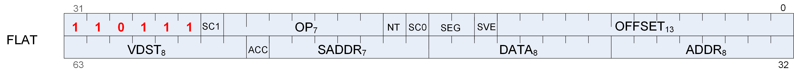

|**Format**|FLAT|
|---|---|
|**Description**|FLAT Memory Access|

_Table 100. FLAT Fields_

|**Field Name**|**Bits**|**Format or Description**|
|---|---|---|
|OFFSET|[12:0]|Address offset Scratch, Global: 13-bit signed byte offset FLAT: 12-bit unsigned offset (MSB is ignored)|
|LDS|[13]|0 = normal, 1 = transfer data between LDS and memory instead of VGPRs and memory.|
|SEG|[15:14]|Memory Segment (instruction type): 0 = flat, 1 = scratch, 2 = global.|
|SC0|[16]|Scope bit 0|
|NT|[17]|Non-Temporal|
|OP|[24:18]|Opcode. See tables below for FLAT, SCRATCH and GLOBAL opcodes.|
|SC1|[25]|Scope bit 1|
|ENCODING|[31:26]|Must be: 110111|
|ADDR|[39:32]|VGPR which holds address or offset. For 64-bit addresses, ADDR has the LSB’s and ADDR+1 has the MSBs. For offset a single VGPR has a 32 bit unsigned offset. For FLAT_*: specifies an address. For GLOBAL_* and SCRATCH_* when SADDR is 0x7f: specifies an address. For GLOBAL_* and SCRATCH_* when SADDR is not 0x7f: specifies an offset.|
|DATA|[47:40]|VGPR which supplies data.|
|SADDR|[54:48]|Scalar SGPR which provides an address of offset (unsigned). Set this field to 0x7f to disable use. Meaning of this field is different for Scratch and Global: FLAT: Unused Scratch: use an SGPR for the address instead of a VGPR Global: use the SGPR to provide a base address and the VGPR provides a 32-bit byte offset.|
|ACC|[55]|VDATA is Accumulation VGPR|
|VDST|[63:56]|Destination VGPR for data returned from memory to VGPRs.|

<!-- page 559 -->

_Table 101. FLAT Opcodes_

|**Opcode #**|**Name**|**Opcode #**|**Name**|
|---|---|---|---|
|16|FLAT_LOAD_UBYTE|69|FLAT_ATOMIC_UMIN|
|17|FLAT_LOAD_SBYTE|70|FLAT_ATOMIC_SMAX|
|18|FLAT_LOAD_USHORT|71|FLAT_ATOMIC_UMAX|
|19|FLAT_LOAD_SSHORT|72|FLAT_ATOMIC_AND|
|20|FLAT_LOAD_DWORD|73|FLAT_ATOMIC_OR|
|21|FLAT_LOAD_DWORDX2|74|FLAT_ATOMIC_XOR|
|22|FLAT_LOAD_DWORDX3|75|FLAT_ATOMIC_INC|
|23|FLAT_LOAD_DWORDX4|76|FLAT_ATOMIC_DEC|
|24|FLAT_STORE_BYTE|77|FLAT_ATOMIC_ADD_F32|
|25|FLAT_STORE_BYTE_D16_HI|78|FLAT_ATOMIC_PK_ADD_F16|
|26|FLAT_STORE_SHORT|79|FLAT_ATOMIC_ADD_F64|
|27|FLAT_STORE_SHORT_D16_HI|80|FLAT_ATOMIC_MIN_F64|
|28|FLAT_STORE_DWORD|81|FLAT_ATOMIC_MAX_F64|
|29|FLAT_STORE_DWORDX2|82|FLAT_ATOMIC_PK_ADD_BF16|
|30|FLAT_STORE_DWORDX3|96|FLAT_ATOMIC_SWAP_X2|
|31|FLAT_STORE_DWORDX4|97|FLAT_ATOMIC_CMPSWAP_X2|
|32|FLAT_LOAD_UBYTE_D16|98|FLAT_ATOMIC_ADD_X2|
|33|FLAT_LOAD_UBYTE_D16_HI|99|FLAT_ATOMIC_SUB_X2|
|34|FLAT_LOAD_SBYTE_D16|100|FLAT_ATOMIC_SMIN_X2|
|35|FLAT_LOAD_SBYTE_D16_HI|101|FLAT_ATOMIC_UMIN_X2|
|36|FLAT_LOAD_SHORT_D16|102|FLAT_ATOMIC_SMAX_X2|
|37|FLAT_LOAD_SHORT_D16_HI|103|FLAT_ATOMIC_UMAX_X2|
|64|FLAT_ATOMIC_SWAP|104|FLAT_ATOMIC_AND_X2|
|65|FLAT_ATOMIC_CMPSWAP|105|FLAT_ATOMIC_OR_X2|
|66|FLAT_ATOMIC_ADD|106|FLAT_ATOMIC_XOR_X2|
|67|FLAT_ATOMIC_SUB|107|FLAT_ATOMIC_INC_X2|
|68|FLAT_ATOMIC_SMIN|108|FLAT_ATOMIC_DEC_X2|

<!-- page 560 -->

### 13.6.2. GLOBAL

_Table 102. GLOBAL Opcodes_

|**Opcode #**|**Name**|**Opcode #**|**Name**|
|---|---|---|---|
|16|GLOBAL_LOAD_UBYTE|67|GLOBAL_ATOMIC_SUB|
|17|GLOBAL_LOAD_SBYTE|68|GLOBAL_ATOMIC_SMIN|
|18|GLOBAL_LOAD_USHORT|69|GLOBAL_ATOMIC_UMIN|
|19|GLOBAL_LOAD_SSHORT|70|GLOBAL_ATOMIC_SMAX|
|20|GLOBAL_LOAD_DWORD|71|GLOBAL_ATOMIC_UMAX|
|21|GLOBAL_LOAD_DWORDX2|72|GLOBAL_ATOMIC_AND|
|22|GLOBAL_LOAD_DWORDX3|73|GLOBAL_ATOMIC_OR|
|23|GLOBAL_LOAD_DWORDX4|74|GLOBAL_ATOMIC_XOR|
|24|GLOBAL_STORE_BYTE|75|GLOBAL_ATOMIC_INC|
|25|GLOBAL_STORE_BYTE_D16_HI|76|GLOBAL_ATOMIC_DEC|
|26|GLOBAL_STORE_SHORT|77|GLOBAL_ATOMIC_ADD_F32|
|27|GLOBAL_STORE_SHORT_D16_HI|78|GLOBAL_ATOMIC_PK_ADD_F16|
|28|GLOBAL_STORE_DWORD|79|GLOBAL_ATOMIC_ADD_F64|
|29|GLOBAL_STORE_DWORDX2|80|GLOBAL_ATOMIC_MIN_F64|
|30|GLOBAL_STORE_DWORDX3|81|GLOBAL_ATOMIC_MAX_F64|
|31|GLOBAL_STORE_DWORDX4|82|GLOBAL_ATOMIC_PK_ADD_BF16|
|32|GLOBAL_LOAD_UBYTE_D16|96|GLOBAL_ATOMIC_SWAP_X2|
|33|GLOBAL_LOAD_UBYTE_D16_HI|97|GLOBAL_ATOMIC_CMPSWAP_X2|
|34|GLOBAL_LOAD_SBYTE_D16|98|GLOBAL_ATOMIC_ADD_X2|
|35|GLOBAL_LOAD_SBYTE_D16_HI|99|GLOBAL_ATOMIC_SUB_X2|
|36|GLOBAL_LOAD_SHORT_D16|100|GLOBAL_ATOMIC_SMIN_X2|
|37|GLOBAL_LOAD_SHORT_D16_HI|101|GLOBAL_ATOMIC_UMIN_X2|
|38|GLOBAL_LOAD_LDS_UBYTE|102|GLOBAL_ATOMIC_SMAX_X2|
|39|GLOBAL_LOAD_LDS_SBYTE|103|GLOBAL_ATOMIC_UMAX_X2|
|40|GLOBAL_LOAD_LDS_USHORT|104|GLOBAL_ATOMIC_AND_X2|
|41|GLOBAL_LOAD_LDS_SSHORT|105|GLOBAL_ATOMIC_OR_X2|
|42|GLOBAL_LOAD_LDS_DWORD|106|GLOBAL_ATOMIC_XOR_X2|
|64|GLOBAL_ATOMIC_SWAP|107|GLOBAL_ATOMIC_INC_X2|
|65|GLOBAL_ATOMIC_CMPSWAP|108|GLOBAL_ATOMIC_DEC_X2|
|66|GLOBAL_ATOMIC_ADD|||

### 13.6.3. SCRATCH

_Table 103. SCRATCH Opcodes_

|**Opcode #**|**Name**|**Opcode #**|**Name**|
|---|---|---|---|
|16|SCRATCH_LOAD_UBYTE|30|SCRATCH_STORE_DWORDX3|
|17|SCRATCH_LOAD_SBYTE|31|SCRATCH_STORE_DWORDX4|
|18|SCRATCH_LOAD_USHORT|32|SCRATCH_LOAD_UBYTE_D16|
|19|SCRATCH_LOAD_SSHORT|33|SCRATCH_LOAD_UBYTE_D16_HI|
|20|SCRATCH_LOAD_DWORD|34|SCRATCH_LOAD_SBYTE_D16|
|21|SCRATCH_LOAD_DWORDX2|35|SCRATCH_LOAD_SBYTE_D16_HI|
|22|SCRATCH_LOAD_DWORDX3|36|SCRATCH_LOAD_SHORT_D16|
|23|SCRATCH_LOAD_DWORDX4|37|SCRATCH_LOAD_SHORT_D16_HI|
|24|SCRATCH_STORE_BYTE|38|SCRATCH_LOAD_LDS_UBYTE|
|25|SCRATCH_STORE_BYTE_D16_HI|39|SCRATCH_LOAD_LDS_SBYTE|
|26|SCRATCH_STORE_SHORT|40|SCRATCH_LOAD_LDS_USHORT|
|27|SCRATCH_STORE_SHORT_D16_HI|41|SCRATCH_LOAD_LDS_SSHORT|
|28|SCRATCH_STORE_DWORD|42|SCRATCH_LOAD_LDS_DWORD|
|29|SCRATCH_STORE_DWORDX2|||

<!-- page 561 -->
